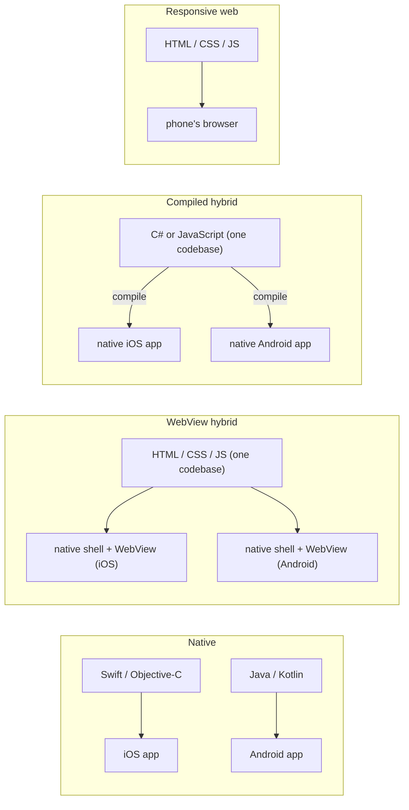

# IN4MATX 133: User Interface Software — Lecture 12：混合与原生架构

## 目录

- [1. 移动优先设计](#1-移动优先设计)
- [2. 构建移动应用的方式](#2-构建移动应用的方式)
- [3. 原生应用](#3-原生应用)
- [4. 混合应用：一套代码，多个平台](#4-混合应用一套代码多个平台)
- [5. WebView 应用](#5-webview-应用)
- [6. 编译型混合应用](#6-编译型混合应用)
- [7. 选择开发方式](#7-选择开发方式)
- [8. 优缺点：混合与原生对比](#8-优缺点混合与原生对比)
- [9. Ionic 与 Capacitor](#9-ionic-与-capacitor)
- [10. 测试与部署 Ionic 应用](#10-测试与部署-ionic-应用)
- [11. Ionic 相比 Angular 增加的内容：组件](#11-ionic-相比-angular-增加的内容组件)
- [12. 课堂问题与演示（附解答）](#12-课堂问题与演示附解答)
- [13. 速查与必记的 5 个要点](#13-速查与必记的-5-个要点)

> UCI IN4MATX 133: User Interface Software — Prof. Travis Linden Reid，2026 年秋季学期，周四 11/5（第 6 周）
> 内容整理自 Lecture 12 的幻灯片（共 53 页）。“No code today!”——本讲在课程仓库中没有 demo 文件夹。按概念组织，而不是按来源组织。

> 📅 **课程安排**：今天没有代码——我们进入 A4 的概念内容。
> A2 的成绩将于下周初公布。
> A3 截止于 **周三 11/11**（即将到来的这个周三）。
> A4 周二开放；截止 **周一 11/23 午夜**。

本讲目标：区分开发移动界面的不同方式；描述开发原生、混合和网页应用的优缺点；解释 Ionic 采用哪种方式开发应用。

---

## 1. 移动优先设计

本讲开头重申了 [Lecture 4](lec-04.zh-CN.md#6-移动优先设计) 中的移动优先理念：

- **先为移动端规划设计。**
- **然后利用更大的屏幕空间让应用变得*更好*：** 增加功能，并让已有功能更易于导航。
- 许多企业会先做**对移动端友好的网站，然后再开发专门的应用**。

幻灯片的图示对比了两种方向。*Mobile last*（桌面 → 平板 → 手机 → 老式手机）被标注为“degraded、shoe-horned、short-sighted、crappy”（降级、硬塞、短视、糟糕）；*Mobile first*（老式手机 → 手机 → 平板 → 桌面）则被标注为“progressively enhanced、future-friendly、awesome”（渐进增强、面向未来、出色）。


在 CSS 中，移动优先意味着基础规则*就是*手机端的设计，`min-width` 媒体查询在此基础上叠加。在下面的示例中（这是我自己做的，不是幻灯片的内容），375px 的页面只显示必要内容和一个菜单按钮；从 768px 起（以 1024px 展示）媒体查询会显示导航链接（更易于导航）以及一个侧边栏（更多功能）。

```viz web-demo
{"title": "Mobile-first design (slide 4) · hand-made example", "html": "<header>\n  <h1>Anteater Eats</h1>\n  <button class=\"menu\">☰ Menu</button>\n  <nav><a href=\"#\">Menu</a> <a href=\"#\">Order</a> <a href=\"#\">Hours</a></nav>\n</header>\n<div class=\"layout\">\n  <main>\n    <h2>Today's special</h2>\n    <p>Spicy tofu bowl — $9</p>\n    <button>Order now</button>\n  </main>\n  <aside>\n    <h2>Extra for big screens</h2>\n    <p>Weekly calendar, map, reviews…</p>\n  </aside>\n</div>", "css": "/* Base styles = the phone design */\nbody { font-family: sans-serif; margin: 0; }\nheader { display: flex; justify-content: space-between; align-items: center; padding: 8px 12px; background: #0064a4; color: white; }\nh1 { font-size: 18px; margin: 0; }\nnav { display: none; }           /* phone: links hidden behind the menu button */\nnav a { color: white; margin-left: 12px; }\nmain, aside { padding: 12px; }\naside { display: none; }         /* phone: no room for extras */\n\n/* Then make it better with more real estate */\n@media (min-width: 768px) {\n  .menu { display: none; }\n  nav { display: block; }        /* easier to navigate */\n  .layout { display: grid; grid-template-columns: 2fr 1fr; }\n  aside { display: block; background: #fff4cc; }  /* more features */\n}", "width": 375, "height": 260, "steps": [{"note": "At 1024px the media query adds the visible nav links and the extra sidebar.", "width": 1024}], "interactive": true}
```

幻灯片接着提出：企业为什么会想要移动*应用*，而不是移动*网站*？这是一个开放式讨论；见 [问题 1](#121-问题-1为什么用移动应用而不是移动网站幻灯片-5)。

> 📝 **练习**：[问题 1](#121-问题-1为什么用移动应用而不是移动网站幻灯片-5)
> 🔗 **延伸阅读**：[Brad Frost：移动优先的响应式网页设计（幻灯片图示的来源）](https://bradfrostweb.com/blog/web/mobile-first-responsive-web-design)

## 2. 构建移动应用的方式

构建移动应用的方式有很多种。讲义比较了四种**移动开发方法**：

| 方法 | 你构建的是什么 | 详见 |
|---|---|---|
| **原生** | 每个平台各自一个应用，使用平台厂商的工具和语言 | [第 3 节](#3-原生应用) |
| **WebView**（混合的一种） | 一个网站，运行在轻量的原生应用中，由它调用手机的浏览器 | [第 5 节](#5-webview-应用) |
| **混合**（幻灯片 18 把混合分为 WebView 和编译型两类；本行指编译型） | 一套代码编译成每个平台的原生应用 | [第 6 节](#6-编译型混合应用) |
| **响应式** | 一个会适应屏幕的网站，在手机浏览器中打开 | [Lecture 4](lec-04.zh-CN.md#2-自适应设计与响应式设计) |



## 3. 原生应用

### 3.1 什么是原生应用

**原生应用**是为特定硬件设计的应用，通常使用硬件或平台厂商自己开发的工具构建：

- **Android Studio**，用于 Android，使用 **Java**
- **Xcode**，用于 iOS，使用 **Swift** 或 **Objective-C**

我们今天所理解的原生应用始于**第一代 iPhone**：苹果在发布硬件的同时也发布了开发平台（幻灯片展示的是 iPhone 发布时的舞台画面）。

### 3.2 iOS

| | iOS |
|---|---|
| 语言 | **Objective-C**、**Swift**，以及 **Cocoa Touch**（API） |
| 工具 | **Xcode**、**iOS 软件开发工具包（SDK）** |
| SDK 提供的能力 | 访问手机的存储、摄像头、传感器等 |

这些语言要么由苹果开发，要么几乎只有苹果在用。幻灯片提问：**开发者锁定（developer lock-in）是……缺点？优点？还是两者兼有？**（一种理解方式：锁定意味着你的 iOS 技能和代码只能留在苹果平台上——想要离开时是一种成本，但一切都设计得天衣无缝。）

### 3.3 Android

| | Android |
|---|---|
| 语言 | 主要是 **Java**；通过 **Android Native Development Kit（NDK）** 使用 **C 和 C++**；近来也支持 **Kotlin** |
| 工具 | **Android Studio**、Android SDK（幻灯片拼写为 "Android Source Development Kit"），以及 Rider 或 VS 等各种 IDE |

Android 的语言与其他场景中使用的语言更接近。幻灯片同样提问这是优点还是缺点（一种理解方式——与 iOS 的锁定正好相反：更容易把已有技能和代码带进来，但也不那么贴合平台。）

### 3.4 平台专属的代码库

原生开发的难点在于**平台专属的代码库**。

- Android 使用 Java，iOS 使用 Objective-C 或 Swift。
- 两者使用不同的库与硬件通信。
- 支持一个新平台通常意味着**从零开始编码**。

> ⚠️ **易错点**：“原生”意味着*按平台划分*。同一产品的 iOS 应用和 Android 应用是两个独立的程序，使用两种语言、两套工具链——这正是混合应用想要避免的成本。

## 4. 混合应用：一套代码，多个平台

两个问题促使人们寻找替代方案：

- 如果我们的应用已经有了**网站**，或者有其他现成的代码库，怎么办？
- 如果我们想要**在多个手机平台之间共享代码**，怎么办？

**解决方案：混合应用**——“使用共同的代码库，在多种平台上部署类原生应用”。主要有两种方式：

1. **WebView 应用**（[第 5 节](#5-webview-应用)）
2. **编译型混合应用**（[第 6 节](#6-编译型混合应用)）

## 5. WebView 应用

### 5.1 WebView 应用的工作方式

- 在轻量的原生应用中**加载手机的内置浏览器**。
- 在该浏览器中**运行用 HTML/CSS/JavaScript 编写的网页**。
- 理想情况下，**向浏览器暴露一些原生 API**。

本质上，**这个应用就是一个网站**。这使得同一套或相似的代码既能用于应用，也能用于网站。

### 5.2 WebView 应用框架

**Ionic** 和 **NativeScript**。这些框架使用网页技术（HTML、CSS、TypeScript、JavaScript），而不是平台专属技术。

既然 WebView 应用只是网站，这些框架到底提供了什么？

- **常见的移动界面元素**，如滑块和按钮（下周会详细介绍）
- **用来运行网站的原生应用**
- **一些与平台 SDK 通信的 API**

## 6. 编译型混合应用

### 6.1 编译型混合应用的工作方式

“用一种语言编写代码，例如 C# 或 JavaScript，然后将其编译为每个平台所支持的原生代码。”

- **结果**：每个平台都有一个原生应用。
- **挑战**：开发时的自由度较低。

### 6.2 编译型混合应用框架

| 框架 | 语言 | 幻灯片的说法 |
|---|---|---|
| **Unity** | C# | 领先的游戏开发平台；支持主机、网页和移动端（“Build once, deploy anywhere”，一次构建，随处部署）；你需要导入或使用平台专属的 SDK |
| **React Native** | JavaScript | 使用 **React**（一种与 Angular 类似的网页框架）；将网页编译为原生应用。幻灯片中的 "Who's using React Native?" 面板列出了 Facebook、Instagram、Airbnb、Skype、Tesla、Walmart 等公司 |

React 是 [Lecture 10](lec-10.zh-CN.md#1-小型与大型客户端界面以及框架) 中与 Angular 并列提到的框架之一。

> 💡 **关键点**：WebView 和编译型混合都从一套代码开始；区别在于最终装到手机上的是什么。WebView 应用交付的是*一个网站加上浏览器外壳*；编译型混合应用交付的是*原生代码*。

> 📝 **练习**：[问题 2](#122-问题-2性能最好与最差幻灯片-2729)——原生、WebView 和编译型混合，哪一种性能最好，哪一种最差？

## 7. 选择开发方式

性能只是其中一个因素。我们该如何选择开发方式？幻灯片把考量因素分成三类：

| 商业 | 用户体验与设计 | 技术 |
|---|---|---|
| 开发时间 | 与平台的一致性 | 编程语言 |
| 开发成本 | 设备能力 | 与设备的集成 |
| 维护问题 | 支持的交互模式 | 性能 |
| 现有基础设施 | 性能与可用性 | 升级与维护 |
| | | 灵活性 |

## 8. 优缺点：混合与原生对比

### 8.1 混合应用

| 优势 | 劣势 |
|---|---|
| 可以在网页和移动端之间共享代码库 | 性能问题 |
| 有时能节省时间和精力 | 与平台不协调 |
| 可以访问部分设备能力 | 对设备能力的访问有限 |

### 8.2 原生应用

| 优势 | 劣势 |
|---|---|
| 与平台保持一致的体验 | 需要为每个平台分别开发 |
| 能充分利用设备能力 | 应用的开发和维护成本 |
| 使用原生 UI 元素 | 需要学习和管理多种编程语言 |
| | 需要管理多套工具 |

幻灯片中的原生 UI 示例是 **iOS 上下文菜单**（长按照片后出现：拷贝、分享、收藏、在所有照片中显示、删除）。React Native 和 Unity **没有**上下文菜单功能——社区开发的包是例外。


### 8.3 结论

- **当性能和与平台的一致性是主要考量时，原生应用最合适。**
- **当时间或金钱是主要考量，并且需要在多个平台上部署时，混合应用最合适。**
- 另外，许多应用是**部分原生、部分混合**构建的。

> 📝 **练习**：[问题 3](#123-问题-3如果做一个开放式-a5你会做什么幻灯片-4041)

## 9. Ionic 与 Capacitor

### 9.1 Ionic

这是一个混合（WebView）框架：

- **WebView 应用框架**，发布于 **2013 年**
- 界面基于 **Angular** 实现；后来增加了对 **React 和 Vue** 的支持
- **Capacitor** 是 Ionic 推荐的混合应用运行时

### 9.2 Capacitor

- 它提供**打开 WebView 的原生应用**。
- 它还提供**连接设备资源的插件**，数量很多，既有官方的也有社区的。

| 官方插件示例 | 社区插件示例 |
|---|---|
| 地理定位（Geolocation） | Facebook |
| 推送通知（Push Notifications） | LinkedIn |
| 摄像头（Camera） | 微信（WeChat） |
| 运动传感器（Motion） | Apple Pay |
| 触觉反馈（Haptic） | Google Maps |
| | YouTube |

用 [第 5.2 节](#52-webview-应用框架) 的术语来说：Ionic 提供移动界面元素，Capacitor 提供原生应用，以及通向平台 SDK 的 API。

> 🔗 **延伸阅读**：[Ionic：Capacitor 与 Cordova 对比，现代混合应用开发](https://ionicframework.com/resources/articles/capacitor-vs-cordova-modern-hybrid-app-development) · [Capacitor：API（官方插件）](https://capacitorjs.com/docs/apis) · [Capacitor Community（GitHub）](https://github.com/capacitor-community/) · [Ionic：Native](https://ionicframework.com/docs/native/) · [Capacitor：社区插件](https://capacitorjs.com/docs/plugins/community)

## 10. 测试与部署 Ionic 应用

### 10.1 Ionic Dev：在浏览器中测试

Ionic Dev 提供一个 WebView 来打开 Ionic 应用，让你可以**在浏览器中测试 Ionic 应用**。幻灯片截图显示的是 Chrome 响应式模式（465 × 938）下 `localhost:8101/tabs/tab1` 的 Ionic 标签页起始模板，并打开了 Elements 面板。页面就是普通的 DOM：Ionic 组件以 `<ion-router-outlet>`、`<ion-header>`、`<ion-content>` 和 `<ion-tab-bar>` 等元素出现，此外还有常见的 `runtime.js`、`polyfills.js`、`vendor.js`、`main.js` 脚本。


既然 WebView 应用就是一个网页，同一个起始界面也可以用纯 HTML、CSS 和 DOM 事件重新实现。试试点击标签页，或修改代码后按 Run：

```viz web-demo
{"title": "A WebView app is just a web page: the Ionic tabs starter (slides 47, 49) re-created by hand in plain HTML/CSS/JS — not Ionic", "html": "<div class=\"app\">\n  <header id=\"title\">Tab 1</header>\n  <section class=\"page\">\n    <strong id=\"page\">Tab 1 page</strong>\n    <span>Explore <a href=\"#\">UI Components</a></span>\n  </section>\n  <footer class=\"tabbar\">\n    <button class=\"tab active\" data-n=\"1\">▲<br>Tab 1</button>\n    <button class=\"tab\" data-n=\"2\">●<br>Tab 2</button>\n    <button class=\"tab\" data-n=\"3\">■<br>Tab 3</button>\n  </footer>\n</div>", "css": "body { margin: 0; font-family: -apple-system, sans-serif; }\n.app { display: flex; flex-direction: column; height: 100vh; background: #121212; color: white; }\nheader { padding: 14px 16px; font-size: 20px; background: #1f1f1f; }\n.page { flex: 1; display: flex; flex-direction: column; align-items: center; justify-content: center; gap: 4px; }\n.page span { color: #aaa; font-size: 14px; }\na { color: #4d8dff; text-decoration: none; }\n.tabbar { display: flex; background: #1f1f1f; }\n.tab { flex: 1; padding: 6px 0; border: none; background: none; color: #888; font-size: 12px; }\n.tab.active { color: #4d8dff; }", "js": "for (const tab of document.querySelectorAll('.tab')) {\n  tab.addEventListener('click', () => {\n    const n = tab.dataset.n;\n    document.querySelector('.tab.active').classList.remove('active');\n    tab.classList.add('active');\n    document.getElementById('title').textContent = 'Tab ' + n;\n    document.getElementById('page').textContent = 'Tab ' + n + ' page';\n    console.log('showing Tab ' + n);\n  });\n}", "width": 375, "height": 520, "steps": [{"note": "Tap Tab 2: plain DOM code swaps the title and page — no native code involved.", "js": "document.querySelectorAll('.tab')[1].click();"}], "interactive": true}
```

点击 Tab 2 后，标题和页面文字会变为 "Tab 2"，并输出 `showing Tab 2`。

### 10.2 部署到应用商店

- 部署包括**打包应用，并以开发者身份对其“签名”**。
- 对于 **Android**，需要安装 **Android Studio**。
- 对于 **iOS**，需要安装 **Xcode** 并拥有**开发者账号**。
- 然后就可以把应用“部署”到应用商店。
- iOS 应用商店提供面向一小群开发者的**“测试版”部署**功能。
- 这个过程通常很麻烦。

### 10.3 Capacitor 拥抱原生工具

“Capacitor 的核心理念是，开发者应当拥抱 Android Studio 和 Xcode 等原生工具。”

- Capacitor **预先构建项目**，供 Xcode 和 Android Studio 使用。
- 这样你就可以在**真机或模拟器**上测试 Ionic 应用。
- **模拟器对插件的支持有限。**


> ⚠️ **易错点**：浏览器（Ionic Dev）和模拟器用于测试界面。与设备硬件交互的插件在模拟器中受限，因此应在真机上测试这些插件。

> 🔗 **延伸阅读**：[Ionic CLI：ionic serve](https://ionicframework.com/docs/cli/commands/serve) · [Ionic：为 iOS 构建](https://ionicframework.com/docs/building/ios) · [Ionic：为 Android 构建](https://ionicframework.com/docs/building/android) · [Ionic：开始开发](https://ionicframework.com/docs/developing/starting)

## 11. Ionic 相比 Angular 增加的内容：组件

Ionic 为移动界面中常见的许多元素提供了**Angular 风格的组件**：**列表、按钮、滑块、标签页、模态对话框、搜索栏**等等。这些将是下一讲的重点。

幻灯片展示了其中两个：**List**（“Recent conversations”和“Online”两个分区，每行包含头像、名称和预览文字）以及 **Range** 滑块（“Adjust display”，两端带图标）。


> 🔗 **延伸阅读**：[Ionic：UI 组件](https://ionicframework.com/docs/components/)

## 12. 课堂问题与演示（附解答）

本讲没有编码演示（“No code today!”）。幻灯片 28 显示每个选项都是 0%，幻灯片 41 尚无回答，因此没有公布任何结果；下面的答案来自讲义自身的幻灯片。

### 12.1 问题 1：为什么用移动应用而不是移动网站？（幻灯片 5）

*问题：企业为什么可能更想要移动应用，而不是移动网站？*（开放式讨论，没有选项）

> ✍️ **先自己试一试。**

**答案**（来自讲义后面的幻灯片）：应用，尤其是原生应用，能做到手机浏览器中的网站做不到的事：**设备能力**（通过 SDK 访问存储、摄像头和传感器；即使是混合应用也能“访问部分设备能力”，幻灯片 35），以及对原生应用而言的**原生 UI 元素**，如 iOS 上下文菜单、与平台**一致**的体验，还有最佳性能（幻灯片 11、37、39）。代价是成本：每个平台都要单独开发，使用不同的工具和语言（幻灯片 38）。这就是许多企业先做对移动端友好的网站、之后再开发专门应用的原因（幻灯片 4）。回到 [第 1 节](#1-移动优先设计)。

### 12.2 问题 2：性能最好与最差（幻灯片 27–29）

*原生、WebView 和编译型混合应用，哪一种性能最好，哪一种最差？*（性能的定义较宽泛：页面加载时间、点击延迟等。）

- A. 编译型混合性能最好，WebView 性能最差
- B. WebView 性能最好，编译型混合性能最差
- C. WebView 性能最好，原生性能最差
- D. 原生性能最好，编译型混合性能最差
- E. 原生性能最好，WebView 性能最差

> ✍️ **先自己试一试。**

**答案：E。** 原生应用是为特定硬件、使用平台自己的工具构建的，讲义也建议在“性能……是主要考量”时选择原生（幻灯片 39）。编译型混合应用最终同样会变成每个平台的原生代码（幻灯片 23），因此它居于两者之间。WebView 应用是运行在手机浏览器中的网站，而“性能问题”是混合应用的第一个劣势（幻灯片 36），因此它最慢。

- A 错误：编译型混合是编译*成*原生代码；它不会比直接编写原生代码更快。
- B 和 C 把 WebView 排在第一，但 WebView 在你的代码和设备之间增加了一层浏览器。
- D 是陷阱：编译型混合是*中间*的选项，而不是最差的。没有变成原生代码的是 WebView 应用。

回到 [第 6 节](#6-编译型混合应用)。

### 12.3 问题 3：如果做一个开放式 A5，你会做什么？（幻灯片 40–41）

（幻灯片把这个投票标为 "L12, Q2"；性能投票是本讲的第一个投票。）

*L12, Q2：如果 A5 是一个开放式的网页或应用开发项目，你会做什么？* 假设你会使用 Angular，或 Ionic + Angular 来构建网站或应用。

> ✍️ **先自己试一试。**

**答案**：这是一个意见投票，没有标准答案。要在网站（Angular）和应用（Ionic + Angular）之间做选择，可以参考 [第 7 节](#7-选择开发方式) 的考量因素，以及 [第 8 节](#8-优缺点混合与原生对比) 的权衡：这个想法是否需要设备能力（摄像头、地理定位，即 Capacitor 插件），或需要移动应用般的体验，还是一个响应式网站就足够了？

## 13. 速查与必记的 5 个要点

**开发方式**

| 方式 | 代码库 | 手机上运行的是什么 | 示例 |
|---|---|---|---|
| 原生 | 每个平台一套 | 原生应用 | Xcode + Swift/Objective-C；Android Studio + Java/Kotlin |
| WebView 混合 | 一套（HTML/CSS/TS/JS） | 手机浏览器中的网站，装在轻量的原生应用内 | Ionic（+ Capacitor）、NativeScript |
| 编译型混合 | 一套（C# 或 JavaScript） | 每个平台各自编译出的原生应用 | Unity（C#）、React Native（JavaScript） |
| 响应式网页 | 一套 | 浏览器中的网站 | Bootstrap 风格的网站（[Lecture 4](lec-04.zh-CN.md#10-bootstrap-网格系统)） |

**平台**

| | iOS | Android |
|---|---|---|
| 语言 | Objective-C、Swift（Cocoa Touch API） | Java、Kotlin；通过 NDK 使用 C/C++ |
| 工具 | Xcode、iOS SDK | Android Studio、Android SDK、Rider / VS |
| 部署方式 | Xcode + 开发者账号；提供测试版部署 | Android Studio |

**Ionic 技术栈**

| 组成部分 | 作用 |
|---|---|
| Ionic | WebView 框架（2013 年）；Angular 风格的移动组件；也支持 React 和 Vue |
| Capacitor | 打开 WebView 的原生应用，以及设备资源插件（官方和社区） |
| Ionic Dev | 在浏览器中测试应用 |
| Xcode / Android Studio | 由 Capacitor 预先构建的项目；在真机或模拟器上运行（插件受限），并签名以上架应用商店 |

**必记的 5 个要点**

1. 原生 = 每个平台一个应用，使用平台厂商的工具和语言：性能和平台一致性最佳，成本最高。
2. 混合 = 一套代码覆盖多个平台，分两种：WebView（原生外壳中的网站）和编译型混合（编译为原生代码）。
3. 性能排序：原生最好，编译型混合居中，WebView 最差。
4. 当性能和与平台的一致性最重要时选择原生；当时间或金钱更重要、且必须在多个平台发布时选择混合。许多真实应用两者兼用。
5. Ionic 是基于 Angular 的 WebView 框架；Capacitor 提供原生应用和插件，而测试真机和部署仍需要 Xcode / Android Studio。