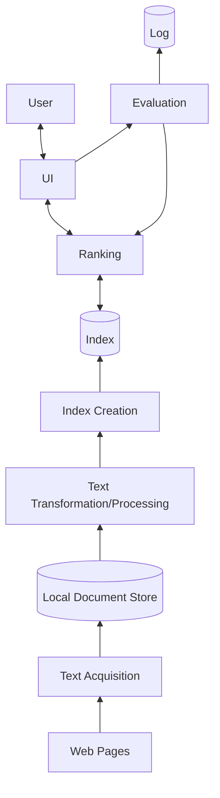

# CS 121: Information Retrieval — Week 1: Course Introduction, IR and the Web, Architecture

## Table of Contents

- [1. How the Course Works](#1-how-the-course-works)
- [2. What Is Information Retrieval?](#2-what-is-information-retrieval)
- [3. Types of IR and Types of Search Engines](#3-types-of-ir-and-types-of-search-engines)
- [4. Why Web Search Engines Matter](#4-why-web-search-engines-matter)
- [5. Database Engines vs. Search Engines](#5-database-engines-vs-search-engines)
- [6. The Core Issue: Relevance and Retrieval Models](#6-the-core-issue-relevance-and-retrieval-models)
- [7. Classic IR vs. Web IR](#7-classic-ir-vs-web-ir)
- [8. Search Engineers and the Job Market](#8-search-engineers-and-the-job-market)
- [9. The Search Workflow from the User's Side](#9-the-search-workflow-from-the-users-side)
- [10. Search Engine Architecture](#10-search-engine-architecture)
- [11. In-class Notes & Assignment Tips](#11-in-class-notes--assignment-tips)
- [12. Worked Examples (with Solutions)](#12-worked-examples-with-solutions)
- [13. Quick Reference & Top 5 Things to Remember](#13-quick-reference--top-5-things-to-remember)

> UCI CS 121 / IN4MATX 141: Information Retrieval — Prof. Alberto Krone-Martins, Fall 2026, week of Sep 30
> Built from the Lecture 1, 2 and 3 slides (the YuJa videos are not included). Organized by concept, not by lecture.
> Slides credit Profs. C. Lopes, A. Krone-Martins, C. Manning, P. Nayak, H. Schütze and others, and Addison Wesley.
> 📖 Readings this week: [Basic computing skills booklet (Canvas)](https://canvas.eee.uci.edu/courses/87165/files/37013271) · [Croft et al., *Search Engines: IR in Practice*, Ch 1–2](https://ciir.cs.umass.edu/downloads/SEIRiP.pdf)

> 📅 **Class logistics**: Quiz 0 is on Canvas (ungraded, "no wrong answers if you provide reasonable answers"; used to calibrate the course; access code given in class, L1 p54).
> Sign and upload the Course Policies document on time for 1 bonus point (L1 p30, L3 p2, p33).
> Assignment 1 (tokenizer from scratch) is introduced in L3; its deadline is Friday, Oct 9.
> Holiday: Veteran's Day, Nov 11 — no in-person class.

---

## 1. How the Course Works

CS 121 is a **flipped class**. The content comes as pre-recorded videos on YuJa (posted Mondays or Wednesdays, slides linked from the Canvas Syllabus table). The Wednesday session (5:00–7:50 pm, HIB 100) is a quick review of the week's topics, and most of it is for you and your group to work on the assignments and ask questions in the room (L1 p4–9). Videos and slides stay online all quarter.

| Item | Rule (L1 p3–23) |
|---|---|
| People | Prof. Alberto Krone-Martins; TAs Ken (Yuangang) Li, Yi-Hung Chou, Yunyan Ding; Readers Jasmine Kaur Marwaha, WanRong Wu |
| Attendance | Wednesday lectures are mandatory: 7 of 9 |
| Discussion | Fridays with the TAs — not mandatory; use it for assignments and quiz doubts |
| Office hours | Wednesdays 3:00–4:30 pm, DBH 5226, from Oct 7; ~15 min one-to-one slots booked on Calendly up to 4 h ahead; walk-ins welcome without a guarantee; Zoom only on request after booking (e.g. sickness) |
| EdDiscussion | Student-to-student forum; bonus points for **non-anonymous** participation |
| Contacting TAs/readers | In discussion sessions, or properly formatted e-mails (see the Course Policy document) |
| Assignments | Three, not equal weights — **50%** of the grade |
| Quizzes + Final | Four graded quizzes + the final, equal weights — **50%**; quizzes in class, on your laptop |
| Dropping | The lowest quiz is dropped, so there is no make-up quiz; the in-person final **cannot** be dropped (date TBA) |
| Quizzes are cumulative | Study regularly |
| Letter grades | The cut-offs may be adjusted if necessary; it's impossible to know beforehand if or how |
| Deadlines | Irvine time |

The course goals (L1 p15–18): know the fundamentals of IR, have techniques to find information spread among $10^n$ documents, and practice web crawling and building your own simple search engine from scratch. It answers three questions: *What is information retrieval? How do you build its most important blocks? How do you do IR on the web?*

The tone (L1 p24): creativity, and constructive discussion on EdDiscussion — "sometimes there is more than one right answer… but there are many wrong answers!" Students who need disability accommodations should contact the Disability Services Center, (949) 824-7494, as soon as possible (L1 p25).

Books (L1 p13–14): the required book is Croft, Metzler & Strohman, *Search Engines: Information Retrieval in Practice* (free PDF). The "required" book in quotes is Manning, Raghavan & Schütze, *Introduction to Information Retrieval*. The Canvas front page lists it as recommended.

> ⚠️ **Pitfall**: On L1 p19–21 the final is listed as "Thursday, June 8" — that's left over from an older offering. The later frames (p22–23) say **date and time TBA**.

> 🔗 **Go deeper**: [Croft et al. (PDF)](https://ciir.cs.umass.edu/downloads/SEIRiP.pdf) · [Manning et al., *Introduction to Information Retrieval*](https://nlp.stanford.edu/IR-book/information-retrieval-book.html)

---

## 2. What Is Information Retrieval?

The course's working definition (L1 p36 · L2 p4 · L2 p19):

> 💡 **Key Insight**: Information retrieval is **the activity of searching and extracting information from a collection of information resources**. In this class, that means *textual* information from *text documents*.

The classic, broader definition (Salton, 1968; L2 p20): IR is a field concerned with the **structure, analysis, organization, storage, searching, and retrieval** of information. Its primary focus is text — scholarly papers, books, news, e-mail, web pages — but IR also covers other media: audio, images, video.

> 🔗 **Go deeper**: [Croft §1.1 What Is Information Retrieval? (book p. 1)](https://ciir.cs.umass.edu/downloads/SEIRiP.pdf)

---

## 3. Types of IR and Types of Search Engines

IR is more than search. The slides list four kinds of task (L1 p37 · L2 p21) and five kinds of search engine (L1 p38 · L2 p22). This course does **search**, on the **web**:

| Types of IR | What it does |
|---|---|
| **Search** (this course) | Find documents for a query |
| Filtering or tracking | Detect documents of interest (e.g. as they arrive) |
| Classification | Label documents with pre-existing labels |
| Question answering | Go beyond finding documents: find *answers* |

| Types of search engines |
|---|
| **Web search** (this course) |
| Vertical search |
| Enterprise search |
| Desktop search |
| Peer-to-peer search |

> 🔗 **Go deeper**: [Croft §1.3 Search Engines (book p. 6)](https://ciir.cs.umass.edu/downloads/SEIRiP.pdf)

---

## 4. Why Web Search Engines Matter

"How often do you use web search engines?" (L2 p6). The slides' case (L2 p7–10, p17):

- **Without search engines the Web wouldn't scale.** Nobody has an incentive to create content that can't be found. Taxonomies and bookmarks can't keep up with the Web's size ("or can they?").
- **The Web is a technology artifact and a social environment.** For most people, Internet = Web, or even Internet = Google search.
- **Search makes aggregation of interest possible**, which creates incentives for niche players, and makes "unlimited selection" stores possible (Amazon, Netflix).
- A Pew Research Center study on search engine use (2012) found users more satisfied than ever with result quality, but many were anxious about search engines and other sites collecting personal information.
- Web search and IR are essential to modern life and central to your future professional life, in industry and academia.

**Search is also the money.** Search turned out to be the first, and best, mechanism for advertising on the Web (L2 p11–16). Slide 11 asks you to guess Google's 2019 global ad revenue ("??????????"); slide 12 then gives a global figure instead: web advertising revenue of USD 633 billion in 2026 (the sentence "(2027 estimated" is cut off on the slide).

| Figure (L2 p13–16) | Value |
|---|---|
| US web advertising revenue, 2025 | USD 294.59B, +14% over 2024 (the 2000–2025 chart rises from near zero, steeply after ~2016) |
| Worldwide digital advertising (Statista; PwC, Omdia) | 266 (2018), 310, 343, 448, 484, 522\*, 562\*, 599\*, 633\* (2026), 663\* (2027) — billion USD, \* = forecast |
| By 2027 | more than USD 663B worldwide |
| US online ad revenue by type, 2025 | **Search 38.8%**, Display 27.7%, Video 26.5%, Other 4.2%, Audio 2.8% |

The business model for ads has changed over time (L2 p14), but search is still the largest slice of US online ad revenue.

> 🔗 **Go deeper**: [Statista: Digital advertising industry in the U.S.](https://www.statista.com/topics/1176/online-advertising/) · [Statista: US online ad revenue by type](https://www.statista.com/statistics/190458/categorie-breakdown-of-us-online-advertising-revenue-2010/)

---

## 5. Database Engines vs. Search Engines

"What is the difference between a database search and a search engine?" (L1 p39 · L2 p23). The slides answer with two kinds of request (L1 p40–41 · L2 p24):

| | Database engine | Search engine |
|---|---|---|
| Example | "Find accounts whose balance is greater than `$100`" | "Canvas UCI", "Find how to merge two lists in Python", "Find the graph of y=log(x)" |
| Data | Well-structured, well-defined; not just text but numbers | Text, with vague and varied information needs |
| Query | Formal language and logic | Informal, ad-hoc |
| Meaning | **Semantics are well-defined** | The engine must infer the meaning of words and sentences — **semantics are inferred** |

(L1's version adds the "semantics" row; L2's version stops at the first three.)

> 💡 **Key Insight**: A database query has exactly one right answer set — every row matching `balance > 100`. A search query has no such answer; the engine has to *guess* what the user meant and rank documents by how well they fit. That guess is the subject of the next section.

> 📝 **Practice**: [Worked Example 12.1](#121-database-query-or-search-query-l1-p3941--l2-p2324)

---

## 6. The Core Issue: Relevance and Retrieval Models

**Relevance** is what a search engine is really computing (L1 p42–43 · L2 p25). Textual similarity between query and document is only the first ingredient — *databases stop there*. A search engine also uses context:

| Context | Examples from the slides |
|---|---|
| Textual similarity | query words vs. document words ("databases stop here!!") |
| Document context | origin, author, popularity, … |
| User context | geographic location, prior queries, age, preferred language, … |
| Query context | special symbols |

A **retrieval model** is defined behind every notion of relevance (L1 p44 · L2 p26). It's the conceptual design of *what to pay attention to* when matching a query and a document — for example, grammar vs. raw text, and which parts of the context count. A good retrieval model finds the documents relevant to **the person who submitted the query**, and it is the basis for the ranking algorithms.

> ⚠️ **Pitfall**: "Relevant" means relevant *to that user*, not "contains the query words". Two people typing the same query can deserve different results (location, language, prior queries).

> 🔗 **Go deeper**: [Croft §1.2 The Big Issues (book p. 4)](https://ciir.cs.umass.edu/downloads/SEIRiP.pdf)

---

## 7. Classic IR vs. Web IR

**Classic IR** (L3 p4–5) assumes a **fixed document collection** (the corpus), and the goal is to retrieve the information relevant to an information need. Formally: for each query $Q$ and stored document $D$ there is a relevance score $R(Q, D)$, and the system maximizes it. Context is ignored, the user is ignored, and the corpus is static.

**Web IR** breaks every one of those assumptions (L3 p6):

| Classic assumption | On the Web | Consequence |
|---|---|---|
| The corpus is stored centrally | The Web is huge — it can't be stored in any centralized memory | Corpus is not centralized |
| The corpus is static | The Web changes all the time | Must update constantly |
| Context is ignored | There is information to avoid (spam, manipulation) — *adversarial IR* | Context can't be ignored |
| The user is ignored | One interface serves hugely divergent needs | User can't be ignored |

**Web search engines** are the practical application of IR (L3 p7). They must crawl terabytes to petabytes of web pages and answer queries in under a second — though indexing can take "a bit" longer. Besides the IR issues, the big design issues are:

- **Performance**: response time, query throughput, indexing speed
- **Speed of discovering and integrating new documents**
- **Coverage**
- **Freshness**
- **Spam**

> 💡 **Key Insight**: Sub-second *queries*, slower *indexing*: the expensive work (crawling, processing, indexing) is done ahead of time so the query path stays fast. That split is exactly the two halves of the architecture in [section 10](#10-search-engine-architecture).

> 📝 **Practice**: [Worked Example 12.2](#122-which-classic-ir-assumption-breaks-l3-p46)

> 🔗 **Go deeper**: [Croft §1.3 Search Engines (book p. 6)](https://ciir.cs.umass.edu/downloads/SEIRiP.pdf)

---

## 8. Search Engineers and the Job Market

Search engineers (L3 p8) either **develop and maintain search engines** or **design and optimize content for search engines**. The slides back the job market with IEEE Spectrum charts built from Hired data (L3 p9–10). Hired reports growth in demand only for each year's top ten specialties, so a 0% means "not in that year's top ten".

| Growth in demand, by specialty | 2018 | 2019 |
|---|---|---|
| AR/VR | 0% | 1,400% |
| Gaming | 0% | 146% |
| Computer Vision | 0% | 146% |
| **Search** | 0% | **137%** |
| Machine Learning | 27% | 89% |
| Security | 132% | 49% |
| Data | 38% | 45% |
| Frontend | 4% | 17% |
| Backend | 33% | 17% |
| Blockchain | 517% | 9% |
| Full-stack | 7% | 5% |
| Embedded | 76% | 0% |
| Mobile | 15% | 0% |

| Software engineering salaries (USD) | London | New York | SF Bay Area | Toronto |
|---|---|---|---|---|
| **Search** | 92,000 | 136,000 | **165,000** | 102,000 |
| NLP | 101,000 | — | 164,000 | — |
| Security | 103,000 | 127,000 | 163,000 | 95,000 |
| Machine Learning | 99,000 | 138,000 | 162,000 | 104,000 |

(NLP shows `$0,000` for New York and Toronto on the chart — no data.) In this data, Search is among the fastest-growing specialties in 2019 and the best-paid of the four in the Bay Area.

> 🔗 **Go deeper**: [IEEE Spectrum: software engineering salaries and demand by specialty](https://spectrum.ieee.org/view-from-the-valley/at-work/tech-careers/software-engineering-salaries-jump-demand-for-arvr-expertise-skyrockets) · [Croft §1.4 Search Engineers (book p. 9)](https://ciir.cs.umass.edu/downloads/SEIRiP.pdf)

---

## 9. The Search Workflow from the User's Side

"The story from the perspective of the user" (L1 p45–49 · L3 p11–14) is built up in four frames. A dashed line separates what the user sees from what runs behind it:

1. **The user** types a query into a search box (Go / Search).
2. The query goes to a **database of pages**, and the **search results** page comes back.
3. A second store, the **ad indices**, feeds the results page too — the sponsored results next to the organic ones.
4. Behind it all, the **web spider** (crawler) walks **the Web** — pages linking to pages — and hands pages to the **indexer**, which builds the **indices** the queries run against.

> 💡 **Key Insight**: The user only ever touches the query side. Everything left of the dashed line — crawling, indexing — happened before the query was typed, which is why the results come back in under a second.

---

## 10. Search Engine Architecture

"The underlying architecture…" (L1 p50–52 · L3 p15–29). This diagram comes back at the start of most later decks as a "you are here" map, so learn it now. It has two halves:

- **Preprocessing steps** (left; offline, before any query): Web Pages → **Text Acquisition** → Local Document Store → **Text Transformation/Processing** → **Index Creation** → Index.
- **Querying process** (right; online, per query): User ↔ **UI** ↔ **Ranking** ↔ Index, with **Evaluation** watching the UI, writing to a **Log**, and feeding back into Ranking.

What each block does (L3 p17–27):

| Block | Responsibilities |
|---|---|
| **Text Acquisition** | Crawler; feeds; data dumps; text conversion (e.g. PDF → text); the document store |
| **Text Transformation** | Parser = tokenizer + structure; **stopping** (removing words like "the", "of"); **stemming** (grouping similar words, e.g. fishes → fish); link extraction and analysis (how popular a link is); information extraction (text structure); classifier (topic, non-content, spam, …) |
| **Index Creation** | Corpus statistics; **term weighting** (how important a word is in documents); **index inversion** (doc → term becomes term → doc); index distribution (essential for large indexes) |
| **User Interaction** (UI) | Query input (keywords, operators such as AND); query transformation (spell checking, query suggestion and expansion); results output (page summaries, highlighting important words) |
| **Ranking** | Relevance scoring (how well each doc matches the query); performance optimization (lower response time); distribution — a query broker allocates queries to different processors |
| **Evaluation** | Logging (improves the engine in the long run); ranking analysis (does the ranking work for its users, judged by their behavior?); performance analysis (people expect fast answers, so performance is monitored and improved) |

L3 p29 ends the build by circling groups of blocks: Web Pages + Text Acquisition; Text Transformation + Index Creation; Index + Ranking; Evaluation; and (in blue) UI + the user.

> 💡 **Key Insight**: **Index inversion** is the heart of the left half. A document naturally maps to its terms (doc → term). Search needs the opposite — given a term, which documents contain it (term → doc). Building that inverted index is what makes sub-second queries possible.

> ⚠️ **Pitfall**: Stopping and stemming are *text transformation*, not index creation, and spell checking / query expansion belong to *user interaction*, not ranking. Quizzes like to ask which block a task lives in — use the table above.

> 🔗 **Go deeper**: [Croft Ch 2 Architecture of a Search Engine (book p. 13)](https://ciir.cs.umass.edu/downloads/SEIRiP.pdf) · Croft §2.3.1–2.3.6 cover the six blocks (book pp. 17–27)

---

## 11. In-class Notes & Assignment Tips

From L1 p26–30, p53 and L3 p30–32:

- **All assignments are in Python.** A1 is individual. A2 and A3 are in groups of 1–4 students, with no changes in the requirements. In A3, different majors get different constraints (stated in the assignment prompt).
- **Get an openlab account** — not formally required, but essentially a requirement for a good experience in Assignment 2. You'll also need the command line.
- **Assignment 1: Tokenizer from scratch.** Write it in Python 3.6+, preferably 3.10, since that's what the openlab.ics.uci.edu machines have. It will help with the next two assignments.
  - "At certain points, the assignment may seem underspecified — this is by design." Make your own choices and assumptions, and be ready to defend them.
  - **Your program must run**: executable from the command line, taking the file names as command-line arguments.
- Sign and upload the Course Policies document on time: 1 bonus point.

> 🔗 **Go deeper**: [openlab account activation](https://www.ics.uci.edu/~lab/students/acct_activate.php) · [Basic computing skills booklet (Canvas)](https://canvas.eee.uci.edu/courses/87165/files/37013271)

---

## 12. Worked Examples (with Solutions)

### 12.1 Database query or search query? (L1 p39–41 · L2 p23–24)

For each request, decide whether it's a database query or a search-engine query, and say why:

1. "Find accounts whose balance is greater than `$100`"
2. "Canvas UCI"
3. "Find how to merge two lists in Python"
4. "Find the graph of y=log(x)"

> ✍️ **Try it first.**

**Solution.** (1) is a **database** query: the data is structured (an accounts table with a numeric balance), the condition is formal logic (`balance > 100`), and the semantics are well-defined — every matching row is correct, none is missing. (2)–(4) are **search** queries: they are informal and ad hoc, and the engine must infer what they mean. Does "Canvas UCI" want the login page or the help pages? Which programming idiom counts as "merge"? A page *about* log(x), or a plot? There is no single correct answer set, only a ranking by relevance. Back to [section 5](#5-database-engines-vs-search-engines).

### 12.2 Which classic IR assumption breaks? (L3 p4–6)

Classic IR maximizes $R(Q, D)$ over a fixed corpus, ignoring context and the user. For each fact about the Web, name the assumption it breaks: (a) the Web can't fit in any centralized memory; (b) pages change all the time; (c) some pages are written to game the ranking; (d) one search box serves everyone.

> ✍️ **Try it first.**

**Solution.** (a) The corpus is centralized → **not centralized**. (b) The corpus is static → **not static**: the engine must update constantly. (c) Context is ignored → it **can't be**: this is *adversarial IR*, with information to avoid. (d) The user is ignored → it **can't be**: hugely divergent needs share one interface. Back to [section 7](#7-classic-ir-vs-web-ir).

---

## 13. Quick Reference & Top 5 Things to Remember

| Term | Meaning |
|---|---|
| Information retrieval | Searching and extracting information from a collection of information resources (here: text documents) |
| Corpus | The document collection |
| Relevance $R(Q, D)$ | How well document $D$ satisfies the need behind query $Q$ |
| Retrieval model | What to pay attention to when matching a query and a document; the basis for ranking |
| Adversarial IR | Retrieval where some content is designed to manipulate the engine (spam) |
| Stopping / stemming | Drop very common words / group word variants (fishes → fish) |
| Index inversion | doc → term becomes term → doc |
| Query broker | Distributes queries to different processors |

| Architecture half | Blocks |
|---|---|
| Preprocessing (offline) | Text Acquisition → Document Store → Text Transformation → Index Creation → Index |
| Querying (online) | UI ↔ Ranking ↔ Index; Evaluation + Log feeding back into Ranking |

**Top 5 things to remember**

1. IR in this course = searching and extracting information from a collection of **text documents**, done on the **Web**.
2. Databases answer well-defined queries over structured data; search engines **infer** meaning from vague queries and **rank** by relevance.
3. Relevance = textual similarity **plus** document, user and query context — databases stop at the first.
4. The Web breaks all four classic IR assumptions: not centralized, not static, adversarial (context matters), and the user matters.
5. Know which architecture block does what — Text Acquisition, Text Transformation (tokenize, stop, stem), Index Creation (term weighting, inversion), UI, Ranking, Evaluation.
