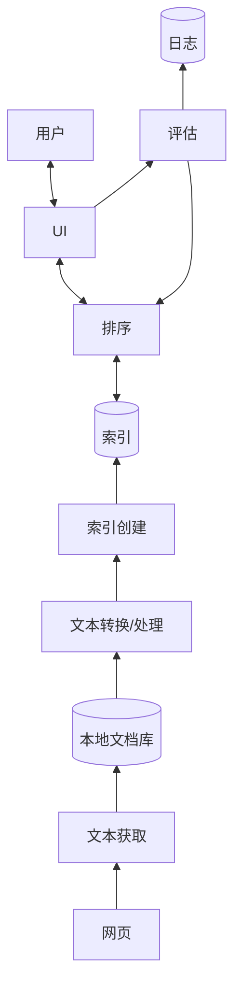

# CS 121: Information Retrieval — Week 1：课程介绍、信息检索与网络、架构

## 目录

- [1. 课程如何运作](#1-课程如何运作)
- [2. 什么是信息检索？](#2-什么是信息检索)
- [3. 信息检索的类型与搜索引擎的类型](#3-信息检索的类型与搜索引擎的类型)
- [4. 为什么网络搜索引擎重要](#4-为什么网络搜索引擎重要)
- [5. 数据库引擎与搜索引擎](#5-数据库引擎与搜索引擎)
- [6. 核心问题：相关性与检索模型](#6-核心问题相关性与检索模型)
- [7. 经典 IR 与 Web IR](#7-经典-ir-与-web-ir)
- [8. 搜索工程师与就业市场](#8-搜索工程师与就业市场)
- [9. 用户视角的搜索流程](#9-用户视角的搜索流程)
- [10. 搜索引擎架构](#10-搜索引擎架构)
- [11. 课堂笔记与作业提示](#11-课堂笔记与作业提示)
- [12. 示例题（附解答）](#12-示例题附解答)
- [13. 速查与必记的 5 件事](#13-速查与必记的-5-件事)

> UCI CS 121 / IN4MATX 141: Information Retrieval — Prof. Alberto Krone-Martins, Fall 2026, week of Sep 30
> 整理自 Lecture 1、2 和 3 的幻灯片（YuJa 视频未收录）。按概念组织，而不是按讲次组织。
> 幻灯片致谢 Profs. C. Lopes、A. Krone-Martins、C. Manning、P. Nayak、H. Schütze 等教授，以及 Addison Wesley。
> 📖 本周阅读：[基础计算机技能手册（Canvas）](https://canvas.eee.uci.edu/courses/87165/files/37013271) · [Croft et al., *Search Engines: IR in Practice*，第 1–2 章](https://ciir.cs.umass.edu/downloads/SEIRiP.pdf)

> 📅 **课程安排**：Quiz 0 在 Canvas 上进行（不计分，“只要答案合理就没有错误答案”；用于校准课程进度；访问码在课堂上给出，L1 p54）。
> 签署并按时上传课程政策文件，可获得 1 分加分（L1 p30、L3 p2、p33）。
> Assignment 1（从零实现分词器）在 L3 中介绍；截止日期为 10 月 9 日（周五）。
> 假期：退伍军人节，11 月 11 日——不进行面对面课程。

---

## 1. 课程如何运作

CS 121 是一门**翻转课堂**（flipped class）。内容以预先录制的视频形式在 YuJa 上发布（周一或周三发布，幻灯片链接在 Canvas Syllabus 表格中）。周三的课堂（下午 5:00–7:50，HIB 100）是对本周主题的快速复习，大部分时间留给你和小组在教室里完成作业、提出问题（L1 p4–9）。视频和幻灯片全学期都保持在线。

| 项目 | 规则（L1 p3–23） |
|---|---|
| 人员 | Prof. Alberto Krone-Martins；TA Ken (Yuangang) Li、Yi-Hung Chou、Yunyan Ding；阅卷员 Jasmine Kaur Marwaha、WanRong Wu |
| 出勤 | 周三课程为必修：9 次中至少出席 7 次 |
| 讨论 | 周五与 TA 一起讨论——非强制；可用于作业和测验疑问 |
| 答疑时间 | 10 月 7 日起，每周三下午 3:00–4:30，DBH 5226；约 15 分钟的一对一时段，需提前最多 4 小时在 Calendly 上预约；欢迎临时到访但不保证时段；仅在预约后、且有特殊情况（如生病）时才提供 Zoom |
| EdDiscussion | 学生之间的论坛；**非匿名**参与可获得加分 |
| 联系 TA/阅卷员 | 在讨论课上，或发送格式正确的电子邮件（见课程政策文件） |
| 作业 | 三次，权重不等——占成绩的 **50%** |
| 小测 + 期末 | 四次计分小测加期末考试，权重相等——占 **50%**；小测在课堂上进行，使用你自己的笔记本电脑 |
| 丢弃 | 去掉最低的一次小测，因此不设补考；线下期末考试**不可**丢弃（日期待定） |
| 小测具有累积性 | 定期复习 |
| 字母等级 | 必要时可能调整分数线；事先无法得知是否会调整以及如何调整 |
| 截止时间 | 以欧文（Irvine）时间为准 |

课程目标（L1 p15–18）：掌握信息检索的基础知识，掌握在 $10^n$ 个文档中查找信息的技术，并练习网络爬取，以及从零开始构建自己的简单搜索引擎。课程回答三个问题：*什么是信息检索？如何构建其中最重要的模块？如何在网络上进行信息检索？*

课程基调（L1 p24）：鼓励创造力，并在 EdDiscussion 上进行建设性讨论——“有时不止一个正确答案……但错误答案有很多！”需要残障支持的学生应尽快联系残障服务中心（Disability Services Center），电话 (949) 824-7494（L1 p25）。

教材（L1 p13–14）：指定教材是 Croft, Metzler & Strohman，*Search Engines: Information Retrieval in Practice*（免费 PDF）。加引号的“指定”教材是 Manning, Raghavan & Schütze，*Introduction to Information Retrieval*。Canvas 首页将其列为推荐教材。

> ⚠️ **易错点**：L1 p19–21 上的期末考试写的是“Thursday, June 8”——这是旧版课程留下的内容。后面的幻灯片（p22–23）写的是**日期和时间待定**。

> 🔗 **延伸阅读**：[Croft et al.（PDF）](https://ciir.cs.umass.edu/downloads/SEIRiP.pdf) · [Manning et al., *Introduction to Information Retrieval*](https://nlp.stanford.edu/IR-book/information-retrieval-book.html)

---

## 2. 什么是信息检索？

本课程的工作定义（L1 p36 · L2 p4 · L2 p19）：

> 💡 **关键见解**：信息检索是**从信息资源集合中搜索和提取信息的活动**。在本课程中，这指的是来自*文本文档*的*文本*信息。

更宽泛的经典定义（Salton, 1968；L2 p20）：IR 是一个研究信息的**结构、分析、组织、存储、搜索和检索**的领域。它的主要关注对象是文本——学术论文、书籍、新闻、电子邮件、网页——但 IR 也涵盖音频、图像、视频等其他媒体。

> 🔗 **延伸阅读**：[Croft §1.1 What Is Information Retrieval?（书中第 1 页）](https://ciir.cs.umass.edu/downloads/SEIRiP.pdf)

---

## 3. 信息检索的类型与搜索引擎的类型

信息检索不只是搜索。幻灯片列出了四类任务（L1 p37 · L2 p21），以及五类搜索引擎（search engine，L1 p38 · L2 p22）。本课程讲的是**网络**上的**搜索**：

| 信息检索的类型 | 功能 |
|---|---|
| **搜索**（本课程） | 为查询找到文档 |
| 过滤或追踪 | 检测感兴趣的文档（例如新文档到达时） |
| 分类 | 用预先存在的标签为文档打标签 |
| 问答 | 超越查找文档，直接找到*答案* |

| 搜索引擎的类型 |
|---|
| **网页搜索**（本课程） |
| 垂直搜索 |
| 企业搜索 |
| 桌面搜索 |
| 点对点搜索 |

> 🔗 **延伸阅读**：[Croft §1.3 Search Engines（书中第 6 页）](https://ciir.cs.umass.edu/downloads/SEIRiP.pdf)

---

## 4. 为什么网络搜索引擎重要

“你多久使用一次网络搜索引擎？”（L2 p6）幻灯片的论点（L2 p7–10、p17）：

- **没有搜索引擎，网络无法扩展。** 没有人有动机去创建无法被找到的内容。分类目录和书签跟不上网络的规模（“或者真的可以吗？”）。
- **网络既是一种技术产物，也是一个社会环境。** 对大多数人来说，互联网 = 网络，甚至互联网 = Google 搜索。
- **搜索使兴趣的聚合成为可能**，这催生了小众玩家的机会，也让“无限选择”的商店（亚马逊、Netflix）得以存在。
- 皮尤研究中心（Pew Research Center）2012 年关于搜索引擎使用的研究发现，用户对结果质量的满意度前所未有地高，但许多人对搜索引擎和其他网站收集个人信息感到焦虑。
- 网络搜索和 IR 对现代生活至关重要，也是你未来职业生涯（无论在业界还是学界）的核心。

**搜索也是一门生意。** 搜索是网络广告的第一个、也是最好的机制（L2 p11–16）。第 11 张幻灯片让你猜测 Google 2019 年的全球广告收入（“??????????”）；第 12 张幻灯片随后给出一个全球数字：2026 年网络广告收入为 USD 633 billion（幻灯片上“（2027 estimated”一句被截断）。

| 数据（L2 p13–16） | 数值 |
|---|---|
| 美国网络广告收入，2025 | USD 294.59B，较 2024 年增长 14%（2000–2025 年的图表从接近零开始上升，约 2016 年后急剧增长） |
| 全球数字广告（Statista；PwC、Omdia） | 266（2018）、310、343、448、484、522\*、562\*、599\*、633\*（2026）、663\*（2027）——单位为十亿美元，\* = 预测值 |
| 到 2027 年 | 全球超过 USD 663B |
| 2025 年美国在线广告收入按类型 | **搜索 38.8%**、展示 27.7%、视频 26.5%、其他 4.2%、音频 2.8% |

广告的商业模式随时间发生了变化（L2 p14），但搜索仍然是美国在线广告收入中占比最大的部分。

> 🔗 **延伸阅读**：[Statista：美国数字广告行业](https://www.statista.com/topics/1176/online-advertising/) · [Statista：美国在线广告收入按类型](https://www.statista.com/statistics/190458/categorie-breakdown-of-us-online-advertising-revenue-2010/)

---

## 5. 数据库引擎与搜索引擎

“数据库搜索和搜索引擎有什么区别？”（L1 p39 · L2 p23）幻灯片用两类请求来回答（L1 p40–41 · L2 p24）：

| | 数据库引擎 | 搜索引擎 |
|---|---|---|
| 示例 | “查找余额大于 `$100` 的账户” | “Canvas UCI”、“查找如何在 Python 中合并两个列表”、“查找 y=log(x) 的图像” |
| 数据 | 结构良好、定义明确；不只是文本，还有数字 | 文本，信息需求模糊且多样 |
| 查询 | 形式语言和逻辑 | 非正式、临时性 |
| 含义 | **语义是明确定义的** | 引擎必须推断词语和句子的含义——**语义是推断出来的** |

（L1 的版本多了“语义”一行；L2 的版本只到前三行。）

> 💡 **关键见解**：数据库查询恰好只有一个正确答案集——所有满足 `balance > 100` 的行。搜索查询没有这样的答案集；引擎必须*猜测*用户的意图，并按文档与查询的匹配程度对文档排序。这个“猜测”就是下一节的主题。

> 📝 **练习**：[例题 12.1](#121-数据库查询还是搜索查询l1-p3941--l2-p2324)

---

## 6. 核心问题：相关性与检索模型

**相关性**（relevance）是搜索引擎真正在计算的东西（L1 p42–43 · L2 p25）。查询与文档之间的文本相似度只是第一个要素——*数据库到此为止*。搜索引擎还会利用上下文：

| 上下文 | 幻灯片中的示例 |
|---|---|
| 文本相似度 | 查询词与文档词（“数据库到此为止！！”） |
| 文档上下文 | 来源、作者、受欢迎程度…… |
| 用户上下文 | 地理位置、先前的查询、年龄、首选语言…… |
| 查询上下文 | 特殊符号 |

每一种相关性概念背后都定义了一个**检索模型**（retrieval model）（L1 p44 · L2 p26）。它是在匹配查询与文档时*应关注什么*的概念设计——例如，语法与原始文本，以及上下文的哪些部分有意义。好的检索模型能找到与**提交查询的人**相关的文档，它是排序算法的基础。

> ⚠️ **易错点**：“相关”指的是与*该用户*相关，而不是“包含查询词”。两个人输入同样的查询，可能应该得到不同的结果（位置、语言、先前的查询）。

> 🔗 **延伸阅读**：[Croft §1.2 The Big Issues（书中第 4 页）](https://ciir.cs.umass.edu/downloads/SEIRiP.pdf)

---

## 7. 经典 IR 与 Web IR

**经典 IR**（L3 p4–5）假设存在一个**固定的文档集合**，即语料库（corpus），目标是检索与信息需求相关的信息。形式化地说：对每个查询 $Q$ 和每个存储的文档 $D$，都存在一个相关性得分 $R(Q, D)$，系统要使其最大化。上下文被忽略，用户被忽略，语料库是静态的。

**Web IR** 打破了上述每一个假设（L3 p6）：

| 经典假设 | 在网络上 | 结果 |
|---|---|---|
| 语料库集中存储 | 网络巨大——无法存放在任何集中式存储中 | 语料库不是集中的 |
| 语料库是静态的 | 网络时刻在变化 | 必须不断更新 |
| 上下文可以被忽略 | 存在需要规避的信息（垃圾信息、操纵）——*对抗性 IR*（adversarial IR） | 上下文不能被忽略 |
| 用户可以被忽略 | 同一个界面要服务差异极大的需求 | 用户不能被忽略 |

**网络搜索引擎**是 IR 的实际应用（L3 p7）。它们必须爬取 TB 到 PB 级的网页，并在一秒以内响应查询——不过索引（index）的构建可能需要“稍微”长一点的时间。除 IR 问题之外，主要的设计问题还有：

- **性能**：响应时间、查询吞吐量、索引速度
- **发现和整合新文档的速度**
- **覆盖率**
- **新鲜度**
- **垃圾信息**

> 💡 **关键见解**：查询要在一秒内完成，索引则较慢：开销大的工作（爬取、处理、索引）提前完成，从而保证查询路径很快。这种分工正是[第 10 节](#10-搜索引擎架构)中架构的两个部分。

> 📝 **练习**：[例题 12.2](#122-哪一条经典-ir-假设被打破l3-p46)

> 🔗 **延伸阅读**：[Croft §1.3 Search Engines（书中第 6 页）](https://ciir.cs.umass.edu/downloads/SEIRiP.pdf)

---

## 8. 搜索工程师与就业市场

搜索工程师（L3 p8）要么**开发和维护搜索引擎**，要么**为搜索引擎设计和优化内容**。幻灯片用 IEEE Spectrum 的图表佐证就业市场，数据来自 Hired（L3 p9–10）。Hired 只报告每年前十大专业的需求增长，因此 0% 的意思是“不在当年前十之列”。

| 按专业划分的需求增长 | 2018 | 2019 |
|---|---|---|
| AR/VR | 0% | 1,400% |
| 游戏 | 0% | 146% |
| 计算机视觉 | 0% | 146% |
| **搜索** | 0% | **137%** |
| 机器学习 | 27% | 89% |
| 安全 | 132% | 49% |
| 数据 | 38% | 45% |
| 前端 | 4% | 17% |
| 后端 | 33% | 17% |
| 区块链 | 517% | 9% |
| 全栈 | 7% | 5% |
| 嵌入式 | 76% | 0% |
| 移动端 | 15% | 0% |

| 软件工程薪资（美元） | London | New York | SF Bay Area | Toronto |
|---|---|---|---|---|
| **搜索** | 92,000 | 136,000 | **165,000** | 102,000 |
| 自然语言处理 | 101,000 | — | 164,000 | — |
| 安全 | 103,000 | 127,000 | 163,000 | 95,000 |
| 机器学习 | 99,000 | 138,000 | 162,000 | 104,000 |

（自然语言处理一行在图表中纽约和多伦多两栏显示为 `$0,000`——没有数据。）在这组数据中，搜索是 2019 年增长最快的专业之一，而且在湾区是这四个方向中薪资最高的。

> 🔗 **延伸阅读**：[IEEE Spectrum：软件工程薪资与各专业需求](https://spectrum.ieee.org/view-from-the-valley/at-work/tech-careers/software-engineering-salaries-jump-demand-for-arvr-expertise-skyrockets) · [Croft §1.4 Search Engineers（书中第 9 页）](https://ciir.cs.umass.edu/downloads/SEIRiP.pdf)

---

## 9. 用户视角的搜索流程

“从用户视角看的故事”（L1 p45–49 · L3 p11–14）分四个画面逐步呈现。虚线把用户看到的部分与其背后运行的部分分隔开：

1. **用户**在搜索框（Go / Search）中输入查询。
2. 查询被发送到**页面数据库**，然后返回**搜索结果**页面。
3. 第二个存储——**广告索引**——同样为结果页面提供数据：与自然结果并列显示的赞助结果。
4. 在幕后，**网络蜘蛛**（web spider，即爬虫 crawler）遍历**网络**——页面链接到页面——并把页面交给**索引器**（indexer），由它构建查询所针对的**索引**。

> 💡 **关键见解**：用户只接触查询这一侧。虚线左侧的一切——爬取、索引——都发生在查询输入之前，这也是结果能在一秒内返回的原因。

---

## 10. 搜索引擎架构

“底层架构……”（L1 p50–52 · L3 p15–29）。这张图会在后续大多数课件的开头以“你在这里”的地图形式再次出现，所以现在就要学会它。它分为两部分：

- **预处理步骤**（左侧；离线，在任何查询之前）：网页 → **文本获取（Text Acquisition）** → 本地文档库 → **文本转换/处理（Text Transformation/Processing）** → **索引创建（Index Creation）** → 索引。
- **查询过程**（右侧；在线，每次查询时）：用户 ↔ **UI** ↔ **排序（Ranking）** ↔ 索引，其中**评估（Evaluation）**监视 UI，写入**日志**（Log），并反馈给排序。

各模块的作用（L3 p17–27）：

| 模块 | 职责 |
|---|---|
| **文本获取** | 爬虫；订阅源；数据转储；文本转换（例如 PDF → 文本）；文档库 |
| **文本转换** | 解析器 = 分词器 + 结构；**停用词去除**（stopping，去掉 "the"、"of" 等词）；**词干提取**（stemming，将相似的词归为一组，例如 fishes → fish）；链接提取与分析（链接有多受欢迎）；信息提取（文本结构）；分类器（主题、非内容、垃圾信息等） |
| **索引创建** | 语料库统计；**词项加权**（term weighting，词在文档中有多重要）；**索引倒排**（index inversion，文档 → 词项 变为 词项 → 文档）；索引分布（对大型索引至关重要） |
| **用户交互**（UI） | 查询输入（关键词、AND 等运算符）；查询变换（拼写检查、查询建议与扩展）；结果输出（页面摘要、突出显示重要词语） |
| **排序** | 相关性打分（每个文档与查询的匹配程度）；性能优化（降低响应时间）；分布式——**查询代理**（query broker）把查询分配给不同的处理器 |
| **评估** | 日志记录（长期来看改进引擎）；排序分析（排序是否对其用户有效，以用户行为判断？）；性能分析（人们期望快速的答案，因此要监控并改进性能） |

L3 p29 在结束构建时，用圈线把几组模块框在一起：网页 + 文本获取；文本转换 + 索引创建；索引 + 排序；评估；以及（蓝色）UI + 用户。

> 💡 **关键见解**：**索引倒排**是左半部分的核心。文档天然地映射到它的词项（文档 → 词项）。搜索需要相反的方向——给定一个词项，哪些文档包含它（词项 → 文档）。构建这个倒排索引，才使亚秒级查询成为可能。

> ⚠️ **易错点**：停用词去除和词干提取属于*文本转换*，而不是索引创建；拼写检查和查询扩展属于*用户交互*，而不是排序。测验常问某个任务属于哪个模块——请以上表为准。

> 🔗 **延伸阅读**：[Croft 第 2 章 Architecture of a Search Engine（书中第 13 页）](https://ciir.cs.umass.edu/downloads/SEIRiP.pdf) · Croft §2.3.1–2.3.6 介绍六个模块（书中第 17–27 页）

---

## 11. 课堂笔记与作业提示

以下内容来自 L1 p26–30、p53 和 L3 p30–32：

- **所有作业都用 Python 完成。** A1 为个人作业。A2 和 A3 为 1–4 人小组，要求没有变化。在 A3 中，不同专业有不同的约束（在作业说明中注明）。
- **申请一个 openlab 账户**——这不是正式要求，但对于做好 A2 来说基本是必需的。你还需要会使用命令行。
- **Assignment 1：从零实现分词器。** 使用 Python 3.6+ 编写，最好是 3.10，因为 openlab.ics.uci.edu 上的机器就是这个版本。它对后两个作业也会有帮助。
  - “在某些地方，作业可能看起来说明不够具体——这是有意为之的。”做出你自己的选择和假设，并准备好为之辩护。
  - **你的程序必须能运行**：可从命令行执行，以文件名作为命令行参数。
- 按时签署并上传课程政策文件：1 分加分。

> 🔗 **延伸阅读**：[openlab 账户激活](https://www.ics.uci.edu/~lab/students/acct_activate.php) · [基础计算机技能手册（Canvas）](https://canvas.eee.uci.edu/courses/87165/files/37013271)

---

## 12. 示例题（附解答）

### 12.1 数据库查询还是搜索查询？（L1 p39–41 · L2 p23–24）

对于每个请求，判断它是数据库查询还是搜索引擎查询，并说明理由：

1. “查找余额大于 `$100` 的账户”
2. “Canvas UCI”
3. “查找如何在 Python 中合并两个列表”
4. “查找 y=log(x) 的图像”

> ✍️ **先自己试一试。**

**解答。** (1) 是**数据库**查询：数据是结构化的（一张带有数值型余额的账户表），条件是形式逻辑（`balance > 100`），语义是明确定义的——每一条匹配的行都是正确的，没有遗漏。(2)–(4) 是**搜索**查询：它们是非正式、临时性的，引擎必须推断其含义。“Canvas UCI”想要的是登录页面还是帮助页面？哪一种编程惯用法算作“合并”？是*关于* log(x) 的页面，还是一张图？这里没有唯一正确的答案集，只有按相关性排序的结果。返回[第 5 节](#5-数据库引擎与搜索引擎)。

### 12.2 哪一条经典 IR 假设被打破？（L3 p4–6）

经典 IR 在固定的语料库上最大化 $R(Q, D)$，忽略上下文和用户。对于关于网络的每一个事实，指出它打破了哪一条假设：(a) 网络无法放进任何集中式存储；(b) 网页时刻在变化；(c) 有些网页是为了操纵排序而编写的；(d) 同一个搜索框服务所有人。

> ✍️ **先自己试一试。**

**解答。** (a) 语料库是集中的 → **不是集中的**。(b) 语料库是静态的 → **不是静态的**：引擎必须不断更新。(c) 上下文被忽略 → 它**不能被忽略**：这就是*对抗性 IR*，存在需要规避的信息。(d) 用户被忽略 → 它**不能被忽略**：差异极大的需求共享同一个界面。返回[第 7 节](#7-经典-ir-与-web-ir)。

---

## 13. 速查与必记的 5 件事

| 术语 | 含义 |
|---|---|
| 信息检索 | 从信息资源集合中搜索和提取信息（此处指文本文档） |
| 语料库 | 文档集合 |
| 相关性 $R(Q, D)$ | 文档 $D$ 满足查询 $Q$ 背后需求的程度 |
| 检索模型 | 在匹配查询与文档时应关注什么；排序的基础 |
| 对抗性 IR | 某些内容被设计用来操纵引擎（垃圾信息）的检索 |
| 停用词去除 / 词干提取 | 去掉非常常见的词 / 将词的变体归为一组（fishes → fish） |
| 索引倒排 | doc → term 变为 term → doc |
| 查询代理 | 将查询分配给不同的处理器 |

| 架构部分 | 模块 |
|---|---|
| 预处理（离线） | 文本获取 → 文档库 → 文本转换 → 索引创建 → 索引 |
| 查询（在线） | UI ↔ 排序 ↔ 索引；评估 + 日志反馈给排序 |

**必记的 5 件事**

1. 在本课程中，IR = 从**文本文档**集合中搜索和提取信息，在**网络**上完成。
2. 数据库回答定义明确的结构化数据查询；搜索引擎会从模糊的查询中**推断**含义，并按相关性**排序**。
3. 相关性 = 文本相似度 **加上** 文档、用户和查询上下文——数据库只做到第一点。
4. 网络打破了经典 IR 的全部四个假设：不是集中的、不是静态的、具有对抗性（上下文很重要），而且用户很重要。
5. 要知道每个架构模块做什么——文本获取、文本转换（分词、停用词去除、词干提取）、索引创建（词项加权、倒排）、UI、排序、评估。
