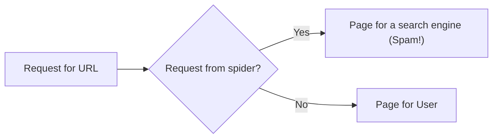
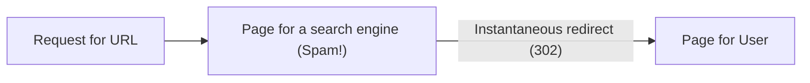

# CS 121: Information Retrieval — Week 2: The Web Corpus, Search Engine Optimization, Web Crawling

## Table of Contents

- [1. Corpus and Text Processing](#1-corpus-and-text-processing)
- [2. Tokenization](#2-tokenization)
- [3. The Web Graph and Its Characteristics](#3-the-web-graph-and-its-characteristics)
- [4. How the Web Evolved and What Web Searches Look Like](#4-how-the-web-evolved-and-what-web-searches-look-like)
- [5. Web Users: Needs, Queries and Behavior](#5-web-users-needs-queries-and-behavior)
- [6. How Users Evaluate Search Engines](#6-how-users-evaluate-search-engines)
- [7. The Business Model: Ads on Search](#7-the-business-model-ads-on-search)
- [8. Search Engine Optimization (SEO)](#8-search-engine-optimization-seo)
- [9. Coercion Techniques and Spam](#9-coercion-techniques-and-spam)
- [10. The War on Spam and Why SEO Tricks Don't Last](#10-the-war-on-spam-and-why-seo-tricks-dont-last)
- [11. What Ranking Really Uses: The Yandex Leak](#11-what-ranking-really-uses-the-yandex-leak)
- [12. URIs, URLs and URNs](#12-uris-urls-and-urns)
- [13. Flavors of Web Data Collection](#13-flavors-of-web-data-collection)
- [14. Toward Web Crawling: What Counts as an Algorithm?](#14-toward-web-crawling-what-counts-as-an-algorithm)
- [15. In-class Notes & Assignment Tips](#15-in-class-notes--assignment-tips)
- [16. Worked Examples (with Solutions)](#16-worked-examples-with-solutions)
- [17. Quick Reference & Top 5 Things to Remember](#17-quick-reference--top-5-things-to-remember)

> UCI CS 121 / IN4MATX 141: Information Retrieval — Prof. Alberto Krone-Martins, Fall 2026, week of Oct 7
> Built from the Lecture 3.5 (in class), 4, 5 and 6 slides (the YuJa videos are not included). Organized by concept, not by lecture.
> Slides credit Profs. C. Lopes, A. Krone-Martins, C. Manning, P. Nayak, H. Schütze and others, and Addison Wesley.
> 📖 Readings this week: [Croft et al., *Search Engines: IR in Practice*, Ch 3 Crawls and Feeds](https://ciir.cs.umass.edu/downloads/SEIRiP.pdf) · [Yandex leaked factors file (Canvas, "if you are curious")](https://canvas.eee.uci.edu/courses/87165/files/37013257)

> 📅 **Class logistics**: **Assignment 1 (tokenizer from scratch) is due Friday, Oct 9.**
> Book office hours if you need them; the professor can try to find alternative slots if necessary (L4 p48).
> Three videos on YuJa this week (Mon + Wed + Fri); the Wednesday session reviews them, then goes to A1 Q&A and assignment work (L3.5 p3, p30).

---

## 1. Corpus and Text Processing

This week starts in the **Text Transformation/Processing** box of the architecture (L4 p3–4, highlighted). The whole diagram is explained in [Week 1, section 10](?kind=course_notes&course=CS-121&lang=en-US&note=CS121_Week01_Notes_en-US.md#10-search-engine-architecture).

- **Corpus** (L4 p5–6): the complete set of documents available to be searched. In web search, it's the full set of pages the search engine will consider — what Text Acquisition put in the Local Document Store.
- **Text processing** (L4 p7): the stage where the documents in your corpus are processed for use in the search engine. It happens **before building the index**, to improve efficiency and performance.
- It typically has **two main steps** (L4 p8):
  1. **Tokenization** (lexical analysis) — breaking the text into tokens.
  2. **Linguistic pre-processing** — applying rules to the tokens to improve the efficiency of the index (Week 1 named two of them: stopping and stemming).

> 🔗 **Go deeper**: [Croft §3.1 Deciding What to Search (book p. 31)](https://ciir.cs.umass.edu/downloads/SEIRiP.pdf)

---

## 2. Tokenization

### 2.1 What a tokenizer does

Tokenization **breaks the input into simple units of meaning** (L4 p9–10). A token can be a word — or not; it depends on how you choose to create tokens. The tokenizer (also called a **lexer** or **scanner**) turns a **character stream into a token stream**. The same machine shows up in two places:

| Where | What the tokenizer feeds |
|---|---|
| Compiler front-end | A parser |
| Preprocessor for information retrieval | The retrieval system |

### 2.2 What is a token? It depends

"Divide on whitespace and throw away punctuation?" (L4 p11–12). The slides list the cases where that simple rule has to make a choice:

| Problem | Examples from the slides |
|---|---|
| Apostrophes | O'Neill, Aren't |
| Hyphens | clear-headed vs clearheaded; mother-in-law |
| Several words, one token? | San Francisco; white space; New York University vs York University |
| Tokens that aren't words | `info@uci.edu`, `http://www.ics.uci.edu/`, `192.168.0.1` |

There is no universally right answer: each choice decides which queries can match (three tokens for New York University means "York University" matches it too).

### 2.3 The early tokenization methodology

Early IR systems used a very simple rule (L4 p13–15):

- A token is a **sequence of 3 or more alphanumeric characters**.
- A **space or special character** ends the token.
- All characters are converted to **lower case**.

On the slide's sentence it gives:

```text
"Bigcorp's 2007 bi-annual report showed profits rose 10%."
        ↓
"bigcorp 2007 annual report showed profits rose"
```

`s`, `bi` and `10` are shorter than 3 characters and are thrown away. The slide's verdict: **too generic and simple, resulting in a lot of lost information** (slide: "To generic").

Step through the rule character by character, or type your own text:

```viz tokenize
{"title": "Early tokenization methodology (L4 p13–15)", "text": "Bigcorp's 2007 bi-annual report showed profits rose 10%.", "interactive": true}
```

> ⚠️ **Pitfall**: This is the *historical* rule the slides criticize, not the rule for Assignment 1. A1's rules come from the A1 prompt — read it, don't copy this demo's choices.

> 📝 **Practice**: [Worked Example 16.1](#161-early-tokenization-of-the-bigcorp-sentence-l4-p1315) · [Worked Example 16.2](#162-what-happens-to-the-tricky-tokens-l4-p1112)

> 🔗 **Go deeper**: [Croft §4.3.2 Tokenizing (book p. 87; a later reading)](https://ciir.cs.umass.edu/downloads/SEIRiP.pdf)

---

## 3. The Web Graph and Its Characteristics

"A bit further on the web" (L4 p19). The user-side search picture from Week 1 comes back with a question: **why can this spider crawl the web?** (L4 p20). Because the Web is a graph (L4 p21–22):

- **Pages are nodes.**
- **Hyperlinks are directed edges.** A link from A to B lets you get from A to B, not back.

A crawler follows the edges from page to page. What does this graph look like? (L4 p23–30):

| Characteristic | What the slides say |
|---|---|
| **Significant duplication** | 30%–40% of pages in some studies [Brod97, Shiv99]; 25%–30% is Google's number from 2013; copyscape.com finds copies of a page |
| **High linkage** | More than 8 links per page |
| **Very large** | Hosts $O(10^9)$; pages $O(???)$ — the slide leaves it open |
| **Spam, misleading and false information** | $O(10^{8\text{–}9}?)$ pages of it |
| **High rate of change** | see the three studies below |

**Size** — Netcraft's survey (L4 p24, 2020 chart; updated in class, L3.5 p5). On a log scale, websites grow from about $10^4$ in 1995 to a **~1.8 billion peak in Feb 2018**, then **~1.1 billion in March 2024**. Feb 2026: **1,419,977,535 hostnames**, only **208,200,947 active sites** (about 14.7%).

**Rate of change** (L4 p27–30; the slide first asks you to guess):

| Study | Sample | Finding |
|---|---|---|
| [Cho00] | 720k pages from 270 popular sites, sampled daily for 5 months in 1999 | **40% changed weekly, 23% daily** |
| [Fett02] | 151M pages checked over a few months | Significant changes: 7% weekly; some changes: 25% weekly |
| [Ntul04] | 154 **large** sites recrawled from scratch weekly | 8% had new pages every week; 8% die; 5% new content; 25% new links |

> 💡 **Key Insight**: Each row is a crawler/index problem: duplicates waste space, size means you can't fetch everything, spam means you can't trust what you fetch, and change makes every copy go stale.

> 🔗 **Go deeper**: [Source of Google's 2013 duplication figure (YouTube)](https://www.youtube.com/watch?v=mQZY7EmjbMA) · [Copyscape](https://www.copyscape.com) · [Netcraft web server survey, Sep 2020](https://news.netcraft.com/archives/2020/09/23/september-2020-web-server-survey.html) · [Netcraft web server survey, Mar 2026](https://www.netcraft.com/blog/march-2026-web-server-survey/) · [Croft §3.2 Crawling the Web (book p. 32)](https://ciir.cs.umass.edu/downloads/SEIRiP.pdf) · [Croft §3.7 Detecting Duplicates (book p. 60)](https://ciir.cs.umass.edu/downloads/SEIRiP.pdf)

---

## 4. How the Web Evolved and What Web Searches Look Like

**Evolution** (L4 p31–32), in five phases:

1. Static content (documents)
2. Dynamic content (applications — the slide shows calendar and weather apps)
3. User-generated content (social — Wikipedia, LinkedIn, Facebook)
4. Mobile
5. ??? AR? VR? Brain-interfaces?

> 💡 **Key Insight**: One need has stayed invariant through every phase: **to find information**. The present-day solution is IR systems for **search and ranking** (L4 p32).

**Web search characteristics** (L4 p33): there are **few popular broad queries** and **many rare specific queries**. The slide's example, all cancer-related searches, is a pie chart with a few visible slices ("cancer", "breast cancer", "skin cancer", "prostate cancer", "lung cancer", "colon cancer", "leukemia", "lymphoma") and hundreds of tiny ones.

**Popular searches** (L4 p34): term interest can be explored at Google Trends, and a search engine **uses trend information** to:

| Use | How trends help |
|---|---|
| Auto-complete | Enhance the user experience; correct spelling errors |
| Optimize search results | What's trending "near you" can help in relevance scoring |
| Smart-cache search results | If a search is trending, keep its results in cache |

> 🔗 **Go deeper**: [Google Trends](https://www.google.com/trends/)

---

## 5. Web Users: Needs, Queries and Behavior

**Why people search** [Jansen et al. 2008] (L4 p35):

| Need | Share | The user wants to… |
|---|---|---|
| Informational | ~80% | learn about something |
| Navigational | ~10% | go to that page (the pie chart calls it "URL Search") |
| Transactional | ~10% | do something |
| Miscellaneous | (small) | explore, socialize, etc. |

**How they write queries** (L4 p36–39): most queries are **ill-defined**:

- **Short** — 80% have fewer than 3 words
- **Imprecise terms**
- **No logical operators**
- **Low effort** — spelling mistakes

**Who they are** (L4 p40–44): wide variance in **needs, expectations, knowledge and bandwidth** ("your search engine will be better if you take these points seriously"). **Behavior**:

- **85% look over one result screen only** (!!!)
- 78% of queries are not modified
- They follow links — "the scent of information"

**How far do people look?** (L4 p49, an iProspect survey: "If you don't find what you are looking for, at what point do you move on, either to another search engine or to another search on the same engine?")

| Users move on… | Share |
|---|---|
| After the first few entries | 22.6% |
| After the first page | 18.6% |
| After the first two pages | 25.8% |
| After the first three pages | 14.7% |
| More than three pages | 10.8% |
| The whole list, unless it's dozens of pages | 7.4% |

So 41.2% give up by the end of the first page and 67.0% by the end of the second (the bars add up to 99.9% because of rounding).

**The information need pipeline** (L4 p45): the query is the last link of a chain, losing meaning at each step.

| Stage | Slide example |
|---|---|
| Task | Stop the noisy fan in the courtyard |
| Info need | Info about EPA regulations |
| Verbal form | What are EPA rules on noise pollution? |
| Query | EPA Sound Pollution |

**Answering the need behind the query** (L4 p46–47). The query is often an **imprecise indicator** of what the user wants. What can we do?

- Design retrieval models and mathematical definitions of the **relevance score** that are generic, albeit not ideal for every specific topic (relevance and retrieval models: [Week 1, section 6](?kind=course_notes&course=CS-121&lang=en-US&note=CS121_Week01_Notes_en-US.md#6-the-core-issue-relevance-and-retrieval-models))
- Use **user context**: who, where, what
- **Guess the type of information** wanted (image, map, math, …)
- **Correct and/or expand** queries

> ⚠️ **Pitfall**: Two different 80% figures: ~80% of searches are *informational*; 80% of queries are *shorter than 3 words*. 85% = one result screen; 78% = queries not modified.

---

## 6. How Users Evaluate Search Engines

**The major standard is the quality of the pages returned** (L5 p2–5). In classic IR that's relevance $R(Q, D)$; a real engine's relevance is $R(Q, D, \dots)$ — query, document *and more* — and how you really define it is among your engine's secrets. Also important to users:

- Trust
- Duplicate elimination (with a "show similar" option)
- Readability
- Fast access
- No pop-ups

### 6.1 Precision vs. recall

(L5 p6–11 · L3.5 p7–14, asked as a class poll)

- **Precision**: how relevant are the *first few* hits?
- **Recall**: how *many* of the relevant hits are presented?

**For web search, precision is more important than recall.** The Nielsen Norman Group eyetracking heat maps (L5 p9) show an **F-shape** on "About us", product and search-results pages alike: across the top, across again, then down the left edge.

**When is recall important? When completeness is required** (L5 p11): a **commitment reading pattern** (the whole page is read) — sources trusted *a priori*, motivated users. Example: search engines for **law and the sciences**.

> 📝 **Practice**: [Worked Example 16.3](#163-precision-or-recall-l5-p611--l35-p714)

### 6.2 Interface and tools

**Good UI: simple, no clutter** (L5 p12–15; screenshots of Google, DuckDuckGo, Bing, Yandex, Baidu and Yahoo!). Plus **pre- and post-processing tools** (L5 p16):

- Spell check / auto correct
- Suggested alternative searches
- Links to resources (maps, images, etc.)
- Handling syntactic cues — e.g. a URL typed in the search box, or a math equation

> 🔗 **Go deeper**: [Nielsen Norman Group (eyetracking studies credited on L5 p9, p11)](https://www.nngroup.com)

---

## 7. The Business Model: Ads on Search

Week 1 showed that search is the largest slice of online ad revenue ([Week 1, section 4](?kind=course_notes&course=CS-121&lang=en-US&note=CS121_Week01_Notes_en-US.md#4-why-web-search-engines-matter)). This week is the history and the mechanics (L5 p17–21):

1. **Early synergy**: keyword-based engines — Altavista (1995–1997), Excite, InfoSeek, Inktomi — and **paid placement ranking**, ads based on an **auction for a keyword** (Goto.com → Overture.com → Yahoo! → Google).
2. **Link-based ranking**, pioneered by Google (1998+): links added **authoritativeness** to relevance and blew away keyword-only engines. Great user experience, no business model yet — meanwhile Goto/Overture's annual revenues were near USD 1B.
3. **Google added paid placement ads**, differentiated from the results. **Yahoo!** bought Inktomi for search tech (a few hundred million USD) and Overture for paid placement tech (USD 1.6 billion, 2003): sponsored links alongside objective results. Google licensed Yahoo!'s paid placement tech — its ad engine for many years (perhaps still; nobody knows with certainty).
4. **Today**: engines maintain that ads do **not** affect vendors' ranking (nobody knows for sure). Placement is **fully automated**, **balances auction price and relevance**, and is **targeted**.

### 7.1 How companies pay

(L5 p22)

| Model | The advertiser pays… | Good for |
|---|---|---|
| **CPM** — Cost Per Mil | per $10^3$ showings (impressions) of the ad | Branding campaigns |
| **CPC** — Cost Per Click | when a user clicks the ad | Sales campaigns |
| **CPA** — Cost Per Action/Acquisition | only if the click triggered some action (e.g. DuckDuckGo + Amazon) | Paying for results |

**Why it makes sense for the business** (L3.5 p16–17): on the search-engine picture, crawling, indexing and organic results are **more interesting, less valuable financially**; the ad indices are **less interesting, ~10× more valuable**.

### 7.2 Click fraud

(L5 p23)

- **USD 7.2 billion were lost between 2016 and 2018** (Guardian).
- Google calls these **"invalid clicks"**.
- Search engines have sophisticated tools to detect fraud.

> ⚠️ **Pitfall**: The M in CPM is *mil(le)* — a thousand impressions, not a million. Click fraud hurts per-click pricing: each fake click is billed.

---

## 8. Search Engine Optimization (SEO)

**Paid ad placement costs money. So…** (L5 p24–26) — **SEO** is the **tuning of a web page/site/app to rank highly** in search results for certain queries. It's an alternative to paying for ad placement, with a bonus: **visibility through rank = greater trust**. In short, **it's marketing**: getting your content to your audience.

| Question (L5 p27–28) | Answer |
|---|---|
| Motives | Commercial, political, religious, lobbying |
| Who does it | Internally: webmasters, writers. Commercially: companies, consultants. Hosting services. Plugins to popular CMSs |

SEO is essentially a **marketing–technology interface** area (L5 p29). How to do it: Google's webmaster guidance, WebmasterWorld's SEO tools, and many books (the slide shows *The Art of SEO* by Enge, Spencer and Stricchiola, O'Reilly).

**Ethical and unethical ways** (L5 p30–31):

| Legitimate | Unethical ("aka spam") |
|---|---|
| Indexed age of the pages (older is better) | Fake pages |
| Good incoming links | Fake sites that point to your site |
| Good content: well written, well organized, up to date | Fake comments/engagement (bots!) |
| Good use of web standards/practices | In short: "alternative facts", aka lies |
| Fast servers (quick response) | |

Sometimes the line between legitimate and illegitimate is hard to find — there's a **large grey area**.

**Location matters too** (L5 p32): results also depend on **which data center receives the query**. google.com, google.fr and google.pt show different results for a single query such as "Paris", so different SEO strategies can be considered per country.

> 🔗 **Go deeper**: [Google: webmaster guidelines (answer 40349)](https://support.google.com/webmasters/answer/40349?hl=en) · [WebmasterWorld SEO tools](http://freetools.webmasterworld.com/category/seo-tools)

---

## 9. Coercion Techniques and Spam

### 9.1 Coercion techniques

(L6 p2–7 · L3.5 p19–22)

**Keyword stuffing.** First-generation search engines relied heavily on textual content and word frequency, so SEO played with keywords (L6 p3–4):

- **Misleading meta-tags** — the slide shows a travel site's `<head>` with a `<meta name="keywords">` tag listing "Expedia, Travel, Cheap Airfare, Car, Hotels, Vacations, Airfare, Car Rental, Cruises, …" and a description tag stuffed the same way
- **Repeating words** over and over
- **Playing games with colors** (white text on white) — visible to spiders/crawlers and indexers, but not to users

**Cloaking**: serving different content to a spider than to a browser (L6 p5). The server checks who is asking:



The slide's remark: this architecture is the same as a **dynamic content engine** — it can adapt to different search engines.

**Doorway pages**: like cloaking, but using a **redirect (302)** (L6 p6). HTTP 302 means "the requested resource resides **temporarily** under a different URI. Since the redirection might be altered on occasion, the client SHOULD continue to use the Request-URI for future requests." The initial page is optimized for the spider; then an instantaneous redirect takes the user to the actual content, so **the user sees the final page**.



**Link exchanges** (L6 p7): "I link to you, you link to me"; "translations"; and **universities and professors are targets** — essentially because of the **trust transfer** that matters at the link-analysis level.

### 9.2 Spam

(L6 p8–11)

| Two major types | What it is |
|---|---|
| **Link spamming** | Bots that search for blogs and leave comments with links |
| **Clicker bots** | Bots that issue queries and "click" on targeted query results |

There is a whole **spam industry** (L6 p10: results selling "First Page of Google GUARANTEED", "How To Get On The First Page of Google In 24 hours"), and web contests get spammed too (L6 p11).

### 9.3 Counteracting cloaking: spoofing the User-Agent

(L3.5 p23–24) The important class is `urllib.request.Request()`: by setting the **User-Agent** header, a simple Python script makes the server think it's Chrome on an iPhone. This is **"spoofing"**, widely used to access sites that refuse scripts/bots — **but be careful with this!** The slide's `print_url_3.py`:

```python
#
# Example 3 of urllib.request.open()
#
import sys
import urllib.request


def print_data_url(url_name: str) -> None:
    # First we spoof an user agent
    headers = {'User-Agent': "Mozilla/5.0 (iPhone; CPU iPhone OS 16_3 like "
                             "Mac OS X) AppleWebKit/605.1.15 (KHTML, like "
                             "Gecko) CriOS/110.0.5481.83 Mobile/15E148 "
                             "Safari/604.1"}
    request = urllib.request.Request(url_name, headers=headers)
    # Now we can retrieve data
    response = urllib.request.urlopen(request)
    response_data = response.read()
    response_data = response_data.decode(encoding = 'utf-8')
    response.close()
    print(response_data)


if __name__ == "__main__":
    print_data_url(sys.argv[1])
```

On the slide, a "what is my user agent" page reports the iPhone string:

```bash
$ python3 print_url_3.py https://www.whatismybrowser.com/detect/what-is-my-user-agent/ | grep -i "Mozilla"
```

Checked against a local server that echoes the header: the script arrives as the iPhone string above; a plain `urlopen(url)` arrives as `Python-urllib/3.x` — the default a cloaking server or bot blocker looks for.

> ⚠️ **Pitfall**: Cloaking and doorway pages both show the engine something the user doesn't see; the difference is the mechanism. Cloaking = the **server branches on who's asking**. Doorway = **one page for everyone, then a 302 redirect** that only a browser follows to the real content.

> 🔗 **Go deeper**: [How to win (or cheat) any online voting contest](https://www.wholewhale.com/tips/how-to-win-or-cheat-any-online-voting-contest/) · [Croft §4.5.3 Link Quality (book p. 111; a later reading)](https://ciir.cs.umass.edu/downloads/SEIRiP.pdf)

---

## 10. The War on Spam and Why SEO Tricks Don't Last

**How engines fight back** (L6 p12–15):

| Weapon | Details |
|---|---|
| Quality indicators | Statistical analysis of links; statistical analysis of votes |
| Usage indicators | Analytics |
| Anti-bot mechanisms | Captchas (the slide shows a reCAPTCHA "type the two words") |
| Limits on meta keywords | |
| Family-friendly filters | |
| **Robust link analysis** | Ignore statistically improbable links (a page in Portuguese from Portugal linking to a page in Chinese from China); detect cycles; use link analysis to detect spammers — a very simple rule: **guilt by association** |
| Editorial (human!) intervention | Black-listing, and creating training sets for supervised ML |
| Spam recognition by machine learning | |

**Webmaster guidelines** (L6 p16): search engines publish SEO policies — what is allowed and what isn't. They **must not be ignored**: once a site is blacklisted by a search engine, it virtually **disappears from the Web**.

**SEO "tricks" are volatile** (L6 p17–19), because they depend on how the engines work, and those methods keep changing:

| Era | Google's methods | What they look at |
|---|---|---|
| 1996 – ? | PageRank; then Panda (2011), Penguin (2012), Hummingbird (2013), Pigeon (2014), … | **Words and links** |
| Since 2016 | RankBrain — machine learning based | **Concepts** |
| Since October 2019 | BERT — NLP, machine learning | |
| Now | RankBrain + BERT + … — **more than 200 methods and signals** (!) | |

Can you optimize for BERT? Google says no (but it's too early to tell).

> 💡 **Key Insight**: The slides' solution (L6 p20 · L3.5 p25): **optimizing for users will guarantee optimizing for good search engines.** Tricks exploit gaps between what engines measure and what users want; the gaps keep closing.

---

## 11. What Ranking Really Uses: The Yandex Leak

(L3.5 p37–43, in-class only)

**Yandex** is the largest internet and technology company in Russia and the former Soviet Union countries. It launched in 1997, one year before Google (1998), and is now probably the largest search engine in Russia — before the war it had a market share of about 42% there. Worldwide it ranks 4th (search engine market share, March 2023):

| Engine | Google | Bing | Yahoo! | **Yandex** | DuckDuckGo | Baidu |
|---|---|---|---|---|---|---|
| Share | 93.18% | 2.87% | 1.12% | **1.02%** | 0.52% | 0.42% |

**The leak** (L3.5 p41): Yandex has developed search technology since 1993. Software information was leaked by a (now former) employee on **25 Jan 2023** — 44 GB of data, available via torrents, covering not only search but also maps, mail and cloud services.

**Three major factor families** (L3.5 p42):

| Factor type | Depends on | Examples |
|---|---|---|
| **Static** | The website only | Links, headers, advertisement ratio |
| **Dynamic** | Website + the query | Text relevance, tf-idf ranking |
| **User search** | The user only | User location, query language |

**Signals used in the ranking** (L3.5 p43):

- MatrixNet + Palekh + Korolyov + CatBoost (ML ranking models)
- PageRank
- tf-idf
- Page quality scoring
- Authoritativeness link inheritance
- Historical server response quality
- Page age, freshness, update frequency
- **Crawl level**: more weight to pages reached directly after the first page
- **Click history**: how often users click the page when it appears in a result list — filtered from bots!
- Specific factors for medical, legal, financial (and probably political) topics
- **URL string**: numbers, trailing slashes, capital letters — all negative!
- Similarity between users
- Font size (is it mobile friendly?)
- …

> 💡 **Key Insight**: The leak matches the week: "fast servers" (section 8) = *historical server response quality*; bot-filtered click history = defence against clicker bots (section 9); static/dynamic/user factors = $R(Q, D, \dots)$ spelled out.

> 🔗 **Go deeper**: [Yandex leaked factors file (Canvas, optional reading)](https://canvas.eee.uci.edu/courses/87165/files/37013257)

---

## 12. URIs, URLs and URNs

"Acquiring data from the Web" (L6 p21): the architecture slide now circles **Web Pages + Text Acquisition** (L6 p22) — the start of crawling.

> 🗣️ **In class**: "Pay attention to the difference between URI, URN and URL" (L3.5 p3–26).

### 12.1 Definitions

(L6 p23–24 · L3.5 p27–29)

A **URI** is a string of characters used to identify a resource. (The slides expand it as "Universal Resource Identifier"; the standard name is **Uniform** Resource Identifier.)

| Example URI | Kind |
|---|---|
| `http://www.ics.uci.edu` | URL |
| ISBN 0-486-27777-3 | URN |
| `ftp://ftp.ics.uci.edu` | URL |

- **URL (locator)**: must specify **where** the resource is.
- **URN (name)**: just **what** it is.
- The course focuses on URLs, but "URI" might slip in as a synonym.

### 12.2 Anatomy of a URL

(L6 p25–28)

```text
scheme://domain:port/path?query_string#fragment_id
         \_________/
          authority
```

`scheme://domain` is **mandatory**; `:port/path?query_string#fragment_id` is **optional**. Together, domain and port form the **authority**. The full picture is slightly more complicated (see the full spec).

The slides annotate two URLs:

| URL | Parts |
|---|---|
| `http://www.ics.uci.edu/~lopes` | `http` = on a web server · `www.ics.uci.edu` = no port, just domain · `~lopes` = path |
| `http://calendar.ics.uci.edu/calendar.php?type=month&calendar=1&category=&month=02&year=2013` | domain `calendar.ics.uci.edu` · path `calendar.php` · query `type=month&calendar=1&category=&month=02&year=2013` |

**Domains and subdomains**: in `calendar.ics.uci.edu`, the **domain name** is `uci.edu`; `ics` and `calendar` are subdomains.

**Absolute vs. relative URLs — important for A2!** (L3.5 p29): `<a href="http://www.ics.uci.edu/~algol/somesite.html">` is absolute; `<a href="/somesite.html">` is relative and has to be resolved against the page it appears on.

Try it — step through the parsing, the query parameters and relative resolution (edit the URLs and press Run):

```viz web-demo
{"title": "Anatomy of a URL (L6 p25–28 · L3.5 p29)", "html": "<p>See the console.</p>", "js": "const urls = [\n  \"http://www.ics.uci.edu/~lopes\",\n  \"http://calendar.ics.uci.edu/calendar.php?type=month&calendar=1&category=&month=02&year=2013\"\n];\nfor (const s of urls) {\n  const u = new URL(s);\n  console.log(s);\n  console.log({ scheme: u.protocol, host: u.hostname, port: u.port, path: u.pathname, query: u.search, fragment: u.hash });\n}", "steps": [{"note": "The query string is a list of name=value pairs; category is present but empty.", "js": "\nconst q = new URL(urls[1]).searchParams;\nfor (const [name, value] of q) console.log(name, \"=\", JSON.stringify(value));"}, {"note": "Relative links are resolved against the page they appear on: a leading / restarts at the domain.", "js": "\nconst page = \"http://www.ics.uci.edu/~algol/somesite.html\";\nconsole.log(new URL(\"/somesite.html\", page).href);\nconsole.log(new URL(\"somesite.html\", page).href);"}, {"note": "Every optional part filled in (illustrative URL): port, path, query, fragment.", "js": "\nconst full = new URL(\"http://www.ics.uci.edu:8080/~lopes/index.html?lang=en#top\");\nconsole.log({ host: full.hostname, port: full.port, path: full.pathname, query: full.search, fragment: full.hash });"}], "height": 60, "interactive": true}
```

In Python (the course language), `urllib.parse` gives the same parts:

```python
from urllib.parse import urlsplit, urljoin

p = urlsplit("http://calendar.ics.uci.edu/calendar.php"
             "?type=month&calendar=1&category=&month=02&year=2013")
print(p.scheme, p.hostname, p.port, p.path)
# http calendar.ics.uci.edu None /calendar.php
print(p.query)
# type=month&calendar=1&category=&month=02&year=2013

page = "http://www.ics.uci.edu/~algol/somesite.html"
print(urljoin(page, "/somesite.html"))
# http://www.ics.uci.edu/somesite.html
print(urljoin(page, "somesite.html"))
# http://www.ics.uci.edu/~algol/somesite.html
```

> ⚠️ **Pitfall**: The slide's two links are **not** the same page. On `http://www.ics.uci.edu/~algol/somesite.html`, `href="/somesite.html"` resolves to `http://www.ics.uci.edu/somesite.html` — the leading `/` drops `~algol/`. Resolve every link (`urljoin`) before you queue it.

> 📝 **Practice**: [Worked Example 16.4](#164-take-the-slides-urls-apart-l6-p2528) · [Worked Example 16.5](#165-uri-url-or-urn-l6-p2324--l35-p2728)

> 🔗 **Go deeper**: [W3C: URL specification](http://www.w3.org/Addressing/URL/url-spec.txt) · [Croft §3.2.1 Retrieving Web Pages (book p. 33)](https://ciir.cs.umass.edu/downloads/SEIRiP.pdf)

---

## 13. Flavors of Web Data Collection

How to acquire data? Four ways (L6 p29–34):

| Flavor | How it works | Notes from the slides |
|---|---|---|
| **Data dumps** | Sites package their data periodically and provide it as a "dump" | Wikipedia (it suggests you torrent it); arXiv bulk full-text access |
| **URL downloads** | Two steps: (1) find out the URLs of specific resources; (2) run a downloader over that list | E.g. "crawling" (!) SourceForge / GitHub for source code — or papers, pages, etc. Some sites use regular URLs: `http://link.springer.com/chapter/10.1007/978-3-642-34213-4_1`, `…_2`, …; Google Code's `http://code.google.com/p/python-for-android/downloads/list` |
| **Web APIs** | Sites provide (REST) interfaces for getting their data | Usually **higher-level** (no HTML parsing) but usually **restrictive** (only part of the data). Facebook Graph API, YouTube API, Twitter API, arXiv API, … |
| **Web crawling** | Like people: get HTML pages and other documents, **discovering new URLs as it goes** | Good for **changing** collections and **unknown** documents. Web admins don't like crawlers: they consume resources meant for people ("more on this later…") |

> 💡 **Key Insight**: Only crawling works when you don't know the URLs in advance; URL downloads need a predictable pattern like `…34213-4_1`, `…_2`.

> 🔗 **Go deeper**: [Wikipedia: Database download](http://en.wikipedia.org/wiki/Wikipedia:Database_download) · [arXiv bulk data (S3)](https://arxiv.org/help/bulk_data_s3) · [arXiv API](https://arxiv.org/help/api/index) · [Facebook Graph API](https://developers.facebook.com/docs/reference/api/) · [Graph API examples](https://developers.facebook.com/docs/reference/api/examples/) · [YouTube API](https://developers.google.com/youtube/)
> 🔗 **More**: [Twitter API docs](https://dev.twitter.com/docs) · [Croft §3.4 Document Feeds (book p. 47)](https://ciir.cs.umass.edu/downloads/SEIRiP.pdf)

---

## 14. Toward Web Crawling: What Counts as an Algorithm?

Lecture 6 ends by opening the next topic, the **basic crawl algorithm** (L6 p35, a title slide). Before writing it down, it asks: "Algorithm?" — using **Knuth's definition** (L6 p36). A procedure is an algorithm if it has:

| Property | The question to ask |
|---|---|
| **Finiteness** | Does it end after a finite number of steps? |
| **Definiteness** | Are the steps rigorously and unambiguously specified? |
| **Input** | Does it have zero or more inputs? |
| **Output** | Does it have one or more outputs related to the inputs? |
| **Effectiveness** | Are the operations basic enough for someone to perform them using pencil and paper only? |

Keep them in mind for the crawl loop — on a huge, ever-changing web (section 3), think about finiteness. The crawl algorithm itself — frontier, politeness, robots.txt — is covered in [Week 3 §1](?kind=course_notes&course=CS-121&lang=en-US&note=CS121_Week03_Notes_en-US.md#1-the-basic-crawl-algorithm).

> 🔗 **Go deeper**: [Croft §3.2.2 The Web Crawler (book p. 35)](https://ciir.cs.umass.edu/downloads/SEIRiP.pdf)

---

## 15. In-class Notes & Assignment Tips

The in-class deck opens with **"Expectations — by the end of the quarter…"** (L3.5 p2; the rest was said in class).

**Assignment 1: tokenizer from scratch** (L4 p16–18 · L3.5 p31–36; due Fri Oct 9):

- **Python** — L4 says 3.10+, the in-class deck 3.6+; either way **preferably 3.10**, what the `openlab.ics.uci.edu` machines have.
- **Underspecified by design**: make and defend your own choices — *but that doesn't mean anything is acceptable*; follow the prompt!
- **It must run from the command line**, e.g. `python3 PartA.py /blabla/assignmentTestCase.txt`, taking the file names from command-line arguments ("yes, you can `import sys`").
- **Well commented**: test by having someone read the code *without* the prompt; comments must reflect your understanding, including the complexity analysis.
- **The method/function signatures are informal**: you can change their names, but not what they do.
- **Exception handling is required**: your code cannot break because of characters in non-English languages, non-existing files, etc.
- **Very important: you cannot `import assignment1`…**

**For A2**: absolute vs. relative URLs ([section 12](#12-uris-urls-and-urns)).

> 🔗 **Go deeper**: [Week 1 A1 and openlab notes](?kind=course_notes&course=CS-121&lang=en-US&note=CS121_Week01_Notes_en-US.md#11-in-class-notes--assignment-tips)

---

## 16. Worked Examples (with Solutions)

### 16.1 Early tokenization of the Bigcorp sentence (L4 p13–15)

Apply the early methodology (tokens = runs of 3 or more alphanumeric characters; any space or special character ends a token; lower-case everything) to:

`Bigcorp's 2007 bi-annual report showed profits rose 10%.`

> ✍️ **Try it first.**

**Solution.** Split at every non-alphanumeric character (`'`, spaces, `-`, `%`, `.`) and lower-case: `bigcorp`, `s`, `2007`, `bi`, `annual`, `report`, `showed`, `profits`, `rose`, `10`. Drop the runs shorter than 3 — `s`, `bi`, `10`. Result: `bigcorp 2007 annual report showed profits rose`, 7 tokens, the slide's answer. Lost: the "bi" that changes "annual" and the 10% that was the news — "too generic". Back to [section 2](#2-tokenization).

### 16.2 What happens to the tricky tokens? (L4 p11–12)

Run each of the slide's examples through (a) "split on whitespace, then throw away punctuation" and (b) the early methodology. Which ones go wrong, and how?

> ✍️ **Try it first.**

**Solution.**

| Input | (a) whitespace + drop punctuation | (b) early methodology (3+ alnum) |
|---|---|---|
| O'Neill | `oneill` | `neill` (`o` dropped) |
| Aren't | `arent` | `aren` (`t` dropped) |
| clear-headed | `clearheaded` | `clear`, `headed` |
| clearheaded | `clearheaded` | `clearheaded` |
| mother-in-law | `motherinlaw` | `mother`, `law` (`in` dropped) |
| San Francisco | `san`, `francisco` | `san`, `francisco` |
| New York University | `new`, `york`, `university` | `new`, `york`, `university` |
| `info@uci.edu` | `infouciedu` | `info`, `uci`, `edu` |
| `http://www.ics.uci.edu/` | `httpwwwicsuciedu` | `http`, `www`, `ics`, `uci`, `edu` |
| `192.168.0.1` | `19216801` | `192`, `168` (`0`, `1` dropped) |

Rule (a) makes clear-headed match clearheaded but glues e-mails, URLs and IPs into meaningless strings; rule (b) shreds them and loses the short parts. **Neither** keeps O'Neill, "San Francisco" or "New York University" as one unit. Every fix is a design decision — "What is a token? Depends…". Check column (b):

```viz tokenize
{"title": "Tricky tokens under the early method (L4 p11)", "text": "O'Neill aren't clear-headed mother-in-law"}
```

Back to [section 2](#2-tokenization).

### 16.3 Precision or recall? (L5 p6–11 · L3.5 p7–14)

The class poll: which is more important for a web search engine, precision (how relevant are the first few hits?) or recall (how many relevant hits are presented?). And when is recall the one that matters?

> ✍️ **Try it first.**

**Solution.** **Precision**, for web search: users read in an F-shape and mostly stop at the first screen (85% look at one result screen; 41.2% give up by the end of page 1 in the iProspect survey), so the *top* hits decide quality. **Recall** matters **when completeness is required** — motivated users, trusted sources, the commitment pattern: search engines for **law** and the **sciences**. Back to [section 6](#61-precision-vs-recall).

### 16.4 Take the slide's URLs apart (L6 p25–28)

Using `scheme://domain:port/path?query_string#fragment_id`, give every part of
(a) `http://www.ics.uci.edu/~lopes` and
(b) `http://calendar.ics.uci.edu/calendar.php?type=month&calendar=1&category=&month=02&year=2013`.
What is the domain name in (b)? Which parts are mandatory?

> ✍️ **Try it first.**

**Solution.**

| Part | (a) | (b) |
|---|---|---|
| scheme | `http` | `http` |
| domain (host) | `www.ics.uci.edu` | `calendar.ics.uci.edu` |
| port | none written ("no port! just domain") | none written |
| path | `/~lopes` | `/calendar.php` |
| query string | none | `type=month&calendar=1&category=&month=02&year=2013` — 5 pairs; `category` is empty |
| fragment | none | none |

Domain name in (b): `uci.edu` (`ics`, `calendar` are subdomains). Only `scheme://domain` is mandatory. Same values as `urlsplit` and the demo in [section 12](#122-anatomy-of-a-url).

### 16.5 URI, URL or URN? (L6 p23–24 · L3.5 p27–28)

Classify `http://www.ics.uci.edu`, ISBN 0-486-27777-3 and `ftp://ftp.ics.uci.edu`.

> ✍️ **Try it first.**

**Solution.** All three are **URIs**. `http://www.ics.uci.edu` and `ftp://ftp.ics.uci.edu` are **URLs** — they say **where** the resource is. The ISBN is a **URN** — it names **what** the book is, not where a copy is. Back to [section 12](#121-definitions).

---

## 17. Quick Reference & Top 5 Things to Remember

| Term | Meaning |
|---|---|
| Corpus | All documents available to be searched |
| Tokenizer / lexer / scanner | Character stream → token stream |
| Precision / recall | Relevance of the first hits / how many relevant hits are shown |
| CPM / CPC / CPA | Per 1,000 impressions / per click / per action |
| URI / URL / URN | Identifier / where it is / what it is |

| Web fact | Number |
|---|---|
| Duplication | 30–40% (studies), 25–30% (Google, 2013) |
| Links per page | more than 8 |
| Websites | ~1.8B peak (Feb 2018), ~1.1B (Mar 2024); Feb 2026: 1.42B hostnames, 208M active |
| Change [Cho00] | 40% weekly, 23% daily |
| Needs [Jansen 2008] | ~80% informational, ~10% navigational, ~10% transactional |
| Queries | 80% shorter than 3 words; 78% not modified |
| Results | 85% look at one result screen only |
| Click fraud | USD 7.2B lost, 2016–2018 |

| Spam technique | How it fools the engine |
|---|---|
| Keyword stuffing | Misleading meta-tags, repeated words, white-on-white text |
| Cloaking | Server sends spiders a different page than browsers |
| Doorway page | Spider-optimized page + instant 302 redirect for users |
| Link exchanges / link spam | Fake links and blog comments to transfer trust |
| Clicker bots | Fake queries and clicks on targeted results |

| URL part | Mandatory? | Example |
|---|---|---|
| `scheme://domain` | Yes | `http://calendar.ics.uci.edu` |
| `:port` | No | omitted → default port |
| `/path` | No | `/calendar.php` |
| `?query_string` | No | `?type=month&…&year=2013` |
| `#fragment_id` | No | — |

**Top 5 things to remember**

1. Tokenization is full of choices; the early "3+ alphanumerics, lower-cased" rule turns the Bigcorp sentence into `bigcorp 2007 annual report showed profits rose` and loses information.
2. The Web is a directed graph: huge, duplicated (30–40%), densely linked (8+ links/page), spam-ridden, changing fast (40% weekly, Cho00).
3. For web search **precision beats recall**; recall matters when completeness is required (law, sciences).
4. CPM = per thousand impressions, CPC = per click, CPA = per action; cloaking branches on the requester, a doorway page uses a 302 redirect.
5. Only `scheme://domain` is mandatory in a URL; URL = *where*, URN = *what*; resolve relative links like `/somesite.html` against their page.
