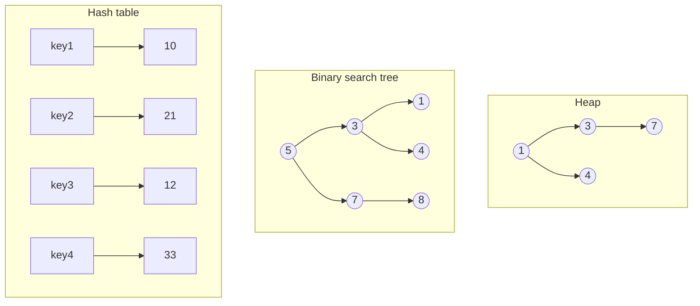
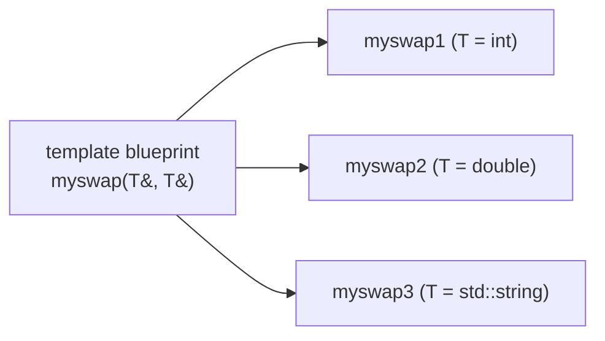
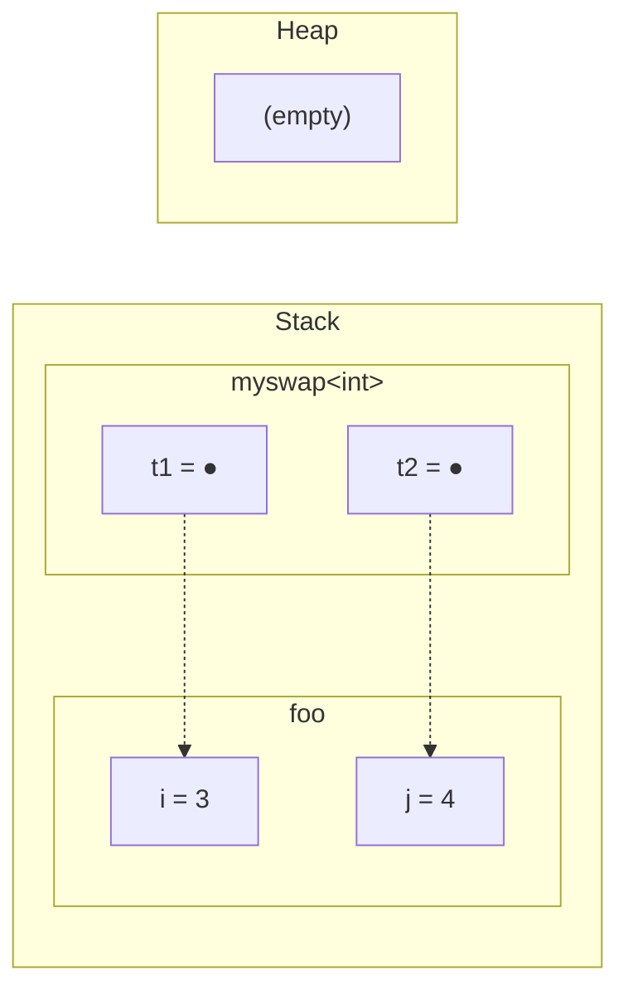
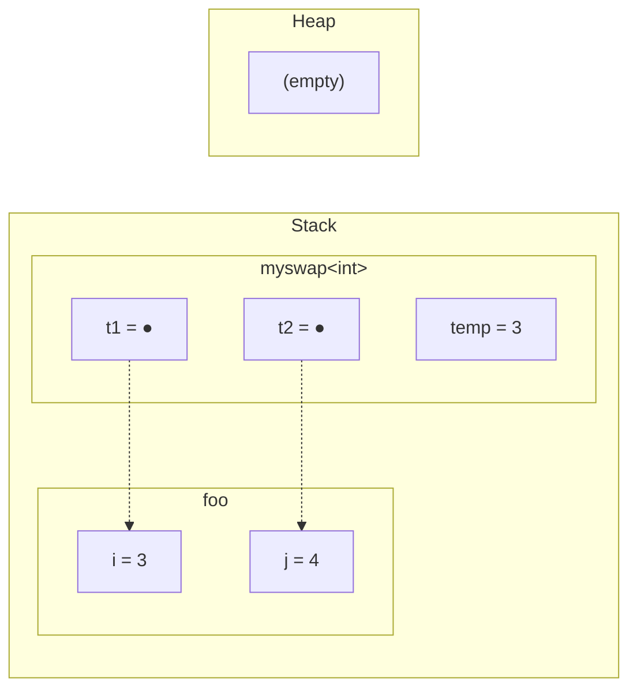
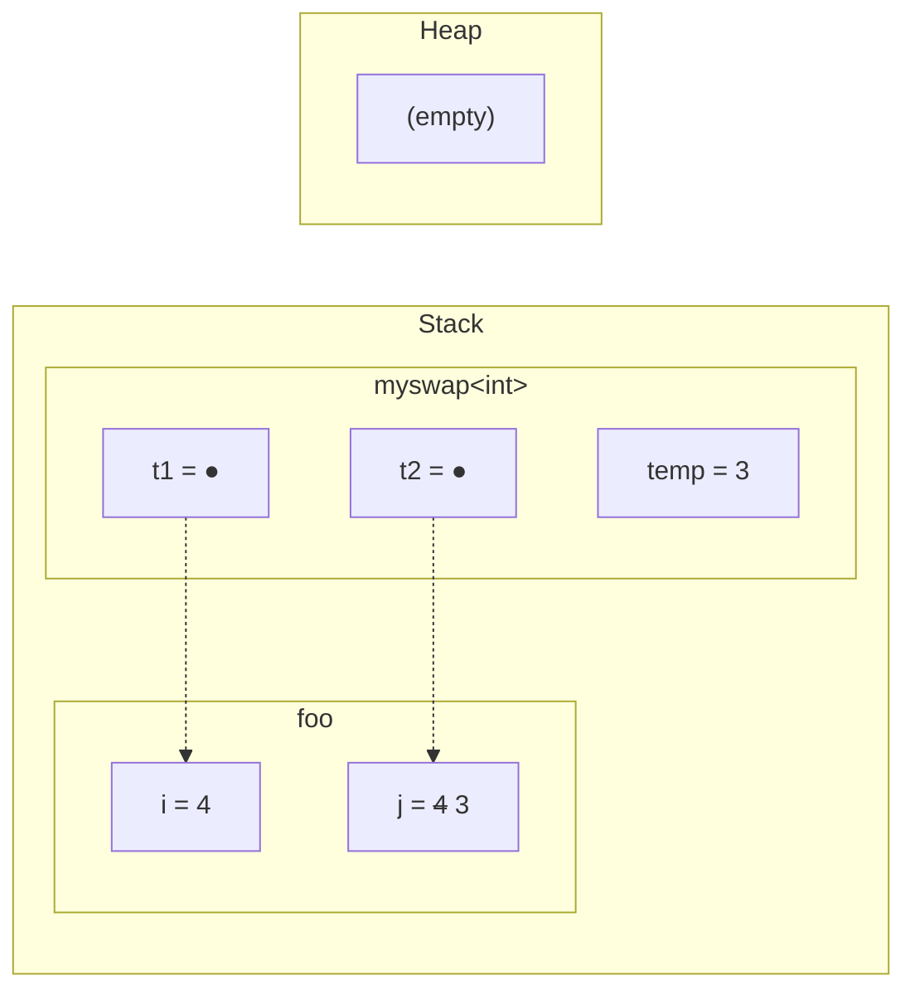

# Information and Computer Science 46 — Lecture 0: Course Introduction, Unit Tests, Templates

## Table of Contents

- [1. What ICS 46 Is About](#1-what-ics-46-is-about)
- [2. C++ Unit Tests with Google Test](#2-c-unit-tests-with-google-test)
- [3. Why Templates Exist](#3-why-templates-exist)
- [4. Writing a Function Template](#4-writing-a-function-template)
- [5. Function Template Instantiation (at Compile Time)](#5-function-template-instantiation-at-compile-time)
- [6. Where Template Code Lives (.hpp and .tpp)](#6-where-template-code-lives-hpp-and-tpp)
- [7. Implicit Constraints on Type Parameters](#7-implicit-constraints-on-type-parameters)
- [8. Class Templates](#8-class-templates)
- [9. A Class Template Example: Box](#9-a-class-template-example-box)
- [10. Complete Implementation](#10-complete-implementation)
- [11. In-class Activities (with Solutions)](#11-in-class-activities-with-solutions)
- [12. Quick Reference & Top 5 Things to Remember](#12-quick-reference--top-5-things-to-remember)

> UCI ICS 46: Data Structure Implementation and Analysis — Prof. Tom Yeh, Fall 2026, 09/24/26 (Week 0, Thursday)
> Built from the Week 0 slides (title slide reads "Lecture 1: Templates, Randomness"; the randomness part is in the next deck), with Thornton's ICS 46 notes (Templates, Course Introduction, Contracts and Exceptions), Thornton's ICS 45C Unit Testing notes, and the Google Test 1.10.0 Primer as supplements. Organized by concept, not by source.

> 📅 **Class logistics**: No office hours or discussion in Week 0. Lab 0 (environment setup) and Lab 1 (small program to test compilation) released this week.
> ICS 46 Gen AI Pre-survey: **0.5% extra credit**, closes Sunday.
> Weekly rhythm: lectures Tue/Thu; in-lecture activities (group) due 1 day after lecture (Tue's on Wed, Thu's on Fri); HW due Fri; labs due Mon; quizzes on Fri in discussion (moved there to give more time than in lecture).
> Prof. Yeh's OH: right after class, 5–6 pm, ICS1 195 (from Week 1). TA/LA OH TBD — see the OH calendar.
> Grading: Exams 50% (Midterm 20% + Final 30%), Quizzes 15% (5, drop lowest), Labs 15% (drop lowest), Homeworks 10% (drop lowest), In-class Activities 10% (drop lowest); extra credit = surveys, more TBA.
> Key dates (schedule, subject to change): Midterm 11/12, no class 11/26 (Thanksgiving), Final 12/8 4:00–6:00 pm.
> Where things are: Canvas (class webpage); Google Drive class folder (syllabus, schedule, slides, labs, OH schedule — needs your UCI account); Ed Discussion for all course questions (private post if it contains code/solutions); email only for special circumstances; ICS tutors (Zotpass app); iGP AI Assistant (built by Prof. Yeh's research group, funded by the ICS tutors program).
> Resources: Sedgewick & Wayne, *Algorithms* 4th ed. (optional, highly recommended); zyBooks *Data Structures in C++* (Yeh can provide code); Thornton's 2022 ICS 45C and ICS 46 notes; VisuAlgo.
> Programming environment (VS Code, OpenLab JupyterHub) is covered in the [Lecture 1 notes](?kind=course_notes&course=ICS-46&lang=en-US&note=ICS46_Lec01_Notes_en-US.md).

---

## 1. What ICS 46 Is About

### 1.1 From ICS 45C to ICS 46

Slide 8 puts the two courses side by side: ICS 45C was about **the C++ language**; ICS 46 uses C++ as the tool and is about **data structures** — arrays, trees, graphs. You're expected to already know C++ (slide 22 calls the C++ part of today a "review"), and the only "new" C++ this lecture is templates, because every data structure you'll write this quarter is a template.

The course has three pillars (slide 9):

| Pillar | What it means |
|---|---|
| **Data structures** | How to **organize data** in a computer based on **problem needs**; explore **common abstractions** (list, stack, queue, tree, map, graph) |
| **Analysis** | Algorithmic analysis for efficiency; choose the data structure that fits the application's **time and memory** requirements |
| **Implementation** | Write efficient data structures and algorithms in C++; harness recursion |

> 💡 **Key Insight**: "Which data structure?" is never answered by taste. It's answered by measuring the operations the problem needs (time) and what you can afford to store (memory). That's what the Analysis pillar trains.

> 📘 **Beyond the lecture**: Thornton's course introduction makes the same point more sharply — you trade off speed, memory, power use, or how well something parallelizes, and you should be able to *quantify* the trade-off, not decide by feel. He also lists what a 45C graduate is assumed to know: built-in types, control flow, header/source files and separate compilation, pointers/references, stack vs heap, `const`, arrays and `std::vector`, iterators, standard algorithms, classes/inheritance/virtual functions, and making classes well-behaved (constructors, destructor, copy constructor). Templates, contracts/invariants, and exceptions/RAII are assumed to be *lightly* covered — which is why templates get re-taught here.

### 1.2 A brief (and incomplete) history of data structures

Slide 10 is a timeline. Its point: most of the structures and algorithms in this course are old (post-WW2, peaking in the 1960s–70s), and we're learning the classics.

| Year (approx.) | Event |
|---|---|
| 1945 | Arrays implemented by computers; mergesort invented (John von Neumann) |
| 1946 | Stack operations (Alan M. Turing) |
| ~1950–54 | More array sorting research |
| ~1953–55 | Hash table (IBM); linked list (Rand Corporation) |
| ~1957 | Array sorting algorithms published |
| 1960 | Binary search trees |
| ~1962 | "Bubble sort" becomes mainstream |
| 1964 | Heapsort |
| 1976 | Computer-aided proof of a graph problem (the four-colour theorem) |

(The slide only labels 1946, 1955, 1960, 1964 and 1976 on the axis; the other positions are read from where the tick marks sit.)

### 1.3 Why data structures still matter in the age of AI

Slide 11: math makes AI models possible, but **data structures determine what's possible, how fast it runs, and how much it costs**. The slide shows five structures and where each appears in an ML workflow:

| Data structure | ML workflow stage (slide 11) |
|---|---|
| Arrays | Data storage |
| Heaps | Feature extraction |
| Hash tables | Training |
| Binary search trees | Training |
| Graphs | Network-based modeling |

Slide 11's picture shows a small example of each: an array `3 1 4 1 4 5` (indices under the cells) above a partly filled array `11 10 21 12 _ _`; a min-heap with 1 at the root, 3 and 4 as children, 7 under 3; a hash table mapping key1→10, key2→21, key3→12, key4→33; a BST with root 5, children 3 and 7, leaves 1, 4 and 8; and a small undirected graph. Redrawn:



You'll build every one of these this quarter.

### 1.4 What industry values: critical thinking

Slide 12 lists the skills industry wants, which are exactly the things you can't hand off to an AI tool:

- **Problem articulation** — define the problem from an open-ended description.
- **Decomposition** — break a complex problem into logical pieces.
- **Testing, verification** — know the edge cases (this is where [unit tests](#2-c-unit-tests-with-google-test) come in).

The common theme is **critical thinking**: move beyond passive execution — avoid the "meat proxy" trap (being a human relay that pastes a prompt in and pastes the answer out) — and engage cognitively with articulation, decomposition, and verification.

### 1.5 Topic overview

Slide 14 (the course schedule on slide 15 gives the week-by-week order):

| Topic | Data structures / algorithms |
|---|---|
| Fundamentals | C++, OOP, algorithm analysis |
| Basic data structures | Arrays, ArrayLists, linked lists, stacks, queues |
| Sorting | Selection sort, insertion sort, quicksort, mergesort, heapsort, heaps, priority queues |
| Searching | BSTs, balanced trees, hash tables |
| Graphs | BFS, DFS, Prim, Kruskal, Dijkstra |

---

## 2. C++ Unit Tests with Google Test

Slide 23 is short: the course uses **Google Test**, and it points you at the **Google Test 1.10.0 Primer** and Thornton's **Unit Testing** notes from ICS 45C. Labs in this course are tested this way, and the "Testing, verification" skill from slide 12 is the reason to learn it. Here's what those two readings say, compressed.

### 2.1 What a unit test is

A **unit test** checks one small piece of a program — one class, one function — **in isolation** from the rest. A data structure is the textbook case: an `ArrayList` has behaviours (insert at the front, resize when full, remove the last element) that your app might never exercise in an obvious, repeatable way, but you still need to know they work.

Every test you write has the same shape: **set up a scenario → run it → compare the result to what you expected → report**. A **unit testing framework** does the boring parts: it finds all your tests automatically (no adding calls to `main`), runs each one independently, and reports which failed, with expected vs. actual values and the line number. C++'s standard library doesn't have one (Python has `unittest`; C++ doesn't), so we use Google's open-source **Google Test** (a.k.a. googletest/gtest).

### 2.2 Writing a test

```cpp
TEST(TestSuiteName, testName)
{
    // set up, run, check
}
```

`TEST` is a macro (it expands to a function plus registration code). It has no return type; the two names in parentheses are the **test suite** (a group of related tests) and the **test's own name**. Google Test registers every `TEST` automatically and runs them all from `RUN_ALL_TESTS()`; linking with `gtest_main` gives you a ready-made `main` that does this.

Inside a test you check results with assertions. They come in pairs:

| Fatal (`ASSERT_*`) | Non-fatal (`EXPECT_*`) | Passes if |
|---|---|---|
| `ASSERT_TRUE(c)` | `EXPECT_TRUE(c)` | `c` is true |
| `ASSERT_FALSE(c)` | `EXPECT_FALSE(c)` | `c` is false |
| `ASSERT_EQ(a, b)` | `EXPECT_EQ(a, b)` | `a == b` |
| `ASSERT_NE(a, b)` | `EXPECT_NE(a, b)` | `a != b` |
| `ASSERT_LT/LE/GT/GE(a, b)` | `EXPECT_LT/LE/GT/GE(a, b)` | `a < b`, `a <= b`, `a > b`, `a >= b` |
| `ASSERT_STREQ(s1, s2)` | `EXPECT_STREQ(s1, s2)` | two **C strings** have the same contents |

- **`ASSERT_*`** fails the test **and stops it** right there. Use it when continuing makes no sense (e.g. the next line dereferences a pointer you just asserted is non-null).
- **`EXPECT_*`** fails the test but **keeps going**, so one run can report several broken expectations. The primer prefers `EXPECT_*` by default.
- You can attach a message: `EXPECT_EQ(x[i], y[i]) << "differ at index " << i;`

Here is a small suite for this lecture's own templates (`myMin` from [Activity 1](#111-activity-1-function-template-slides-31-32) and `Pair` from [Activity 2](#112-activity-2-class-template-slides-38-39); code in [§10](#10-complete-implementation)):

```cpp
#include <gtest/gtest.h>
#include <string>
#include "templates.hpp"

TEST(MyMinTests, returnsSmallerInt)
{
    EXPECT_EQ(3, myMin(3, 5));
    EXPECT_EQ(-2, myMin(7, -2));
}

TEST(MyMinTests, comparesStringsAlphabetically)
{
    EXPECT_EQ("apple", myMin(std::string("apple"), std::string("banana")));
}

TEST(PairTests, containTheValuesGivenWhenConstructed)
{
    Pair<int> p{4, 6};
    EXPECT_EQ(4, p.first());
    EXPECT_EQ(6, p.second());
}

TEST(PairTests, setSecondReplacesOnlyTheSecondValue)
{
    Pair<std::string> p{"Zot", "Zot"};
    p.setSecond("Anteater");
    EXPECT_EQ("Zot", p.first());
    EXPECT_EQ("Anteater", p.second());
}
```

Built with `g++ -std=c++17 -Wall pair_tests.cpp -lgtest -lgtest_main -pthread` and run:

```text
Running main() from ./googletest/src/gtest_main.cc
[==========] Running 4 tests from 2 test suites.
[----------] Global test environment set-up.
[----------] 2 tests from MyMinTests
[ RUN      ] MyMinTests.returnsSmallerInt
[       OK ] MyMinTests.returnsSmallerInt (0 ms)
[ RUN      ] MyMinTests.comparesStringsAlphabetically
[       OK ] MyMinTests.comparesStringsAlphabetically (0 ms)
[----------] 2 tests from MyMinTests (0 ms total)

[----------] 2 tests from PairTests
[ RUN      ] PairTests.containTheValuesGivenWhenConstructed
[       OK ] PairTests.containTheValuesGivenWhenConstructed (0 ms)
[ RUN      ] PairTests.setSecondReplacesOnlyTheSecondValue
[       OK ] PairTests.setSecondReplacesOnlyTheSecondValue (0 ms)
[----------] 2 tests from PairTests (0 ms total)

[----------] Global test environment tear-down
[==========] 4 tests from 2 test suites ran. (0 ms total)
[  PASSED  ] 4 tests.
```

### 2.3 What makes a good test

- **One behaviour per test, not one function per test.** You can't test `first()` on its own — you test "after constructing with (4, 6), `first()` returns 4". A behaviour is a *sequence of calls with a known result*. If you want to check three behaviours, write three tests, so a failure tells you exactly which scenario broke.
- **Name the test after the behaviour** (`setSecondReplacesOnlyTheSecondValue`). The report prints the names of failing tests, so a good name often tells you the bug before you open the code.
- **Tests are independent.** There's no guaranteed order; never rely on another test having run first.
- **Vary your test data.** Thornton deliberately uses different constants in each test, so a test can't pass by accident because of a value that happens to work.
- **Edge cases** (empty structure, one element, full array, front vs back) are where data-structure bugs live.

> ⚠️ **Pitfall**: `EXPECT_EQ` on two `const char*` compares **pointers**, not text. Use `EXPECT_STREQ` for C strings, or compare `std::string`s with `EXPECT_EQ` (as above, where `"apple"` is compared to a `std::string`, so `std::string`'s `==` is used). For floating point, use the floating-point variants (e.g. `EXPECT_DOUBLE_EQ`) to avoid rounding failures.

> ⚠️ **Pitfall**: Thornton's 45C notes say `ASSERT_EQ(expected, actual)`, expected first, so the failure report reads correctly. The 1.10 primer notes that since 2016 `*_EQ` treats both arguments the same way; either order works, but stay consistent. (The examples here use expected-first.)

> 📘 **Beyond the lecture**: Terminology — what Google Test calls a **test suite** (first argument of `TEST`) was called a "test case" in older versions; Thornton's 45C notes use the old name. Test names shouldn't contain underscores. When many tests need the same setup, a **test fixture** (a class derived from `::testing::Test`, used with `TEST_F` instead of `TEST`) builds fresh objects for each test via `SetUp()`/`TearDown()`. If you write your own `main`, call `::testing::InitGoogleTest(&argc, argv)` and `return RUN_ALL_TESTS();`.

---

## 3. Why Templates Exist

C++ has a **static type system**: every variable's type is fixed at compile time. So a function that swaps two `int`s can't swap two `double`s, and to work with different parameter types you end up writing near-identical versions (slide 25):

```cpp
void myswap(int& a, int& b) noexcept
{
    int temp = a;
    a = b;
    b = temp;
}
```

```cpp
void myswap(double& a, double& b) noexcept
{
    double temp = a;
    a = b;
    b = temp;
}
```

Because C++ allows **overloading** (same name, different parameter types), both can coexist, and you could have a hundred more for every type. But the bodies are identical except for the type name. Copy-paste like this means every bug fix has to be made N times.

A **template** solves this. It's a **blueprint for an infinite set of possibilities**: you write the code once and specify *how the different instances differ from each other* (here: only the type). The compiler stamps out each concrete version when it's needed. Slide 25's picture is a blueprint with arrows to `myswap1`, `myswap2`, `myswap3`:



There are two main kinds:
1. **Function templates** — a blueprint for functions (§4–§7).
2. **Class templates** — a blueprint for classes (§8–§9). Data structures are their main use.

> 💡 **Key Insight**: A template is not a function or a class. It's a recipe the compiler uses to *generate* functions/classes, one per set of template arguments.

---

## 4. Writing a Function Template

### 4.1 Syntax

Slide 27 gives four steps:

1. Start with the **`template`** keyword.
2. Enclose the template parameters in **`< >`**.
3. Write **`typename`** followed by the type parameter's name (`T` by convention).
4. Write the function definition as usual, using `T` wherever the type varies.

```cpp
template <typename T>
void myswap(T& t1, T& t2)
{
    T temp = t1;
    t1 = t2;
    t2 = temp;
}
```

- This is a **blueprint** for any number of `myswap` functions.
- The keyword **`typename`** says this parameter is a **type placeholder** (not, say, an `int` constant).
- **`T`** names that type; during instantiation, every `T` is replaced by the **actual type**.

### 4.2 Kinds of template parameters

Slide 27's "Parameter Types" box:

| Kind | Examples | Meaning |
|---|---|---|
| **Type parameters** | `typename T`, `class T` | stand for a type; the argument is a type like `int` or `std::string` |
| **Non-type parameters** | constants, pointers, references | stand for a compile-time *value*, e.g. `template <typename T, int N>` |
| **Template template parameters** | — | a parameter that is itself a template (e.g. "some container template") |

`typename T` and `class T` mean exactly the same thing inside `< >` (`class` here doesn't require T to be a class; `int` works). The slide also lists `std::string` under type parameters — read that as an example of a type you'd *pass as the argument* (`T = std::string`), not as something you write in the parameter list.

A non-type parameter example (mine, compiled):

```cpp
template <typename T, int N>
T sumFirst(const std::vector<T>& v) {
    T total{};
    for (int i = 0; i < N && i < static_cast<int>(v.size()); ++i) total += v[i];
    return total;
}
// sumFirst<int, 3>(std::vector<int>{1, 2, 3, 4, 5}) == 6
```

`N` must be known at compile time; `sumFirst<int, 3>` and `sumFirst<int, 4>` are two different generated functions.

### 4.3 Why the template dropped `noexcept`

Notice slide 25's `int` and `double` versions are `noexcept`, but the template isn't. That's deliberate (Thornton): swapping `int`s can never throw, but swapping `std::string`s copies strings, and copying a string can allocate memory, which can throw. A single template can't promise "never throws" for every `T`.

> 📘 **Beyond the lecture**: `noexcept` is a promise, not a check — if a `noexcept` function does throw, the program calls `std::terminate()`. A template can make the promise **conditional** on `T`: `noexcept(expr)` where `expr` is a compile-time `bool`. The inner `noexcept(...)` *operator* asks "is this expression declared not to throw?" without running it:
>
> ```cpp
> template <typename T>
> void myswap(T& t1, T& t2)
>     noexcept(noexcept(T{t1}) && noexcept(t1 = t2))
> ```
>
> or, more readably, with `#include <type_traits>`:
>
> ```cpp
> template <typename T>
> void myswap(T& t1, T& t2)
>     noexcept(std::is_nothrow_copy_constructible_v<T> &&
>              std::is_nothrow_copy_assignable_v<T>)
> ```
>
> Compiled check: `noexcept(myswap(i, j))` is `true` for `int` and `false` for `std::string`. (Thornton's page writes `std::is_nothrow_assignable_v<T>` with one argument; that trait actually takes two types, so use `is_nothrow_copy_assignable_v<T>`.) Library code like the standard containers cares about this because some operations get faster when the compiler knows moves/copies can't throw.

---

## 5. Function Template Instantiation (at Compile Time)

A function template generates nothing until it's **used**. Slide 28 walks through what the compiler does when it hits a call, in three steps:

| Step | Name | What the compiler does |
|---|---|---|
| 1 | **Call encountered** | At a template call, checks whether it recognizes the function template. |
| 2 | **Type deduction** | Tries to automatically deduce the template parameter types from the argument types. |
| 3 | **Instantiation** | Generates an actual concrete function definition for the deduced types. |

Slide 28's three panels, as code:

**1. Call location (`foo`)**
```cpp
void foo()
{
    int i = 3;
    int j = 4;
    myswap(i, j);
}
```

**2. Template (`myswap`)**
```cpp
template <typename T>
void myswap(T& t1, T& t2)
{
    T temp = t1;
    t1 = t2;
    t2 = temp;
}
```

**3. Instantiated (`int`)** — what the compiler generates for T = `int`:
```cpp
void myswap(int& t1, int& t2)
{
    int temp = t1;
    t1 = t2;
    t2 = temp;
}
```

Both arguments are `int`, so `T&` must be `int&`, so T = `int`. The generated function is a real function in your program, called `myswap<int>`. Calling `myswap` with two `double`s later generates a second function `myswap<double>`; calling it with `int`s again reuses `myswap<int>`.

Here's what that call does in memory (Python Tutor style). `t1` and `t2` are references — dotted arrows — so writes through them land in `foo`'s variables:

**Memory trace: `myswap<int>(i, j)`** (4 steps)

**Step 1/4:** `myswap(i, j);  // enter myswap<int>` — t1 and t2 are references: aliases of foo's i and j, not copies



**Step 2/4:** `T temp = t1;` — copy constructor: temp is a new int initialised from i



**Step 3/4:** `t1 = t2;` — copy assignment through the alias writes foo's i


**Step 4/4:** `t2 = temp;` — copy assignment writes foo's j; temp is destroyed when myswap returns



The three operations the trace performs on `T` — copy-construct `temp`, copy-assign twice, destroy `temp` — are exactly the requirements in [§7](#7-implicit-constraints-on-type-parameters).

### 5.1 When deduction fails

Step 2 **fails if the compiler can't confidently determine the exact type** — e.g. a **conflict** between arguments, or **no hint** at all. Mixing types (compiled with g++ 13):

```cpp
int i = 3; double d = 4.0;
myswap(i, d);
```

```text
error: no matching function for call to 'myswap(int&, double&)'
note:   deduced conflicting types for parameter 'T' ('int' and 'double')
```

From the first argument T would be `int`, from the second `double`; the compiler won't pick one. (For `myswap` there's no fix — you can't bind an `int&` to a `double`. For a by-value or `const T&` function like `myMin`, you can supply the type yourself, see below.)

You can always give the template argument **explicitly**:

```cpp
myswap<int>(i, j);   // legal, but unnecessary here — deduction already gets int
```

Explicit arguments are required when there's nothing to deduce from (e.g. T only appears in the return type) and they settle conflicts where conversions are possible: `myMin<double>(3, 4.5)` compiles and returns 3 (the `int` 3 is converted to `double`).

> ⚠️ **Pitfall**: Deduction does **not** do the usual conversions. `myMin(3, 4.5)` is a compile error even though `int` → `double` is a normal conversion; `myMin<double>(3, 4.5)` is fine.

> 📘 **Beyond the lecture**: If two `.cpp` files both call `myswap<int>`, each one generates its own copy of `myswap<int>`. Normally two definitions of the same function would be a link error, but the linker is required to accept duplicate template instantiations and keep one. That's what makes the "put it in the header" rule in §6 work.

---

## 6. Where Template Code Lives (.hpp and .tpp)

Slide 29's **instantiation requirement**: the **full template definition** (body included, not just the declaration) must be **visible wherever it's used**, so the compiler can generate the specialized function at that point. So template code goes in headers. Two options:

### 6.1 Option 1 — single header file (.hpp)

Declaration and definition together in the `.hpp`. Best for smaller utilities and straightforward templates.

```cpp
// myswap.hpp
#pragma once
#include <utility>

// 1. Declaration & definition combined
template <typename T>
void myswap(T& a, T& b) {
  T temp = std::move(a);
  a = std::move(b);
  b = std::move(temp);
}
```

### 6.2 Option 2 — split header and implementation (.hpp + .tpp)

- **Clean separation**: interface in `.hpp`, implementation in `.tpp`.
- **"Secret include"**: the `.hpp` `#include`s the `.tpp` **at the bottom**, so anyone who includes the header still gets the full definition.

```cpp
// myswap.hpp (Header & Interface)
#pragma once
// 1. Only declaration is visible first
template <typename T>
void myswap(T& a, T& b);
// 2. Include implementation at bottom
#include "myswap.tpp"
```

```cpp
// myswap.tpp (Template Implementation)
#include <utility>
template <typename T>
void myswap(T& a, T& b) {
  T temp = std::move(a);
  a = std::move(b);
  b = std::move(temp);
}
```

The `.tpp` is **not** compiled on its own and must not be listed as a source file; it's a header in disguise. (`.tpp` is a naming convention; the compiler doesn't care about the extension.) Tested: `#include "myswap.hpp"` then `myswap(i, j)` with `int`s, `myswap<double>` and `std::string`s gives `4 3`, `2.5 1.5`, `banana apple`.

This version uses **`std::move`** (from `<utility>`) instead of copying: it lets `T` *move* its contents (e.g. steal a string's buffer) rather than copy them, which is cheaper for big objects. For `int` it makes no difference. Move semantics come up again with smart pointers in [Lecture 2](?kind=course_notes&course=ICS-46&lang=en-US&note=ICS46_Lec02_Notes_en-US.md).

> ⚠️ **Pitfall**: The 45C habit of "declaration in `.hpp`, definition in `.cpp`" **breaks for templates**. A `.cpp` that only sees the declaration compiles fine, assumes `myswap<int>` is defined somewhere else, and you get an *undefined reference* **link error**, because the `.cpp` with the body never saw a call with `int` and so never generated it.

---

## 7. Implicit Constraints on Type Parameters

Can `T` be anything? Slide 30's answer:

- **T must be a concrete type** — a basic type (`int`) or a **fully filled-in template type** like `std::vector<int>` (not bare `std::vector`; that's a template, not a type).
- **T is subject to implicit restrictions** based on the **operations performed inside the template**. Nothing in `template <typename T>` says "T must be copyable"; the body says it.

**Required operations for `myswap`** (slide 30):

| # | Operation | Where in `myswap` |
|---|---|---|
| 1 | **Copy constructor** | `T temp = t1;` |
| 2 | **Copy assignment operator** | `t1 = t2;` and `t2 = temp;` |
| 3 | **Destructor** | `temp` is a local (stack, "statically allocated") variable, so its destructor runs automatically when the function ends |

**Constraint failure**: a type missing any of these three can't be used with `myswap`. Thornton's example: a class whose copy constructor and assignment are deleted.

```cpp
class X
{
public:
    X();
    X(const X& x) = delete;
    X& operator=(const X& x) = delete;
};

X a, b;
myswap(a, b);   // compile error
```

g++ 13 (with the `.tpp` version of `myswap`):

```text
myswap.tpp:5:5: error: use of deleted function 'X::X(const X&)'
myswap.tpp:6:5: error: use of deleted function 'X& X::operator=(const X&)'
```

Note *where* the error is reported: inside the template's body, at the line that needs the missing operation, not at your call. That's typical — template errors point into the template, and you work backwards to the type you passed.

> ⚠️ **Pitfall**: "Statically allocated" on slide 30 (and in Thornton) means **automatic storage — a local variable on the stack**, not a `static` variable. It's the opposite of heap allocation with `new`.

> 💡 **Key Insight**: To find a template's requirements on `T`, read its body and list every operation it does to a `T`: construct (how?), copy, assign, compare (`<`, `==`), call a member, destroy. Each one is a requirement. That's how both in-class activities are answered.

> 📘 **Beyond the lecture**: These requirements are part of the template's **contract** — like a function's preconditions, but checked by the compiler at instantiation. Thornton's Contracts notes cover preconditions, postconditions, side effects, and class invariants more generally. (C++20 added *concepts* to write such requirements explicitly; this course uses C++17-style implicit constraints.)

> 📝 **Practice**: [Activity 1](#111-activity-1-function-template-slides-31-32) — write `myMin` and work out its constraints.

---

## 8. Class Templates

**Data structure implementations are the primary use case for class templates** (slide 34). A list works the same way whether it holds `int`s or `std::string`s; only the element type changes. Same syntax rules:

- Start with the **`template`** keyword.
- Template parameters go in **angle brackets `< >`, separated by commas**.
- **`ElementType`** below is a placeholder describing the type of element stored in a particular `Vector`.

```cpp
template <typename ElementType>
class Vector
{
    ...
};
```

Inside the class, you write `ElementType` everywhere you mean "the type of element in this Vector". Slide 34's picture: one blueprint → `Vector1`, `Vector2`, `Vector3`.

### 8.1 Instantiating a class template

Slide 35's standard-library example is `std::vector` itself:

| Code | Meaning |
|---|---|
| `std::vector<T>` | the template class (blueprint) |
| `std::vector<std::string>` | creates a vector of strings |
| `std::vector<int>` | creates a vector of integers |

The instantiation process is similar to function templates:

1. **Compiler verification** — at creation or use, the compiler checks that it recognizes the template.
2. **Type deduction** — typically requires **explicit** type parameters (e.g. `<int>`). Unlike `myswap(i, j)`, `std::vector v;` gives the compiler nothing to deduce from.
3. **Template instantiation & definition** — the full template definition must be available to generate the code.
4. **Header implementation** — so class templates go in `.hpp` or `.hpp` + `.tpp` files, exactly as in [§6](#6-where-template-code-lives-hpp-and-tpp).

> 📘 **Beyond the lecture**: Since C++17, the compiler *can* deduce class template arguments from a constructor call: `Box b{42};` makes a `Box<int>` (class template argument deduction, "CTAD" — compiled and checked). Yeh's "typically requires explicit type parameters" is still the safe habit; with no constructor arguments, or for clarity, write the type.

### 8.2 Each instantiation is a separate, unrelated type

`std::vector<int>` and `std::vector<std::string>` contain the same code with different types plugged in, but to the compiler they're **completely different classes**: not related by inheritance, not convertible, not assignable to each other. You can't pass a `vector<std::string>` to a function expecting a `vector<int>`. Compiled check with `Box` from §9:

```cpp
Box<int> b{42};
Box<double> d{2.5};
d = b;   // error: no match for 'operator=' (operand types are 'Box<double>' and 'Box<int>')
```

…even though `int` converts to `double`.

> ⚠️ **Pitfall**: Inside the class template you can write just `Vector` (it means "this instantiation"), but outside you must always write the arguments: `Vector<int>`, never bare `Vector` as a type.

---

## 9. A Class Template Example: Box

Slides 36 and 37 (the same content, re-laid-out) use a one-item container:

```cpp
template <typename T>
class Box {
public:
    // Constructor
    Box(const T& value) : item{value} {}

    // Getter
    T getValue() const {
        return item;
    }

    // Setter
    void setValue(const T& value) {
        item = value;
    }

private:
    T item;
};
```

**What can T be?** (slide 36/37, "typename parameter types")

- **Primitive types**: integer types, floating types — `Box<int>`, `Box<double>`.
- **Non-primitive types**:
  - user-defined: classes or structs — `Box<Person>`;
  - library-defined: e.g. `std::vector` — `Box<std::vector<int>>` (a filled-in vector type, per §7).

**Compiler type requirements on T**: T must be a type the compiler can properly **copy, store, and destroy**:

| Requirement | Where Box needs it |
|---|---|
| **Copy-constructible** | `Box(const T& value)` initializing `item{value}` (also `getValue()` returning `T` by value) |
| **Copy-assignable** | `item = value;` in `setValue` |
| **Destructible** | `item` is a member; it's destroyed when the `Box` is |

**Note** (slide 37): `T` is used to build other types — `const T&` is "reference to const T". Passing `const T&` instead of `T` avoids an extra copy of a possibly large object, while still promising not to modify it.

Tested usage:

```cpp
Box<int> bi{42};
bi.setValue(7);
Box<std::string> bs{"ICS 46"};
std::cout << bi.getValue() << " " << bs.getValue() << std::endl;   // 7 ICS 46
Box<std::vector<int>> bv{{1, 2, 3}};
std::cout << bv.getValue().size() << std::endl;                    // 3
```

### 9.1 Only the member functions you use get generated

A class template's member functions are themselves instantiated only **if they're called** (Thornton). So a requirement attached to one member function only matters if you call that function. Checked: a type `NoAssign` with a deleted assignment operator:

```cpp
struct NoAssign { NoAssign(int) {} NoAssign& operator=(const NoAssign&) = delete; };

Box<NoAssign> b{NoAssign{1}};
b.getValue();            // compiles: constructor and getValue only need copy construction
b.setValue(NoAssign{2}); // adding this line → error: use of deleted function
                         // 'NoAssign& NoAssign::operator=(const NoAssign&)'
```

So "copy-assignable" is really "copy-assignable **if you call `setValue`**". The slides' list is the full set of requirements for using the whole class.

> 📘 **Beyond the lecture**: Thornton's version of the same reasoning: if a member function of `Vector` contains
> `ElementType e; e.foo();`
> then `ElementType` must (1) be default-constructible (`e` is made with no arguments), (2) have a destructor (`e` is a local that gets destroyed), and (3) have a member function `foo` taking no arguments (any return type, since the result is ignored).

> 📝 **Practice**: [Activity 2](#112-activity-2-class-template-slides-38-39) — write a `Pair` class template and list its restrictions on `T`.

---

## 10. Complete Implementation

Everything from today in one header (the slides' `myMin`, `Box`, and `Pair`; `myswap` is in [§6](#6-where-template-code-lives-hpp-and-tpp)), plus a test driver. Compiled with `g++ -std=c++17 -Wall -fsanitize=address,undefined`, no warnings.

```cpp
// templates.hpp
#pragma once
#include <string>

template <typename T>
T myMin(const T& a, const T& b) {
    return (a < b) ? a : b;
}

template <typename T>
class Box {
public:
    // Constructor
    Box(const T& value) : item{value} {}

    // Getter
    T getValue() const {
        return item;
    }

    // Setter
    void setValue(const T& value) {
        item = value;
    }

private:
    T item;
};

template <typename T>
class Pair {
public:
    Pair(const T& first, const T& second)
        : first_(first), second_(second) {}

    T& first() { return first_; }
    const T& first() const { return first_; }
    T& second() { return second_; }
    const T& second() const { return second_; }

    void setFirst(const T& value) { first_ = value; }
    void setSecond(const T& value) { second_ = value; }

private:
    T first_;
    T second_;
};
```

```cpp
// main.cpp
#include <iostream>
#include <string>
#include <vector>
#include "templates.hpp"

int main() {
    std::cout << myMin(3, 5) << std::endl;
    std::cout << myMin(std::string("apple"), std::string("banana")) << std::endl;
    std::cout << myMin<double>(3, 4.5) << std::endl;   // explicit T fixes the int/double conflict

    Box<int> bi{42};
    bi.setValue(7);
    Box<std::string> bs{"ICS 46"};
    std::cout << bi.getValue() << " " << bs.getValue() << std::endl;
    Box<std::vector<int>> bv{{1, 2, 3}};
    std::cout << bv.getValue().size() << std::endl;

    Pair<std::string> p{"Zot", "Zot!"};
    p.first() += "!";                 // non-const overload returns T&
    p.setSecond("Anteater");
    const Pair<std::string>& cp = p;  // const overload returns const T&
    std::cout << cp.first() << " " << cp.second() << std::endl;
    return 0;
}
```

Output:

```text
3
apple
3
7 ICS 46
3
Zot! Anteater
```

---

## 11. In-class Activities (with Solutions)

### 11.1 Activity 1: Function Template (slides 31, 32)

- Implement a function template called `myMin` that returns the smaller of 2 inputs.
- Are there any constraints on the type of inputs?
- Implement a main function to test `myMin` with ints then strings.

> ✍️ **Try it first.** Hint: list every operation the body performs on a `T`, including the `return`.

**Solution** (slide 32's solution, compiled — output `3` then `apple`):

```cpp
template <typename T>
T myMin(const T& a, const T& b) {
    return (a < b) ? a : b;
}

int main() {
    std::cout << myMin(3, 5) << std::endl;
    std::cout << myMin(std::string("apple"), std::string("banana")) << std::endl;
}
```

(The slide omits the includes: you need `<iostream>` and `<string>`.)

**Constraints on T** (slide 32):
- The function **returns by value**, so T needs a **copy (or move) constructor** — the result is copied out of `a` or `b`.
- T must support **`operator<`**. With a struct that doesn't define it, g++ says: `no match for 'operator<' (operand types are 'const Point' and 'const Point')`.
- Also (implied): both arguments must deduce to the **same** T, and T must be destructible (the returned temporary is destroyed).

Why `std::string("apple")` and not just `"apple"`? Traps worth knowing:
- `myMin("apple", "banana")` doesn't compile: the literals are `const char[6]` and `const char[7]`, two different types → "deduced conflicting types".
- Even same-length literals, `myMin("abc", "abd")`, fail: T = `char[4]` and a function can't return an array.
- With `const char*` variables it compiles but compares **addresses**, not text — the "smaller" pointer is whichever string sits lower in memory. Wrapping in `std::string` makes `<` compare alphabetically.
- `myMin(3, 4.5)` fails (int vs double); `myMin<double>(3, 4.5)` works.

↩ Concepts: [§5.1 deduction](#51-when-deduction-fails), [§7 implicit constraints](#7-implicit-constraints-on-type-parameters).

### 11.2 Activity 2: Class Template (slides 38, 39)

Implement a `Pair` class template that stores 2 items of the same type T.

What are some restrictions on the type T?

> ✍️ **Try it first.** Hint: do it the way §9 analyses `Box`.

**Solution** (slide 39; the slide's two setter lines run off the right edge, completed here as `first_ = value;` / `second_ = value;`, and the closing `};` is cut off at the bottom):

```cpp
template <typename T>
class Pair {
public:
    Pair(const T& first, const T& second)
        : first_(first), second_(second) {}

    T& first() { return first_; }
    const T& first() const { return first_; }
    T& second() { return second_; }
    const T& second() const { return second_; }

    void setFirst(const T& value) { first_ = value; }
    void setSecond(const T& value) { second_ = value; }

private:
    T first_;
    T second_;
};
```

Why two versions of each getter? The non-`const` one returns `T&` so you can modify the element in place (`p.first() += "!"`); the `const` one is the only one callable on a `const Pair` and returns `const T&` so the caller can't modify it. Returning references avoids copying T at all, so — unlike `Box::getValue` — the getters don't need T to be copyable.

**Restrictions on T** (slide 39):
- ✓ **Copy-constructible** — required by the constructor: `first_(first)`.
- ✓ **Copy-assignable** — required by the setters `setFirst` and `setSecond`.
- ✓ **Destructible** — the `T` members are destroyed when the `Pair` goes out of scope.

(As §9.1 showed, copy-assignable only matters if you actually call a setter.)

↩ Concepts: [§8 class templates](#8-class-templates), [§9 Box](#9-a-class-template-example-box).

---

## 12. Quick Reference & Top 5 Things to Remember

| Concept | Syntax / rule |
|---|---|
| Function template | `template <typename T>` before a normal function definition |
| Class template | `template <typename ElementType>` before `class Vector { ... };` |
| `typename` vs `class` in `< >` | identical meaning |
| Non-type parameter | `template <typename T, int N>` — N is a compile-time constant |
| Deduction | function templates: from argument types; class templates: usually explicit `<int>` (C++17 can deduce from constructor args) |
| Explicit argument | `myswap<int>(i, j)`, `myMin<double>(3, 4.5)` |
| Deduction fails | conflicting types (`int` vs `double`) or no hint |
| Where to put the code | `.hpp`, or `.hpp` that `#include`s a `.tpp` at the bottom — never a separate `.cpp` |
| myswap needs | copy constructor, copy assignment, destructor |
| myMin needs | `operator<`, copy/move constructor (returns by value) |
| Box / Pair need | copy-constructible, copy-assignable, destructible |
| Instantiations | `Box<int>` and `Box<double>` are unrelated, incompatible types |
| Google Test | `TEST(Suite, name) { EXPECT_EQ(expected, actual); }`; `ASSERT_*` stops the test, `EXPECT_*` continues |

**Top 5 things to remember**

1. A template is a **blueprint**: nothing exists until the compiler instantiates it for specific types, and each instantiation is a separate type/function.
2. The **full template definition must be visible where it's used**, so it lives in a header (`.hpp` or `.hpp` + bottom-`#include`d `.tpp`); a definition in a `.cpp` gives a link error.
3. Constraints on `T` are **implicit**: read the body and list every operation on a `T` (copy-construct, assign, `<`, destroy…) — that list is your answer to every "restrictions on T?" question.
4. **Type deduction does no conversions**: `myMin(3, 4.5)` and `myMin("apple", "banana")` fail; fix with an explicit `<double>` or with `std::string(...)`.
5. In Google Test, **test one behaviour per test**, name it after that behaviour, use `EXPECT_*` by default and `ASSERT_*` when continuing makes no sense, and compare C strings with `STREQ`, not `EQ`.

> ➡️ **Continued in [Lecture 1](?kind=course_notes&course=ICS-46&lang=en-US&note=ICS46_Lec01_Notes_en-US.md)**: Randomness (the second half of slide 1's title) and the programming environment setup.
