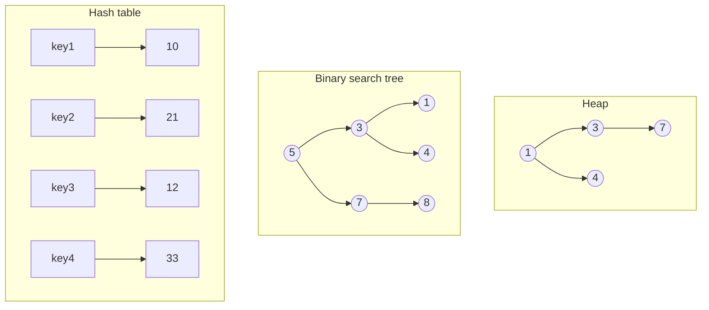
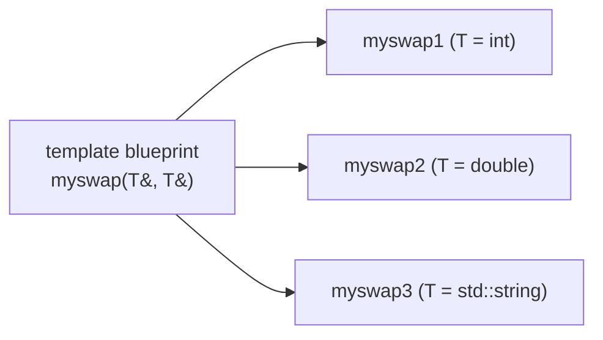
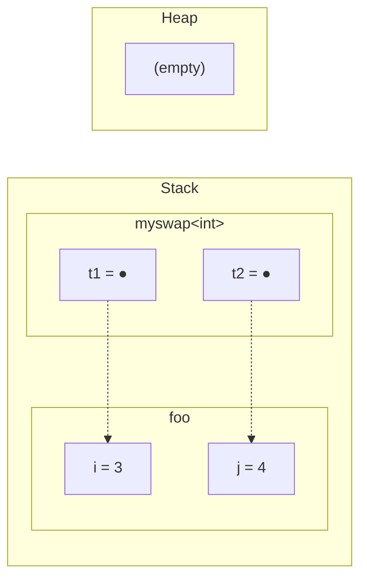
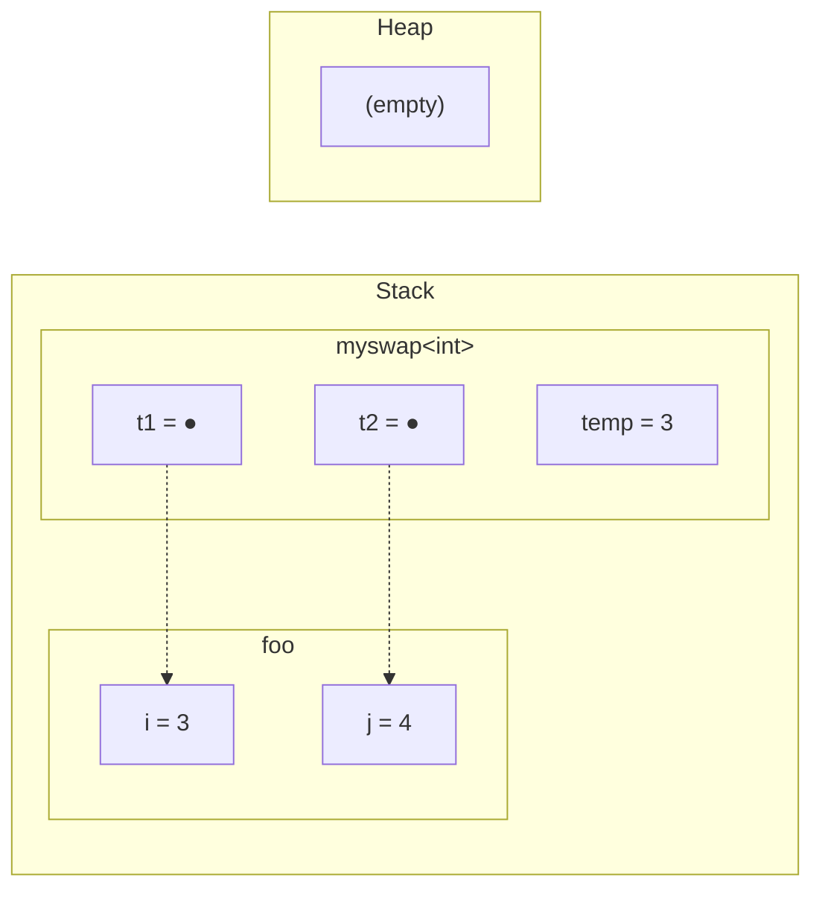
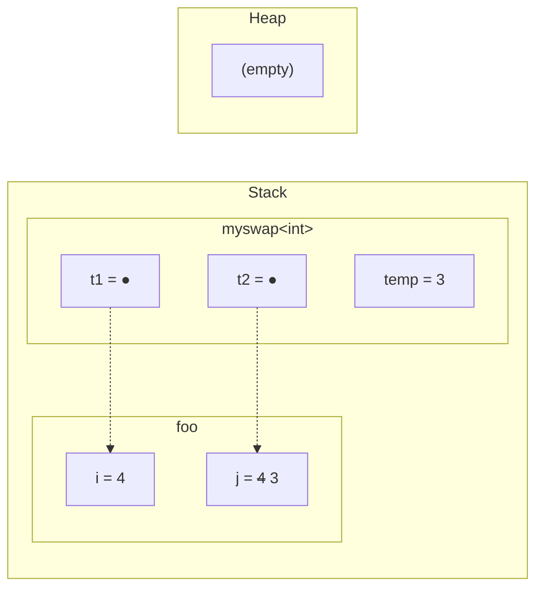

# Information and Computer Science 46 — Lecture 0：课程介绍、单元测试、模板

## 目录

- [1. ICS 46 课程简介](#1-ics-46-课程简介)
- [2. 用 Google Test 编写 C++ 单元测试](#2-用-google-test-编写-c-单元测试)
- [3. 为什么需要模板（Templates）](#3-为什么需要模板templates)
- [4. 编写函数模板（Function Templates）](#4-编写函数模板function-templates)
- [5. 函数模板的实例化（编译期进行）](#5-函数模板的实例化编译期进行)
- [6. 模板代码放在哪里（.hpp 与 .tpp）](#6-模板代码放在哪里hpp-与-tpp)
- [7. 类型参数的隐含约束](#7-类型参数的隐含约束)
- [8. 类模板（Class Templates）](#8-类模板class-templates)
- [9. 类模板示例：Box](#9-类模板示例box)
- [10. 完整实现](#10-完整实现)
- [11. 课堂活动（附解答）](#11-课堂活动附解答)
- [12. 速查 & 必记 5 点](#12-速查--必记-5-点)

> UCI ICS 46：数据结构的实现与分析 — Prof. Tom Yeh，2026 年秋季，09/24/26（Week 0，周四）
> 基于 Week 0 讲义（标题页写的是 “Lecture 1: Templates, Randomness”，随机性部分在下一份讲义中），并参考 Thornton 的 ICS 46 笔记（Templates、Course Introduction、Contracts and Exceptions）、Thornton 的 ICS 45C Unit Testing 笔记，以及 Google Test 1.10.0 Primer 作为补充。按概念而非来源组织。

> 📅 **课程安排**：第 0 周没有答疑时间和讨论课。Lab 0（环境配置）与 Lab 1（测试编译的小程序）本周发布。
> ICS 46 Gen AI 预调查：**额外学分 0.5%**，周日截止。
> 每周节奏：讲课在周二/周四；课堂小组活动在讲课后一天截止（周二的周三截止，周四的周五截止）；HW 周五截止；Lab 周一截止；测验在周五讨论课进行（比课堂上更有时间）。
> Prof. Yeh 的答疑（OH）：下课后 5–6 pm，ICS1 195（从第 1 周开始）。TA/LA 答疑时间待定——见 OH 日程表。
> 成绩：考试 50%（期中 20% + 期末 30%），测验 15%（5 次，去掉最低分），实验 15%（去掉最低分），作业 10%（去掉最低分），课堂活动 10%（去掉最低分）；额外学分 = 调查问卷，其他待定。
> 重要日期（日程表，可能变动）：期中 11/12，11/26 无课（感恩节），期末 12/8 4:00–6:00 pm。
> 资料位置：Canvas（课程网页）；Google Drive 课程文件夹（教学大纲、日程、讲义、实验、OH 日程——需要 UCI 账号）；Ed Discussion 用于所有课程问题（若含代码/解答则发私密帖）；邮件仅用于特殊情况；ICS 导师（Zotpass 应用）；iGP AI 助手（由 Yeh 教授的研究组开发，由 ICS 导师项目资助）。
> 参考资料：Sedgewick & Wayne，*Algorithms* 第 4 版（选读，强烈推荐）；zyBooks *Data Structures in C++*（Yeh 可提供代码）；Thornton 的 2022 年 ICS 45C 与 ICS 46 笔记；VisuAlgo。
> 编程环境（VS Code、OpenLab JupyterHub）在 [Lecture 1 笔记](?kind=course_notes&course=ICS-46&lang=zh-CN&note=ICS46_Lec01_Notes_zh-CN.md) 中介绍。

---

## 1. ICS 46 课程简介

### 1.1 从 ICS 45C 到 ICS 46

幻灯片 8 将两门课并排放在一起：ICS 45C 关于 **C++ 语言本身**；ICS 46 则把 C++ 当作工具，研究 **数据结构**——数组、树、图。大家默认已经会 C++（幻灯片 22 把今天的 C++ 部分称为 “复习”），本讲唯一“新”的 C++ 内容是模板，因为本学期你们要写的每一种数据结构都是模板。

课程有三大支柱（幻灯片 9）：

| 支柱 | 含义 |
|---|---|
| **数据结构** | 如何根据**问题需要**在计算机中**组织数据**；探索**常见抽象**（列表、栈、队列、树、映射、图） |
| **分析** | 面向效率的算法分析；根据应用的**时间与内存**需求选择合适的数据结构 |
| **实现** | 用 C++ 编写高效的数据结构与算法；善用递归 |

> 💡 **关键见解**：“哪种数据结构？”从来不是凭感觉决定的。它取决于测量问题所需的操作（时间），以及你能负担多少存储（内存）。这正是分析支柱要训练的能力。

> 📘 **讲义之外**：Thornton 的课程介绍更尖锐地表达了同一点——你要在速度、内存、功耗或并行化程度之间权衡，而且应当能够**量化**这种权衡，而不是凭感觉决定。他还列出了 45C 的毕业生应当已经掌握的内容：内置类型、控制流、头文件/源文件与分别编译、指针/引用、栈与堆、`const`、数组与 `std::vector`、迭代器、标准算法、类/继承/虚函数，以及让类表现良好（构造函数、析构函数、拷贝构造函数）。模板、契约/不变式、异常/RAII 被假定只是*轻度*涉及——这也是为什么模板要在这里重新讲。

### 1.2 数据结构的简史（简略且不完整）

幻灯片 10 是一条时间线。它的要点是：本课程的大多数结构与算法都很古老（二战后出现，1960–70 年代达到高峰），我们学习的是经典。

| 年份（约） | 事件 |
|---|---|
| 1945 | 计算机实现数组；归并排序由 John von Neumann 发明 |
| 1946 | 栈操作（Alan M. Turing） |
| 约 1950–54 | 更多数组排序研究 |
| 约 1953–55 | 哈希表（IBM）；链表（Rand Corporation） |
| 约 1957 | 数组排序算法发表 |
| 1960 | 二叉搜索树 |
| 约 1962 | “冒泡排序”成为主流 |
| 1964 | 堆排序 |
| 1976 | 图问题的计算机辅助证明（四色定理） |

（幻灯片的坐标轴上只标注了 1946、1955、1960、1964 和 1976；其余位置是根据刻度线的位置读出的。）

### 1.3 在 AI 时代，数据结构为什么仍然重要

幻灯片 11：数学使 AI 模型成为可能，但**数据结构决定了什么是可能的、运行多快、成本多高**。幻灯片列出了五种结构，并标出它们在机器学习流程中的位置：

| 数据结构 | 机器学习流程阶段（幻灯片 11） |
|---|---|
| 数组 | 数据存储 |
| 堆 | 特征提取 |
| 哈希表 | 训练 |
| 二叉搜索树 | 训练 |
| 图 | 基于网络的建模 |

幻灯片 11 的图中给出了每种结构的一个小例子：数组 `3 1 4 1 4 5`（下标位于单元格下方）位于部分填充数组 `11 10 21 12 _ _` 之上；一个最小堆，根为 1，3 和 4 为子节点，7 在 3 之下；一个哈希表，将 key1→10、key2→21、key3→12、key4→33；一棵二叉搜索树，根为 5，子节点 3 和 7，叶子 1、4 和 8；以及一个小型无向图。重绘如下：



你们本学期会实现以上每一种结构。

### 1.4 业界看重什么：批判性思维

幻灯片 12 列出了业界想要的技能，这些恰恰是无法交给 AI 工具代劳的：

- **问题表述**——从一段开放式描述中界定问题。
- **分解**——把复杂问题拆分为逻辑上的各个部分。
- **测试与验证**——了解边界情况（这正是 [单元测试](#2-用-google-test-编写-c-单元测试) 出场的地方）。

共同的主题是**批判性思维**：不要停留在被动执行上——避免“肉身代理”陷阱（即充当人类中继，把提示粘贴进去、再把答案粘贴出来）——而是在表述、分解和验证上主动投入认知。

### 1.5 主题概览

幻灯片 14（第 15 张幻灯片给出了按周排列的课程安排）：

| 主题 | 数据结构 / 算法 |
|---|---|
| 基础 | C++、OOP、算法分析 |
| 基本数据结构 | 数组、ArrayList、链表、栈、队列 |
| 排序 | 选择排序、插入排序、快速排序、归并排序、堆排序、堆、优先队列 |
| 查找 | 二叉搜索树、平衡树、哈希表 |
| 图 | BFS、DFS、Prim、Kruskal、Dijkstra |

---

## 2. 用 Google Test 编写 C++ 单元测试

幻灯片 23 很简短：本课程使用 **Google Test**，并指向 **Google Test 1.10.0 Primer** 以及 ICS 45C 中 Thornton 的 **Unit Testing** 笔记。本课程的实验都用这种方式测试，而幻灯片 12 中的“测试与验证”技能正是学习它的原因。以下是这两份阅读材料的压缩要点。

### 2.1 什么是单元测试

**单元测试**在**隔离**于程序其余部分的情况下，检查程序中的一小块——一个类、一个函数。数据结构是典型例子：`ArrayList` 有一些行为（在前端插入、满时扩容、删除最后一个元素），你的应用可能从未以明显、可重复的方式触发它们，但你仍然需要确保它们正确。

每个测试都有相同的形式：**设置场景 → 运行 → 将结果与预期比较 → 报告**。**单元测试框架**负责那些枯燥的部分：它自动找到所有测试（无需在 `main` 中添加调用），独立运行每个测试，并报告哪些失败、给出预期值与实际值以及行号。C++ 标准库没有自带的框架（Python 有 `unittest`，C++ 没有），所以我们使用 Google 的开源 **Google Test**（又名 googletest/gtest）。

### 2.2 编写测试

```cpp
TEST(TestSuiteName, testName)
{
    // set up, run, check
}
```

`TEST` 是一个宏（它展开为一个函数加上注册代码）。它没有返回类型；括号中的两个名字分别是**测试套件**（一组相关测试）和**测试自身的名字**。Google Test 会自动注册每个 `TEST`，并通过 `RUN_ALL_TESTS()` 运行它们全部；链接 `gtest_main` 即可获得一个现成的 `main` 来完成这一步。

在测试中，你用断言检查结果。断言成对出现：

| 致命断言（`ASSERT_*`） | 非致命断言（`EXPECT_*`） | 通过条件 |
|---|---|---|
| `ASSERT_TRUE(c)` | `EXPECT_TRUE(c)` | `c` 为真 |
| `ASSERT_FALSE(c)` | `EXPECT_FALSE(c)` | `c` 为假 |
| `ASSERT_EQ(a, b)` | `EXPECT_EQ(a, b)` | `a == b` |
| `ASSERT_NE(a, b)` | `EXPECT_NE(a, b)` | `a != b` |
| `ASSERT_LT/LE/GT/GE(a, b)` | `EXPECT_LT/LE/GT/GE(a, b)` | `a < b`、`a <= b`、`a > b`、`a >= b` |
| `ASSERT_STREQ(s1, s2)` | `EXPECT_STREQ(s1, s2)` | 两个 **C 字符串** 内容相同 |

- **`ASSERT_*`** 会使测试失败并**立即停止**。当继续执行没有意义时使用它（例如下一行会解引用你刚断言为非空的指针）。
- **`EXPECT_*`** 会使测试失败但**继续执行**，因此一次运行可以报告多个错误的期望。Primer 默认更偏向 `EXPECT_*`。
- 你可以附加一条消息：`EXPECT_EQ(x[i], y[i]) << "differ at index " << i;`

这里是针对本讲模板的一个小测试套件（`myMin` 来自 [活动 1](#111-活动-1函数模板幻灯片-31-32)，`Pair` 来自 [活动 2](#112-活动-2类模板幻灯片-38-39)；代码见 [§10](#10-完整实现)）：

```cpp
#include <gtest/gtest.h>
#include <string>
#include "templates.hpp"

TEST(MyMinTests, returnsSmallerInt)
{
    EXPECT_EQ(3, myMin(3, 5));
    EXPECT_EQ(-2, myMin(7, -2));
}

TEST(MyMinTests, comparesStringsAlphabetically)
{
    EXPECT_EQ("apple", myMin(std::string("apple"), std::string("banana")));
}

TEST(PairTests, containTheValuesGivenWhenConstructed)
{
    Pair<int> p{4, 6};
    EXPECT_EQ(4, p.first());
    EXPECT_EQ(6, p.second());
}

TEST(PairTests, setSecondReplacesOnlyTheSecondValue)
{
    Pair<std::string> p{"Zot", "Zot"};
    p.setSecond("Anteater");
    EXPECT_EQ("Zot", p.first());
    EXPECT_EQ("Anteater", p.second());
}
```

使用 `g++ -std=c++17 -Wall pair_tests.cpp -lgtest -lgtest_main -pthread` 编译并运行：

```text
Running main() from ./googletest/src/gtest_main.cc
[==========] Running 4 tests from 2 test suites.
[----------] Global test environment set-up.
[----------] 2 tests from MyMinTests
[ RUN      ] MyMinTests.returnsSmallerInt
[       OK ] MyMinTests.returnsSmallerInt (0 ms)
[ RUN      ] MyMinTests.comparesStringsAlphabetically
[       OK ] MyMinTests.comparesStringsAlphabetically (0 ms)
[----------] 2 tests from MyMinTests (0 ms total)

[----------] 2 tests from PairTests
[ RUN      ] PairTests.containTheValuesGivenWhenConstructed
[       OK ] PairTests.containTheValuesGivenWhenConstructed (0 ms)
[ RUN      ] PairTests.setSecondReplacesOnlyTheSecondValue
[       OK ] PairTests.setSecondReplacesOnlyTheSecondValue (0 ms)
[----------] 2 tests from PairTests (0 ms total)

[----------] Global test environment tear-down
[==========] 4 tests from 2 test suites ran. (0 ms total)
[  PASSED  ] 4 tests.
```

### 2.3 好测试的特征

- **每个测试只测一种行为，而不是每个函数一个测试。** 你不能单独测试 `first()`——你要测试的是“用 (4, 6) 构造之后，`first()` 返回 4”。行为是*一串调用加上一个已知结果*。如果你想检查三种行为，就写三个测试，这样失败时你就能确切知道是哪种场景出错。
- **以行为命名测试**（`setSecondReplacesOnlyTheSecondValue`）。报告会打印失败测试的名字，因此好的名字往往在你打开代码之前就能告诉你 bug 在哪里。
- **测试之间相互独立。** 没有保证的执行顺序；永远不要依赖另一个测试先运行过。
- **让测试数据有所变化。** Thornton 特意在每个测试中使用不同的常量，这样测试就不会因为某个恰好可行的值而意外通过。
- **边界情况**（空结构、只有一个元素、数组已满、前端与后端）是数据结构 bug 的藏身之处。

> ⚠️ **陷阱**：对两个 `const char*` 使用 `EXPECT_EQ` 比较的是**指针**，而不是文本。比较 C 字符串请使用 `EXPECT_STREQ`，或者用 `EXPECT_EQ` 比较 `std::string`（如上，`"apple"` 与 `std::string` 比较，因此使用的是 `std::string` 的 `==`）。对于浮点数，请使用浮点版本（例如 `EXPECT_DOUBLE_EQ`），以避免舍入导致的失败。

> ⚠️ **陷阱**：Thornton 的 45C 笔记写的是 `ASSERT_EQ(expected, actual)`，即期望值在前，这样失败报告读起来才正确。1.10 版 Primer 指出，自 2016 年起 `*_EQ` 对两个参数的处理方式相同；两种顺序都可以，但要保持一致。（此处的示例使用期望值在前的写法。）

> 📘 **讲义之外**：术语方面——Google Test 称为**测试套件**的东西（`TEST` 的第一个参数），在旧版本中叫做 "test case"；Thornton 的 45C 笔记使用的是旧名称。测试名称中不应包含下划线。当许多测试需要相同的设置时，可以使用**测试夹具**（继承自 `::testing::Test` 的类，配合 `TEST_F` 而不是 `TEST` 使用），它通过 `SetUp()`/`TearDown()` 为每个测试构建全新的对象。如果你自己编写 `main`，请调用 `::testing::InitGoogleTest(&argc, argv)`，然后 `return RUN_ALL_TESTS();`。

---

## 3. 为什么需要模板（Templates）

C++ 拥有**静态类型系统**：每个变量的类型在编译期就已固定。因此，一个交换两个 `int` 的函数无法交换两个 `double`，要处理不同的参数类型，你最终会写出几乎相同的多个版本（幻灯片 25）：

```cpp
void myswap(int& a, int& b) noexcept
{
    int temp = a;
    a = b;
    b = temp;
}
```

```cpp
void myswap(double& a, double& b) noexcept
{
    double temp = a;
    a = b;
    b = temp;
}
```

由于 C++ 允许**重载**（同名、参数类型不同），两者可以共存，而且每种类型都可以再写一百个。但除了类型名之外，函数体完全相同。这样复制粘贴意味着每次修 bug 都得改 N 遍。

**模板**解决了这个问题。它是**无限多种可能性的蓝图**：你只需编写一次代码，并说明*各个实例彼此之间有何不同*（这里只是类型）。编译器会在需要时生成每个具体版本。幻灯片 25 的图是一张蓝图，箭头指向 `myswap1`、`myswap2`、`myswap3`：



主要有两种：
1. **函数模板**——函数的蓝图（§4–§7）。
2. **类模板**——类的蓝图（§8–§9）。数据结构是它们最主要的用途。

> 💡 **关键见解**：模板既不是函数也不是类。它是编译器用来*生成*函数/类的配方，每组模板实参生成一个。

---

## 4. 编写函数模板（Function Templates）

### 4.1 语法

幻灯片 27 给出四个步骤：

1. 以 **`template`** 关键字开始。
2. 将模板参数放在 **`< >`** 中。
3. 写 **`typename`**，后面跟类型参数的名字（按惯例为 `T`）。
4. 像往常一样编写函数定义，在类型会变化的地方使用 `T`。

```cpp
template <typename T>
void myswap(T& t1, T& t2)
{
    T temp = t1;
    t1 = t2;
    t2 = temp;
}
```

- 这是任意数量 `myswap` 函数的**蓝图**。
- 关键字 **`typename`** 表明这个参数是一个**类型占位符**（而不是例如 `int` 常量）。
- **`T`** 为该类型命名；实例化时，每个 `T` 都会被替换为**实际类型**。

### 4.2 模板参数的种类

幻灯片 27 的“Parameter Types”框：

| 种类 | 示例 | 含义 |
|---|---|---|
| **类型参数** | `typename T`、`class T` | 代表一个类型；实参是诸如 `int` 或 `std::string` 的类型 |
| **非类型参数** | 常量、指针、引用 | 代表一个编译期*值*，例如 `template <typename T, int N>` |
| **模板模板参数** | — | 本身就是模板的参数（例如“某个容器模板”） |

`< >` 内的 `typename T` 与 `class T` 含义完全相同（这里的 `class` 并不要求 T 必须是类；`int` 也可以）。幻灯片还把 `std::string` 列在类型参数下——应将其理解为一个你会*作为实参传入*的类型示例（`T = std::string`），而不是你在参数列表中要写的东西。

非类型参数的例子（我自己写的，已编译）：

```cpp
template <typename T, int N>
T sumFirst(const std::vector<T>& v) {
    T total{};
    for (int i = 0; i < N && i < static_cast<int>(v.size()); ++i) total += v[i];
    return total;
}
// sumFirst<int, 3>(std::vector<int>{1, 2, 3, 4, 5}) == 6
```

`N` 必须在编译期已知；`sumFirst<int, 3>` 与 `sumFirst<int, 4>` 是两个不同的生成函数。

### 4.3 为什么模板去掉了 `noexcept`

注意幻灯片 25 中 `int` 与 `double` 的版本都是 `noexcept`，而模板版本不是。这是有意为之（Thornton 的说法）：交换 `int` 绝不会抛出异常，但交换 `std::string` 会复制字符串，而复制字符串可能分配内存，进而抛出异常。单个模板无法对每个 `T` 都承诺“永不抛出”。

> 📘 **讲义之外**：`noexcept` 是一种承诺，而非检查——如果一个 `noexcept` 函数真的抛出异常，程序会调用 `std::terminate()`。模板可以让这个承诺**依赖于** `T`：`noexcept(expr)` 中的 `expr` 是编译期 `bool`。内层的 `noexcept(...)` *运算符* 用于询问“这个表达式是否被声明为不抛出异常”，而无需真正执行它：
>
> ```cpp
> template <typename T>
> void myswap(T& t1, T& t2)
>     noexcept(noexcept(T{t1}) && noexcept(t1 = t2))
> ```
>
> 或者，更易读的写法（需要 `#include <type_traits>`）：
>
> ```cpp
> template <typename T>
> void myswap(T& t1, T& t2)
>     noexcept(std::is_nothrow_copy_constructible_v<T> &&
>              std::is_nothrow_copy_assignable_v<T>)
> ```
>
> 编译检查：`noexcept(myswap(i, j))` 对 `int` 为 `true`，对 `std::string` 为 `false`。（Thornton 的页面写的是 `std::is_nothrow_assignable_v<T>`，只带一个参数；但该 trait 实际上接受两个类型，所以应使用 `is_nothrow_copy_assignable_v<T>`。）像标准容器这样的库代码会关心这一点，因为当编译器知道移动/拷贝不会抛出异常时，某些操作会更快。

---

## 5. 函数模板的实例化（编译期进行）

函数模板在被**使用**之前不会生成任何东西。幻灯片 28 分三步讲解编译器遇到调用时做了什么：

| 步骤 | 名称 | 编译器所做的事 |
|---|---|---|
| 1 | **遇到调用** | 在模板调用处，检查它是否识别该函数模板。 |
| 2 | **类型推导** | 尝试根据实参类型自动推导出模板参数类型。 |
| 3 | **实例化** | 为推导出的类型生成一个实际的具体函数定义。 |

幻灯片 28 的三个面板，以代码形式呈现：

**1. 调用位置（`foo`）**
```cpp
void foo()
{
    int i = 3;
    int j = 4;
    myswap(i, j);
}
```

**2. 模板（`myswap`）**
```cpp
template <typename T>
void myswap(T& t1, T& t2)
{
    T temp = t1;
    t1 = t2;
    t2 = temp;
}
```

**3. 实例化后（`int`）** — 编译器为 T = `int` 生成的代码：
```cpp
void myswap(int& t1, int& t2)
{
    int temp = t1;
    t1 = t2;
    t2 = temp;
}
```

两个实参都是 `int`，所以 `T&` 必须是 `int&`，因此 T = `int`。生成的函数是程序中一个真实的函数，名为 `myswap<int>`。之后用两个 `double` 调用 `myswap` 会生成第二个函数 `myswap<double>`；再次用 `int` 调用则复用 `myswap<int>`。

下面是该调用在内存中的过程（Python Tutor 风格）。`t1` 与 `t2` 是引用——虚线箭头——因此通过它们的写入会落在 `foo` 的变量上：

**内存追踪：`myswap<int>(i, j)`**（4 步）

**第 1/4 步：** `myswap(i, j);  // enter myswap<int>` — t1 和 t2 是引用：foo 中 i 和 j 的别名，而不是副本



**第 2/4 步：** `T temp = t1;` — 拷贝构造：temp 是一个用 i 初始化的新 int



**第 3/4 步：** `t1 = t2;` — 通过别名进行拷贝赋值，写入了 foo 的 i


**第 4/4 步：** `t2 = temp;` — 拷贝赋值写入 foo 的 j；myswap 返回时 temp 被销毁



该追踪对 `T` 执行的三种操作——拷贝构造 `temp`、拷贝赋值两次、销毁 `temp`——正是 [§7](#7-类型参数的隐含约束) 中的要求。

### 5.1 推导失败的情况

第 2 步**在编译器无法确定地推断出精确类型时失败**——例如实参之间存在**冲突**，或者**完全没有提示**。混用类型（使用 g++ 13 编译）：

```cpp
int i = 3; double d = 4.0;
myswap(i, d);
```

```text
error: no matching function for call to 'myswap(int&, double&)'
note:   deduced conflicting types for parameter 'T' ('int' and 'double')
```

从第一个实参看 T 会是 `int`，从第二个看会是 `double`；编译器不会选择其中之一。（对于 `myswap` 没有修复办法——你不能把 `int&` 绑定到 `double` 上。对于像 `myMin` 那样按值或 `const T&` 传参的函数，你可以自己指定类型，见下文。）

你总是可以**显式**给出模板实参：

```cpp
myswap<int>(i, j);   // 合法，但在这里没有必要——推导已经得到 int
```

当没有可供推导的信息时（例如 T 只出现在返回类型中），必须显式给出实参；当存在可以转换的情况时，显式实参也能消除冲突：`myMin<double>(3, 4.5)` 可以编译，并返回 3（int 3 被转换为 double）。

> ⚠️ **陷阱**：推导**不会**进行通常的转换。`myMin(3, 4.5)` 是编译错误，即使 `int` → `double` 是一种普通转换；`myMin<double>(3, 4.5)` 则没有问题。

> 📘 **讲义之外**：如果两个 `.cpp` 文件都调用了 `myswap<int>`，每个文件都会生成自己的一份 `myswap<int>`。通常同一函数的两个定义会导致链接错误，但链接器被要求接受重复的模板实例化，并只保留一份。这正是 §6 中“把它放进头文件”这一规则能够生效的原因。

---

## 6. 模板代码放在哪里（.hpp 与 .tpp）

幻灯片 29 的**实例化要求**：**完整的模板定义**（包括函数体，而不仅仅是声明）必须**在每个使用处可见**，这样编译器才能在该处生成特化的函数。因此模板代码要放在头文件中。有两种做法：

### 6.1 方案 1——单一头文件（.hpp）

在 `.hpp` 中同时包含声明与定义。最适合较小的工具和简单的模板。

```cpp
// myswap.hpp
#pragma once
#include <utility>

// 1. 声明与定义合并在一起
template <typename T>
void myswap(T& a, T& b) {
  T temp = std::move(a);
  a = std::move(b);
  b = std::move(temp);
}
```

### 6.2 方案 2——拆分的头文件与实现（.hpp + .tpp）

- **清晰分离**：接口放在 `.hpp` 中，实现放在 `.tpp` 中。
- **“隐藏包含”（Secret include）**：`.hpp` 在**底部** `#include` `.tpp`，因此任何包含该头文件的人都能获得完整的定义。

```cpp
// myswap.hpp（头文件与接口）
#pragma once
// 1. 先只让声明可见
template <typename T>
void myswap(T& a, T& b);
// 2. 在底部包含实现
#include "myswap.tpp"
```

```cpp
// myswap.tpp（模板实现）
#include <utility>
template <typename T>
void myswap(T& a, T& b) {
  T temp = std::move(a);
  a = std::move(b);
  b = std::move(temp);
}
```

`.tpp` **不**单独编译，也不能列为源文件；它本质上是一个伪装的头文件。（`.tpp` 只是命名惯例；编译器并不在意扩展名。）经测试：`#include "myswap.hpp"` 后，用 `int` 调用 `myswap(i, j)`、使用 `myswap<double>` 以及 `std::string`，输出分别为 `4 3`、`2.5 1.5`、`banana apple`。

这个版本使用 **`std::move`**（来自 `<utility>`）而不是拷贝：它让 `T` 可以*移动*其内容（例如偷走字符串的缓冲区），而不是复制，对大对象来说开销更小。对 `int` 而言没有区别。移动语义会在 [Lecture 2](?kind=course_notes&course=ICS-46&lang=zh-CN&note=ICS46_Lec02_Notes_zh-CN.md) 中随智能指针再次出现。

> ⚠️ **陷阱**：45C 中“声明放 `.hpp`、定义放 `.cpp`”的习惯**对模板不适用**。只看到声明的 `.cpp` 可以正常编译，并假定 `myswap<int>` 在别处有定义，于是你会遇到*未定义引用*的**链接错误**，因为包含函数体的那个 `.cpp` 从未见过用 `int` 的调用，因此从未生成它。

---

## 7. 类型参数的隐含约束

`T` 能是任何东西吗？幻灯片 30 的回答：

- **T 必须是具体类型**——基本类型（`int`）或**完整指定的模板类型**，例如 `std::vector<int>`（而不是裸的 `std::vector`；后者是模板，不是类型）。
- **T 受到隐含限制**，这些限制取决于在模板内部执行的**操作**。`template <typename T>` 中没有任何地方写明“T 必须可拷贝”；这一要求写在函数体里。

**`myswap` 所需的操作**（幻灯片 30）：

| # | 操作 | 在 `myswap` 中的位置 |
|---|---|---|
| 1 | **拷贝构造函数** | `T temp = t1;` |
| 2 | **拷贝赋值运算符** | `t1 = t2;` 与 `t2 = temp;` |
| 3 | **析构函数** | `temp` 是局部（栈上，“静态分配”）变量，因此函数结束时其析构函数会自动运行 |

**约束失败**：缺少这三者中任何一项的类型都不能用于 `myswap`。Thornton 的例子：一个拷贝构造函数与赋值运算符都被删除的类。

```cpp
class X
{
public:
    X();
    X(const X& x) = delete;
    X& operator=(const X& x) = delete;
};

X a, b;
myswap(a, b);   // 编译错误
```

g++ 13（使用 `myswap` 的 `.tpp` 版本）：

```text
myswap.tpp:5:5: error: use of deleted function 'X::X(const X&)'
myswap.tpp:6:5: error: use of deleted function 'X& X::operator=(const X&)'
```

注意错误是在**哪里**报告的：在模板的函数体内部、需要那个缺失操作的那一行，而不是在你的调用处。这很典型——模板错误会指向模板内部，你需要从那里反推到你传入的类型。

> ⚠️ **陷阱**：幻灯片 30（以及 Thornton 的笔记）中的“Statically allocated”指的是**自动存储期——栈上的局部变量**，而不是 `static` 变量。它与使用 `new` 的堆分配恰好相反。

> 💡 **关键见解**：要找出模板对 `T` 的要求，请阅读它的函数体，并列出它对 `T` 做的每一项操作：构造（怎样构造？）、拷贝、赋值、比较（`<`、`==`）、调用成员、销毁。每一项都是一条要求。两个课堂活动都是这样解答的。

> 📘 **讲义之外**：这些要求是模板**契约**的一部分——类似函数的前置条件，只不过由编译器在实例化时检查。Thornton 的 Contracts 笔记更一般地涵盖了前置条件、后置条件、副作用以及类不变式。（C++20 加入了 *concepts* 来显式地书写这类要求；本课程使用的是 C++17 风格的隐含约束。）

> 📝 **练习**：[活动 1](#111-活动-1函数模板幻灯片-31-32)——编写 `myMin` 并找出它的约束。

---

## 8. 类模板（Class Templates）

**数据结构的实现是类模板的主要用途**（幻灯片 34）。一个链表无论存放的是 `int` 还是 `std::string`，工作方式都相同；只有元素类型会改变。规则与前面相同：

- 以 **`template`** 关键字开始。
- 模板参数放在**尖括号 `< >` 中，以逗号分隔**。
- 下面的 **`ElementType`** 是占位符，表示某个特定 `Vector` 中存储的元素类型。

```cpp
template <typename ElementType>
class Vector
{
    ...
};
```

在类的内部，凡是你想表示“这个 Vector 中元素的类型”的地方，都写 `ElementType`。幻灯片 34 的图：一张蓝图 → `Vector1`、`Vector2`、`Vector3`。

### 8.1 类模板的实例化

幻灯片 35 的标准库例子就是 `std::vector` 本身：

| 代码 | 含义 |
|---|---|
| `std::vector<T>` | 模板类（蓝图） |
| `std::vector<std::string>` | 创建一个字符串向量 |
| `std::vector<int>` | 创建一个整数向量 |

实例化过程与函数模板类似：

1. **编译器验证**——在创建或使用时，编译器检查它是否识别该模板。
2. **类型推导**——通常需要**显式**的类型参数（例如 `<int>`）。与 `myswap(i, j)` 不同，`std::vector v;` 没有给编译器任何可供推导的信息。
3. **模板实例化与定义**——必须能获得完整的模板定义，才能生成代码。
4. **头文件实现**——因此类模板要放在 `.hpp` 或 `.hpp` + `.tpp` 文件中，与 [§6](#6-模板代码放在哪里hpp-与-tpp) 中完全相同。

> 📘 **讲义之外**：自 C++17 起，编译器*可以*从构造函数调用中推导类模板实参：`Box b{42};` 会得到一个 `Box<int>`（类模板实参推导，即 “CTAD”——已编译并检查过）。Yeh 教授所说的“通常需要显式类型参数”仍是更安全的习惯；如果没有构造函数实参，或为了清晰起见，就把类型写出来。

### 8.2 每个实例都是独立且无关的类型

`std::vector<int>` 与 `std::vector<std::string>` 包含的是同一份代码，只是插入了不同的类型，但对编译器来说它们是**完全不同的类**：彼此没有继承关系，不能相互转换，也不能相互赋值。你不能把 `vector<std::string>` 传给一个期望 `vector<int>` 的函数。下面是用 §9 的 `Box` 做的编译检查：

```cpp
Box<int> b{42};
Box<double> d{2.5};
d = b;   // 错误：没有匹配的 'operator='（操作数类型为 'Box<double>' 与 'Box<int>'）
```

……即使 `int` 可以转换为 `double`。

> ⚠️ **陷阱**：在类模板内部你可以只写 `Vector`（它表示“这个实例化”），但在外部你必须始终写出实参：`Vector<int>`，永远不要把裸的 `Vector` 当作类型使用。

---

## 9. 类模板示例：Box

幻灯片 36 与 37（内容相同，只是版式重排）使用一个单元素容器：

```cpp
template <typename T>
class Box {
public:
    // 构造函数
    Box(const T& value) : item{value} {}

    // 获取函数
    T getValue() const {
        return item;
    }

    // 设置函数
    void setValue(const T& value) {
        item = value;
    }

private:
    T item;
};
```

**T 可以是什么？**（幻灯片 36/37，“typename 参数类型”）

- **基本类型**：整数类型、浮点类型——`Box<int>`、`Box<double>`。
- **非基本类型**：
  - 用户自定义：类或结构体——`Box<Person>`；
  - 库定义的类型：例如 `std::vector`——`Box<std::vector<int>>`（一个完整指定的 vector 类型，见 §7）。

**编译器对 T 的类型要求**：T 必须是编译器能够正确**拷贝、存储和销毁**的类型：

| 要求 | Box 在何处需要它 |
|---|---|
| **可拷贝构造** | `Box(const T& value)` 中用 `item{value}` 初始化（以及 `getValue()` 按值返回 `T`） |
| **可拷贝赋值** | `setValue` 中的 `item = value;` |
| **可销毁** | `item` 是一个成员；当 `Box` 被销毁时它也被销毁 |

**注意**（幻灯片 37）：`T` 被用来构造其他类型——`const T&` 是“对 const T 的引用”。传递 `const T&` 而不是 `T`，可以避免对可能很大的对象进行一次额外拷贝，同时承诺不修改它。

经测试的用法：

```cpp
Box<int> bi{42};
bi.setValue(7);
Box<std::string> bs{"ICS 46"};
std::cout << bi.getValue() << " " << bs.getValue() << std::endl;   // 7 ICS 46
Box<std::vector<int>> bv{{1, 2, 3}};
std::cout << bv.getValue().size() << std::endl;                    // 3
```

### 9.1 只有你用到的成员函数才会被生成

类模板的成员函数本身只有在**被调用时**才会被实例化（Thornton）。因此，附加在某个成员函数上的要求，只有当你调用那个函数时才会起作用。已检查：一个赋值运算符被删除的类型 `NoAssign`：

```cpp
struct NoAssign { NoAssign(int) {} NoAssign& operator=(const NoAssign&) = delete; };

Box<NoAssign> b{NoAssign{1}};
b.getValue();            // 可以编译：构造函数与 getValue 只需要拷贝构造
b.setValue(NoAssign{2}); // 加入这一行 → 错误：使用了已删除的函数
                         // 'NoAssign& NoAssign::operator=(const NoAssign&)'
```

因此，“可拷贝赋值”实际上是“**如果你调用 `setValue`，则需可拷贝赋值**”。幻灯片的列表是使用整个类所需的全部要求。

> 📘 **讲义之外**：Thornton 对同样推理的表述：如果 `Vector` 的某个成员函数包含
> `ElementType e; e.foo();`
> 那么 `ElementType` 必须 (1) 可默认构造（`e` 无参数构造）、(2) 有析构函数（`e` 是会被销毁的局部变量），并且 (3) 有一个不接受参数的成员函数 `foo`（返回类型任意，因为结果被忽略）。

> 📝 **练习**：[活动 2](#112-活动-2类模板幻灯片-38-39)——编写一个 `Pair` 类模板，并列出它对 `T` 的限制。

---

## 10. 完整实现

把今天的所有内容放在一个头文件中（幻灯片中的 `myMin`、`Box` 和 `Pair`；`myswap` 见 [§6](#6-模板代码放在哪里hpp-与-tpp)），外加一个测试驱动程序。使用 `g++ -std=c++17 -Wall -fsanitize=address,undefined` 编译，无警告。

```cpp
// templates.hpp
#pragma once
#include <string>

template <typename T>
T myMin(const T& a, const T& b) {
    return (a < b) ? a : b;
}

template <typename T>
class Box {
public:
    // 构造函数
    Box(const T& value) : item{value} {}

    // 获取函数
    T getValue() const {
        return item;
    }

    // 设置函数
    void setValue(const T& value) {
        item = value;
    }

private:
    T item;
};

template <typename T>
class Pair {
public:
    Pair(const T& first, const T& second)
        : first_(first), second_(second) {}

    T& first() { return first_; }
    const T& first() const { return first_; }
    T& second() { return second_; }
    const T& second() const { return second_; }

    void setFirst(const T& value) { first_ = value; }
    void setSecond(const T& value) { second_ = value; }

private:
    T first_;
    T second_;
};
```

```cpp
// main.cpp
#include <iostream>
#include <string>
#include <vector>
#include "templates.hpp"

int main() {
    std::cout << myMin(3, 5) << std::endl;
    std::cout << myMin(std::string("apple"), std::string("banana")) << std::endl;
    std::cout << myMin<double>(3, 4.5) << std::endl;   // 显式指定 T 以解决 int/double 冲突

    Box<int> bi{42};
    bi.setValue(7);
    Box<std::string> bs{"ICS 46"};
    std::cout << bi.getValue() << " " << bs.getValue() << std::endl;
    Box<std::vector<int>> bv{{1, 2, 3}};
    std::cout << bv.getValue().size() << std::endl;

    Pair<std::string> p{"Zot", "Zot!"};
    p.first() += "!";                 // 非 const 重载返回 T&
    p.setSecond("Anteater");
    const Pair<std::string>& cp = p;  // const 重载返回 const T&
    std::cout << cp.first() << " " << cp.second() << std::endl;
    return 0;
}
```

输出：

```text
3
apple
3
7 ICS 46
3
Zot! Anteater
```

---

## 11. 课堂活动（附解答）

### 11.1 活动 1：函数模板（幻灯片 31-32）

- 实现一个名为 `myMin` 的函数模板，返回两个输入中较小的那个。
- 输入的类型有什么约束吗？
- 实现一个 main 函数，先用 int 再用字符串测试 `myMin`。

> ✍️ **先自己试一试。** 提示：列出函数体对 `T` 执行的每一项操作，包括 `return`。

**解答**（幻灯片 32 的解答，已编译——输出先为 `3`，然后是 `apple`）：

```cpp
template <typename T>
T myMin(const T& a, const T& b) {
    return (a < b) ? a : b;
}

int main() {
    std::cout << myMin(3, 5) << std::endl;
    std::cout << myMin(std::string("apple"), std::string("banana")) << std::endl;
}
```

（幻灯片省略了 include：你需要 `<iostream>` 和 `<string>`。）

**对 T 的约束**（幻灯片 32）：
- 函数**按值返回**，因此 T 需要一个**拷贝（或移动）构造函数**——结果是从 `a` 或 `b` 复制出来的。
- T 必须支持 **`operator<`**。如果一个结构体没有定义它，g++ 会报告：`no match for 'operator<' (operand types are 'const Point' and 'const Point')`。
- 此外（隐含地）：两个实参必须推导为**同一个** T，并且 T 必须可销毁（返回的临时对象会被销毁）。

为什么要用 `std::string("apple")` 而不直接用 `"apple"`？值得了解的陷阱：
- `myMin("apple", "banana")` 无法编译：字面量分别是 `const char[6]` 与 `const char[7]`，是两种不同的类型 → “deduced conflicting types”。
- 即使是长度相同的字面量，`myMin("abc", "abd")` 也会失败：T = `char[4]`，而函数不能返回数组。
- 对于 `const char*` 变量，它可以编译，但比较的是**地址**，而不是文本——“较小”的指针取决于哪个字符串在内存中位置更低。包装成 `std::string` 后，`<` 才会按字母顺序比较。
- `myMin(3, 4.5)` 会失败（int 与 double）；`myMin<double>(3, 4.5)` 则可以。

↩ 相关概念：[§5.1 推导](#51-推导失败的情况)、[§7 隐含约束](#7-类型参数的隐含约束)。

### 11.2 活动 2：类模板（幻灯片 38-39）

实现一个 `Pair` 类模板，存储两个相同类型 T 的元素。

类型 T 有哪些限制？

> ✍️ **先自己试一试。** 提示：按照 §9 分析 `Box` 的方式来做。

**解答**（幻灯片 39；幻灯片中两行 setter 超出了右边缘，此处补全为 `first_ = value;` / `second_ = value;`，底部的 `};` 被截断）：

```cpp
template <typename T>
class Pair {
public:
    Pair(const T& first, const T& second)
        : first_(first), second_(second) {}

    T& first() { return first_; }
    const T& first() const { return first_; }
    T& second() { return second_; }
    const T& second() const { return second_; }

    void setFirst(const T& value) { first_ = value; }
    void setSecond(const T& value) { second_ = value; }

private:
    T first_;
    T second_;
};
```

为什么每个获取函数要有两个版本？非 `const` 版本返回 `T&`，因此你可以原地修改元素（`p.first() += "!"`）；`const` 版本只能在 `const Pair` 上调用，返回 `const T&`，因此调用者无法修改它。返回引用完全避免了拷贝 T，因此——与 `Box::getValue` 不同——这些获取函数不要求 T 可拷贝。

**T 的限制**（幻灯片 39）：
- ✓ **可拷贝构造**——构造函数所需：`first_(first)`。
- ✓ **可拷贝赋值**——setter `setFirst` 与 `setSecond` 所需。
- ✓ **可销毁**——当 `Pair` 离开作用域时，其 `T` 成员被销毁。

（如 §9.1 所示，只有当你真的调用 setter 时，可拷贝赋值才起作用。）

↩ 相关概念：[§8 类模板](#8-类模板class-templates)、[§9 Box](#9-类模板示例box)。

---

## 12. 速查 & 必记 5 点

| 概念 | 语法 / 规则 |
|---|---|
| 函数模板 | 在普通函数定义之前加 `template <typename T>` |
| 类模板 | 在 `class Vector { ... };` 之前加 `template <typename ElementType>` |
| `< >` 中的 `typename` 与 `class` | 含义相同 |
| 非类型参数 | `template <typename T, int N>` —— N 是编译期常量 |
| 推导 | 函数模板：从实参类型推导；类模板：通常需要显式 `<int>`（C++17 可从构造函数实参推导） |
| 显式实参 | `myswap<int>(i, j)`、`myMin<double>(3, 4.5)` |
| 推导失败 | 类型冲突（`int` 与 `double`）或没有提示 |
| 代码放在哪里 | `.hpp`，或在底部 `#include` `.tpp` 的 `.hpp` —— 绝不要单独放在 `.cpp` 中 |
| myswap 需要 | 拷贝构造函数、拷贝赋值、析构函数 |
| myMin 需要 | `operator<`、拷贝/移动构造函数（按值返回） |
| Box / Pair 需要 | 可拷贝构造、可拷贝赋值、可销毁 |
| 实例化 | `Box<int>` 与 `Box<double>` 是无关、不兼容的类型 |
| Google Test | `TEST(Suite, name) { EXPECT_EQ(expected, actual); }`；`ASSERT_*` 会停止测试，`EXPECT_*` 则继续 |

**必记 5 点**

1. 模板是一张**蓝图**：在编译器针对特定类型实例化之前，什么都不存在；每个实例化都是一个独立的类型/函数。
2. **完整的模板定义必须在使用处可见**，因此它放在头文件中（`.hpp`，或 `.hpp` 加底部 `#include` 的 `.tpp`）；在 `.cpp` 中定义会导致链接错误。
3. 对 `T` 的约束是**隐含的**：阅读函数体，列出对 `T` 的每一项操作（拷贝构造、赋值、`<`、销毁……）——这份清单就是每个“T 有哪些限制？”问题的答案。
4. **类型推导不做任何转换**：`myMin(3, 4.5)` 与 `myMin("apple", "banana")` 会失败；可通过显式的 `<double>` 或 `std::string(...)` 修正。
5. 在 Google Test 中，**每个测试只测一种行为**，以该行为命名；默认使用 `EXPECT_*`，当继续执行没有意义时使用 `ASSERT_*`；比较 C 字符串时用 `STREQ`，而不是 `EQ`。

> ➡️ **接续 [Lecture 1](?kind=course_notes&course=ICS-46&lang=zh-CN&note=ICS46_Lec01_Notes_zh-CN.md)**：随机性（幻灯片 1 标题的后半部分）以及编程环境配置。
