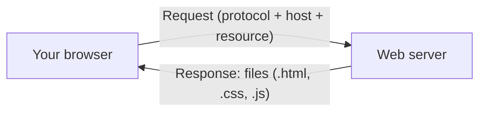
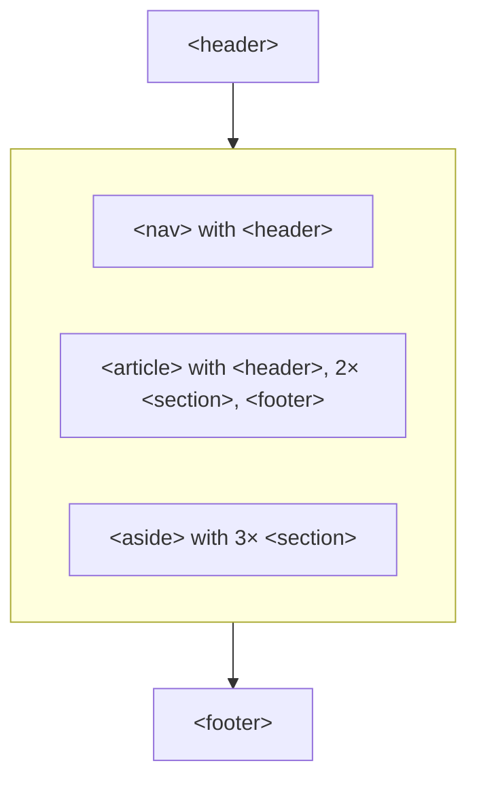

# IN4MATX 133: User Interface Software — Lecture 2: HTML & Accessibility

## Table of Contents

- [1. How the web works](#1-how-the-web-works)
- [2. HTML tags](#2-html-tags)
- [3. Nesting](#3-nesting)
- [4. Attributes](#4-attributes)
- [5. Document structure and validation](#5-document-structure-and-validation)
- [6. Why web accessibility matters](#6-why-web-accessibility-matters)
- [7. Screen readers and semantic elements](#7-screen-readers-and-semantic-elements)
- [8. alt text, aria-label and accessibility validators](#8-alt-text-aria-label-and-accessibility-validators)
- [9. Inclusive design is better for everyone](#9-inclusive-design-is-better-for-everyone)
- [10. In-class Questions & Demos (with Solutions)](#10-in-class-questions--demos-with-solutions)
- [11. Quick Reference & Top 5 Things to Remember](#11-quick-reference--top-5-things-to-remember)

> UCI IN4MATX 133: User Interface Software — Prof. Travis Linden Reid, Fall 2026, Tuesday 9/29
> Built from the Lecture 2 slides (all 57 pages) and the demo repo folder `W1_L1_Sep29`. Organized by concept, not by source.

> 📅 **Class logistics**: Discussion this week is a Git & GitHub demo. Discussion topics and office hours are on the Canvas page "Discussion & Office Hours Updates" (Prof. Reid: Thursdays, in person; Ziqi: sometimes online).
> **Live demos**: starter and solution code for in-class coding is on the Coding Demo repo linked on Canvas; follow along in the Starter file, the Solution file has the answer. ("Live coding is HARD!! … Speak up and correct me when you see mistakes.")
> **A1 — Responsive portfolio in HTML and CSS**: due **11:59pm Wednesday, October 7**. Three requirements: content (basic HTML and CSS, this and next class), responsiveness (next week), validity (well-formed HTML/CSS that passes accessibility guidelines). Open-ended; you may reuse an existing portfolio, but it must be hand-coded (no Squarespace / Google Sites / page builders).
> **Next lecture**: styling pages with CSS ([Lecture 3 notes](?kind=course_notes&course=IN4MATX-133&lang=en-US&note=IN4MATX133_Lec03_Notes_en-US.md)).

---

## 1. How the web works

### 1.1 Client and server

Client-side web development is about the left half of this picture: **your browser** (the client). On the other side sits a **web server** that has the information.

When you type a URL, the browser sends a **request** to the server and gets a **response** back. A URL has three parts the slide labels:

| Part | Meaning | In `https://en.wikipedia.org/wiki/Donald_Bren_School_of_Information_and_Computer_Sciences` |
|---|---|---|
| Protocol | *how* to handle the info | `https` |
| Host | *who* has the info | `en.wikipedia.org` |
| Resource | *what* info you want | `/wiki/Donald_Bren_School_…` |

In words: "Hey Wikipedia, I'd like to see the page for the school of ICS!" The server's response is files out of a folder tree (the slide shows `wiki/donald_bren_school/` with `css/style.css`, `data/index.html`, `js/app.js`). Those files plus a browser (Chrome, Edge, Firefox, Opera, Safari) **equal** the rendered Wikipedia page.



### 1.2 The web sends files around

Fundamentally, the web is designed to send **files** around. A file on the web can be as plain as `test.html` containing one line typed in an editor:

```
Hi IN4MATX 133! This is a file.
```

Opened in Chrome, the same file shows that text. The address bar reads `file:///Users/…/test.html`: the protocol is `file`, the resource is the path, and the **host is implicit, given the protocol** (it's your own disk).

### 1.3 HTML: specifying how content is rendered

What if we want to say *how* the content is rendered? That's **HTML (HyperText Markup Language)**. It:

- **adds meaning to text** (this is a heading, this is a list), and
- **links documents to one another** — the hypertext vision of Vannevar Bush (the Memex, covered in [Lecture 1](?kind=course_notes&course=IN4MATX-133&lang=en-US&note=IN4MATX133_Lec01_Notes_en-US.md)).

Slide 13 spells it "Vanneaver Bush"; the name is **Vannevar** Bush (as on the slide 46 question and in Lecture 1).

## 2. HTML tags

### 2.1 Anatomy of a tag

```html
<div>
Content goes here.
</div>
```

`<div>` is the **open/start tag**, `</div>` the **close/end tag**, and everything between them is the **content**. **Whitespace and tag case are ignored**: the browser collapses runs of spaces and newlines into one space, and `<B>` means the same as `<b>`.

The live demo `tagBasics.html` shows this: three "Hello world!" lines with lots of spaces and blank lines inside `<b>…</b>` render as **one line**, `Hello world! Hello world! Hello world!` in bold, followed by a plain `Hello world!`.

### 2.2 Some common tags

```html
<h1>Heading level 1</h1>
<h2>Heading level 2</h2>
...
<p>A paragraph</p>
<!--A comment-->
 An image
<ul> An unordered list (bullets)
<li> A list item
<table> A data table
<strong> Important content (bolded)
<em> Emphasized content (italicized)
<div> A division (section) of content
```

| Tag | Purpose |
|---|---|
| `<h1>` … `<h6>` | headings, level 1 (most important) down |
| `<p>` | a paragraph |
| `<!-- … -->` | a comment (not shown) |
| `` | an image |
| `<ul>` / `<li>` | an unordered (bulleted) list / a list item |
| `<table>` | a data table |
| `<strong>` | important content (rendered bold) |
| `<em>` | emphasized content (rendered italic) |
| `<div>` | a division (section) of content |

There are **hundreds of tags**. You won't use them all, but explore them: search Google or W3C (the slide shows an HTML5 tag cheat sheet) to understand each tag's purpose.

The demo `tagExamples.html` is the slide's list as a page. Note that its `<li>` items have no `</li>` — the browser closes them for you (more on browser forgiveness in [section 5](#5-document-structure-and-validation)). Step through both demo files below, or edit and press Run:

```viz web-demo
{"title": "Slides 14–15 · tagBasics.html, then tagExamples.html", "html": "<b>\n    Hello world!        Hello world!\n\n\n    Hello world!\n</b>\nHello world!", "js": "const b = document.querySelector('b');\nif (b) console.log(JSON.stringify(b.innerText));", "steps": [{"note": "Swap in tagExamples.html (the image is left out: the demo can't load momo.png).", "html": "<h1>Heading level 1</h1>\n<h2>Heading level 2</h2>\n...\n<p>A paragraph</p>\n<!--A comment-->\n An image\n<ul> An unordered list (bullets)\n    <li> A list item\n    <li> Another list item\n    <li> Yet another list item\n</ul>\n<strong> Important content (bolded) </strong>\n<em> Emphasized content (italicized) </em>", "js": "console.log(document.querySelectorAll('li').length + ' list items');"}], "height": 300, "interactive": true}
```

> 🧪 **Demo files**: [tagBasics.html](https://github.com/travislindenreid/INF33-Demos/blob/main/W1_L1_Sep29/tagBasics.html) · [tagExamples.html](https://github.com/travislindenreid/INF33-Demos/blob/main/W1_L1_Sep29/tagExamples.html)

> 🔗 **Go deeper**: [w3schools: HTML tag reference](https://www.w3schools.com/tags/)

## 3. Nesting

### 3.1 Tags inside tags

The **content** of a tag can contain other HTML tags:

```html
<div><p>I <strong>love</strong> HTML!</p></div>
```

The rule is "last opened, first closed" — like matching brackets in C++ or Go. `<strong>` opened inside `<p>` must close before `</p>`, and `<p>` before `</div>`.

> 📝 **Practice**: [Question 1](#101-question-1-how-would-you-specify-a-div-with-the-p-paragraph-i-love-html-slides-1720) asks which of five strings nests this correctly.

### 3.2 Nested lists: the shopping list demo

Live demo: turn "Professor Reid's vampire birthday party shopping list (real)" into HTML. The starter file `shoppingList_starter.html` is just plain text lines — with no tags, the browser renders it as **one run-on line**. The slide's solution:

```html
<h2>Prof Reid's Vampire Bday Party Shopping List:</h2>
<ul>
  <li>4 cans tomatoes</li>
  <li>2 cans coconut</li>
  <li>64 shrimp</li>
  <li>Black and red fruits:
    <!--Lists can be nested!-->
    <ul>
      <li>Pomegranates</li>
      <li>Blackberries</li>
      <li>Red grapes</li>
    </ul>
  </li>
</ul>
```

It renders as a heading, four bullets, and a second level of hollow-circle bullets under "Black and red fruits".

> ⚠️ **Pitfall**: the repo's `shoppingList_complete.html` closes `<li>Black and red fruits</li>` and then puts the inner `<ul>` *directly* inside the outer `<ul>`. It looks the same in a browser, but a `<ul>` may only contain `<li>` children, so it isn't valid HTML. The slide's version (inner list *inside* the `<li>`) is the correct one.

```viz web-demo
{"title": "Slides 22–23 · shoppingList_starter.html → shoppingList_complete.html", "html": "Prof Reid's Vampire Bday Party Shopping List:\n4 cans tomatoes\n2 cans coconut\n64 shrimp\nBlack and red fruits\nPomegranates\nBlackberries\nRed grapes", "steps": [{"note": "The finished version: an h2 plus a ul whose last items sit in a nested ul.", "html": "<h2>Prof Reid's Vampire Bday Party Shopping List:</h2>\n<ul>\n    <li>4 cans tomatoes</li>\n    <li>2 cans coconut</li>\n    <li>64 shrimp</li>\n    <li>Black and red fruits</li>\n    <ul>\n    <li>Pomegranates</li>\n    <li>Blackberries</li>\n    <li>Red grapes</li>\n    </ul>\n</ul>"}], "height": 240, "interactive": true}
```

> 🧪 **Demo files**: [shoppingList_starter.html](https://github.com/travislindenreid/INF33-Demos/blob/main/W1_L1_Sep29/shoppingList_starter.html) · [shoppingList_complete.html](https://github.com/travislindenreid/INF33-Demos/blob/main/W1_L1_Sep29/shoppingList_complete.html)

### 3.3 The whole document nests inside html

By convention, an HTML document is the **content of an `<html>` element**, and the visible part is the content of `<body>`:

```html
<html>                              <!-- Start of HTML document -->
  <body>                            <!-- Start of body (visible) content -->
    <h1>Hello, IN4MATX 133!</h1>
    <p>HTML is <em>great</em>!</p>
  </body>                           <!-- End of body content -->
</html>                             <!-- End of HTML document -->
```

## 4. Attributes

Attributes **specify options and add meaning**. They go in the start tag as a space-separated list of `name="value"` pairs — kind of like variables, and almost always strings:

```html
<div attributeA="valueA" attributeB="valueB">
Content goes here
</div>
```

The three attributes you'll use constantly (slide 26):

```html
<a href=“https://travislindenreid.github.io/">Prof Reid</a>

<html lang="en">
...
</html>
```

| Code | Meaning |
|---|---|
| `<a href="…">` | **a**nchor (hyperlink); `href` = **h**ypertext **ref**erence, the link target |
| `` | `src` = source file; `alt` = **alt**ernative text for screen readers. `img` has no (text) content, so **no closing tag** |
| `<html lang="en">` | language of the document is English |

> ⚠️ **Pitfall**: slide 26 opens three values with curly quotes (`“`). Those aren't quote characters to HTML — they become part of the value: the browser reads `href` as `“https://travislindenreid.github.io/"` and `alt` as `“Momo"`, so the link and image break. Always type straight quotes `"…"` (watch out when pasting from slides or Word). The same slip is in slide 43's `role=“form"`.

The demo `attributes.html` puts a link and the image of Momo (Prof. Reid's cat) on a page. Its `` has **no `alt`** — the step below adds it. (In the demo the image file can't load, which is exactly when the `alt` text shows.)

```viz web-demo
{"title": "Slides 26–28 · attributes.html (body only)", "html": "<p><a href=\"https://travislindenreid.github.io/\">Prof Reid's Games Portfolio</a></p>\n        <p>", "js": "const a = document.querySelector('a');\nconsole.log('href:', a.getAttribute('href'));\nconst img = document.querySelector('img');\nconsole.log('src:', img.getAttribute('src'), '| alt:', img.getAttribute('alt'));", "height": 140, "interactive": true, "steps": [{"note": "Add the alt attribute from slide 26: the missing image is now announced as \"Momo\".", "html": "<p><a href=\"https://travislindenreid.github.io/\">Prof Reid's Games Portfolio</a></p>\n        <p>"}]}
```

> 🧪 **Demo files**: [attributes.html](https://github.com/travislindenreid/INF33-Demos/blob/main/W1_L1_Sep29/attributes.html) · [momo.png](https://github.com/travislindenreid/INF33-Demos/blob/main/W1_L1_Sep29/momo.png)

## 5. Document structure and validation

### 5.1 The HTML template

Every page should follow this skeleton (slide 27, with the slide's annotations as comments):

```html
<!DOCTYPE html>                               <!-- Document format -->
<html lang="en">                              <!-- Specify language -->
<head>                                        <!-- Document header (content that's not shown) -->
   <meta charset="UTF-8">                     <!-- Character set (for non-latin characters) -->
   <meta name="author" content="your name">   <!-- For search engines -->
   <title>My Webpage</title>                  <!-- Webpage title in tab -->
</head>
<body>                                        <!-- Document body (content that's shown) -->
   <h1>Hello, world!</h1>
   ...
</body>
</html>
```

`<head>` holds information *about* the page; `<body>` holds what's shown. `<meta>`, like ``, has no closing tag.

### 5.2 Browsers forgive; validators don't

Surprisingly, browsers are **accommodating** about HTML structure — there are **no "compiler errors"**. `attributes.html` is the example: it has no `<!DOCTYPE html>`, no `</body>`, and an unclosed `<p>`, yet it renders fine (link, then image). Validation still matters because it helps ensure **browser compatibility and site usability**.

The **W3C validator** (validator.w3.org) checks a page against the spec. Slide 29 runs two pages through it:

| Input | Validator result |
|---|---|
| The full template from 5.1 | "Document checking completed. No errors or warnings to show." |
| `<html><head><title>My Page Title</title></head><body><h1>Hello, world!</h1><p>...` (no doctype, no `lang`) | **Warning**: Consider adding a `lang` attribute to the `html` start tag to declare the language of this document. **Error**: Start tag seen without seeing a doctype first. Expected `<!DOCTYPE html>`. |

> 💡 **Key Insight**: "It looks right in Chrome" is not "it's valid." A1 is graded on validity, so run every page through the validator.

> 🔗 **Go deeper**: [W3C Markup Validation Service](https://validator.w3.org/)

Why does structure matter beyond the validator? Because of who reads your page — next section.

## 6. Why web accessibility matters

Taking a step back: **web access is important**.

> "The power of the Web is in its universality. Access by everyone regardless of disability is an essential aspect." — Tim Berners-Lee, inventor of the World Wide Web and 2016 Turing Award winner

All sorts of people will use the webpage you create. Two personas from the slides:

- **Tracy Young**, 28, born blind. College degree in English literature, writes poems and short stories; never learned Braille (audio tapes, books and tutors got her through school). At work she uses **JAWS**, a **screen reader** that reads the screen aloud in an artificial voice; JAWS runs only on Internet Explorer, her company's standard browser.
- **Gerald Oldman**, 68, retired investment banker, manages his investments and pension online several hours a week. His vision has reduced with age (letters blur after a while; he needs an overhead light and a magnifying glass) and his hands are shaky, so exact mouse movements are hard — he **prefers keyboard controls**.

**Common impairments**:

| Kind | Examples |
|---|---|
| Vision | blind, low vision, colorblind |
| Motor | arthritis, cerebral palsy, tremors, paralysis |
| Cognitive | autism, dyslexia, language barriers |
| … | much more |

> 🔗 **Go deeper**: [W3C WAI: Introduction to Web Accessibility](https://www.w3.org/WAI/fundamentals/accessibility-intro/) · [Accessibility personas (source of Tracy and Gerald, PDF)](https://publikationen.sulb.uni-saarland.de/bitstream/20.500.11880/25641/1/personas_access.pdf)

## 7. Screen readers and semantic elements

### 7.1 Apple VoiceOver

One accommodation is **Apple VoiceOver**, a screen reader that enables navigating visual content **via the keyboard**. The slides (stills from a video, on a Wikipedia page) show three things it does:

- reads the focused element ("Interact with Google - Wikipedia, the free encyclopedia, HTML content");
- **navigates via headings** ("heading level 2, Contents") — jump heading to heading;
- **navigates via specific types of content** with the *rotor* (Control + Option + U): lists of headings, links, landmarks and so on.

### 7.2 Add semantic meaning to tags

How do we support easy navigation with a screen reader? **Add semantic meaning to tags.** A screen reader can only jump to "headings" or "the navigation" if the markup says which parts those are. There are two ways.

**ARIA roles — the "old" way.** Give non-semantic elements (like `<div>`s) a `role` attribute:

```html
<div role="main">
<div role="navigation">
<div role=“form">
```

(The third line has the slide's curly-quote slip — write `role="form"`.)

**HTML5 tags — the "new" way.** Dedicated semantic (landmark) tags. The slide's layout diagram:



The demo below is a small page built with these tags (not from the slides; coloured like the slide's diagram); its console lists the landmark tags a screen reader can jump between:

```viz web-demo
{"title": "Slides 43–45 · HTML5 landmark tags + aria-label (own example)", "html": "<header>Site header</header>\n<nav>Nav: <a href=\"#\">Home</a> · <a href=\"#\">Projects</a></nav>\n<main>\n  <article>\n    <h1>Post title</h1>\n    <section>First section</section>\n    <section>Second section</section>\n  </article>\n  <aside>Related links</aside>\n</main>\n<footer>Footer</footer>\n<button aria-label=\"Close\">X</button>", "css": "header,nav,footer{background:#5fd4d8;padding:6px;margin:4px}\narticle{background:#7ed957;padding:6px;margin:4px}\nsection{background:#e889c2;padding:4px;margin:4px}\naside{background:#f39c3c;padding:6px;margin:4px}", "js": "for (const el of document.querySelectorAll('header, nav, main, article, section, aside, footer'))\n  console.log(el.tagName.toLowerCase());\nconst b = document.querySelector('button');\nconsole.log('button text:', b.textContent, '| aria-label:', b.getAttribute('aria-label'));", "height": 300, "interactive": true}
```

> 🔗 **Go deeper**: [W3C ARIA Authoring Practices Guide](https://www.w3.org/WAI/ARIA/apg/) · [w3schools: HTML5 semantic elements](https://www.w3schools.com/html/html5_semantic_elements.asp) · [Apple VoiceOver video (YouTube)](https://youtu.be/5R-6WvAihms)

## 8. alt text, aria-label and accessibility validators

### 8.1 Two more accessibility attributes

- **`alt`** on images: the text a screen reader reads instead of the picture.
- **`aria-label`** describes non-visual elements, like a button whose visible text is just a symbol:

```html
<button aria-label="Close">X</button>
```

A sighted user sees "X"; a screen reader announces "Close" (the demo in section 7 logs `button text: X | aria-label: Close`).

### 8.2 Alt text guidelines

1. **Always include an `alt` attribute**, even if it's empty.
2. **Describe the information, not the picture.**
3. **"Active" images** and images that **contain information** need descriptive alt text — e.g. the icon buttons in Google Docs (comment, Present, Share).
4. **Decorative images** should have **empty** alt text (`alt=""`) — e.g. cover photos on Twitter/Facebook.
5. **Be succinct**; avoid being redundant with the surrounding text.

`alt=""` and a *missing* `alt` are different: empty tells the screen reader "skip this, it's decoration"; missing gives the screen reader nothing to go on (guideline 1).

> 📝 **Practice**: [Question 2](#102-question-2-which-alt-text-would-best-describe-this-image-slides-4648) — pick the best alt text for a photo of Vannevar Bush.

### 8.3 Accessibility validators

- **WAVE** (wave.webaim.org) and **AChecker** check a page for accessibility problems.
- Both **over-report** problems: you have to think through whether each flag is actually an accessibility issue.
- You can also try your page with a real screen reader: **VoiceOver** (Mac, Settings → Accessibility) or **NVDA** (Windows, a free download).

The slide spells it "ACheker" and its link text reads `achecks.org/achecker/` while the link itself points to `achecker.ca/checker/`; both are below.

> 🔗 **Go deeper**: [WebAIM: Alternative text](https://webaim.org/techniques/alttext/) · [AbilityNet: Five golden rules for compliant alt text](https://abilitynet.org.uk/news-blogs/five-golden-rules-compliant-alt-text) · [WAVE](http://wave.webaim.org/) · [AChecker (link on the slide)](https://achecker.ca/checker/) · [AChecker (URL typed on the slide)](https://achecks.org/achecker/) · [NVDA screen reader](https://www.nvaccess.org/)

## 9. Inclusive design is better for everyone

Wrap-up: semantic, accessible markup helps everyone, not only screen-reader users.

- **The HTML stands alone**: developers can glance at a page's source and have a good idea of what it renders.
- **Semantic HTML helps people identify the content they want**:
  - the accessibility benefits above;
  - interfaces can selectively remove or de-emphasize contextually unimportant content (e.g. footnotes on a small screen);
  - search engines can index the important content (headings, articles) rather than UI content (nav, footers).

## 10. In-class Questions & Demos (with Solutions)

In-class questions run on PollEverywhere (PollEv.com/LindenReid565) in four phases: **answer individually → reveal responses → classwide discussion → reveal correct answer** (slide 17).

### 10.1 Question 1: How would you specify a div with the p (paragraph) "I love HTML!"? (slides 17–20)

How would you specify a `<div>` with the `<p>` (paragraph) "I **love** HTML!"?

- A. `<div><p>I <strong>love HTML!`
- B. `<div><p>I <strong>love</strong> HTML!</p>`
- C. `<div><p>I <strong>love<strong> HTML!<p><div>`
- D. `<div><p>I <strong>love</strong> HTML!</p></div>`
- E. `<div><p>I </p><strong>love</strong><p> HTML!</p></div>`

> ✍️ **Try it first.**

**Answer: D** (revealed on slide 20). Every tag is closed, in reverse order of opening: `strong` inside `p` inside `div`.

Why the others are wrong (each is what the browser's parser does with it):

- **A** — nothing is closed. The browser closes everything at the end of the page, so "HTML!" ends up bold too.
- **B** — `</div>` is missing. It renders fine here, but the div swallows whatever comes after it.
- **C** — `<strong>`, `<p>` and `<div>` are written as *opening* tags where closing tags belong. The browser parses it as `<div><p>I <strong>love<strong> HTML!</strong></strong></p><p></p><div><strong><strong>…` — nested bold, an empty paragraph and a new div.
- **E** — this is `q1demo.html` from the repo. It's valid HTML but the wrong structure: three separate blocks, so "I", "love" and "HTML!" render on **three separate lines** instead of one paragraph.

Step through all five as the browser renders them; the console shows the parsed HTML:

```viz web-demo
{"title": "Question 1 · option D first, then A, B, C, E (E is q1demo.html)", "html": "<div><p>I <strong>love</strong> HTML!</p></div>", "js": "console.log(document.body.innerHTML.split('<script')[0].trim());", "steps": [{"note": "Option A.", "html": "<div><p>I <strong>love HTML!"}, {"note": "Option B.", "html": "<div><p>I <strong>love</strong> HTML!</p>"}, {"note": "Option C.", "html": "<div><p>I <strong>love<strong> HTML!<p><div>"}, {"note": "Option E.", "html": "<div><p>I </p><strong>love</strong><p> HTML!</p></div>"}], "height": 120, "tab": "html"}
```

> 🧪 **Demo files**: [q1demo.html](https://github.com/travislindenreid/INF33-Demos/blob/main/W1_L1_Sep29/q1demo.html)

Back to [3.1 Tags inside tags](#31-tags-inside-tags).

### 10.2 Question 2: Which alt text would best describe this image? (slides 46–48)

The slide shows a black-and-white portrait photo of Vannevar Bush. Which `alt` text would best describe this image?

- A. ``
- B. ``
- C. ``
- D. ``
- E. ``

> ✍️ **Try it first.**

**Answer: A** (revealed on slide 48, with the note "Depends on the context, really"). Applying the guidelines from [8.2](#82-alt-text-guidelines):

- **A** describes the information (who it is), succinctly.
- **B** — "A picture of" is redundant: the screen reader already announces it as an image.
- **C** describes the picture, not the information.
- **D** — empty alt is for decorative images; this photo carries information.
- **E** — redundant opener and too long; the "writer of…" part belongs in the surrounding text if it matters. Context could change this: on a page where the image *is* the only source of that fact, more detail may be right.

Back to [8.2 Alt text guidelines](#82-alt-text-guidelines).

### 10.3 Demo 1: Shopping list (slides 22–23 · shoppingList_starter → shoppingList_complete)

**Task**: turn the plain-text list in `shoppingList_starter.html` into HTML — a heading, a bulleted list, and a nested list for the fruits.

```
Prof Reid's Vampire Bday Party Shopping List:
4 cans tomatoes
2 cans coconut
64 shrimp
Black and red fruits
Pomegranates
Blackberries
Red grapes
```

> ✍️ **Try it first.**

**Solution** (the repo's `shoppingList_complete.html`, exactly as committed):

```html
<h2>Prof Reid's Vampire Bday Party Shopping List:</h2>
<ul>
    <li>4 cans tomatoes</li>
    <li>2 cans coconut</li>
    <li>64 shrimp</li>
    <li>Black and red fruits</li>
    <ul>
    <li>Pomegranates</li>
    <li>Blackberries</li>
    <li>Red grapes</li>
    </ul>
</ul>
```

It renders as the intended two-level list. For a **valid** version, move the inner `<ul>` inside the fruits `<li>` as on slide 23 (see the pitfall in [3.2](#32-nested-lists-the-shopping-list-demo)); the demo there steps from starter to solution.

## 11. Quick Reference & Top 5 Things to Remember

**Tags**

| Tag | Use | Closing tag? |
|---|---|---|
| `<html>` `<head>` `<body>` | document, metadata, visible content | yes |
| `<title>` | page title in the tab | yes |
| `<meta>` | charset, author… | no |
| `<h1>`–`<h6>`, `<p>` | headings, paragraph | yes |
| `<strong>`, `<em>` | important (bold), emphasized (italic) | yes |
| `<ul>` / `<li>` | bulleted list / item (nest a list inside an `<li>`) | yes |
| `<table>`, `<div>` | data table, generic division | yes |
| `<a href>` | hyperlink | yes |
| `` | image | no |
| `<!-- … -->` | comment | — |
| `<header>` `<nav>` `<main>` `<article>` `<section>` `<aside>` `<footer>` | HTML5 semantic (landmark) tags | yes |

**Attributes**

| Attribute | On | Meaning |
|---|---|---|
| `href` | `<a>` | link target |
| `src` | `` | image file |
| `alt` | `` | text alternative; `""` for decorative |
| `lang` | `<html>` | document language (`"en"`) |
| `charset` | `<meta>` | character set (`"UTF-8"`) |
| `role` | any (e.g. `<div>`) | ARIA role, the "old" way to add semantics |
| `aria-label` | e.g. `<button>` | accessible name for non-text content |

**Tools**: W3C validator (HTML validity) · WAVE, AChecker (accessibility; they over-report) · VoiceOver (Mac), NVDA (Windows) screen readers.

**Top 5 things to remember**

1. Close tags in reverse order of opening — `<div><p>I <strong>love</strong> HTML!</p></div>` (Question 1 = D).
2. Browsers silently fix bad HTML, so "looks fine" proves nothing: start from the `<!DOCTYPE html>` + `lang` + `charset` template and run the W3C validator.
3. Every `` gets an `alt`: describe the information, not the picture; `alt=""` only for decoration (Question 2 = A).
4. Prefer HTML5 semantic tags (`<nav>`, `<main>`, `<article>`…) over `<div>`s; `role` on a `<div>` is the old way. Screen-reader users navigate by them.
5. Use straight quotes in attributes — curly quotes (`“`) become part of the value and break links and images.
