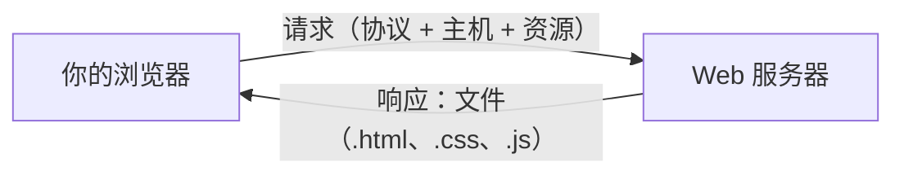
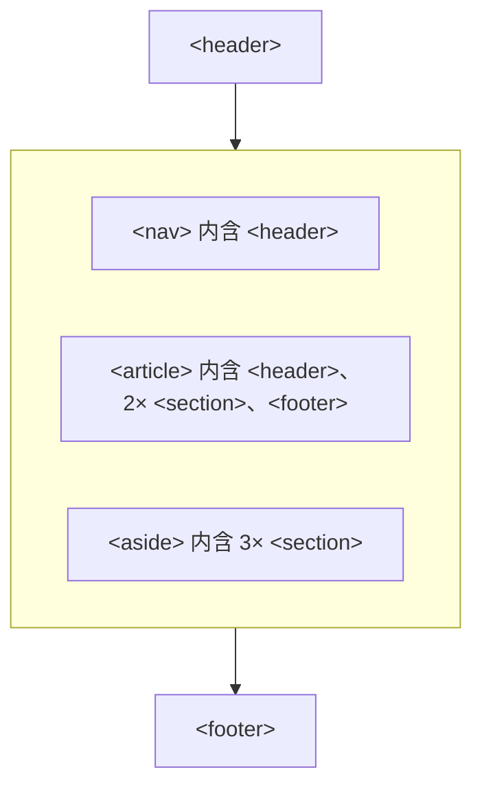

# IN4MATX 133: User Interface Software — Lecture 2：HTML 与无障碍（Accessibility）

## 目录

- [1. Web 是如何工作的](#1-web-是如何工作的)
- [2. HTML 标签](#2-html-标签)
- [3. 嵌套](#3-嵌套)
- [4. 属性](#4-属性)
- [5. 文档结构与校验](#5-文档结构与校验)
- [6. 为什么 Web 无障碍很重要](#6-为什么-web-无障碍很重要)
- [7. 屏幕阅读器与语义元素](#7-屏幕阅读器与语义元素)
- [8. alt 文本、aria-label 与无障碍校验器](#8-alt-文本aria-label-与无障碍校验器)
- [9. 包容性设计对所有人都更好](#9-包容性设计对所有人都更好)
- [10. 课堂问题与 Demo（附解答）](#10-课堂问题与-demo附解答)
- [11. 速查与必记的 5 个要点](#11-速查与必记的-5-个要点)

> UCI IN4MATX 133: User Interface Software — Prof. Travis Linden Reid，2026 年秋季学期，9/29（周二）
> 内容整理自 Lecture 2 的幻灯片（全部 57 页）和 demo 仓库文件夹 `W1_L1_Sep29`。按概念组织，而不是按来源组织。

> 📅 **课程安排**：本周的 Discussion 是 Git & GitHub 演示。Discussion 主题和 office hours 见 Canvas 页面 “Discussion & Office Hours Updates”（Prof. Reid：周四，线下；Ziqi：有时在线）。
> **现场 Demo**：课堂编程的 starter 和 solution 代码在 Canvas 上链接的 Coding Demo 仓库里；跟着 Starter 文件一起写，Solution 文件里是答案。（“Live coding is HARD!! … Speak up and correct me when you see mistakes.”）
> **A1 — 用 HTML 和 CSS 做响应式作品集**：截止时间为 **10 月 7 日（周三）晚上 11:59**。三项要求：内容（基础 HTML 和 CSS，本节课和下节课）、响应式（下周）、有效性（格式良好、且符合无障碍准则的 HTML/CSS）。题目开放；可以沿用已有的作品集，但必须手写代码（不能用 Squarespace / Google Sites / 建站工具）。
> **下一讲**：用 CSS 给页面设置样式（[Lecture 3 笔记](?kind=course_notes&course=IN4MATX-133&lang=zh-CN&note=IN4MATX133_Lec03_Notes_zh-CN.md)）。

---

## 1. Web 是如何工作的

### 1.1 客户端与服务器

客户端 Web 开发关注的是这张图的左半部分：**你的浏览器**（客户端）。另一侧是持有信息的 **Web 服务器**。

当你输入一个 URL，浏览器会向服务器发送一个**请求（request）**，并收到一个**响应（response）**。幻灯片标出了 URL 的三个部分：

| 部分 | 含义 | 在 `https://en.wikipedia.org/wiki/Donald_Bren_School_of_Information_and_Computer_Sciences` 中 |
|---|---|---|
| Protocol（协议） | *如何*处理信息 | `https` |
| Host（主机） | *谁*拥有信息 | `en.wikipedia.org` |
| Resource（资源） | 你想要*什么*信息 | `/wiki/Donald_Bren_School_…` |

换成人话就是：“嘿 Wikipedia，我想看 ICS 学院的页面！”服务器的响应是一个文件夹树里的文件（幻灯片展示的是 `wiki/donald_bren_school/`，里面有 `css/style.css`、`data/index.html`、`js/app.js`）。这些文件加上一个浏览器（Chrome、Edge、Firefox、Opera、Safari）**就等于**渲染出来的 Wikipedia 页面。



### 1.2 Web 传输的是文件

从根本上说，Web 的设计就是用来传送**文件**的。Web 上的文件可以朴素到只是 `test.html`，里面是在编辑器里敲的一行字：

```
Hi IN4MATX 133! This is a file.
```

用 Chrome 打开，同一个文件会显示这行文字。地址栏显示 `file:///Users/…/test.html`：协议是 `file`，资源是路径，而**主机由协议隐含给出**（就是你自己的磁盘）。

### 1.3 HTML：规定内容如何渲染

如果我们想说明内容*如何*渲染呢？这就是 **HTML（HyperText Markup Language，超文本标记语言）**。它：

- **给文本添加含义**（这是标题，这是列表），并且
- **把文档相互链接起来**——这是 Vannevar Bush 的超文本构想（Memex，见 [Lecture 1](?kind=course_notes&course=IN4MATX-133&lang=zh-CN&note=IN4MATX133_Lec01_Notes_zh-CN.md)）。

幻灯片 13 把名字拼成了 “Vanneaver Bush”；正确的名字是 **Vannevar** Bush（幻灯片 46 的问题和 Lecture 1 里都是这样拼的）。

## 2. HTML 标签

### 2.1 标签的结构

```html
<div>
Content goes here.
</div>
```

`<div>` 是**开始标签（open/start tag）**，`</div>` 是**结束标签（close/end tag）**，两者之间的一切都是**内容（content）**。**空白和标签的大小写都会被忽略**：浏览器会把连续的空格和换行折叠成一个空格，`<B>` 和 `<b>` 的含义相同。

现场 demo `tagBasics.html` 展示了这一点：`<b>…</b>` 里的三行 “Hello world!” 带有大量空格和空行，渲染出来却是**一行**加粗的 `Hello world! Hello world! Hello world!`，后面再跟一个不加粗的 `Hello world!`。

### 2.2 一些常见标签

```html
<h1>Heading level 1</h1>
<h2>Heading level 2</h2>
...
<p>A paragraph</p>
<!--A comment-->
 An image
<ul> An unordered list (bullets)
<li> A list item
<table> A data table
<strong> Important content (bolded)
<em> Emphasized content (italicized)
<div> A division (section) of content
```

| 标签 | 用途 |
|---|---|
| `<h1>` … `<h6>` | 标题，从 1 级（最重要）往下 |
| `<p>` | 段落 |
| `<!-- … -->` | 注释（不显示） |
| `` | 图片 |
| `<ul>` / `<li>` | 无序（项目符号）列表 / 列表项 |
| `<table>` | 数据表格 |
| `<strong>` | 重要内容（渲染为粗体） |
| `<em>` | 强调内容（渲染为斜体） |
| `<div>` | 内容的一个分区（division） |

标签有**几百个**。你不会全部用到，但要多去了解：搜索 Google 或 W3C（幻灯片展示了一份 HTML5 标签速查表）来弄清每个标签的用途。

demo `tagExamples.html` 就是把幻灯片上的这个列表做成了页面。注意它的 `<li>` 项没有 `</li>`——浏览器会替你补上（关于浏览器的宽容，详见[第 5 节](#5-文档结构与校验)）。可以逐步查看下面两个 demo 文件，也可以自己编辑后点击 Run：

```viz web-demo
{"title": "幻灯片 14–15 · 先 tagBasics.html，再 tagExamples.html", "html": "<b>\n    Hello world!        Hello world!\n\n\n    Hello world!\n</b>\nHello world!", "js": "const b = document.querySelector('b');\nif (b) console.log(JSON.stringify(b.innerText));", "steps": [{"note": "换成 tagExamples.html（图片省略了：demo 无法加载 momo.png）。", "html": "<h1>Heading level 1</h1>\n<h2>Heading level 2</h2>\n...\n<p>A paragraph</p>\n<!--A comment-->\n An image\n<ul> An unordered list (bullets)\n    <li> A list item\n    <li> Another list item\n    <li> Yet another list item\n</ul>\n<strong> Important content (bolded) </strong>\n<em> Emphasized content (italicized) </em>", "js": "console.log(document.querySelectorAll('li').length + ' list items');"}], "height": 300, "interactive": true}
```

> 🧪 **Demo 文件**：[tagBasics.html](https://github.com/travislindenreid/INF33-Demos/blob/main/W1_L1_Sep29/tagBasics.html) · [tagExamples.html](https://github.com/travislindenreid/INF33-Demos/blob/main/W1_L1_Sep29/tagExamples.html)

> 🔗 **延伸阅读**：[w3schools: HTML tag reference](https://www.w3schools.com/tags/)

## 3. 嵌套

### 3.1 标签里套标签

标签的**内容**里可以包含其他 HTML 标签：

```html
<div><p>I <strong>love</strong> HTML!</p></div>
```

规则是“后开先闭”——就像 C++ 或 Go 里括号的匹配。在 `<p>` 里打开的 `<strong>` 必须在 `</p>` 之前关闭，`<p>` 又必须在 `</div>` 之前关闭。

> 📝 **练习**：[问题 1](#101-问题-1如何指定一个包含-p-段落-i-love-html-的-div幻灯片-1720) 问五个字符串中哪一个嵌套正确。

### 3.2 嵌套列表：购物清单 demo

现场 demo：把 “Professor Reid's vampire birthday party shopping list (real)” 变成 HTML。起始文件 `shoppingList_starter.html` 只是几行纯文本——没有标签，浏览器会把它渲染成**一整行连在一起的文字**。幻灯片上的解答：

```html
<h2>Prof Reid's Vampire Bday Party Shopping List:</h2>
<ul>
  <li>4 cans tomatoes</li>
  <li>2 cans coconut</li>
  <li>64 shrimp</li>
  <li>Black and red fruits:
    <!--Lists can be nested!-->
    <ul>
      <li>Pomegranates</li>
      <li>Blackberries</li>
      <li>Red grapes</li>
    </ul>
  </li>
</ul>
```

它渲染出来是一个标题、四个项目符号，以及 “Black and red fruits” 下面第二层的空心圆圈项目符号。

> ⚠️ **易错点**：仓库里的 `shoppingList_complete.html` 先把 `<li>Black and red fruits</li>` 关闭，然后把内层 `<ul>` *直接*放进外层 `<ul>` 里。浏览器里看起来一样，但 `<ul>` 的子元素只能是 `<li>`，所以这不是合法的 HTML。幻灯片上的写法（内层列表*放在* `<li>` 里面）才是正确的。

```viz web-demo
{"title": "幻灯片 22–23 · shoppingList_starter.html → shoppingList_complete.html", "html": "Prof Reid's Vampire Bday Party Shopping List:\n4 cans tomatoes\n2 cans coconut\n64 shrimp\nBlack and red fruits\nPomegranates\nBlackberries\nRed grapes", "steps": [{"note": "完成后的版本：一个 h2，加上一个 ul，最后几项放在嵌套的 ul 里。", "html": "<h2>Prof Reid's Vampire Bday Party Shopping List:</h2>\n<ul>\n    <li>4 cans tomatoes</li>\n    <li>2 cans coconut</li>\n    <li>64 shrimp</li>\n    <li>Black and red fruits</li>\n    <ul>\n    <li>Pomegranates</li>\n    <li>Blackberries</li>\n    <li>Red grapes</li>\n    </ul>\n</ul>"}], "height": 240, "interactive": true}
```

> 🧪 **Demo 文件**：[shoppingList_starter.html](https://github.com/travislindenreid/INF33-Demos/blob/main/W1_L1_Sep29/shoppingList_starter.html) · [shoppingList_complete.html](https://github.com/travislindenreid/INF33-Demos/blob/main/W1_L1_Sep29/shoppingList_complete.html)

### 3.3 整个文档都嵌套在 html 里

按照惯例，一个 HTML 文档是 **`<html>` 元素的内容**，而可见的部分是 `<body>` 的内容：

```html
<html>                              <!-- Start of HTML document -->
  <body>                            <!-- Start of body (visible) content -->
    <h1>Hello, IN4MATX 133!</h1>
    <p>HTML is <em>great</em>!</p>
  </body>                           <!-- End of body content -->
</html>                             <!-- End of HTML document -->
```

## 4. 属性

属性（attribute）用来**指定选项并添加含义**。它们写在开始标签里，是以空格分隔的 `name="value"` 键值对列表——有点像变量，而且几乎总是字符串：

```html
<div attributeA="valueA" attributeB="valueB">
Content goes here
</div>
```

你会经常用到的三个属性（幻灯片 26）：

```html
<a href=“https://travislindenreid.github.io/">Prof Reid</a>

<html lang="en">
...
</html>
```

| 代码 | 含义 |
|---|---|
| `<a href="…">` | **a**nchor（锚点，即超链接）；`href` = **h**ypertext **ref**erence（超文本引用），即链接目标 |
| `` | `src` = 源文件（source）；`alt` = 给屏幕阅读器用的**替代文本（alt**ernative text）。`img` 没有（文本）内容，所以**没有结束标签** |
| `<html lang="en">` | 文档语言是英语 |

> ⚠️ **易错点**：幻灯片 26 用弯引号（`“`）开头写了三个值。对 HTML 来说这些并不是引号字符，而会成为值的一部分：浏览器读到的 `href` 是 `“https://travislindenreid.github.io/"`，`alt` 是 `“Momo"`，于是链接和图片都会失效。一定要输入直引号 `"…"`（从幻灯片或 Word 里粘贴时要当心）。幻灯片 43 的 `role=“form"` 也有同样的失误。

demo `attributes.html` 在页面上放了一个链接和 Momo（Prof. Reid 的猫）的图片。它的 `` **没有 `alt`**——下面的步骤会把它加上。（demo 里图片文件无法加载，而这恰好就是 `alt` 文本显示出来的时候。）

```viz web-demo
{"title": "幻灯片 26–28 · attributes.html（仅 body 部分）", "html": "<p><a href=\"https://travislindenreid.github.io/\">Prof Reid's Games Portfolio</a></p>\n        <p>", "js": "const a = document.querySelector('a');\nconsole.log('href:', a.getAttribute('href'));\nconst img = document.querySelector('img');\nconsole.log('src:', img.getAttribute('src'), '| alt:', img.getAttribute('alt'));", "height": 140, "interactive": true, "steps": [{"note": "加上幻灯片 26 里的 alt 属性：缺失的图片现在会被读作 “Momo”。", "html": "<p><a href=\"https://travislindenreid.github.io/\">Prof Reid's Games Portfolio</a></p>\n        <p>"}]}
```

> 🧪 **Demo 文件**：[attributes.html](https://github.com/travislindenreid/INF33-Demos/blob/main/W1_L1_Sep29/attributes.html) · [momo.png](https://github.com/travislindenreid/INF33-Demos/blob/main/W1_L1_Sep29/momo.png)

## 5. 文档结构与校验

### 5.1 HTML 模板

每个页面都应该遵循这个骨架（幻灯片 27，幻灯片上的标注以注释形式保留）：

```html
<!DOCTYPE html>                               <!-- Document format -->
<html lang="en">                              <!-- Specify language -->
<head>                                        <!-- Document header (content that's not shown) -->
   <meta charset="UTF-8">                     <!-- Character set (for non-latin characters) -->
   <meta name="author" content="your name">   <!-- For search engines -->
   <title>My Webpage</title>                  <!-- Webpage title in tab -->
</head>
<body>                                        <!-- Document body (content that's shown) -->
   <h1>Hello, world!</h1>
   ...
</body>
</html>
```

`<head>` 放的是关于页面的信息；`<body>` 放的是显示出来的内容。`<meta>` 和 `` 一样，没有结束标签。

### 5.2 浏览器会宽容，校验器不会

令人意外的是，浏览器对 HTML 结构非常**宽容**——这里**没有“编译错误”**。`attributes.html` 就是例子：它没有 `<!DOCTYPE html>`，没有 `</body>`，还有一个没闭合的 `<p>`，但依然渲染正常（先是链接，然后是图片）。尽管如此，校验仍然重要，因为它有助于确保**浏览器兼容性和网站可用性**。

**W3C 校验器（validator）**（validator.w3.org）会按规范检查页面。幻灯片 29 把两个页面放进去校验：

| 输入 | 校验器结果 |
|---|---|
| 5.1 中的完整模板 | “Document checking completed. No errors or warnings to show.” |
| `<html><head><title>My Page Title</title></head><body><h1>Hello, world!</h1><p>...`（没有 doctype，没有 `lang`） | **Warning**：Consider adding a `lang` attribute to the `html` start tag to declare the language of this document。**Error**：Start tag seen without seeing a doctype first. Expected `<!DOCTYPE html>`. |

> 💡 **关键点**：“在 Chrome 里看着没问题”不等于“有效”。A1 按有效性评分，所以每个页面都要过一遍校验器。

> 🔗 **延伸阅读**：[W3C Markup Validation Service](https://validator.w3.org/)

除了校验器，结构为什么还重要？因为要看谁在读你的页面——见下一节。

## 6. 为什么 Web 无障碍很重要

退一步看：**Web 访问权很重要**。

> “The power of the Web is in its universality. Access by everyone regardless of disability is an essential aspect.” — Tim Berners-Lee，万维网（World Wide Web）的发明者、2016 年图灵奖得主

各种各样的人都会使用你做的网页。幻灯片里有两个人物画像（persona）：

- **Tracy Young**，28 岁，天生失明。拥有英语文学的大学学位，写诗和短篇小说；从未学过盲文（靠有声磁带、书籍和家教完成了学业）。工作中她使用 **JAWS**，一种用人工合成语音朗读屏幕内容的**屏幕阅读器（screen reader）**；JAWS 只能在 Internet Explorer 上运行，而这是她公司的标准浏览器。
- **Gerald Oldman**，68 岁，退休的投资银行家，每周花几个小时在网上管理自己的投资和养老金。他的视力随年龄下降（字母看一会儿就模糊，需要头顶灯光和放大镜），而且手会抖，很难精确移动鼠标——他**更喜欢键盘操作**。

**常见的障碍类型**：

| 类别 | 例子 |
|---|---|
| 视觉 | 失明、低视力、色盲 |
| 运动 | 关节炎、脑瘫、震颤、瘫痪 |
| 认知 | 自闭症、阅读障碍（dyslexia）、语言障碍 |
| … | 还有很多 |

> 🔗 **延伸阅读**：[W3C WAI: Introduction to Web Accessibility](https://www.w3.org/WAI/fundamentals/accessibility-intro/) · [Accessibility personas（Tracy 和 Gerald 的出处，PDF）](https://publikationen.sulb.uni-saarland.de/bitstream/20.500.11880/25641/1/personas_access.pdf)

## 7. 屏幕阅读器与语义元素

### 7.1 Apple VoiceOver

一种辅助方案是 **Apple VoiceOver**，这是一种屏幕阅读器，让用户可以**通过键盘**浏览可视内容。幻灯片（截取自一段在 Wikipedia 页面上演示的视频）展示了它的三项功能：

- 朗读当前聚焦的元素（“Interact with Google - Wikipedia, the free encyclopedia, HTML content”）；
- **按标题导航**（“heading level 2, Contents”）——在标题之间跳转；
- 用 *rotor*（转盘，Control + Option + U）**按特定类型的内容导航**：标题列表、链接列表、landmark（地标）列表等等。

### 7.2 给标签添加语义

如何让屏幕阅读器方便地导航？**给标签添加语义（semantic meaning）。**只有标记里说明了哪些部分是“标题”或“导航栏”，屏幕阅读器才能跳转到它们。有两种做法。

**ARIA role——“旧”方法。**给没有语义的元素（比如 `<div>`）加上 `role` 属性：

```html
<div role="main">
<div role="navigation">
<div role=“form">
```

（第三行带有幻灯片上的弯引号失误——应该写成 `role="form"`。）

**HTML5 标签——“新”方法。**专门的语义（landmark）标签。幻灯片上的布局图：



下面的 demo 是用这些标签搭的一个小页面（不是幻灯片里的内容；配色参照幻灯片上的图）；它的控制台会列出屏幕阅读器可以在其间跳转的 landmark 标签：

```viz web-demo
{"title": "幻灯片 43–45 · HTML5 landmark 标签 + aria-label（自编例子）", "html": "<header>Site header</header>\n<nav>Nav: <a href=\"#\">Home</a> · <a href=\"#\">Projects</a></nav>\n<main>\n  <article>\n    <h1>Post title</h1>\n    <section>First section</section>\n    <section>Second section</section>\n  </article>\n  <aside>Related links</aside>\n</main>\n<footer>Footer</footer>\n<button aria-label=\"Close\">X</button>", "css": "header,nav,footer{background:#5fd4d8;padding:6px;margin:4px}\narticle{background:#7ed957;padding:6px;margin:4px}\nsection{background:#e889c2;padding:4px;margin:4px}\naside{background:#f39c3c;padding:6px;margin:4px}", "js": "for (const el of document.querySelectorAll('header, nav, main, article, section, aside, footer'))\n  console.log(el.tagName.toLowerCase());\nconst b = document.querySelector('button');\nconsole.log('button text:', b.textContent, '| aria-label:', b.getAttribute('aria-label'));", "height": 300, "interactive": true}
```

> 🔗 **延伸阅读**：[W3C ARIA Authoring Practices Guide](https://www.w3.org/WAI/ARIA/apg/) · [w3schools: HTML5 semantic elements](https://www.w3schools.com/html/html5_semantic_elements.asp) · [Apple VoiceOver 视频（YouTube）](https://youtu.be/5R-6WvAihms)

## 8. alt 文本、aria-label 与无障碍校验器

### 8.1 另外两个无障碍属性

- 图片上的 **`alt`**：屏幕阅读器用来代替图片朗读的文字。
- **`aria-label`** 用来描述非视觉元素，比如可见文字只是一个符号的按钮：

```html
<button aria-label="Close">X</button>
```

视力正常的用户看到的是 “X”；屏幕阅读器会读出 “Close”（第 7 节的 demo 会在控制台输出 `button text: X | aria-label: Close`）。

### 8.2 alt 文本准则

1. **始终包含 `alt` 属性**，哪怕它是空的。
2. **描述信息，而不是描述图片本身。**
3. “有交互作用的”图片，以及**包含信息**的图片，需要有描述性的 alt 文本——例如 Google Docs 里的图标按钮（评论、Present、Share）。
4. **装饰性图片**应该使用**空的** alt 文本（`alt=""`）——例如 Twitter/Facebook 的封面图。
5. **简洁**；避免与周围的文字重复。

`alt=""` 和*缺少* `alt` 是不同的：空值告诉屏幕阅读器“跳过这个，它只是装饰”；缺少则让屏幕阅读器无从判断（准则 1）。

> 📝 **练习**：[问题 2](#102-问题-2哪个-alt-文本最能描述这张图片幻灯片-4648)——为一张 Vannevar Bush 的照片选出最合适的 alt 文本。

### 8.3 无障碍校验器

- **WAVE**（wave.webaim.org）和 **AChecker** 会检查页面的无障碍问题。
- 两者都会**过度报告**问题：你需要自己判断每个标记是否真的是无障碍问题。
- 你也可以用真正的屏幕阅读器来试用自己的页面：**VoiceOver**（Mac，Settings → Accessibility）或 **NVDA**（Windows，可免费下载）。

幻灯片把它拼成了 “ACheker”，而且链接文字写的是 `achecks.org/achecker/`，实际链接却指向 `achecker.ca/checker/`；两个都列在下面。

> 🔗 **延伸阅读**：[WebAIM: Alternative text](https://webaim.org/techniques/alttext/) · [AbilityNet: Five golden rules for compliant alt text](https://abilitynet.org.uk/news-blogs/five-golden-rules-compliant-alt-text) · [WAVE](http://wave.webaim.org/) · [AChecker（幻灯片上的链接）](https://achecker.ca/checker/) · [AChecker（幻灯片上打出来的 URL）](https://achecks.org/achecker/) · [NVDA 屏幕阅读器](https://www.nvaccess.org/)

## 9. 包容性设计对所有人都更好

总结：语义化、可访问的标记不只帮助屏幕阅读器用户，而是帮助所有人。

- **HTML 本身就能说明问题**：开发者扫一眼页面源码，就大致知道它会渲染成什么样。
- **语义化 HTML 帮助人们找到想要的内容**：
  - 上面提到的无障碍方面的好处；
  - 界面可以有选择地移除或弱化与上下文无关的内容（例如在小屏幕上隐藏脚注）；
  - 搜索引擎可以索引重要内容（标题、文章），而不是 UI 内容（导航栏、页脚）。

## 10. 课堂问题与 Demo（附解答）

课堂问题通过 PollEverywhere（PollEv.com/LindenReid565）进行，分四个阶段：**个人作答 → 公布回答 → 全班讨论 → 公布正确答案**（幻灯片 17）。

### 10.1 问题 1：如何指定一个包含 p 段落 “I love HTML!” 的 div？（幻灯片 17–20）

如何指定一个 `<div>`，里面有 `<p>`（段落）“I **love** HTML!”？

- A. `<div><p>I <strong>love HTML!`
- B. `<div><p>I <strong>love</strong> HTML!</p>`
- C. `<div><p>I <strong>love<strong> HTML!<p><div>`
- D. `<div><p>I <strong>love</strong> HTML!</p></div>`
- E. `<div><p>I </p><strong>love</strong><p> HTML!</p></div>`

> ✍️ **先自己试一试。**

**答案：D**（幻灯片 20 公布）。每个标签都关闭了，且关闭顺序与打开顺序相反：`strong` 在 `p` 里，`p` 在 `div` 里。

其他选项为什么错（每条都是浏览器解析器对它的处理方式）：

- **A** — 什么都没关闭。浏览器会在页面末尾把所有东西关掉，所以 “HTML!” 也会变成粗体。
- **B** — 缺少 `</div>`。这里渲染没问题，但这个 div 会把它后面的所有内容都吞进去。
- **C** — `<strong>`、`<p>` 和 `<div>` 在本该写结束标签的地方写成了*开始*标签。浏览器把它解析成 `<div><p>I <strong>love<strong> HTML!</strong></strong></p><p></p><div><strong><strong>…`——嵌套的粗体、一个空段落和一个新的 div。
- **E** — 这就是仓库里的 `q1demo.html`。它是合法的 HTML，但结构不对：三个独立的块，所以 “I”、“love” 和 “HTML!” 会渲染在**三行**上，而不是一个段落。

下面按浏览器的渲染方式逐个查看这五个选项；控制台会显示解析后的 HTML：

```viz web-demo
{"title": "问题 1 · 先是选项 D，然后依次是 A、B、C、E（E 是 q1demo.html）", "html": "<div><p>I <strong>love</strong> HTML!</p></div>", "js": "console.log(document.body.innerHTML.split('<script')[0].trim());", "steps": [{"note": "选项 A。", "html": "<div><p>I <strong>love HTML!"}, {"note": "选项 B。", "html": "<div><p>I <strong>love</strong> HTML!</p>"}, {"note": "选项 C。", "html": "<div><p>I <strong>love<strong> HTML!<p><div>"}, {"note": "选项 E。", "html": "<div><p>I </p><strong>love</strong><p> HTML!</p></div>"}], "height": 120, "tab": "html"}
```

> 🧪 **Demo 文件**：[q1demo.html](https://github.com/travislindenreid/INF33-Demos/blob/main/W1_L1_Sep29/q1demo.html)

回到 [3.1 标签里套标签](#31-标签里套标签)。

### 10.2 问题 2：哪个 alt 文本最能描述这张图片？（幻灯片 46–48）

幻灯片上是一张 Vannevar Bush 的黑白肖像照片。哪个 `alt` 文本最能描述这张图片？

- A. ``
- B. ``
- C. ``
- D. ``
- E. ``

> ✍️ **先自己试一试。**

**答案：A**（幻灯片 48 公布，并附注 “Depends on the context, really”）。运用 [8.2](#82-alt-文本准则) 中的准则：

- **A** 描述了信息（这是谁），而且简洁。
- **B** — “A picture of” 是多余的：屏幕阅读器本来就会把它报成图片。
- **C** 描述的是图片本身，而不是信息。
- **D** — 空 alt 用于装饰性图片；这张照片承载着信息。
- **E** — 开头多余，而且太长；如果 “writer of…” 这部分重要，应该放在周围的正文里。语境也可能改变结论：如果页面上这张图片*就是*该事实的唯一来源，那么多给一些细节可能是对的。

回到 [8.2 alt 文本准则](#82-alt-文本准则)。

### 10.3 Demo 1：购物清单（幻灯片 22–23 · shoppingList_starter → shoppingList_complete）

**任务**：把 `shoppingList_starter.html` 里的纯文本清单变成 HTML——一个标题、一个项目符号列表，以及水果部分的嵌套列表。

```
Prof Reid's Vampire Bday Party Shopping List:
4 cans tomatoes
2 cans coconut
64 shrimp
Black and red fruits
Pomegranates
Blackberries
Red grapes
```

> ✍️ **先自己试一试。**

**解答**（仓库里的 `shoppingList_complete.html`，与提交的版本完全一致）：

```html
<h2>Prof Reid's Vampire Bday Party Shopping List:</h2>
<ul>
    <li>4 cans tomatoes</li>
    <li>2 cans coconut</li>
    <li>64 shrimp</li>
    <li>Black and red fruits</li>
    <ul>
    <li>Pomegranates</li>
    <li>Blackberries</li>
    <li>Red grapes</li>
    </ul>
</ul>
```

它会渲染成预期的两层列表。要得到**合法**的版本，请像幻灯片 23 那样把内层 `<ul>` 移到水果的 `<li>` 里面（见 [3.2](#32-嵌套列表购物清单-demo) 中的易错点）；那里的 demo 会从 starter 一步步走到解答。

## 11. 速查与必记的 5 个要点

**标签**

| 标签 | 用途 | 有结束标签？ |
|---|---|---|
| `<html>` `<head>` `<body>` | 文档、元数据、可见内容 | 有 |
| `<title>` | 标签页中的页面标题 | 有 |
| `<meta>` | 字符集、作者…… | 无 |
| `<h1>`–`<h6>`、`<p>` | 标题、段落 | 有 |
| `<strong>`、`<em>` | 重要（粗体）、强调（斜体） | 有 |
| `<ul>` / `<li>` | 项目符号列表 / 列表项（嵌套列表要放在 `<li>` 里面） | 有 |
| `<table>`、`<div>` | 数据表格、通用分区 | 有 |
| `<a href>` | 超链接 | 有 |
| `` | 图片 | 无 |
| `<!-- … -->` | 注释 | — |
| `<header>` `<nav>` `<main>` `<article>` `<section>` `<aside>` `<footer>` | HTML5 语义（landmark）标签 | 有 |

**属性**

| 属性 | 用在 | 含义 |
|---|---|---|
| `href` | `<a>` | 链接目标 |
| `src` | `` | 图片文件 |
| `alt` | `` | 替代文本；装饰性图片用 `""` |
| `lang` | `<html>` | 文档语言（`"en"`） |
| `charset` | `<meta>` | 字符集（`"UTF-8"`） |
| `role` | 任意元素（如 `<div>`） | ARIA role，添加语义的“旧”方法 |
| `aria-label` | 如 `<button>` | 非文本内容的可访问名称 |

**工具**：W3C 校验器（HTML 有效性）· WAVE、AChecker（无障碍；会过度报告）· VoiceOver（Mac）、NVDA（Windows）屏幕阅读器。

**必记的 5 个要点**

1. 按与打开相反的顺序关闭标签——`<div><p>I <strong>love</strong> HTML!</p></div>`（问题 1 = D）。
2. 浏览器会悄悄修复糟糕的 HTML，所以“看起来没问题”什么也证明不了：从 `<!DOCTYPE html>` + `lang` + `charset` 的模板开始，并运行 W3C 校验器。
3. 每个 `` 都要有 `alt`：描述信息，而不是描述图片；只有装饰性图片才用 `alt=""`（问题 2 = A）。
4. 优先使用 HTML5 语义标签（`<nav>`、`<main>`、`<article>`……），而不是 `<div>`；给 `<div>` 加 `role` 是旧方法。屏幕阅读器用户靠它们来导航。
5. 属性里要用直引号——弯引号（`“`）会变成值的一部分，让链接和图片失效。
