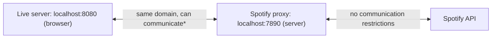

# IN4MATX 133: User Interface Software — Lecture 8: AJAX, Fetch, & Promises

## Table of Contents

- [1. Web APIs](#1-web-apis)
- [2. Anatomy of a web request: URIs](#2-anatomy-of-a-web-request-uris)
- [3. HTTP verbs and responses](#3-http-verbs-and-responses)
- [4. Escaping characters in URLs](#4-escaping-characters-in-urls)
- [5. AJAX, XML and JSON](#5-ajax-xml-and-json)
- [6. XMLHttpRequest](#6-xmlhttprequest)
- [7. fetch()](#7-fetch)
- [8. Asynchronous requests](#8-asynchronous-requests)
- [9. Promises and .then()](#9-promises-and-then)
- [10. Getting the data out: response.json() and chaining](#10-getting-the-data-out-responsejson-and-chaining)
- [11. Client-side vs server-side JS and the same-origin policy](#11-client-side-vs-server-side-js-and-the-same-origin-policy)
- [12. Catching errors with .catch()](#12-catching-errors-with-catch)
- [13. Multiple promises with Promise.all](#13-multiple-promises-with-promiseall)
- [14. In-class Questions & Demos (with Solutions)](#14-in-class-questions--demos-with-solutions)
- [15. Quick Reference & Top 5 Things to Remember](#15-quick-reference--top-5-things-to-remember)

> UCI IN4MATX 133: User Interface Software — Prof. Travis Linden Reid, Fall 2026, Week 5
> Built from the Lecture 8 slides and the demo repo folder `W4_L1_Oct20_Ajax`. Organized by concept, not by source.

> 📅 **Class logistics**: A1 grades almost done — aiming for early next week.
> A3 will be posted by Thursday's class (updated for 2026); due **Wednesday, Nov 11** (pushed back).
> Friday's discussion: Angular.

Goals for today: explain how programs access web resources and how those resources respond, implement a `fetch` request to get a resource from a web API, and use promises to handle the asynchronous request.

---

## 1. Web APIs

Many web services and data sources let you use HTTP (web) requests to access their data. They do this by providing a **web API**.

**API = Application Programming Interface**: the interface you use to interact with an application through programming. An interface is just a defined set of functions — the slide's example of "an interface":

```js
function doSomething(param1, param2) {
  //...
}
```

A web API is the same idea, except each "function" is a URL you send an HTTP request to. Examples on the slides: **PokeAPI** (used for all of today's demos), **GitHub**, **Spotify** (A3), **OC Transpo**, **Google Maps**, **Stripe**, **US Census Bureau**.

GitHub example from the slide — the original repo is a normal web page, but the API returns the same kind of information as data:

- Original repo: `https://github.com/travislindenreid/GDIM32-Final`
- All forks of that repo, sorted by stars, up to 100: `https://api.github.com/repos/travislindenreid/GDIM32-Final/forks?sort=stargazers&per_page=100`

> 🔗 **Go deeper**: [PokeAPI](https://pokeapi.co/) · [GDIM32-Final repo](https://github.com/travislindenreid/GDIM32-Final) · [GitHub API: forks of GDIM32-Final](https://api.github.com/repos/travislindenreid/GDIM32-Final/forks?sort=stargazers&per_page=100)

## 2. Anatomy of a web request: URIs

**Using the internet** (slide 7): your browser sends a **request** to a web server and gets a **response** back. The address bar URL `https://en.wikipedia.org/wiki/Donald_Bren_School_of_Information_and_Computer_Sciences` breaks into three parts — "Hey Wikipedia, I'd like to see the page for the school of ICS!":

| Part | Example | Meaning |
|---|---|---|
| Protocol | `https://` | how to handle the info |
| Host | `en.wikipedia.org` | who has the info |
| Resource | `/wiki/Donald_Bren_School_…` | what info you want |

### 2.1 URI vs URL

**URI** (the slide expands it as "Uniform Resource Indicator"; the standard name is Uniform Resource *Identifier*). All URLs are URIs, but URLs also specify the **access mechanism** (`http://`, `file://`). A URI returns a **resource** — a webpage, an image file, etc., or just data.

- `http://www.domain.com/users` → returns a list of users. The list of users is the resource.
- Resources can have **sub-resources**: `http://www.domain.com/users/shawna` → returns one specific user.

### 2.2 Base URI and endpoints

- **Base URI**: how every request for that API starts — `https://pokeapi.co/api/`
- **Endpoint**: a specific resource accessible through the API — `v2/pokemon/ditto`, `v2/type/3`. Endpoints often contain an **API version number** (`v2`).

### 2.3 Query parameters

Some APIs take **key/value pairs after the URI** — parameters for the resource that specify exactly what to return or in what format: `?key=value&key=value`. PokeAPI doesn't do this, but Spotify does (you'll need it for A3). The slide's Twitter example:

```
https://api.twitter.com/1.1/search/tweets.json?q=UCI&lang=en
```

`q=UCI` is the "query" — in Twitter, the text or hashtag to search for; `lang=en` means language = English.

> 🔗 **Go deeper**: [PokeAPI](https://pokeapi.co/) · [X API: search filter operators](https://docs.x.com/x-api/posts/search/introduction#filter-operators)

## 3. HTTP verbs and responses

An HTTP request includes a **target resource** and a **verb** (method) saying what to do with it:

| Verb | Meaning |
|---|---|
| `GET` | return a representation of the current state of the resource |
| `POST` | add a new resource (e.g., a record, an entry) |
| `PUT` | update an existing resource to a new state |
| `PATCH` | update a portion of the resource's state |
| `DELETE` | remove the resource |
| `OPTIONS` | return the set of methods that can be performed on the resource |

A **response** includes a **status code** (whether it worked as expected) and a **body** (the actual response):

| Code | Meaning |
|---|---|
| `200` | OK |
| `201` | Created (for `POST`) |
| `400` | Bad request (something is wrong with your URI) |
| `403` | Forbidden (some access or authentication issue) |
| `404` | Not found (resource does not exist) |
| `500` | Internal server error (generic server-side error) |

**Putting it all together** (slide 14): `HTTP GET https://pokeapi.co/api/v2/pokemon/ditto` — use the GET verb to access the Pokémon "Ditto"; we expect/hope for status `200` (OK); then we access the body. (Section 8's demo makes exactly this request and logs `status: 200 ok: true`.)

> 🔗 **Go deeper**: [REST API Tutorial: HTTP status codes](https://www.restapitutorial.com/httpstatuscodes.html)

## 4. Escaping characters in URLs

Some characters are **reserved** in URLs, so they have to be **encoded** as `%` + the character's hex code. The slide's table (from w3schools; Windows-1252 and UTF-8 agree for these):

| Character | Encoded |
|---|---|
| space | `%20` |
| `!` | `%21` |
| `"` | `%22` |
| `#` | `%23` |
| `$` | `%24` |
| `%` | `%25` |
| `&` | `%26` |
| `'` | `%27` |

"Who's that Pokémon? It's Farfetch'd!" Strictly we'd have to encode the apostrophe, but PokeAPI simply drops it: `HTTP GET https://pokeapi.co/api/v2/pokemon/farfetchd` (returns 200).

> 📝 **Practice**: [Question 1 — encoding Mr. Mime](#141-question-1-reading-mr-mime-from-pokeapi-slides-1618)

> 🔗 **Go deeper**: [w3schools: HTML URL encoding reference](https://www.w3schools.com/tags/ref_urlencode.asp)

## 5. AJAX, XML and JSON

So how does *JavaScript* make a web request? With **AJAX: Asynchronous JavaScript and XML**.

### 5.1 XML

**XML (Extensible Markup Language)**: a generalized syntax for semantically defining structured content. HTML is XML with a defined set of tags; in XML you make up your own:

```html
<person>
   <firstName>Alice</firstName>
   <lastName>Smith</lastName>
   <favorites>
      <music>jazz</music>
      <food>pizza</food>
   </favorites>
</person>
```

Slide 22 shows a breakfast menu as plain text and as XML (first item shown; the slide has five: Belgian Waffles, Strawberry Belgian Waffles, Berry-Berry Belgian Waffles, French Toast, Homestyle Breakfast):

```html
<breakfast_menu>
  <food>
    <name>Belgian Waffles</name>
    <price>$5.95</price>
    <description>
      Two of our famous Belgian Waffles with plenty of real maple syrup
    </description>
    <calories>650</calories>
  </food>
  <!-- ... four more <food> entries ... -->
</breakfast_menu>
```

### 5.2 The same data as JSON

```json
{
  "breakfast_menu": {
    "food": [
    {
      "name": "Belgian Waffles",
      "price": "$5.95",
      "description": "Two of our famous Belgian Waffles with plenty of real maple syrup",
      "calories": "650"
    }
    ]
  }
}
```

(The slide's array has all five foods.) Notice the mapping: a repeated `<food>` element becomes an array, child elements become keys.

**XML vs JSON** (slide 24): they represent the same data, but

- JSON is **more concise** → less data to move around on the web;
- JSON is **easier to read** — closing tags in XML are redundant;
- JSON has **taken over** as the typical format of web requests.

So in practice AJAX is "Asynchronous JavaScript and ~~XML~~ JSON" (slide 25) — the name stuck even though the X is now usually JSON.

## 6. XMLHttpRequest

AJAX requests are built into a browser-provided object called `XMLHttpRequest` — the original way to do it (slides 27–28):

```js
var xhttp = new XMLHttpRequest();
xhttp.onreadystatechange = function() {
    if (xhttp.readyState == 4 && xhttp.status == 200) {
       // Action to be performed when the document is read;
       var xml = xhttp.responseXML;
       var movie = xml.getElementsByTagName("track");
       //...
    }
};
xhttp.open("GET", "filename", true);
xhttp.send();
```

Read it as: create the request object → register a callback that fires every time the request's state changes → in it, act only when `readyState == 4` (done) **and** `status == 200` (OK) → `open` the request (verb, URL, `true` = asynchronous) → `send` it. The response XML is searched with the same DOM methods you use on a page (`getElementsByTagName`, from [Lecture 6](?kind=course_notes&course=IN4MATX-133&lang=en-US&note=IN4MATX133_Lec06_Notes_en-US.md)). It works, but it's verbose — which is why `fetch` exists.

## 7. fetch()

**`fetch`** is a newer, modern method for submitting these requests, included in most browsers (the slide's MDN Baseline box: "Widely available … across browsers since March 2017"). Basic form: `fetch('url')`.

- `fetch('some-url')` **defaults to a GET** request.
- `fetch` optionally takes a **second "options" argument** (a dictionary / object):
  - `method`: what method to use (e.g., `POST`, `PUT`, `DELETE`)
  - `headers`: content type format, etc. (more on headers next week)
  - `body`: what you want to send for a `POST`/`PUT` request

```js
// For a GET request
fetch('some-url');

// For a POST request
fetch('some-url', {
  method: 'POST',
  headers: {'Content-Type': 'application/json'},
  body: JSON.stringify(data-to-send)
});
```

`data-to-send` is a placeholder, not real JS — as written it's a subtraction `data - to - send`. Use a variable name like `dataToSend`. Slide 29 also writes `fetch('url')` with curly quotes; in real code they must be straight quotes `'url'`.

`body` must be a string, which is why the object is passed through `JSON.stringify` and the `Content-Type` header says it's JSON.

> 🔗 **Go deeper**: [MDN: Window.fetch()](https://developer.mozilla.org/en-US/docs/Web/API/Window/fetch) · [CSS-Tricks: Using fetch](https://css-tricks.com/using-fetch/)

## 8. Asynchronous requests

AJAX requests are **asynchronous**: they happen at the same time as the rest of your code. After the request is sent, the **next line runs without waiting for the request to finish**:

```js
console.log('About to send request');   // (1)
//send request for data to the url
fetch(url);                             // (2) Does NOT return the data
console.log('Sent request');            // (3)
                                        // (4) Data is actually received sometime later!
```

Why do it this way? It's uncertain how long a request will take. Handling it asynchronously means the person can **keep interacting with your page** — the request doesn't block their interface interactions. A page that freezes while you try to navigate it is a bad experience.

If you know Python's `requests.get(url)` (blocks until the response arrives) — `fetch` is the opposite: it returns immediately with a placeholder.

Try it — a real request to PokeAPI. Note that the third line logs a **Promise**, not Ditto's data, and the status line only arrives after `Sent request`:

```viz web-demo
{"title": "Slides 32–35 · fetch is asynchronous (live PokeAPI)", "interactive": true, "height": 60, "html": "<p>See the console.</p>", "js": "var url = 'https://pokeapi.co/api/v2/pokemon/ditto';\n\nconsole.log('About to send request');\nvar thePromise = fetch(url);   // does NOT return the data\nconsole.log('Sent request');\nconsole.log(thePromise);\n\nthePromise.then(function(response) {\n  console.log('status:', response.status, 'ok:', response.ok);\n});"}
```

Output:

```
About to send request
Sent request
Promise
status: 200 ok: true
```

## 9. Promises and .then()

Because `fetch()` is asynchronous, it returns a **Promise**: a "placeholder" for the data that will eventually be received from the AJAX request.

```js
//fetch() returns a Promise
var thePromise = fetch(url);
```

Use the **`.then()`** method to give a **callback function** that runs when the promise is **fulfilled** (the asynchronous request is finished). The callback is passed the request's response. `.then` takes an optional second callback for when the promise is rejected:

```js
//what to do when we get the response
function successCallback(response) {
   console.log(response);
}
//when fulfilled, execute the callback function
//(which will be passed the fetched data)
var promise = fetch(url);
promise.then(successCallback, rejectCallback);   // rejectCallback is optional

//more common to use anonymous variables/callbacks:
fetch(url).then(function(response) {
   console.log(response);
});
```

### 9.1 Making your own promise (Demo 1)

Slide 36 (`setup1.js`) uses a promise with **no fetch at all**, just to show `.then()`: print "Hello from the future!" 5 seconds after the script loads, sending the string back as the promise's result. The repo's solution:

```js
var hello = new Promise((resolve, reject) => {
	setTimeout(() => {
		resolve("Hello from the future!");
	}, 5000);
});

console.log("Hello from the present!");

hello.then((text) => {
	console.log(text);
});
```

`new Promise(...)` takes a function that receives `resolve` and `reject`. Calling `resolve(value)` fulfils the promise; whatever you pass becomes the argument of the `.then` callback. Output (the console screenshot on slide 36 shows the same two lines):

```
Hello from the present!
Hello from the future!     ← 5 seconds later
```

```viz web-demo
{"title": "Slide 36 · solution1.js (Demo 1)", "height": 60, "html": "<p>See the console — the second line arrives after 5 seconds.</p>", "js": "var hello = new Promise((resolve, reject) => {\n\tsetTimeout(() => {\n\t\tresolve(\"Hello from the future!\");\n\t}, 5000);\n});\n\nconsole.log(\"Hello from the present!\");\n\nhello.then((text) => {\n\tconsole.log(text);\n});"}
```

> 🧪 **Demo files**: [setup1.js](https://github.com/travislindenreid/INF33-Demos/blob/main/W4_L1_Oct20_Ajax/demo1/setup1.js) · [solution1.js](https://github.com/travislindenreid/INF33-Demos/blob/main/W4_L1_Oct20_Ajax/demo1/solution1.js)

> 📝 **Practice**: [Demo 1 — Hello from the future](#143-demo-1-hello-from-the-future-slide-36--setup1--solution1)

> 🔗 **Go deeper**: [MDN: Promise.prototype.then()](https://developer.mozilla.org/en-US/docs/Web/JavaScript/Reference/Global_Objects/Promise/then)

## 10. Getting the data out: response.json() and chaining

### 10.1 The response is not the data

The parameter passed to `fetch`'s `.then()` callback is the **Response**, not the data you want. The fetch API gives the response a `.json()` method to extract the data — but **`.json()` is also asynchronous and returns another promise**:

```js
fetch(url).then(function(response) {
   var newPromise = response.json();   // another promise, not the data
   //... what now?
});
```

### 10.2 Chaining promises

**`.then()` itself returns a Promise** containing the value returned by its callback. So you can **chain** callbacks — each one runs after the previous promise is fulfilled:

```js
function makeString(data) {
   return data.join(", "); //a value to put in Promise
}
function makeUpper(string) {
   return string.toUpperCase(); //a value to put in Promise
}

var promiseA = getData();                  // when completed, promiseA => json data
var promiseB = promiseA.then(makeString);  // promiseB => comma-separated string
var promiseC = promiseB.then(makeUpper);   // promiseC => uppercase string
promiseC.then(function(data) {
   console.log(data);                      // an uppercase, comma-separated string
});

//more common to use anonymous variables and chain functions
getData()
   .then(makeString)
   .then(makeUpper)
   .then(function(d) { console.log(d); });
```

Both slide versions (38–39) end with `};` / `};` — missing the `)` that closes `.then(`; fixed above. `getData()` is a stand-in for any function returning a promise. If a callback returns a **promise** (like `response.json()`), the next `.then` waits for it and receives its *value* — that's what makes the next pattern work.

### 10.3 Extracting fetch() data — the standard pattern

```js
fetch(url)
   .then(function(response) {
      var dataPromise = response.json();
      return dataPromise;
   })
   .then(function(data) {
      //do something with data
   });
```

Two `.then`s: the first turns the Response into a data promise; the second gets the parsed JSON object.

### 10.4 Getting Pokemon (Demo 2)

Slide 41 (`setup2.js`): use `fetch()` to get the first 25 Pokémon from PokeAPI and show them in a list — then get them **in order**. The setup gives a helper that builds the DOM (Lecture 6 style) and an empty `getPokemon`:

```js
function addPokemonToList(id, name, sprite) {
    var listItem = document.createElement('li');
	var nameSpan = document.createElement('span');
	nameSpan.textContent = '#' + id + ': ' + name;
    var spriteImg = document.createElement('img');
	spriteImg.src = sprite;
	listItem.appendChild(nameSpan);
	listItem.appendChild(spriteImg);
    document.getElementById('pokemon_list').appendChild(listItem);
}
```

The repo's solution nests `.json()` inside the first `.then` (instead of returning it) and only requests the **next** Pokémon once the current one has arrived:

```js
function getPokemon(pokedexNumber) {
	fetch(base_url + 'pokemon/' + pokedexNumber).then((response) => {
		response.json().then((pokemon_json) => {
			addPokemonToList(pokemon_json.id, pokemon_json.name, pokemon_json.sprites.front_default);
			if(pokemon_json.id < 25) {
				getPokemon(pokemon_json.id + 1);
			}
		});
	});
}
```

Result: `#1: bulbasaur` … `#25: pikachu`, each with its sprite, always in order (matches the slide's screenshot).

```viz web-demo
{"title": "Slide 41 · solution2.js (Demo 2, live PokeAPI)", "interactive": true, "height": 420, "html": "<h1>First 25 pokemon</h1>\n<ul id=\"pokemon_list\">\n</ul>", "js": "function addPokemonToList(id, name, sprite) {\n    var listItem = document.createElement('li');\n\tvar nameSpan = document.createElement('span');\n\tnameSpan.textContent = '#' + id + ': ' + name;\n    var spriteImg = document.createElement('img');\n\tspriteImg.src = sprite;\n\tlistItem.appendChild(nameSpan);\n\tlistItem.appendChild(spriteImg);\n    document.getElementById('pokemon_list').appendChild(listItem);\n}\n\nfunction getPokemon(pokedexNumber) {\n\tfetch(base_url + 'pokemon/' + pokedexNumber).then((response) => {\n\t\tresponse.json().then((pokemon_json) => {\n\t\t\taddPokemonToList(pokemon_json.id, pokemon_json.name, pokemon_json.sprites.front_default);\n\t\t\tif(pokemon_json.id < 25) {\n\t\t\t\tgetPokemon(pokemon_json.id + 1);\n\t\t\t}\n\t\t});\n\t});\n}\n\nvar base_url = 'https://pokeapi.co/api/v2/';\n\ngetPokemon(1); // demo script runs after the list exists, so no DOMContentLoaded needed"}
```

> ⚠️ **Pitfall**: the setup's commented-out loop `for (var i = 1; i <= 25; i++) getPokemon(i);` fires all 25 requests at once, and responses arrive in **whatever order the server answers**. One real run finished in the order `2 3 1 5 4 6 7 9 10 8 11 12 13 14 16 15 17 18 20 19 21 22 24 23 25`. Async code never guarantees order unless you make it wait.

> 🧪 **Demo files**: [setup2.js](https://github.com/travislindenreid/INF33-Demos/blob/main/W4_L1_Oct20_Ajax/demo2/setup2.js) · [solution2.js](https://github.com/travislindenreid/INF33-Demos/blob/main/W4_L1_Oct20_Ajax/demo2/solution2.js) · [solution2.html](https://github.com/travislindenreid/INF33-Demos/blob/main/W4_L1_Oct20_Ajax/demo2/solution2.html)

> 📝 **Practice**: [Demo 2 — first 25 Pokémon, in order](#144-demo-2-first-25-pokemon-in-order-slide-41--setup2--solution2)

> 🔗 **Go deeper**: [MDN: Response](https://developer.mozilla.org/en-US/docs/Web/API/Response)

## 11. Client-side vs server-side JS and the same-origin policy

### 11.1 Two places JavaScript runs

Slide 42: in the request/response picture, client-side JS lives in **your browser**, where it can edit what's being rendered and trigger or react to events. Server-side JS lives on the **web server**, where it can navigate the file system programmatically, dynamically generate pages or views, and transport, store, or interact with data.

| | Client-side | Server-side |
|---|---|---|
| Runs | in the browser | in the command line, etc. (but maybe can still be accessed from the browser) |
| Changes happen | in real time in the browser | in response to HTTP requests |
| HTTP requests | **cannot** make them to many APIs | **can** make them to most APIs |
| Examples | AJAX, Angular, React, Vue.js | Node, ASP.NET |

### 11.2 Same-origin policy

Many browsers will **not permit AJAX requests to a different server**. This helps prevent malicious scripts from accessing data in the DOM. The workaround (slide 43 diagram): your web app in the browser can't GET from Yahoo directly ("No"), but it can talk to its **own web server acting as a proxy**, and that non-browser proxy can talk to Yahoo ("OK").

Why it matters (slides 44–45):

- Two browser tabs: a bank app in one, an evil app in the other. Both have JavaScript, and both run on the **same JavaScript engine**.
- The bank's script reads/edits your bank data. The **origin** is the HTML page that opened the JavaScript file, so each tab is a separate origin.
- Without the policy, the evil app's script could read and edit your bank data. With it, each script can only act within its own tab (origin).

Two exceptions:

1. An app can always communicate with other apps in the **same domain** (e.g., localhost apps can communicate with other localhost apps\*).
2. A **server can designate** that it accepts connections from a particular origin (or any origin).

You *can* disable the policy in your browser, but probably shouldn't.

### 11.3 Servers on localhost (the A3 setup)

**localhost** = "this computer". Slide 47's picture:



- The **browser** (Live Server page) implements the same-origin policy to protect the other data you have open in it.
- The **Spotify proxy** runs as a server, so it has no same-origin restrictions and can talk to Spotify.
- They're both on localhost, so they can communicate\*.

(\*The asterisk is followed up in the Lecture 9 deck: different ports are technically different origins; the proxy is configured to allow them.)

> 📝 **Practice**: [Question 2 — who can call the Spotify API?](#142-question-2-which-can-make-an-http-request-to-the-spotify-api-slides-4850)

> 🔗 **Go deeper**: [Wikipedia: Same-origin policy](https://en.wikipedia.org/wiki/Same-origin_policy) · [Security StackExchange: Why is the same-origin policy so important?](https://security.stackexchange.com/questions/8264/why-is-the-same-origin-policy-so-important)

## 12. Catching errors with .catch()

`.catch()` gives a callback that runs if the promise is **rejected** (an error occurs). It catches errors from **all previous `.then()`s** in the chain; a `.then` after the `.catch` still runs:

```js
getData(fooSrc)
  .then(firstCallback)
  .then(secondCallback)
  .catch(function(error) {
     //called if EITHER previous callback
     //has an error
     //param is object representing the error itself
     console.log(error.message);
  })
  .then(thirdCallback) //will only do this if
                       //no previous errors
```

One correction to the slide's last comment: `thirdCallback` runs if there were no errors **and also** after `.catch` handled one — a `.catch` that returns normally puts the chain back on the success path. Below, the second chain throws in its first callback: the next `.then` is skipped, `.catch` logs the message, and the `.then` after it still runs.

```viz web-demo
{"title": "Slides 38–39, 51 · chaining and .catch()", "interactive": true, "height": 60, "html": "<p>See the console.</p>", "js": "// getData() stands in for any function that returns a Promise\nfunction getData() { return Promise.resolve(['ditto', 'pikachu', 'mew']); }\nfunction makeString(data) { return data.join(', '); }\nfunction makeUpper(string) { return string.toUpperCase(); }\n\ngetData()\n  .then(makeString)\n  .then(makeUpper)\n  .then(function(d) { console.log(d); });\n\ngetData()\n  .then(function(d) { return d.foo.bar; })   // throws: d.foo is undefined\n  .then(function() { console.log('skipped'); })\n  .catch(function(error) { console.log('caught:', error.message); })\n  .then(function() { console.log('runs after catch'); });"}
```

Output:

```
DITTO, PIKACHU, MEW
caught: Cannot read properties of undefined (reading 'bar')
runs after catch
```

## 13. Multiple promises with Promise.all

Promises are just commands to do something, so you can start several and **wait for all of them** to be done — the requests run concurrently:

```js
var foo = fetch(fooUrl);
var bar = fetch(barUrl);

//a promise for when all commands ready
Promise.all(foo, bar)
  .then(function(fooRes, barRes) {
     //do something both both responses, e.g.,
     return Promise.all(fooRes.json(), barRes.json());
  })
  .then(function(fooData, barData){
     //now have both data sets!
  })
```

> ⚠️ **Pitfall**: the slide's code doesn't run. `Promise.all` takes **one array** of promises and fulfils with **one array** of results. `Promise.all(foo, bar)` rejects with `object is not iterable`, and a `.then` callback only ever receives one argument. Fixed version: `Promise.all([foo, bar]).then(function([fooRes, barRes]) { return Promise.all([fooRes.json(), barRes.json()]); }).then(function([fooData, barData]) { … })`.

Both versions side by side (real requests for Pokémon #1 and #4):

```viz web-demo
{"title": "Slide 52 · Promise.all — slide version vs fixed (live PokeAPI)", "interactive": true, "height": 60, "html": "<p>See the console.</p>", "js": "var foo = fetch('https://pokeapi.co/api/v2/pokemon/1');\nvar bar = fetch('https://pokeapi.co/api/v2/pokemon/4');\n\n// Slide version: two separate arguments\nPromise.all(foo, bar)\n  .then(function(fooRes, barRes) { console.log('never gets here'); })\n  .catch(function(e) { console.log('slide version rejected:', e.message); });\n\n// Fixed: pass ONE array, destructure ONE array\nPromise.all([foo, bar])\n  .then(function([fooRes, barRes]) {\n    return Promise.all([fooRes.json(), barRes.json()]);\n  })\n  .then(function([fooData, barData]) {\n    console.log(fooData.name, barData.name);\n  });"}
```

Output:

```
slide version rejected: object is not iterable (cannot read property Symbol(Symbol.iterator))
bulbasaur charmander
```

## 14. In-class Questions & Demos (with Solutions)

### 14.1 Question 1: Reading Mr. Mime from PokeAPI (slides 16–18)

*If we did need to encode… how would we read the PokeAPI entry for Mr. Mime?*

- A. `HTTP GET https://pokeapi.co/api/v2/pokemon/mr. mime`
- B. `HTTP GET https://pokeapi.co/api/v2/pokemon/mrmime`
- C. `HTTP GET https://pokeapi.co/api/v2/pokemon/mr%2E%20mime`
- D. `HTTP POST https://pokeapi.co/api/v2/pokemon/mr. mime`
- E. `HTTP POST https://pokeapi.co/api/v2/pokemon/mr%2E%20mime`

> ✍️ **Try it first.**

**Answer: C.** Two decisions: the verb and the encoding.

- *Reading* a resource is **GET**; POST adds a new resource → D and E are out.
- "If we did need to encode": the space becomes `%20` and the period `%2E` → C. A leaves a raw space in the URL; B drops characters, which is what PokeAPI does for Farfetch'd but not "encoding".

(Outside the hypothetical: PokeAPI's actual name for this Pokémon is `mr-mime`; `/pokemon/mrmime` returns 404.) Back to [Section 4](#4-escaping-characters-in-urls).

### 14.2 Question 2: Which can make an HTTP request to the Spotify API? (slides 48–50)

*(Assume the browser uses default settings.)*

1. A browser open to spotify.com
2. A browser with client-side JavaScript at localhost:8888
3. A browser with server-side JavaScript at localhost:8888
4. A server running in the Spotify domain

- A. 4
- B. 1, 4
- C. 1, 2, 4
- D. 1, 3, 4
- E. 1, 2, 3, 4

> ✍️ **Try it first.**

**Answer: B (1, 4).** The slides don't reveal the poll result; this is the answer that follows from slides 43–47.

- (1) ✅ The page came from Spotify's own domain, so its scripts talk to Spotify within the same domain (exception 1).
- (2) ❌ Client-side JS on localhost is a different origin than Spotify; the browser's same-origin policy blocks it — that's why A3 needs a proxy.
- (3) ❌ The trap: server-side JavaScript doesn't run *in* a browser (it runs in the command line, e.g. Node). "A browser with server-side JS" is still a browser bound by the policy.
- (4) ✅ A server has no same-origin restrictions (and it's in Spotify's domain anyway).

Back to [Section 11](#11-client-side-vs-server-side-js-and-the-same-origin-policy).

### 14.3 Demo 1: Hello from the future (slide 36 · setup1 → solution1)

Task (`setup1.js` is only this comment): *Use a promise to print "Hello from the future!" 5 seconds after the JavaScript loads by sending the string back as the result of a promise. No `fetch()` here — just `.then()` after a Promise completes.*

> ✍️ **Try it first.**

**Answer** (`solution1.js`):

```js
var hello = new Promise((resolve, reject) => {
	setTimeout(() => {
		resolve("Hello from the future!");
	}, 5000);
});

console.log("Hello from the present!");

hello.then((text) => {
	console.log(text);
});
```

Output: `Hello from the present!` immediately, `Hello from the future!` 5 s later. Key point: the `.then` is registered right away, but its callback only runs once `resolve` is called; meanwhile the rest of the script keeps going. Back to [Section 9.1](#91-making-your-own-promise-demo-1).

### 14.4 Demo 2: First 25 Pokemon, in order (slide 41 · setup2 → solution2)

Task: fill in `getPokemon(pokedexNumber)` — use `fetch()` (in a loop) to get the first 25 Pokémon from `https://pokeapi.co/api/v2/` and add each with `addPokemonToList(id, name, sprite)`; once they appear, get them **in order**. Starter:

```js
function getPokemon(pokedexNumber) {
	// write fetch call here!
    // use addPokemonToList to create HTML once have pokemon
}

var base_url = 'https://pokeapi.co/api/v2/';

document.addEventListener('DOMContentLoaded', () => {
    // for(var i = 1; i <= 25; i++) {
    //     getPokemon(i);
    // }
    getPokemon(1);
});
```

> ✍️ **Try it first.**

**Answer** (`solution2.js`):

```js
function getPokemon(pokedexNumber) {
	fetch(base_url + 'pokemon/' + pokedexNumber).then((response) => {
		response.json().then((pokemon_json) => {
			addPokemonToList(pokemon_json.id, pokemon_json.name, pokemon_json.sprites.front_default);
			if(pokemon_json.id < 25) {
				getPokemon(pokemon_json.id + 1);
			}
		});
	});
}
```

and the `DOMContentLoaded` handler calls just `getPokemon(1)`. The fields used: `id`, `name`, `sprites.front_default` (the sprite image URL). Why the recursion: with the loop, all 25 requests are in flight at once and arrive out of order; requesting #n+1 inside #n's callback **serializes** them, so the list is always 1 → 25 (at the cost of being slower — one request at a time). Back to [Section 10.4](#104-getting-pokemon-demo-2).

## 15. Quick Reference & Top 5 Things to Remember

**HTTP**

| Verb | Use | | Code | Meaning |
|---|---|---|---|---|
| `GET` | read | | `200` | OK |
| `POST` | add new | | `201` | Created |
| `PUT` | replace/update | | `400` | Bad request |
| `PATCH` | update part | | `403` | Forbidden |
| `DELETE` | remove | | `404` | Not found |
| `OPTIONS` | list allowed methods | | `500` | Internal server error |

**URI parts**: base URI `https://pokeapi.co/api/` + endpoint `v2/pokemon/ditto` + optional query `?key=value&key=value`. Encode reserved characters: space `%20`, `'` `%27`, `&` `%26`.

**fetch & promises**

| Code | What it gives you |
|---|---|
| `fetch(url)` | Promise of a Response (GET) |
| `fetch(url, {method, headers, body})` | other verbs; `body: JSON.stringify(obj)` |
| `p.then(onOk, onFail)` | new Promise of the callback's return value |
| `response.json()` | Promise of the parsed data |
| `p.catch(fn)` | handles a rejection from any earlier step |
| `new Promise((resolve, reject) => …)` | your own promise; `resolve(v)` fulfils it |
| `Promise.all([p1, p2])` | Promise of `[v1, v2]` once all are done |

**Top 5 things to remember**

1. `fetch` returns a **Promise** immediately — the line after it runs before any data arrives.
2. Two steps to the data: `.then(response => response.json())`, then `.then(data => …)`; the response is not the data.
3. `.then` returns a new promise, so chain; `.catch` handles errors from **every** earlier `.then`.
4. Read = GET, add = POST; encode reserved characters (space → `%20`).
5. The browser's **same-origin policy** blocks client-side requests to many APIs; a server (or same-domain page) isn't blocked — hence the localhost proxy for A3.
