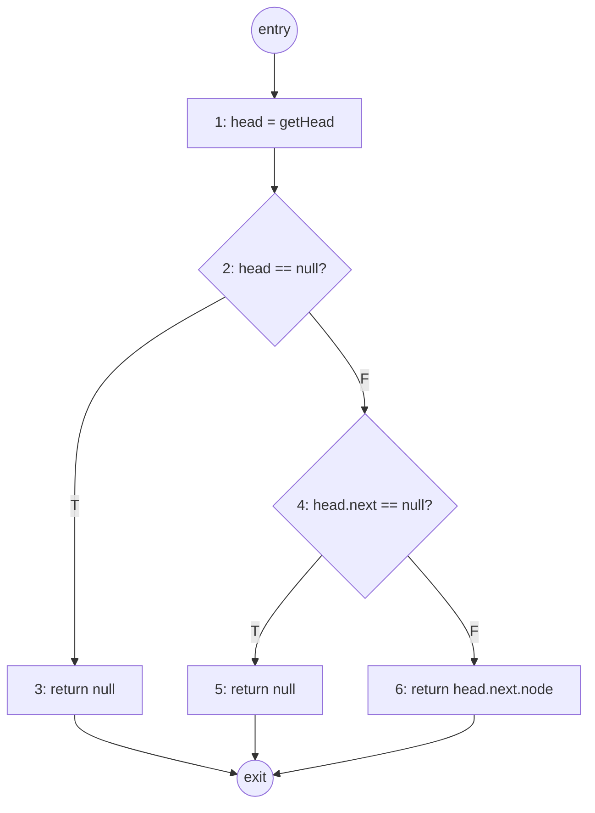
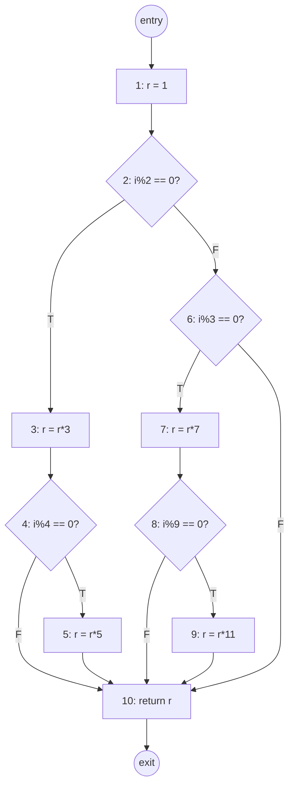

# Informatics 43 — Week 8 Lecture Notes

> Covers **Lecture 15 & Lecture 16**: *"How do we choose test cases?" (Parts 3 & 4)*

## Table of Contents

1. [Where We Are — From "Why Test?" to "Which Tests?"](#1-where-we-are--from-why-test-to-which-tests)
2. [The Two Overall Testing Approaches](#2-the-two-overall-testing-approaches)
3. [Black-Box / Specification-Based Testing](#3-black-box--specification-based-testing)
4. [Equivalence Class Partitioning](#4-equivalence-class-partitioning)
5. [Boundary Value Analysis](#5-boundary-value-analysis)
6. [The Systematic 5-Step Procedure](#6-the-systematic-5-step-procedure)
7. [Worked Example — The Grading Program](#7-worked-example--the-grading-program)
8. [Combinatorial Testing](#8-combinatorial-testing)
9. [White-Box / Structural Testing](#9-white-box--structural-testing)
10. [Control-Flow Graphs (CFGs)](#10-control-flow-graphs-cfgs)
11. [Worked Example 1 — `getSecondElement()`](#11-worked-example-1--getsecondelement)
12. [Statement (Node) Coverage](#12-statement-node-coverage)
13. [Branch (Edge) Coverage](#13-branch-edge-coverage)
14. [Worked Example 2 — The CFG-and-Coverage Handout](#14-worked-example-2--the-cfg-and-coverage-handout)
15. [Other Coverage Criteria](#15-other-coverage-criteria)
16. [Challenges with White-Box Testing](#16-challenges-with-white-box-testing)
17. [Inspections and Reviews](#17-inspections-and-reviews)
18. [Formal Methods](#18-formal-methods)
19. [Static Analysis](#19-static-analysis)
20. [Testing Topics Not Covered](#20-testing-topics-not-covered)
21. [Quiz 7 Study Guide](#21-quiz-7-study-guide)
22. [Wrap-Up and Memory Framework](#22-wrap-up-and-memory-framework)

---

## 1. Where We Are — From "Why Test?" to "Which Tests?"

Week 7 answered *why* we test. Lecture 13 framed Quality Assurance as **verification + validation** and named the four QA technique families (formal methods, static analysis, reviews, **testing**); Lecture 14 introduced the **basic testing process**, the three **levels** (unit / integration / system), **test oracles**, and the realist's mantra: *all software has bugs.* The lecture closed on three claims that Week 8 takes as starting points:

- **Testing can never be exhaustive.**
- **Testing can never prove a system's correctness.**
- **All software has bugs.**

Given all three, the engineering question becomes operational:

$$\boxed{\textbf{Of the (essentially infinite) possible test inputs, } \textit{which ones do we actually run?}}$$

Week 8 (Lectures 15 & 16) answers this with three concrete strategies — **black-box (specification-based)**, **combinatorial**, and **white-box (structural)** testing — plus a brief tour of the other three QA technique families (inspections, formal methods, static analysis) so that the testing unit closes with the whole QA toolbox in view. Lecture 16 also publishes the **Quiz 7 Study Guide**.

The recurring pattern from Week 7 — *use a mixture of techniques* — applies here at the next level down: **no single test-case-selection strategy catches all faults**; black-box and white-box have different blind spots and are best used together.

---

## 2. The Two Overall Testing Approaches

The first big distinction in test design is *what the tester looks at* to design test cases. Everything else this week — equivalence partitioning, boundary analysis, statement coverage, branch coverage — slots under one of these two headings.

| Approach | Synonyms | What the tester looks at | Mental picture |
|------|------|------|------|
| **Black-box testing** | Functional testing, **Specification-based** testing | Only the **specification** of what the system should do. The implementation is opaque. | A sealed box: feed inputs in, observe outputs, compare against the **oracle** |
| **White-box testing** | Structural testing, **Code-based** testing | The **source code** itself. Tester designs inputs to exercise specific code structures. | A glass box: tester sees the code and aims tests at chosen statements / branches / paths, with a **coverage criterion** as the stopping rule |

The two diagrams the slide uses make the contrast visible:

```text
Black-box:
    Input → [ System ] → Output → Oracle → Pass / Fail

White-box:
    Input → [ System ] → Output → Oracle       → Pass / Fail
                       ↘ Coverage Criterion? → Stop (when met)
```


The black-box pipeline ends at the **oracle**: did the output match what the spec said? The white-box pipeline adds a second exit — the **coverage criterion** — which is what tells the white-box tester when they've tested *enough of the code structure*.

> The two approaches are complementary, not competing. Black-box tests catch **missing features** and **misread specs** that white-box can't see (the code might be doing exactly what the developer thought it should, but the spec said something different). White-box tests catch **dead branches**, **unreachable code**, and **implementation-specific edge cases** that black-box can miss (the spec doesn't mention the `null` head-pointer case, but the code does). A real test plan uses both.

---

## 3. Black-Box / Specification-Based Testing

The defining commitments of black-box testing:

- **Use the specification to derive test cases.** Not the code — the spec.
- **Choose test cases that guarantee a wide range of coverage** *of the input domain*, not of the code.

The lecture lists five kinds of inputs a black-box test suite should reach for:

| Kind of input | Why include it |
|------|------|
| **Typical values** | Confirms the system handles the common case it was designed for |
| **Boundary values** | Bugs cluster at edges — off-by-one, `<` vs `<=`, integer wrap-around |
| **Special cases** | Empty strings, zero, `null`, single-element collections, leap days, time-zone transitions |
| **Invalid input values** | Negative ages, malformed JSON, future birthdates — does the system reject them safely? |
| **Combinations of values** | When multiple parameters interact, the bug may be in the combination, not in either one alone (see §8) |

Two systematic techniques structure this into a repeatable procedure: **equivalence class partitioning** (§4) and **boundary value analysis** (§5). They work together — partitioning gives you the classes, boundary analysis tells you which points inside each class to pick.

---

## 4. Equivalence Class Partitioning

The intuition: even though the input space is enormous, **most inputs behave the same way** from the program's point of view. We don't need to test every integer between 70 and 79 — we just need to test *one* of them, because they all map to the letter grade `C`.

$$\boxed{\textbf{An equivalence class is a set of inputs the program is expected to treat the same way for the purpose of finding bugs.}}$$

So if the program passes for one member, it is *likely* to pass for all members; if it fails for one member, it is *likely* to fail for all members. Pick **one representative per class**, and you've covered the class.

### How the classes are determined

| Source | Example |
|------|------|
| **The requirements specification** | "Scores ≥ 90 map to A" — the spec literally names a class |
| **The tester's intuition** | Spec doesn't mention `null`, but tester knows null inputs are a likely trouble class |

### Two properties the classes must satisfy

| Property | Why |
|------|------|
| **Cover the complete input domain** | Otherwise, some inputs go untested entirely |
| **Do not overlap** | Otherwise, you waste tests double-covering the same behavior |

Together: the equivalence classes **partition** the input domain — every input belongs to exactly one class.

> Equivalence partitioning compresses an infinite (or huge) input space into a small finite collection of *representative* inputs. The compression ratio is the whole point: a 100-value integer domain (0..100, for the grading example below) collapses to 5 classes, and the test budget compresses by 20×.

---

## 5. Boundary Value Analysis

A complementary technique built on the same partitioning. The observation behind it is empirical and well-known:

> *Many errors are made at the "boundaries" rather than under normal conditions* — e.g., confusion between `<` and `<=`, off-by-one in loop bounds, integer overflow at `INT_MAX`.

Boundary value analysis uses the **same equivalence classes** as partitioning, but instead of picking any representative from inside the class, it picks the values **at the boundaries** of each class — the smallest, the largest, and (if applicable) the values *just outside* the boundary on either side.

| Equivalence partitioning | Boundary value analysis |
|------|------|
| Pick *any* representative inside a class | Pick the values *on the edge* of each class |
| Catches "this whole class is broken" bugs | Catches off-by-one and edge-case bugs |
| Few tests per class | Two to four tests per class (the boundaries themselves) |

> In practice the two are used **together**: partition the domain into classes, then for each class pick *one typical interior value* (partitioning) **plus the boundary values** (boundary analysis). The grading example in §7 shows what this looks like in practice.

---

## 6. The Systematic 5-Step Procedure

Lecture 15 turns the two techniques into a single recipe:

1. **Identify the set of all possible inputs (the "domain")** — what is the program actually supposed to accept?
2. **Identify a basis for subdividing the set of inputs.** Possible bases include:
   - **Size / magnitude** — small, medium, large
   - **Structure** — empty vs. one-element vs. many-element collections
   - **Correctness** — valid vs. invalid inputs
   - **Tester's creative thinking / intuition**
3. **Use this basis to divide the set of all possible inputs into classes/subdomains.**
4. **From each subdomain, select a representative (or representatives) to be a test case input.** One test case may suffice per class.
5. **Test for each subdomain:**
   - "Normal" or "representative" values (any value inside the subdomain)
   - **Boundary or edge input values** (Boundary Value Analysis)

> The bases in step 2 are not exclusive. A real test design often uses **multiple bases at once** — for example, partitioning by both *correctness* (valid vs. invalid) and *magnitude* (small, medium, large). The resulting partition is the *intersection* of the per-basis partitions: "small-valid", "small-invalid", "medium-valid", etc.

---

## 7. Worked Example — The Grading Program

The lecture's example:

> A program takes a single assignment score from **0 to 100** in integer format and returns a letter grade in the standard scoring (90s are A, 80s are B, 70s are C, 60s are D, 50s and lower are F — no plusses or minuses).

### 7.1 Step 1 — The domain

In principle: all integers. In the spec: integers in **[0, 100]**. The spec implicitly defines a *second* class too: integers **outside [0, 100]** are **invalid** inputs.

### 7.2 Steps 2–3 — Basis and partitions

The natural basis here is *what the spec says the output should be*. That gives six classes:

| Class | Score range | Expected output |
|------|------|------|
| F  | 0–59   | `F` |
| D  | 60–69  | `D` |
| C  | 70–79  | `C` |
| B  | 80–89  | `B` |
| A  | 90–100 | `A` |
| Invalid | < 0 or > 100 | error / rejected |

### 7.3 Step 4–5 — Representative + boundary values per class

For each class, list the **boundaries** (the smallest and largest valid value inside the class). The boundary-value analysis says these are the values most likely to surface bugs.

| Class | Lower boundary | Upper boundary |
|------|------|------|
| F  | 0   | 59  |
| D  | 60  | 69  |
| C  | 70  | 79  |
| B  | 80  | 89  |
| A  | 90  | 100 |
| Invalid (below) | (any value < 0)  | -1 |
| Invalid (above) | 101 | (any value > 100) |

### 7.4 The resulting test suite (input, expected output)

The format the lecture asks for is `"input, expected output"`:

| Input | Expected output | Why this test exists |
|------|------|------|
| `0`   | `F` | Boundary — lower edge of F (and of valid domain) |
| `59`  | `F` | Boundary — upper edge of F |
| `60`  | `D` | Boundary — lower edge of D (off-by-one candidate vs 59) |
| `69`  | `D` | Boundary — upper edge of D |
| `70`  | `C` | Boundary — lower edge of C |
| `79`  | `C` | Boundary — upper edge of C |
| `80`  | `B` | Boundary — lower edge of B |
| `89`  | `B` | Boundary — upper edge of B |
| `90`  | `A` | Boundary — lower edge of A |
| `100` | `A` | Boundary — upper edge of A (and of valid domain) |
| `-1`  | error | Invalid — just below lower edge |
| `101` | error | Invalid — just above upper edge |

That's 12 test cases for a function whose input domain has 101 valid integers — a ~8× compression that still hits every boundary likely to harbor an off-by-one.

> Notice what this test suite is *good* at and *bad* at. **Good**: catches `< 90` vs `<= 90` confusion (the F-vs-A bug), missing invalid-input handling, off-by-one errors at every cutoff. **Bad**: does not catch a subtle bug like "the function returns `B` when the input is exactly 85" — because we never test 85. That's why this is paired with §16: black-box testing leaves blind spots that white-box testing is designed to fill.

---

## 8. Combinatorial Testing

So far, every example has a *single* input parameter. Real functions take many. **What happens to equivalence-class partitioning when there are multiple parameters?**

The lecture's answer is mechanical but disciplined:

1. **For each parameter independently**, determine its equivalence partitions and representative (possibly boundary) values — exactly as in §4–§7.
2. **Then devise combinations** of those per-parameter values to form the test inputs.

The "devise combinations" step is where the engineering judgment lives, because the full Cartesian product blows up fast. If three parameters each have 5 representative values, the full combination is $5 \times 5 \times 5 = 125$ tests — and with realistic functions (say, ten parameters with five values each), the full product is $5^{10} \approx 9.77$ million.

| Combination strategy | What it covers | Cost |
|------|------|------|
| **Full Cartesian product** | Every combination of every per-parameter value | Exponential in the number of parameters — infeasible past a few |
| **All-pairs (pairwise)** | Every *pair* of (param-i value, param-j value) appears at least once | Much smaller; empirically catches most multi-parameter bugs |
| **Hand-picked combinations** | Cases the tester thinks are interesting | Cheap but unsystematic |

> The empirical justification for **all-pairs** is striking: studies of real-world bug databases show most multi-parameter bugs are triggered by an interaction of **just two** parameters. So testing every pair (rather than every full tuple) captures most of the combinatorial value at a small fraction of the cost. INF 43 doesn't go deeper, but the term "pairwise testing" / "all-pairs testing" is worth knowing.

---

## 9. White-Box / Structural Testing

The pivot from black-box to white-box. The defining commitments:

- **Use source code to derive test cases** (not the spec).
- **Build a graph model of the system** (the **control-flow graph**, §10).
- **State test cases in terms of graph coverage** — pick inputs so that the resulting executions visit chosen graph elements.

The new ingredient that black-box did not need is the **coverage criterion** — a precise rule for *which* graph elements need to be visited before testing is "done." The lecture lists six families, in roughly increasing strictness:

| Coverage criterion | What must be visited | Section |
|------|------|------|
| **Statement (node) coverage** | Every node | §12 |
| **Branch (edge) coverage** | Every edge | §13 |
| **Condition coverage** | Every sub-condition in each boolean expression, both `T` and `F` | §15 |
| **Method coverage** | Every method called at least once | §15 |
| **Method-call coverage** | Every call site reaches every possible method (including all polymorphic targets) | §15 |
| **Path coverage** | Every distinct path from entry to exit | §15 |

Stronger criteria *subsume* weaker ones: full branch coverage implies full statement coverage (visiting every edge forces visiting every node), and full path coverage implies full branch coverage. **Path coverage is the strongest** — and, as §15 makes clear, **often infeasible**.

---

## 10. Control-Flow Graphs (CFGs)

The graph model that white-box testing operates on. The rules from the slide:

| Element | Rule |
|------|------|
| **Entry node** | Every CFG has one — represents all control flow coming *into* the function |
| **Exit node**  | Every CFG has one — represents all control flow leaving the function |
| **Nodes** | Each node corresponds to an **atomic instruction**, generally one line of code |
| **Edges** | Each edge is **directed** (arrow from source to target) and represents possible control flow |
| **Branches** | Any node with **2 or more outgoing edges**. Those edges must be **labeled** with the condition that selects them (`T`/`F` for predicates, the case value for `switch` statements) |

> Two facts about CFGs that are worth absorbing now and will come back later: **(1) Loops are cycles in the CFG** — a `while` or `for` statement is a node with an outgoing edge that eventually loops back to the loop header. **(2) Every CFG has a single entry and a single exit by construction** — even functions with multiple `return` statements get a single virtual exit node that all returns flow into.

---

## 11. Worked Example 1 — `getSecondElement()`

The lecture's running example is the Python function:

```python
def getSecondElement():
1   head = getHead()
2   if head == null:
3       return null
4   if head.next == null:
5       return null
6   return head.next.node
```

### The control-flow graph



Plain-text version (for environments without Mermaid rendering):

```text
        entry
          |
          v
          1            (head = getHead())
          |
          v
          2            (if head == null)
         / \
       T/   \F
       /     \
      3       4        (3: return null;  4: if head.next == null)
      |      / \
      |   T /   \F
      |    /     \
      |   5       6    (5: return null;  6: return head.next.node)
       \  |      /
        \ |     /
         vvv  vv
          exit
```


The graph has three end-to-end paths through the body:

| Path | Conditions | Returned value |
|------|------|------|
| 1 → 2 → 3 → exit | `head == null` (2T) | `null` |
| 1 → 2 → 4 → 5 → exit | `head != null` (2F), `head.next == null` (4T) | `null` |
| 1 → 2 → 4 → 6 → exit | `head != null` (2F), `head.next != null` (4F) | `head.next.node` |

These three paths are the canonical scenarios — each corresponds to a *kind* of input list (empty / single-element / multi-element). §12 and §13 design test inputs that hit them under different coverage rules.

---

## 12. Statement (Node) Coverage

The first and weakest coverage criterion.

$$\boxed{\textbf{Statement coverage: every node in the CFG must be visited by at least one test case.}}$$

Also called **node coverage**. For the `getSecondElement` CFG, the nodes that must be visited are `{1, 2, 3, 4, 5, 6}`.

### Designing test cases for full statement coverage

We need linked-list inputs that, taken together, exercise nodes 1–6. The lecture's sample test inputs (notation: a list literal, with `null` for empty):

| Test input | Path taken | Nodes hit | New coverage |
|------|------|------|------|
| `{null, 2, 4}` (head pointer = `null`) | 1 → 2 → 3 | `1, 2, 3` | first time at 1, 2, 3 |
| `{5, null, 8, 7}` (single-element list — `head.next == null`) | 1 → 2 → 4 → 5 | `1, 2, 4, 5` | adds 4, 5 |
| `{9, 2}` (two-element list) | 1 → 2 → 4 → 6 | `1, 2, 4, 6` | adds 6 |

After all three tests: nodes hit = `{1, 2, 3, 4, 5, 6}` → **full statement coverage**.

> The {null, 2, 4} notation in the slide is shorthand for "a list whose first element is `null`" — i.e., an empty list, where `getHead()` returns `null`. The other elements are unused by the function. Similarly, the second test passes a list whose head's `.next` is `null`. The notation looks confusing because the function under test only inspects `head` and `head.next`.

---

## 13. Branch (Edge) Coverage

A stricter criterion.

$$\boxed{\textbf{Branch coverage: every } \textit{edge} \textbf{ in the CFG must be visited by at least one test case.}}$$

Also called **edge coverage**. For `getSecondElement` the edges are:

`entry→1`, `1→2`, `2→3 (T)`, `2→4 (F)`, `4→5 (T)`, `4→6 (F)`, `3→exit`, `5→exit`, `6→exit`.

The branch points are nodes 2 and 4. For full branch coverage we need to take both the `T` and `F` outgoing edges at *each* branch point — so we need a test that takes `2T`, one that takes `2F+4T`, and one that takes `2F+4F`.

| Test input | `2T/F` | `4T/F` | Edges added |
|------|------|------|------|
| `{null, 2, 4}` | 2T | (not reached) | `2→3` |
| `{5, null, 8, 7}` | 2F | 4T | `2→4`, `4→5` |
| `{9, 2}` | 2F | 4F | `4→6` |

After all three: every edge hit → **full branch coverage**.

> For this example the same three test cases satisfy both statement coverage and branch coverage — they happen to be the **three end-to-end paths** through the function. That's a coincidence of the small example; in general, branch coverage requires *more* tests than statement coverage. **Branch coverage is more thorough** because it catches logical errors that statement coverage can miss — e.g., a branch where the `else` is never taken can still have all its statements covered through the `if` side, but branch coverage forces both directions.

---

## 14. Worked Example 2 — The CFG-and-Coverage Handout

The handout (`int m(int i)`) is a bigger CFG with nested `if`s on both sides of a top-level `if/else`. Working it out completely is the canonical exercise for this material.

### 14.1 The code

```c
int m(int i) {
 1    r = 1;
 2    if ( (i%2) == 0 ) {
 3        r = r * 3;
 4        if ( (i%4) == 0 ) {
 5            r = r * 5;
          }
      } else {
 6        if ( (i%3) == 0 ) {
 7            r = r * 7;
 8            if ( (i%9) == 0 ) {
 9                r = r * 11;
              }
          }
      }
10    return r;
}
```


### 14.2 The control-flow graph

Branch points are at nodes 2, 4, 6, 8. The graph:



### 14.3 Tracing a few inputs

To design test cases we trace by hand what each input does. The function's logic in words: *start at `r=1`; if `i` is even, multiply by 3, and if also divisible by 4 multiply by 5; otherwise if `i` is divisible by 3, multiply by 7, and if also divisible by 9 multiply by 11; return `r`.*

| `i` | Path through CFG | Statements visited | Branches taken | `r` returned |
|------|------|------|------|------|
| `1`  | 1→2→6→10 | 1, 2, 6, 10 | 2F, 6F | `1` |
| `2`  | 1→2→3→4→10 | 1, 2, 3, 4, 10 | 2T, 4F | `3` |
| `3`  | 1→2→6→7→8→10 | 1, 2, 6, 7, 8, 10 | 2F, 6T, 8F | `7` |
| `4`  | 1→2→3→4→5→10 | 1, 2, 3, 4, 5, 10 | 2T, 4T | `15` |
| `9`  | 1→2→6→7→8→9→10 | 1, 2, 6, 7, 8, 9, 10 | 2F, 6T, 8T | `77` |

### 14.4 A minimal test set for **statement coverage** (S1–S10)

We need every one of `S1, S2, ..., S10` visited at least once. From the table:

| Test input | Statements newly covered |
|------|------|
| `i = 4` | `S1, S2, S3, S4, S5, S10` |
| `i = 9` | adds `S6, S7, S8, S9` |

Two test cases — `i = 4` and `i = 9` — cover all 10 statements.

| Test input → | `i=4` | `i=9` |
|------|------|------|
| Expected output | `15` | `77` |
| S1 | ✓ | ✓ |
| S2 | ✓ | ✓ |
| S3 | ✓ |   |
| S4 | ✓ |   |
| S5 | ✓ |   |
| S6 |   | ✓ |
| S7 |   | ✓ |
| S8 |   | ✓ |
| S9 |   | ✓ |
| S10 | ✓ | ✓ |

### 14.5 A minimal test set for **branch coverage** (8 branches)

The eight branches to cover are `2T, 2F, 4T, 4F, 6T, 6F, 8T, 8F`. Two test cases are no longer enough — each input takes exactly one direction at each branch point it reaches, and we need both directions at all four branch points.

| Test input | Branches covered |
|------|------|
| `i = 4` | `2T, 4T` |
| `i = 2` | `2T, 4F` |
| `i = 9` | `2F, 6T, 8T` |
| `i = 3` | `2F, 6T, 8F` |
| `i = 1` | `2F, 6F` |

| Test input → | `i=4` | `i=2` | `i=9` | `i=3` | `i=1` |
|------|------|------|------|------|------|
| Expected output | `15` | `3` | `77` | `7` | `1` |
| 2T | ✓ | ✓ |   |   |   |
| 2F |   |   | ✓ | ✓ | ✓ |
| 4T | ✓ |   |   |   |   |
| 4F |   | ✓ |   |   |   |
| 6T |   |   | ✓ | ✓ |   |
| 6F |   |   |   |   | ✓ |
| 8T |   |   | ✓ |   |   |
| 8F |   |   |   | ✓ |   |

Five test cases give **full branch coverage**. Notice they also automatically give full statement coverage (every statement on every branch is visited along the way) — illustrating that **branch coverage subsumes statement coverage**.

> A small subtlety from the table: there is no test in this set that covers `8T` together with `4T`, because they're on opposite sides of the top-level `if/else`. That's not a flaw — they're mutually exclusive in this program, so no input can hit both. **Some coverage targets are unreachable in combination; full branch coverage demands hitting each branch at least once, not in every combination with every other.** §16 returns to this idea under the heading **infeasibility**.

---

## 15. Other Coverage Criteria

Beyond statement and branch coverage, the lecture names four more — included so the vocabulary is complete, but not drilled into.

| Criterion | What it requires | What it adds beyond branch coverage |
|------|------|------|
| **Condition coverage** | In a compound boolean expression like `if (a > b \|\| c > d)`, *each sub-condition* (`a > b`, `c > d`) must be evaluated to both `T` and `F` | Catches bugs where a compound condition is wrong but the top-level branch direction is the same |
| **Method coverage** | Every method in the system has been called by some test | Cheap sanity check — finds methods nobody is testing |
| **Method-call coverage** | Every method-call site has been exercised against every possible target method (considering polymorphism — virtual / overridden methods) | Critical for OO code: a call `shape.draw()` could dispatch to `Circle.draw`, `Square.draw`, `Triangle.draw`; method-call coverage requires reaching all of them from that site |
| **Data-flow coverage** | Every variable assignment reaches all of its reachable uses (def-use pairs) | Finds bugs where a value is set but never used, or used without being set |
| **Path coverage** | **Every distinct path from entry to exit** is exercised | The strictest — but generally infeasible (see below) |

### Why path coverage is rarely achievable

The number of paths grows **multiplicatively** with the number of branches, and **exponentially with loops**.

| Construct | Paths added |
|------|------|
| One `if/else` | × 2 |
| Two nested `if/else` | × 4 |
| A loop iterated 0..N times | × (N+1) |
| A loop iterated 0..∞ times | infinite paths |

For loops the lecture's pragmatic compromise is: test **0 iterations**, **1 iteration**, **an average number of iterations**, and the **maximum number of iterations**. That captures the most common loop bugs (off-by-one at the entry, off-by-one at the exit, accumulator overflow) without claiming to enumerate every path.

> The trade-off is universal: stronger criteria find more bugs but cost more tests, and at some point the cost goes infinite. The practical recommendation is **branch coverage** as the working standard for most code, with **condition coverage** added for safety-critical compound expressions and **path coverage** reserved for small, critical fragments where the path count is tractable.

---

## 16. Challenges with White-Box Testing

White-box testing is powerful but has three named limits, all worth memorizing:

| Challenge | What it means | Why it matters |
|------|------|------|
| **Useful for identifying under-tested parts of a program** | Coverage tools tell you *what was never run* | A clear actionable signal — go write tests for the uncovered lines |
| **Can cover all nodes or edges without revealing obvious faults** | 100% branch coverage does **not** mean bug-free | Coverage is necessary but not sufficient — you can run every line without exercising the buggy *combination* of inputs |
| **Some nodes, edges, or loop combinations may be infeasible** | Logically unreachable code (defensive `else` branches, "this should never happen" assertions) cannot be covered no matter what input you supply | Don't chase 100% coverage at any cost — sometimes <100% is the correct stopping point |

> The deepest of the three is the second. Coverage is a property of the *test executions*, not of *the bugs found*. A test suite that runs every line but never *checks* the output is a useless test suite with 100% coverage. The right slogan: **coverage is necessary but not sufficient — pair it with strong oracles**.

### Further reading (from the slide)

Two tutorial-style posts the lecturer recommends:

- *Path Testing: The Theory* — <http://testerstories.com/2014/06/path-testing-the-theory/>
- *Path Testing: The Coverage* — <http://testerstories.com/2014/06/path-testing-the-coverage/>

---

## 17. Inspections and Reviews

After two lectures of executable testing, Lecture 16 returns to the **other three QA technique families** named in Lecture 13 — starting with reviews. The slogan is short and surprising:

> **Humans read documents and look for defects. Surprisingly effective.**


Why surprising? Because intuitively, an expensive specialist *reading the code* sounds slower and weaker than running thousands of automated tests. The empirical finding is that reviews catch a *different* class of bug — bugs that no test would think to write a case for.

### Benefits (from Bacchelli & Bird, *"Code Reviewing in the Trenches,"* IEEE Software 2018)

| Benefit | One-line description |
|------|------|
| **Improve code quality** | Reviewers push back on shortcuts and ugly patterns |
| **Improve code understandability** | Forcing yourself to explain code to a reviewer surfaces unclear parts |
| **Find defects** | The original purpose; still works |
| **Transfer knowledge** | Reviewers learn the part of the codebase they review |
| **Explore alternative solutions** | "Have you considered doing this with X instead?" |
| **Improve the development process** | Patterns of review comments highlight process gaps |
| **Avoid breaking builds** | Catches obvious mistakes before they hit CI |
| **Increase team awareness** | Everyone sees what everyone else is working on |
| **Share code ownership** | Multiple people know each part of the code |
| **Team assessment** | Managers can see who is reviewing, who is being reviewed |

> Modern open-source workflows make this concrete: a **pull request** on GitHub *is* a code review. Reviewers leave inline comments, the author responds with revisions, and the PR doesn't merge until the reviewer approves. The PR-review pattern is the industrial form of inspections and is now nearly universal in software development.

---

## 18. Formal Methods

The third QA family — and the one with the highest assurance and the highest cost.

The lecture's three-line summary:

| Property | What it means |
|------|------|
| **Proofs of correctness** | A mathematical proof that the program meets its formal specification |
| **Verification only** | Formal methods answer "does the system match the spec?" They cannot answer "is the spec right?" — that's still validation |
| **Usually done with formal specifications** | The spec itself must be written in a formal language (e.g., **Z**, **TLA+**, **Coq**, **Alloy**) before it can be proved against |

The slide shows a snippet of a **Z specification** (the example uses set-builder notation, universal quantifiers, and predicate logic over an `OZSpec → UMLDiagram` mapping) — a hint at how dense formal specifications can be. Most students will never write Z, but they should recognize the shape.


> The trade-off is brutal: formal methods give the strongest possible correctness guarantee, but at a cost that is only justified for very small, very critical components — the math behind a flight-control law, the encryption code in a TLS library, a real-time operating system kernel. They are not used for everyday application code.

---

## 19. Static Analysis

The fourth QA family, and the one most students will actually use.

> **A computer program analyzes source code and finds possible defects (without running the code).**
> **Results are reviewed by a person because many warnings are not actually problems.**

Two ideas pack into those two lines:

- **Without running the code.** Static analyzers parse the source and reason about it symbolically — types, dataflow, control flow, possible aliasing. They never execute the program. That's why they're cheap and fast and can be run on every commit.
- **Many warnings are not actually problems.** Static analyzers necessarily approximate. They flag any *possible* defect — including ones that are unreachable at runtime. The output is a **list of candidate defects**, not a list of bugs. A human triages the list.

### Example tool: FindBugs

The slide screenshots **FindBugs**, a Java static analyzer that flags bug *patterns* — "Suspicious calls to generic container methods", "Call to equals() with null argument", "Call to equals() comparing unrelated class and interface". The screenshot shows it flagging a specific line `if (!enum_.equals(""))` and explaining: *"We don't call nextElement() on `enum_`, so this will be an infinite loop if it is ever called. Should be `if (!enum_.nextElement().equals(""))`."* — a real bug pattern caught without running the code.

![Screenshot of the FindBugs static analyzer Eclipse plugin. Left pane lists bug patterns grouped by category and priority — "Suspicious calls to generic container methods (1)", "Call to equals() comparison (20)", with "Call to equals() comparing unrelated class and interface" highlighted. Right pane shows the offending Java source `PartialCompositeContext.java` with the flagged line highlighted in yellow. Bottom pane displays the bug description "Call to equals() comparing unrelated class and interface" and the explanatory text that the comparison will always be false at runtime.](https://cdn.jsdelivr.net/gh/KKazuhaK/assets@main/ics.uci.edu/in4matx-43/week-8/findbugs-screenshot.png)

Other widely-used static analyzers worth knowing the names of:

| Language | Tool |
|------|------|
| Java | FindBugs / SpotBugs, Checkstyle, PMD |
| Python | mypy (types), pylint, flake8, ruff |
| JavaScript / TypeScript | ESLint, TypeScript compiler |
| C / C++ | Clang Static Analyzer, Coverity, PVS-Studio |
| Multi-language | SonarQube |

> Static analysis is the QA technique with the best **cost / benefit ratio for routine use**. It's nearly free (run it in CI), it catches whole categories of bugs that no test could reliably find (null derefs, resource leaks, dead code, simple races), and it gets out of the way once you've configured it. Every serious project should turn it on. The Power-of-Ten Rule #10 from Week 7 — *compile with all warnings enabled, and use one or more source code analyzers* — is the safety-critical version of this same recommendation.

---

## 20. Testing Topics Not Covered

The lecture closes the testing unit by naming the topics it *didn't* cover — so students know what they're missing and can pursue them independently.

| Topic | One-line summary |
|------|------|
| **Regression testing** | Re-run the existing test suite on every new version to ensure old features still work (Week 7 named it; this week didn't drill deeper) |
| **Integration testing** | The "middle level" of the test pyramid — testing interfaces among modules |
| **Interaction testing (Mocking)** | Replacing real collaborators with **mock objects** that record calls and return fixed values — lets a unit be tested in isolation from its dependencies |
| **Debugging** | Once a test fails, the process of finding and fixing the underlying fault |
| **Mutation testing** | The automated form of fault seeding (§19.3 in Week 7) — tools like **PIT**, **Stryker**, **mutmut** systematically inject mutations and measure what fraction the test suite catches |
| **Fuzz testing** | Feed the program *random or malformed* inputs and watch for crashes or hangs — extremely effective at finding security vulnerabilities |
| **Exploratory testing** | Skilled human tester interacts with the system without a predefined script, guided by hypotheses and curiosity |

> All of these are **standard topics in a graduate-level testing course or in industry**. INF 43 is an introduction; you have the vocabulary and core practices now, but real-world testing involves several more techniques on top of this base.

---

## 21. Quiz 7 Study Guide

Lecture 16 publishes the study guide explicitly. Quiz 7 covers everything from Lecture 13 (Week 7) through Lecture 16 (Week 8) — Weeks 7 and 8 together.

### 21.1 Testing Fundamentals (Lectures 13–14)

| Topic | What you need to be able to do |
|------|------|
| **Validation vs. verification** | Define both; explain the diff ("building the right system" vs. "building the system right") |
| **Mistake / fault / error / failure (IEEE)** | Define all four; give the causal chain (Mistake → Fault → Error → Failure) |
| **Testing goals** | Find faults; improve confidence (V+V); accurate / thorough / repeatable / systematic |
| **Dijkstra quote** | Memorize the wording: *"Program testing can be used to show the presence of bugs, but never to show their absence."* Explain *why* |
| **Levels of testing** | Unit / integration (functional) / system (acceptance) — definition + example for each |
| **Test oracles** | What is an oracle? Why is automating it hard? (cosine example) |
| **Different ways to know when we're done** | Time/budget; find-rate stabilizes; fault seeding; "each requirement tested at least once" (the most common in industry) |

### 21.2 Black-Box Testing (Lecture 15)

| Topic | What you need to be able to do |
|------|------|
| **Equivalence class partitioning** | Define; identify classes from a spec; pick representatives |
| **Boundary value analysis** | Define; pick boundary values inside each class; explain *why* boundaries (off-by-one, `<` vs `<=`) |
| **Combinatorial testing** | Explain how to combine partitions across multiple parameters; know the Cartesian-product blow-up |

### 21.3 White-Box Testing (Lectures 15–16)

| Topic | What you need to be able to do |
|------|------|
| **Statement / node coverage** | Define; given a CFG, design a minimal test set that achieves it |
| **Branch / edge coverage** | Define; given a CFG, design a minimal test set that achieves it; explain why it's stronger than statement coverage |
| **Control-flow graphs** | Build one from source code; label branches correctly (T/F or case values); identify entry and exit |

### 21.4 Other QA Topics (Lecture 16)

| Topic | What you need to be able to do |
|------|------|
| **Code inspections** | What they are; *why* they are "surprisingly effective"; name 2–3 benefits |
| **Static analyzers** | What they are; that they run *without* executing the code; that warnings need human triage |

### 21.5 Worked-example fluency

The CFG-and-coverage handout (§14) is exactly the kind of mechanical exercise the quiz can repeat: *here is a small function, draw the CFG, give a minimal test set for statement coverage, give a minimal test set for branch coverage.* Be able to do all three smoothly without drawing the graph twice.

---

## 22. Wrap-Up and Memory Framework

```text
Week 8 knowledge structure
|
+-- The question this week
|   +-- Given that we can't test exhaustively / prove correctness,
|       which test cases do we actually run?
|
+-- Two overall testing approaches (Lecture 15)
|   +-- Black-box / specification-based / functional
|   |     +-- look only at the SPEC
|   |     +-- stops via the test oracle (pass/fail)
|   +-- White-box / structural / code-based
|         +-- look at the SOURCE CODE
|         +-- stops via a coverage criterion (statement, branch, ...)
|
+-- Black-box techniques (Lecture 15)
|   +-- Equivalence Class Partitioning:
|   |     +-- group inputs the program treats the same
|   |     +-- classes must COVER the domain and NOT OVERLAP
|   |     +-- one representative per class
|   +-- Boundary Value Analysis:
|   |     +-- bugs cluster at edges (< vs <=)
|   |     +-- pick values on the boundaries of each class
|   +-- Systematic 5-step procedure:
|   |     1. Identify the domain
|   |     2. Pick a basis for partitioning
|   |        (size, structure, correctness, intuition)
|   |     3. Divide into subdomains
|   |     4. Pick representative(s) per subdomain
|   |     5. Test reps + boundaries
|   +-- Grading example: 0..100 -> A/B/C/D/F + invalid
|   |     12 tests = boundaries of 5 classes + 2 invalid edges
|   +-- Combinatorial Testing:
|         +-- partition each parameter independently
|         +-- devise combinations (full Cartesian, all-pairs, ...)
|
+-- White-box techniques (Lectures 15-16)
|   +-- Control-Flow Graphs:
|   |     +-- entry + exit nodes
|   |     +-- node = atomic instruction
|   |     +-- edge = directed control flow
|   |     +-- branches = 2+ outgoing edges, labeled T/F
|   +-- Coverage criteria (increasing strictness):
|   |     +-- Statement / node:  every node visited
|   |     +-- Branch / edge:     every edge visited
|   |     +-- Condition:         every sub-condition T and F
|   |     +-- Method:            every method called
|   |     +-- Method-call:       every call site x every target
|   |     +-- Path:              every path (often infeasible)
|   +-- Branch SUBSUMES statement (every edge -> every node)
|   +-- Worked example: int m(int i) with i%2, i%4, i%3, i%9
|   |     +-- statement coverage minimal: { i=4, i=9 }     (2 tests)
|   |     +-- branch coverage minimal:    { 4, 2, 9, 3, 1} (5 tests)
|   +-- Challenges:
|         +-- great for finding under-tested parts
|         +-- 100% coverage != bug-free (need strong oracles)
|         +-- some elements are INFEASIBLE (unreachable code)
|
+-- The other 3 QA families (Lecture 16)
|   +-- Inspections & Reviews:
|   |     +-- humans read code/docs for defects
|   |     +-- "surprisingly effective"
|   |     +-- modern form: GitHub Pull Requests
|   +-- Formal Methods:
|   |     +-- mathematical proofs of correctness
|   |     +-- VERIFICATION ONLY (not validation)
|   |     +-- needs formal specifications (Z, TLA+, Coq, ...)
|   +-- Static Analysis:
|         +-- analyze source WITHOUT running it
|         +-- e.g. FindBugs / SpotBugs / mypy / ESLint / Coverity
|         +-- humans triage warnings (not all are real bugs)
|
+-- Topics named but not covered
|   +-- regression, integration, mocking, debugging,
|       mutation testing, fuzz testing, exploratory testing
|
+-- Quiz 7 = Weeks 7 + 8
    +-- V&V, M/F/E/F, Dijkstra, levels, oracles, when-done
    +-- Black-box: eq partitioning + boundary + combinatorial
    +-- White-box: statement + branch + CFG
    +-- Inspections + static analyzers
    +-- Be able to: draw a CFG, design min statement-coverage
        test set, design min branch-coverage test set
```

### One-sentence summary

> Test-case selection is the engineering art of compressing an effectively infinite input space into a finite test suite: **black-box testing** uses the specification to partition inputs into equivalence classes and pick representatives plus boundary values (and combines partitions across parameters via combinatorial testing), **white-box testing** uses a control-flow graph derived from the source code and demands that test inputs achieve a coverage criterion — most often **statement** or the strictly stronger **branch** coverage — and the broader QA toolbox surrounding testing also includes **inspections and code reviews** (humans reading code), **formal methods** (mathematical proofs of correctness, for the most critical components), and **static analysis** (tools like FindBugs that flag candidate defects without executing the code), with the recurring lesson that no single technique catches every bug and serious projects use a **mixture**.
