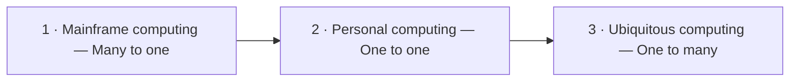

# IN4MATX 133: User Interface Software — Lecture 1: Introduction & History

## Table of Contents

- [1. Why UI implementation matters](#1-why-ui-implementation-matters)
- [2. Weiser and the three waves of computing](#2-weiser-and-the-three-waves-of-computing)
- [3. First wave: mainframe computing](#3-first-wave-mainframe-computing)
- [4. Second wave: personal computing](#4-second-wave-personal-computing)
- [5. Third wave: ubiquitous computing](#5-third-wave-ubiquitous-computing)
- [6. Why web tools are the standard](#6-why-web-tools-are-the-standard)
- [7. Course goals and assignments](#7-course-goals-and-assignments)
- [8. Course staff and policies](#8-course-staff-and-policies)
- [9. In-class Questions & Demos (with Solutions)](#9-in-class-questions--demos-with-solutions)
- [10. Quick Reference & Top 5 Things to Remember](#10-quick-reference--top-5-things-to-remember)

> UCI IN4MATX 133: User Interface Software — Prof. Travis Linden Reid, Fall 2026, Thursday 9/25
> Built from the Lecture 1 slides (72 pages). This lecture has no demo folder in the course repo. Organized by concept, not by source.

> 📅 **Class logistics**: PollEverywhere polls start Tuesday, Sept 29 (Lecture 2).
> Attendance grading starts Tuesday, Oct 13 (after the add/drop date).
> Next Friday's discussion section: introduction to Git and GitHub (not covered in lecture).

---

## 1. Why UI implementation matters

The slides frame the course with a simplified **product design process**: Ideate → Refine → Design → Implement → Test → Deploy, with an arrow from Deploy back to Ideate (it is a loop, not a line). This course lives in the **Implement** step.

User interface implementation:

- has the power to turn ideas into reality;
- often dictates design decisions and timelines, for better or for worse;
- is unavoidable: either you will be implementing, or you will need to communicate with colleagues who are.

**What is interface implementation today?** Often **HTML, CSS, and JavaScript**, plus the frameworks built on them. The slide's logo wall: Angular, Bootstrap, React JS, Backbone.js, Meteor, Ionic, Node, Vue.js, Ember. Of these, the course assignments use Bootstrap, Angular and Ionic ([section 7](#7-course-goals-and-assignments)).

That raises the lecture's central question: *there are a lot of languages and development frameworks — why do most people use web tools?* The history in sections 2–5 builds the answer, given in [section 6](#6-why-web-tools-are-the-standard).

> 📝 **Practice**: [Question 1: Why do most people use web tools?](#91-question-1-why-are-web-tools-the-standard-for-interface-development-slides-6-38)

## 2. Weiser and the three waves of computing

**"The Computer for the 21st Century"** by Mark Weiser, Chief Scientist at Xerox PARC, published in *Scientific American* in 1991. It **coined "Ubiquitous Computing"**. The slide calls it both *reflective* (looks back at how computing developed) and *speculative* (imagines what comes next).

The lecture organizes computing history into **three waves**, each defined by how many people share how many computers:

| Wave | Era in the slides | Person : computer | Slide label |
|---|---|---|---|
| 1. Mainframe computing | 1940s–1960s | many people share one computer | "Many to one" |
| 2. Personal computing | 1970s–1990s | one person, one computer | "One to one" |
| 3. Ubiquitous computing | today | one person, many computers | "One to many" |

> 💡 **Key Insight**: The three ratios — many-to-one, one-to-one, one-to-many — are the one-line summary of the whole history part of this lecture.

> 🔗 **Go deeper**: [Weiser, "The Computer for the 21st Century" (ACM DL)](https://dl.acm.org/citation.cfm?id=329126)

## 3. First wave: mainframe computing

### 3.1 The Harvard Mark I and batch processing

The **Harvard Mark I** is the slide's example mainframe:

- **Large**: 55 feet wide, 8 feet high, 5 tons.
- **Expensive**: the enclosure alone cost 50,000 US dollars in 1945.
- Used to calculate implosion during the **Manhattan Project**.

Mainframes worked by **batch processing**:

1. Write your program on punch cards.
2. Wait your turn for the computer.
3. Run the program, hope it works.
4. If it doesn't, fix it and wait for your next turn.

Result: **poor interactivity**. Many people shared one machine — **"many to one"**.

### 3.2 Vannevar Bush and "As We May Think"

**Vannevar Bush**: MIT faculty; oversaw the National Defense Research Committee, which led the Manhattan Project; after the war helped define the mission of the **National Science Foundation**:

- the federal government funds universities;
- universities do basic scientific research;
- that research helps the economy and defense.

His essay **"As We May Think"** (*Atlantic Monthly*, 1945) in part set out a post-war scientific research agenda. Unlike Weiser's paper it is **speculative, not reflective** — it imagines devices that didn't exist.

### 3.3 Memex (1945 speculative design)

The essay's imagined device is the **Memex**, a desk-sized machine for:

- **linking information** across devices and sources — i.e. **hypertext, the foundation of the web**;
- **pen-based annotation** of primary sources.

The slide's animation is from 1995 (presented at SIGIR), not from 1945 — the Memex was never built.

### 3.4 Command-line interfaces (1960s)

- Originally used in a **terminal connected to a mainframe**; later integrated into personal computing (Unix, etc.).
- A person could **change execution based on output**.
- This enabled **real-time debugging** — a big step up from waiting a turn with punch cards.

### 3.5 Doug Engelbart's NLS (1968)

The 1968 demonstration of NLS (the "oN-Line System") showed:

- the **first working hypertext system** (the Memex idea, built);
- the **invention of the mouse**;
- simple graphics (earlier systems had them, but here they were used in a full system);
- other ideas too: a **chording keyboard** and **remote collaboration**.

Reception was mixed: some people thought he "faked it"; others thought it irrelevant because "the terminal can do the same". Engelbart won the **Turing Award in 1997**.

> ⚠️ **Pitfall**: Keep the dates and roles apart — Bush *imagined* hypertext (Memex, 1945); Engelbart *built* the first working hypertext system and the mouse (NLS, 1968).

> 🔗 **Go deeper**: [Bush, "As We May Think" (The Atlantic, 1945)](http://www.theatlantic.com/magazine/print/1945/07/as-we-may-think/3881/) · [Memex animation (1995, YouTube)](https://www.youtube.com/watch?v=c539cK58ees) · [Engelbart's 1968 demo](http://www.dougengelbart.org/firsts/1968-demo-interactive.html)

## 4. Second wave: personal computing

Personal computing was **first introduced by Xerox**:

| System | Year | What the slides note |
|---|---|---|
| Xerox Alto | 1973 | mouse, chording keyboard |
| Xerox Star | 1981 | software running in **windows**; a **desktop with icons** for navigating between files and programs; "super slow!" |
| Apple Macintosh | 1984 | (screenshot: Mac desktop with windows, folders, calculator) |
| Windows 1.0 | 1985 | (screenshot: tiled windows — file list, Reversi, clock, Write) |
| Windows 3.0 & 3.1 | 1990 & 1992 | **windowing became primary**; added Solitaire, Minesweeper and FreeCell — a trick to **teach mouse skills** |
| Mosaic web browser | 1993 | originally for Unix, later ported to Mac and Windows; the "first" graphical web browser |

The Xerox models were **commercially unsuccessful**: still expensive, and too few applications. On browsers: Microsoft IE came in 1995; Apple didn't make a browser until Safari in 2003.

One person now had one computer — **"one to one"**.

> 🔗 **Go deeper**: [Xerox Star demo (1981, YouTube)](https://www.youtube.com/watch?v=ODZBL80JPqw)

## 5. Third wave: ubiquitous computing

Weiser speculated that people would interact with **three types of computers**, and that devices would have **shared ownership**:

| Weiser's term | Scale | Analogy | Today (per the slides) |
|---|---|---|---|
| Tabs | inch-scale | post-its | phones and watches |
| Pads | foot-scale | paper | tablets and laptops |
| Boards | yard-scale | whiteboards | interactive projectors? smart TVs? augmented reality? |

This lines up with what we use today, for the most part (the slide shows phones, tablets, a smart TV, laptops, smartwatches and VR/AR headsets). The big miss: there is **still a strong sense of device ownership**, not shared devices.

One person now uses many computers — **"one to many"**.

## 6. Why web tools are the standard

The answer to the opening question: **ubiquitous computing is, in large part, why web tools are the current standard for interface development.**

The picture: **one person, many devices, synced over the cloud** (phone, smart speaker, watch, tablet, desktop, laptop all connected to one cloud). The web stack maps onto that directly:

| Job | Web tool |
|---|---|
| Send data to the cloud and receive data from it | **HTTP requests** — JavaScript provided early tools to do this |
| Render that data | **HTML** |
| Style it | **CSS** |

Reasons web tools became the standard (slide 42):

- Nearly every platform needs to communicate with a cloud system.
- Most need a web browser so people can access sites.
- A shared programming language and development environment enables efficient work.
- Developers can **write once, deploy to many platforms** — and hopefully customize style and functionality to the device.
- "Other reasons?" — left open for discussion.

> 💡 **Key Insight**: "Customize style and functionality to the device" is the seed of responsive design, which A1 and Lectures 3–4 cover.

> 📝 **Practice**: [Question 1: Why are web tools the standard?](#91-question-1-why-are-web-tools-the-standard-for-interface-development-slides-6-38)

## 7. Course goals and assignments

### 7.1 Course goals

By the end of the course you should be able to:

- build webpages in HTML, CSS and JavaScript that are **sensitive to screen size and a person's abilities**;
- build **mobile apps in TypeScript frameworks**, following design best practices;
- leverage **external web APIs** (databases, information sources) and **device resources** (photos, sensors) to lower development burden and enable new capabilities;
- for a given design, **choose appropriate devices** to support and development frameworks to use.

### 7.2 The five assignments

| # | Title | Tech | Learning goal |
|---|---|---|---|
| A1 | Responsive Portfolio | HTML, CSS (Bootstrap logo on the overview) | familiarity with HTML and CSS, the foundation of all web design; apply **responsive** design — adapt to screen size and orientation |
| A2 | Runkeeper Tweet Report | JavaScript and TypeScript | become comfortable with JavaScript; use JavaScript libraries for visualization and interaction |
| A3 | Spotify Browser | Angular | web frameworks that separate interface from data and interaction (**Model-View-Controller**); an interactive browser of Spotify's library |
| A4 | Sleep Tracker | Ionic | leverage UI components in a mobile framework and follow principles of good mobile design; an app to log daily sleep |
| A5 | GenAI and Design Systems | Generative AI (ZotGPT logo) | re-style a webpage to follow a design system, using GenAI to help write the code; reflect on GenAI's strengths and weaknesses for interface development |

**Assignment workflow**: fork the starter code from a GitHub repository → read instructions, write code, break things, fix things, get it all working → zip the finished assignment plus supplemental materials (screenshots, videos, etc.) and submit the `.zip` on Canvas. Unsure about Git or GitHub? Go to discussion next Friday.

### 7.3 What kind of course this is

- An **applied course with a lot of programming**: about half covers implementation techniques, the other half theoretical concepts that inform design and development.
- Principles and languages are taught at a high level; **you pick up the specifics of APIs and packages on your own**. Staff are happy to help, but haven't used every aspect of every API.
- Past students (quoted on the slides): you will learn a lot ("before I took the class, web development was something I had never even tried … now feel extremely confident"), but it will be hard ("the assignments were somewhat challenging for those … never exposed to JavaScript and app development").
- High expectations, but staff care and will listen — tell them how things are going. Be "all in"; if you're not ready to commit, drop now so someone else can take the spot.

## 8. Course staff and policies

### 8.1 Staff

| Role | Name | From the slides |
|---|---|---|
| Professor | Travis Reid (he/him) | B.S. CS, Louisiana State; game engineer at Blizzard, EA and startups/indies; teaching at UCI since 2024 and making indie games; normally teaches GDIM 31–33, first time teaching INF 133. Started coding on Neopets at 12, learning HTML & CSS by copying and modifying page templates (also MySpace). |
| TA | Ziqi Yang (she/her) | 3rd-year Informatics PhD; M.S. Information Science (UMich), B.S. ECE (Shanghai Jiao Tong); interested in HCI, women's health, health informatics; has TA'd this class multiple times. |
| Readers | Andy Nguyen (he/him) & Evy Sanchez (she/her) | Readers = undergrads who help grade. Andy: 4th-year Informatics, HCI specialization, interested in UI/UX and accessibility. |

> 🔗 **Go deeper**: [Neopets pet-page templates (cited on slide 47)](https://sunnyneo.com/petpages.php)

### 8.2 Grading

| Component | Weight |
|---|---|
| Assignments (5 × 17%) | 85% |
| Participation (in-class surveys) | 15% |
| Extra credit: Slack participation | up to 5% |
| Exams | **none** |

Slack extra credit is evaluated holistically at the end of the quarter: you must **answer** questions, not just ask, and contribute positively to class culture.

### 8.3 Participation and attendance

- In-class survey questions, think-share and discussion, done via **PollEverywhere (PollEV)**. Polls start Tuesday, Sept 29; attendance grading starts Tuesday, Oct 13 (after add/drop).
- Lectures are in person; a **synchronous, in-person response** is required for credit.
- Graded on **completion, not correctness**.
- You can miss **2 questions (~1 class)** without penalty — that one missed class is automatically excused. Don't ask to excuse a class unless it's both after the add/drop deadline **and** more than one missed class.
- Answering each other's questions on Slack also earns participation credit.

### 8.4 Late work ("Flexibility")

- Within reason, late submissions are allowed **without penalty** if you email staff **at least 48 hours before the deadline**.
- Typically a 1–2 day extension; max 1 week for exceptional disruptions.
- **No late submissions for the last assignment.**
- Treat extensions as a last resort.

> ⚠️ **Pitfall**: The extension request has to come *before* the deadline (48 h ahead) — asking after you've missed it doesn't qualify, and A5 can't be extended at all.

### 8.5 Communication and office hours

| Channel | Use it for |
|---|---|
| Slack (public channels) | assignment clarification and help; information goes out on Slack first. Staff **won't reply to direct messages**. |
| Email | personal matters (absences, concerns): Prof. Reid `lindenr@uci.edu`, TA Ziqi `ziqiy30@uci.edu` |
| Canvas | assignment submissions; announcements; Discussion & Office Hours Updates page |
| Regrade form | regrades (linked on the syllabus) |

- **Office hours**: Prof. Reid, Thursdays 2:30–3:30 PM, DBH 5221. TA Ziqi: TBA (see the Canvas Discussion & Office Hours Updates page).
- **Discussion sections** are optional: more depth on lecture topics, sometimes open office hours. Next Friday's covers Git and GitHub, which lecture won't.

## 9. In-class Questions & Demos (with Solutions)

### 9.1 Question 1: Why are web tools the standard for interface development? (slides 6, 38)

Slide 6: *"There are lot of languages and development frameworks. Why do most people use web tools?"* — asked again as a Think & Share on slide 38: *"Why are web tools now the standard for interface development?"* (open discussion, no answer options).

> ✍️ **Try it first.**

**Answer** (the slides' own, p39–42): **ubiquitous computing**. One person now uses many devices synced over the cloud. Every platform needs to talk to the cloud (HTTP requests, which JavaScript gave early tools for) and most have a browser; HTML renders the data and CSS styles it. A shared language and environment lets developers write once, deploy to many platforms, and customize per device. Back to [section 6](#6-why-web-tools-are-the-standard).

## 10. Quick Reference & Top 5 Things to Remember

**Timeline**

| Year | Event |
|---|---|
| 1945 | Harvard Mark I (Manhattan Project); Bush's "As We May Think" / Memex |
| 1960s | Command-line interfaces on terminals |
| 1968 | Engelbart's NLS: first working hypertext, the mouse |
| 1973 | Xerox Alto |
| 1981 | Xerox Star: windows, desktop icons |
| 1984 | Apple Macintosh |
| 1985 | Windows 1.0 |
| 1990/92 | Windows 3.0 / 3.1 |
| 1991 | Weiser coins "Ubiquitous Computing" |
| 1993 | Mosaic, first graphical web browser |
| 1995 | Internet Explorer |
| 1997 | Engelbart's Turing Award |
| 2003 | Safari |

**Course numbers**: assignments 85% (5 × 17%) · participation 15% · Slack extra credit 5% · no exams · 1 class (2 questions) missed free · extensions: email ≥ 48 h before, usually 1–2 days, max 1 week, none for A5.

**Top 5**

1. Three waves = mainframe ("many to one") → personal ("one to one") → ubiquitous ("one to many").
2. Weiser (1991) coined ubiquitous computing: tabs (phones/watches), pads (tablets/laptops), boards (TVs/projectors/AR); he got shared ownership wrong.
3. Bush imagined hypertext in the Memex (1945); Engelbart's NLS built it and introduced the mouse (1968).
4. Web tools are the standard largely *because* of ubiquitous computing: HTTP + JavaScript for cloud data, HTML to render, CSS to style, write once and deploy everywhere.
5. Participation needs in-person, real-time poll responses from Oct 13; late work needs an email 48 h before the deadline, and the last assignment can't be late.

> ➡️ **Next**: [Lecture 2 notes](lec-02.en-US.md)