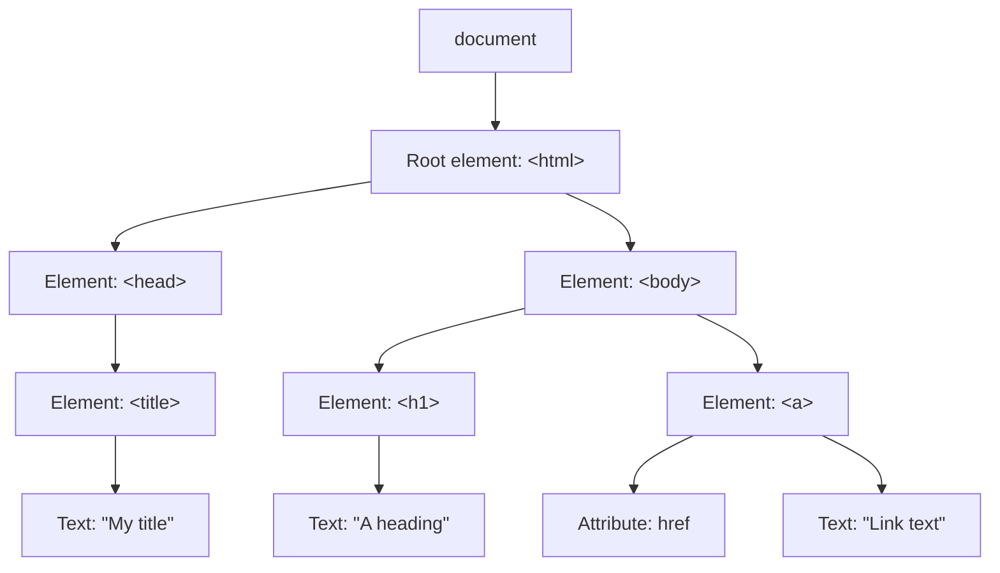

# IN4MATX 133: User Interface Software — Lecture 6: DOM Manipulation & Package Management

## Table of Contents

- [1. JavaScript on the client and the server](#1-javascript-on-the-client-and-the-server)
- [2. The Document Object Model (DOM)](#2-the-document-object-model-dom)
- [3. Putting JavaScript in a page](#3-putting-javascript-in-a-page)
- [4. Selecting elements](#4-selecting-elements)
- [5. Editing elements](#5-editing-elements)
- [6. Changing the DOM tree](#6-changing-the-dom-tree)
- [7. Events and listeners](#7-events-and-listeners)
- [8. Document ready and script order](#8-document-ready-and-script-order)
- [9. Client-side uses: validating and gathering data](#9-client-side-uses-validating-and-gathering-data)
- [10. Package managers](#10-package-managers)
- [11. npm](#11-npm)
- [12. In-class Questions & Demos (with Solutions)](#12-in-class-questions--demos-with-solutions)
- [13. Quick Reference & Top 5 Things to Remember](#13-quick-reference--top-5-things-to-remember)

> UCI IN4MATX 133: User Interface Software — Prof. Travis Linden Reid, Fall 2026, Tuesday 10/13
> Built from the Lecture 6 slides (53 pages) and the demo repo folder `W3_L1_Oct13_DOM`. Organized by concept, not by source.

> 📅 **Class logistics**: Start A2 soon: it's due in ~2 weeks, has its own `#a2` Slack channel, and students report it's difficult, so it's NOT the one to procrastinate on.
> A2 draws on three lectures: Lec 5 (10/8, JavaScript basics), this one (10/13, modifying page content with JavaScript + npm), and Lec 7 (10/15, TypeScript objects + Vega-Lite graphs).

---

## 1. JavaScript on the client and the server

So far ([Lecture 5](lec-05.en-US.md)) JavaScript has looked like any other language. It took over the web because it has **lots of built-in functions for editing web pages**. Today it runs in two places:

| | Client-side (your browser) | Server-side (web server) |
|---|---|---|
| Visible to the user? | Yes | No |
| When changes happen | In real time, in the browser | On the server, in response to HTTP requests |
| What it does | Edits what's being rendered; triggers or reacts to events | Navigates the file system programmatically; dynamically generates pages or views; transports, stores or interacts with data |
| Examples | AJAX, Angular, React, Vue.js | Node, ASP.NET |

The browser sends a **request**, the server sends back a **response** (slide 8 shows a server folder with `index.html`, `css/style.css`, `js/app.js`). The slide's warning: it can be confusing to follow your code if JavaScript is on both sides.

### 1.1 The window object (client only)

On the client, `window` is the browser itself; you read its properties and call its functions:

```js
/* example properties */
var width = window.innerWidth;   //viewport width
var height = window.innerHeight; //viewport height
/* example functions */
window.alert("Boo!");
var confirmed = window.confirm("Are you sure?");
var quest = window.prompt("What is your quest?");
```

The slide marks the alert/confirm/prompt pop-ups as **bad form**: put the message or the input on your page instead. (Slide bug: the prompt line ends `?”);` with a curly quote, which is a syntax error; the version above uses a straight `"`.)

**Server-side has no `window`**: on a server there would be nothing to scroll to and no one to alert. Client–server communication comes back in A3.

In this demo the pop-ups are shown as console lines. `confirm` answers `true` and `prompt` answers `""` (the empty string):

```viz web-demo
{"title": "Slide 10 · the window object (alerts go to the console here)", "html": "<p>See the console.</p>", "js": "/* example properties */\nvar width = window.innerWidth;   //viewport width\nvar height = window.innerHeight; //viewport height\nconsole.log(width > 0, height > 0);\n\n/* example functions */\nwindow.alert(\"Boo!\");\nvar confirmed = window.confirm(\"Are you sure?\");\nvar quest = window.prompt(\"What is your quest?\");\nconsole.log(confirmed, JSON.stringify(quest));", "height": 60}
```

---

## 2. The Document Object Model (DOM)

The DOM is "a standard for how to get, change, add, or delete HTML elements". The HTML you write is parsed by the browser and **turned into the DOM**, and then client-side JavaScript can edit the DOM. Server-side JavaScript might decide what HTML to send, but it **does not edit the DOM**.

When a page loads, the browser builds a DOM of the page. The DOM is a **tree**: HTML elements are nodes (text and attributes hang off them as nodes too). Through it JavaScript can **respond to events** and **change structure, style and content**. The slide's tree:



> 💡 **Key Insight**: Every DOM call in the rest of this lecture is a tree operation: find a node, change a node, or add/move/remove a child.

> 🔗 **Go deeper**: [CSS-Tricks: What is the DOM?](https://css-tricks.com/dom/) · [Wikipedia: Document Object Model](https://en.wikipedia.org/wiki/Document_Object_Model)

---

## 3. Putting JavaScript in a page

You can write JavaScript inline in a `<script>` tag. Wiring a handler with an `onclick` attribute works, but the slide flags it as **bad style**:

```html
<head>
  <script>
    function buttonClicked() {
      alert("Button Clicked!");
    }
  </script>
</head>
<body>
  <!--Bad style! Don't do this-->
  <button onclick="buttonClicked()">Click me!</button>
</body>
```

Like CSS, it's better to **load an external script** (same as Lecture 5's "Loading JavaScript"):

```html
<head>
  <script src="js/script.js"></script>
</head>
```

The better way to attach the click handler is `addEventListener` ([section 7](#7-events-and-listeners)). Putting the script in the `<head>` only works if the script waits for the page to load ([section 8](#8-document-ready-and-script-order)).

---

## 4. Selecting elements

Before you can change an element you need a reference to it, which you get by calling **selector functions** on `document`:

```js
//element with id="foo"
var fooElem = document.getElementById('foo');
//elements with class="row"
var rowElems = document.getElementsByClassName('row');
//<li> elements
var liElems = document.getElementsByTagName('li');
```

Look at the names. `getElementById` is singular and returns **one element** (or `null`). `getElementsBy…` is plural and returns a **collection** (an `HTMLCollection`), even if only one element matches. To use one element from it you index it, like `liElems[0]`.

Slide 17 runs the first one against `<div id="foo">This is a div with ID 'foo'.</div>`. The console prints the div's `innerHTML`, which is `This is a div with ID 'foo'.` (Slide bugs: the slide code has curly quotes `‘foo'` / `“foo”`, which are a JavaScript syntax error, and `console.Log`, which throws `TypeError: console.Log is not a function`. The repo version below uses `'foo'` and `console.log`.)

**The easiest way is to reuse CSS selectors.** Any selector from [Lecture 3](lec-03.en-US.md) works. `.selectExample > p` is the child selector: a `<p>` that is a *direct* child of `.selectExample`, not a grandchild.

```js
/*easiest to select by reusing CSS selectors! */
var cssSelector = '.selectExample > p';
//selects FIRST element that matches css selector
var elem = document.querySelector(cssSelector);
//matches ALL elements that match css selector
var elems = document.querySelectorAll(cssSelector);
elems.forEach((elem) => {
    console.log(elem.innerHTML);
});
```

The `forEach` loop is from lectureExamples.js. On the repo page it prints `CSS selector example!!` once. The second paragraph inside `.selectExample` sits inside a nested `<div>`, so it is a grandchild and isn't matched.

| Function | Returns | Has `forEach`? |
|---|---|---|
| `getElementById` | one element or `null` | n/a |
| `getElementsByClassName`, `getElementsByTagName` | `HTMLCollection` (live) | **no**, so use a `for` loop |
| `querySelector` | first match or `null` | n/a |
| `querySelectorAll` | `NodeList` | **yes** |

The repo's own comment (solution1.js) says the same thing: "HTMLCollection, which getElementsByTagName returns, does NOT have a foreach() method but NodeList, which querySelector returns, does". It means `querySelectorAll`. In Chromium, `typeof collection.forEach` is `undefined` for an HTMLCollection and `function` for a NodeList.

Try your own selectors below; edit the JS and press Run:

```viz web-demo
{"title": "Slides 16–18 · lectureExamples.html / .js (Selecting elements 1–2)", "interactive": true, "html": "<div id=\"foo\">This is a div with ID 'foo'.</div>\n<ol>\n    <li>List item</li>\n    <li>List item</li>\n    <li>List item</li>\n</ol>\n<div class=\"selectExample\">\n    <p>CSS selector example!!</p>\n    <div><p>Here's another paragraph that will not be selected... because it's not a direct descendent!</p></div>\n</div>", "js": "//element with id=\"foo\"\nvar fooElem = document.getElementById('foo');\nconsole.log(fooElem.innerHTML);\n\n//<li> elements\nvar liElems = document.getElementsByTagName('li');\nconsole.log(liElems.length);\n\n/*easiest to select by reusing CSS selectors! */\nvar cssSelector = '.selectExample > p';\nvar elem = document.querySelector(cssSelector);\nvar elems = document.querySelectorAll(cssSelector);\nelems.forEach((elem) => {\n    console.log(elem.innerHTML);\n});\nconsole.log(elems.length);", "height": 200}
```

> 🧪 **Demo files**: [lectureExamples.html](https://github.com/travislindenreid/INF33-Demos/blob/main/W3_L1_Oct13_DOM/lectureExamples/lectureExamples.html) · [lectureExamples.js](https://github.com/travislindenreid/INF33-Demos/blob/main/W3_L1_Oct13_DOM/lectureExamples/lectureExamples.js)

> ⚠️ **Pitfall**: Writing a property on a collection (`getElementsByClassName("para").innerHTML = …`) throws no error and changes nothing on the page. You have to index first: `[0].innerHTML`.

> 📝 **Practice**: [Question 1](#121-question-1-which-snippet-edits-the-p-slide-23) tests exactly this.

---

## 5. Editing elements

Once you have an element, you change it by **setting its properties**.

```js
/* properties to access the CONTENT of the element */
var elem = document.querySelector('p.queryTest');
//the text content of the elem
elem.textContent = "I'm different!"; //change the content
//content including tags
elem.innerHTML = "I'm <strong>different</strong>";
var parent = elem.parentNode; //get the parent node
```

- `textContent` is plain text. Tags in the string are **not** parsed; they show up literally on the page (in Chromium the stored HTML is `I'm &lt;strong&gt;different&lt;/strong&gt;`).
- `innerHTML` is parsed as HTML, so `different` becomes bold.
- `parentNode` moves up the tree. Here it's the `<body>`, whose `tagName` is `BODY`.

(Slide bug: `‘p.queryTest’` uses curly quotes; use `'p.queryTest'`.)

You can also **add or remove classes, IDs and inline style**:

```js
var elements = document.getElementsByTagName("h1");
for(var i = 0; i < elements.length; i++) {
  elements[i].classList.add("title");
  elements[i].style.color="blue";
}
```

With the repo's CSS `.title { font-style: italic; }`, the heading "Hello, IN4MATX 133!" turns **blue and italic**. That's the slide's screenshot, and it's also what I got running lectureExamples.html. `classList.add` keeps styling in the CSS file, while `style.color` writes an inline style on the element. The loop is a `for` loop because the result is an `HTMLCollection` ([section 4](#4-selecting-elements)).

Step through it:

```viz web-demo
{"title": "Slides 19–20 · lectureExamples.js (Editing elements 1–2)", "css": ".title {\n    font-style: italic;\n}", "html": "<h1>Hello, IN4MATX 133!</h1>\n<p class=\"queryTest\">Editing inner HTML...</p>", "js": "var elem = document.querySelector('p.queryTest');", "steps": [{"note": "textContent replaces the text; tags in the string would show literally.", "js": "\nelem.textContent = \"I'm different!\"; //change the content"}, {"note": "innerHTML parses the string as HTML, so <strong> becomes bold.", "js": "\nelem.innerHTML = \"I'm <strong>different</strong>\";\nvar parent = elem.parentNode; //get the parent node\nconsole.log(parent.tagName);"}, {"note": "Add the class \"title\" (italic, from the CSS) and an inline blue color to every h1.", "js": "\nvar elements = document.getElementsByTagName(\"h1\");\nfor(var i = 0; i < elements.length; i++) {\n    elements[i].classList.add(\"title\");\n    elements[i].style.color=\"blue\";\n}"}], "height": 150}
```

> 🧪 **Demo files**: [lectureExamples.js](https://github.com/travislindenreid/INF33-Demos/blob/main/W3_L1_Oct13_DOM/lectureExamples/lectureExamples.js) · [lectureExamples.css](https://github.com/travislindenreid/INF33-Demos/blob/main/W3_L1_Oct13_DOM/lectureExamples/lectureExamples.css)

---

## 6. Changing the DOM tree

Besides editing elements that already exist, you can create new nodes and attach, insert, replace or remove them:

```js
//create a new <p> (not yet in the tree)
var newP = document.createElement('p');
newP.textContent = "I'm new!";
//create Node of textContent only
var newText = document.createTextNode("I'm blank");
var div = document.querySelector('div#container');
div.appendChild(newP); //add element INSIDE (at end)
div.appendChild(newText);
//add node BEFORE element (new, old)
div.insertBefore(document.createTextNode("First!"), newP);
//replace node (new, old)
div.replaceChild(document.createTextNode('boo'), newText);
//remove node
div.removeChild(div.querySelector('p'));
```

A node you create **isn't on the page until you append or insert it** somewhere. Running the calls in order, `div.innerHTML` goes like this (Chromium output):

| After | `div.innerHTML` |
|---|---|
| `appendChild(newP)` | `<p>I'm new!</p>` |
| `appendChild(newText)` | `<p>I'm new!</p>I'm blank` |
| `insertBefore("First!", newP)` | `First!<p>I'm new!</p>I'm blank` |
| `replaceChild('boo', newText)` | `First!<p>I'm new!</p>boo` |
| `removeChild(p)` | `First!boo` |

The argument order is the trap: `insertBefore` and `replaceChild` both take **(new, old)**. The repo's lectureExamples.js comments out every call after the first `appendChild`, so its page only shows "I'm new!". The demo below runs them all:

```viz web-demo
{"title": "Slide 21 · Changing the DOM, one call per step", "html": "<div id=\"container\"></div>", "js": "//create a new <p> (not yet in the tree)\nvar newP = document.createElement('p');\nnewP.textContent = \"I'm new!\";\n//create Node of textContent only\nvar newText = document.createTextNode(\"I'm blank\");\nvar div = document.querySelector('div#container');", "steps": [{"note": "appendChild adds the new p inside the div, at the end.", "js": "\ndiv.appendChild(newP); //add element INSIDE (at end)\nconsole.log(div.innerHTML);"}, {"note": "A text node is appended after the p.", "js": "\ndiv.appendChild(newText);\nconsole.log(div.innerHTML);"}, {"note": "insertBefore(new, old) puts \"First!\" before the p.", "js": "\ndiv.insertBefore(document.createTextNode(\"First!\"), newP);\nconsole.log(div.innerHTML);"}, {"note": "replaceChild(new, old) swaps \"I'm blank\" for \"boo\".", "js": "\ndiv.replaceChild(document.createTextNode('boo'), newText);\nconsole.log(div.innerHTML);"}, {"note": "removeChild removes the p; only the two text nodes are left.", "js": "\ndiv.removeChild(div.querySelector('p'));\nconsole.log(div.innerHTML);"}], "height": 120}
```

The in-class **DOM manipulation demo** (slide 22: `setup1.html`, `setup1.css`, `setup1.js`) puts sections 4–6 together on a timer. It's worked out in [Demo 1](#122-demo-1-edit-the-page-on-a-timer-slide-22--setup1--solution1).

> 📝 **Practice**: [Demo 1](#122-demo-1-edit-the-page-on-a-timer-slide-22--setup1--solution1)

---

## 7. Events and listeners

*How do we make interactive pages?* You attach a **listener** to an element: a function to call when that element causes an event. Usually it's an anonymous callback (callbacks were covered in [Lecture 5](lec-05.en-US.md)):

```js
//often use an anonymous callback function
elem.addEventListener('click', function(){
  console.log('clicky clicky!');
});
```

The callback is passed an **event** parameter. Sometimes it's useful, but you can often ignore it, since all JavaScript parameters are optional. `event.target` is the element the event came from:

```js
elem.addEventListener('click', function(event) {
   console.log('You clicked me!');
   //get what was clicked;
   var clickedElem = event.target;
});
```

You can add several listeners to the same element and they all run in the order they were added. On the repo page, one click on `#buttonTest` prints `clicky clicky!` and then `You clicked me!`, followed by the button element itself.

Event types listed on the slide:

| Type | When |
|---|---|
| `'click'` | mouse or button clicked |
| `'dblclick'` | double-clicked |
| `'hover'` | mouse hover (see the slide bug below) |
| `'focus'` | element gains focus (the slide marks this important) |
| `'mouseenter'` / `'mouseleave'` | mouse moves over / leaves the element |
| `'mousedown'` | mouse button is pressed |
| `'keydown'` | key is pressed |

Slide bug: there is **no `'hover'` event**. I attached a `'hover'` listener in Chromium and hovered the element, and it never fired, while `'mouseenter'` did. Use `mouseenter`/`mouseleave` (or the CSS `:hover` selector for styling).

Click the button and watch the console:

```viz web-demo
{"title": "Slides 27–28 · lectureExamples.js (Listeners 1–2) — click the button", "interactive": true, "html": "<button id=\"buttonTest\">click me!</button>", "js": "var elem = document.getElementById('buttonTest');\n\n//often use an anonymous callback function\nelem.addEventListener('click', function(){\n    console.log('clicky clicky!');\n});\n\nelem.addEventListener('click', function(event) {\n    console.log('You clicked me!');\n    // get what was clicked\n    var clickedElem = event.target;\n    console.log(clickedElem);\n});", "height": 80}
```

> 🧪 **Demo files**: [lectureExamples.js](https://github.com/travislindenreid/INF33-Demos/blob/main/W3_L1_Oct13_DOM/lectureExamples/lectureExamples.js) (sections "Listeners (1)" and "Listeners (2)")

> 🔗 **Go deeper**: [MDN: Event reference](https://developer.mozilla.org/en-US/docs/Web/Events)

---

## 8. Document ready and script order

Your script should **wait until the page has loaded**. Otherwise the elements it's trying to access might not exist yet:

```js
document.addEventListener('DOMContentLoaded', function (event) {
  alert("Page loaded!");
});
```

This is how lectureExamples.js works: its whole body sits inside one `DOMContentLoaded` listener, even though it's loaded in the `<head>`. Without the listener, a `<head>` script runs before the `<body>` is parsed. At the top level of such a script, `document.querySelector('h1')` returns `null`; inside the listener it finds the heading. The demo files use the older `<body onload="runJS()">` for the same purpose.

**Importing JavaScript.** When your script uses document ready, the convention is to load it in the `<head>`. **Order matters**, especially for libraries: load Math.js *before* the script that uses it.

```html
<head>
  <script src="https://cdnjs.cloudflare.com/ajax/libs/mathjs/9.0.0/math.js"></script>
  <script src="index.js"></script>
</head>
```

(The slide opens the first `src` with a curly `“`; that has to be a straight `"`.)

> ⚠️ **Pitfall**: `Cannot read properties of null` from a selector almost always means the script ran before the element existed. Wrap your code in `DOMContentLoaded`.

---

## 9. Client-side uses: validating and gathering data

**Validating data.** Check form fields *before* sending to a server. The user gets instant feedback and there's less back-and-forth with the server:

```html
<script>
function validateForm() {
  var x = document.forms["myForm"]["fname"].value;
  if(x==null || x=="") {
    alert("Name must be filled out");
    return false;
  }
}
</script>
<form name="myForm" onsubmit="return validateForm()" method="post">
  <label>Name: </label>
  <input type="text" name="fname">
  <input type="submit" value="Submit">
</form>
```

`return false` from the `onsubmit` handler **cancels the submit**. With the field empty, it alerts `Name must be filled out` and the page stays put. `document.forms["myForm"]["fname"]` looks up the form by its `name`, then the input by its `name`.

Step through both cases (empty, then filled in), or type in the box and press Submit yourself. The demo never actually sends the form; it logs `[form submitted]` instead:

```viz web-demo
{"title": "Slide 32 \u00b7 validating a form before it is sent \u2014 step through, or type and press Submit", "interactive": true, "html": "<form name=\"myForm\" onsubmit=\"return validateForm()\" method=\"post\">\n<label>Name: </label>\n<input type=\"text\" name=\"fname\">\n<input type=\"submit\" value=\"Submit\">\n</form>", "js": "function validateForm() {\n    var x = document.forms[\"myForm\"][\"fname\"].value;\n    if(x==null || x==\"\") {\n        alert(\"Name must be filled out\");\n        return false;\n    }\n}", "height": 80, "steps": [{"note": "Submit with the field empty: validateForm alerts and returns false, so the submit is cancelled.", "js": "\n// simulate pressing Submit with an empty field\ndocument.forms[\"myForm\"].requestSubmit();"}, {"note": "Fill in a name and submit again: validateForm returns nothing, so the form would be sent.", "js": "\ndocument.forms[\"myForm\"][\"fname\"].value = \"Peter\";\ndocument.forms[\"myForm\"].requestSubmit();"}]}
```

**Gathering and using information.** Client-side code can read things only the browser knows, such as the user's location:

```html
<script>
var x = document.getElementById("demo");
function getLocation() {
    if (navigator.geolocation) {
        navigator.geolocation.getCurrentPosition(showPosition);
    } else {
        x.innerHTML = "Geolocation is not supported by this browser.";
    }
}
function showPosition(position) {
    x.innerHTML = "Latitude: " + position.coords.latitude +
    "<br>Longitude: " + position.coords.longitude;
}
</script>
```

`getCurrentPosition` takes `showPosition` as a callback and calls it later with the position. The slide's reminder is that **this is client-side**: it's the user's browser (and device) that knows the location. (Not run here, because it needs a location permission prompt.)

---

## 10. Package managers

*Switching topics.* So far we've imported packages in two ways ([Lecture 4](lec-04.en-US.md) did this for Bootstrap):

- through **CDNs**, by pasting a `<script>` tag into the `<head>`, e.g. `<script src="https://cdnjs.cloudflare.com/ajax/libs/mathjs/9.0.0/math.min.js"></script>`;
- by **downloading from the source** (e.g. downloading Bootstrap instead of using a CDN).

**Package managers** give you an easy way to install software on your computer, both new programs and libraries. They also make it simple to update software to the latest version. The hard part is that packages depend on other packages, often on different versions of them, and your package manager should handle that for you. They're essentially **app stores where all the content is free**.

| Level | Examples |
|---|---|
| OS-level | apt-get (Unix), homebrew (macOS), winget (Windows) |
| Language-level | pip (Python), npm (JavaScript), yarn (also JavaScript), RubyGems (Ruby) |

**Why are there so many?** There's some value in keeping language- or domain-specific contexts. Certain languages work better with certain file formats, most managers are community-driven, and each new one solves some problem of an earlier one. The slide's verdict: "a lot of these are excuses; in reality, it's often a frustrating mess."

> 🔗 **Go deeper**: [Quora: Why do so many programming languages have their own package manager?](https://www.quora.com/Why-do-so-many-different-programming-languages-have-their-own-package-manager)

---

## 11. npm

### 11.1 npm and Yarn

- **npm** was introduced as the package manager for **Node.js** (server-side JavaScript).
- **Yarn** came later, released as open source by Facebook. It uses the **same registry** (list of packages).
- Both have a lot of useful libraries for building web pages and web interfaces, for both server-side and client-side JavaScript. They're occasionally used to install system-wide software too.
- "Package" and "library" are often used interchangeably, which can be misleading.

Some example web libraries:

| Library | For |
|---|---|
| Moment.js* | managing time and time zones (*the slide links an article saying you probably don't need it anymore) |
| Math.js | any math, unit conversion, etc. |
| Express | routing your website to different content (other pages or files) |

> 🔗 **Go deeper**: [Moment.js docs](https://momentjs.com/docs/) · [DockYard: You probably don't need Moment.js anymore](https://dockyard.com/blog/2020/02/14/you-probably-don-t-need-moment-js-anymore) · [Math.js docs](http://mathjs.org/docs/) · [Express](https://expressjs.com/)

### 11.2 The three npm files and git

| Thing | What it is | Commit to git? |
|---|---|---|
| `package.json` | the libraries installed in this project; kept in the project's root folder by convention | **yes** |
| `package-lock.json` | the specific versions of the libraries *your* libraries require ("the libraries of your libraries") | **yes** |
| `node_modules/` | all the installed libraries themselves | **no**: add it to `.gitignore` |

`.gitignore` lists the files that should not be committed. You commit the two JSON files so someone else can install **the same package versions** you used. You don't commit `node_modules/` because it's redundant (`package.json` already says what to download) and large (it holds the packages themselves).

### 11.3 Using npm

npm runs in your OS's command line, from your project's **root directory**:

```bash
cd path/to/project
npm install packagename   # installs into this project's node_modules/
npm update                # get the latest versions (important for security patches)
```

**Cloning a project.** To run the course webpage, for example: install npm, clone the repository, and run `npm install` with no package name in the root directory. That installs every library the project depends on (listed in `package.json`) into `node_modules/`.

**Global packages** are just software on your computer, usually command-line programs:

```bash
npm install -g packagename
```

Global packages are programs, not libraries, so they are **not added to `package.json` or `node_modules/`**, although your project might depend on them to run. They often overlap with what OS-level package managers provide. **A2 only requires global packages.**

> 🔗 **Go deeper**: [npm: Get npm](https://www.npmjs.com/get-npm)

### 11.4 package.json and version ranges

"Do not edit manually unless you know what you're doing!" The slide's example (an old course website, an Angular project):

```json
{
  "name": "inf133-wi22",
  "version": "0.0.0",
  "scripts": {
    "ng": "ng",
    "start": "ng serve",
    "build": "ng build"
  },
  "dependencies": {
    "@angular/animations": "~7.2.0",
    "@angular/common": "~7.2.0",
    "@angular/compiler": "~7.2.0",
    "@angular/core": "~7.2.0",
    "@angular/forms": "~7.2.0",
    "@angular/platform-browser": "~7.2.0",
    "@angular/platform-browser-dynamic": "~7.2.0",
    "@angular/router": "~7.2.0",
    "bibtex-parse-js": "0.0.24",
    "component": "^1.1.0",
    "core-js": "^2.5.4",
    "moment": "^2.24.0",
    "ngx-moment": "^3.4.0",
    "rxjs": "~6.3.3",
    "tslib": "^1.10.0",
    "zone.js": "~0.8.26"
  }
}
```

(Slide bugs: `“inf133-wi22"` opens with a curly quote, and there is a trailing comma after `"build": "ng build"`. Both are invalid JSON, so they're fixed above.)

| Prefix | Meaning | `"~7.2.0"` / `"^1.1.0"` accepts |
|---|---|---|
| `^` | "compatible with" | `^1.1.0` → 1.X.X |
| `~` | "approximately the same as" | `~7.2.0` → 7.2.X |
| none | exactly that version | `"0.0.24"` |
| `>`, `<`, `>=`, `=` | explicit comparisons | |

`scripts` names commands you run with npm (e.g. `npm start` runs `ng serve`). In an empty project, `npm install moment` (npm 10.9.4) writes `"moment": "^2.31.0"` to `package.json`, creates `package-lock.json`, and downloads into `node_modules/`.

> 📝 **Practice**: [Question 2](#123-question-2-npm-install-vs-npm-install--g-slide-49)

---

## 12. In-class Questions & Demos (with Solutions)

### 12.1 Question 1: Which snippet edits the p? (slide 23)

Which snippet would edit the `p` to display "1, 2, 3, 4, 5"?

```html
<p class="para" id="intro">1, 2, 3</p>
```

- **A** `document.getElementById("intro").append(", 4, 5");`
- **B** `document.getElementsByClassName(“para").innerHTML = "1, 2, 3, 4, 5";`
- **C** `document.getElementsByTagName(“p")[0].innerHTML = "1, 2, 3, 4, 5";`
- **D** Two of the above
- **E** All of the above

> ✍️ **Try it first.**

**Answer: D** (A and C; the slide 25 reveal highlights A, C and D).

- **A works.** `getElementById` returns the element, and `append` adds the text at the end, giving `1, 2, 3, 4, 5`.
- **B fails silently.** `getElementsByClassName` returns an `HTMLCollection`. Setting `.innerHTML` on the collection just creates a useless property on it, so the `<p>` still says `1, 2, 3`, and no error is thrown.
- **C works.** It's a collection too, but `[0]` takes the first `<p>` out of it and then sets its `innerHTML`.

(The slide's B and C open the string with a curly `“`, which would be a syntax error in real code. The repo's `q1.js` uses straight quotes; the answer assumes them.) Running q1.js with each option uncommented gives the same output as this check:

```viz web-demo
{"title": "Question 1 · each option run on a fresh copy of the p (q1.js)", "html": "<p class=\"para\" id=\"intro\">1, 2, 3</p>", "js": "var p = document.getElementById(\"intro\");\n\n// A\ndocument.getElementById(\"intro\").append(\", 4, 5\");\nconsole.log(\"A:\", p.innerHTML);\np.innerHTML = \"1, 2, 3\"; // reset\n\n// B\ndocument.getElementsByClassName(\"para\").innerHTML = \"1, 2, 3, 4, 5\";\nconsole.log(\"B:\", p.innerHTML);\np.innerHTML = \"1, 2, 3\"; // reset\n\n// C\ndocument.getElementsByTagName(\"p\")[0].innerHTML = \"1, 2, 3, 4, 5\";\nconsole.log(\"C:\", p.innerHTML);", "height": 60}
```

> 🧪 **Demo files**: [q1.html](https://github.com/travislindenreid/INF33-Demos/blob/main/W3_L1_Oct13_DOM/q1/q1.html) · [q1.js](https://github.com/travislindenreid/INF33-Demos/blob/main/W3_L1_Oct13_DOM/q1/q1.js)

Back to [4. Selecting elements](#4-selecting-elements).

### 12.2 Demo 1: Edit the page on a timer (slide 22 · setup1 → solution1)

The starting page shows "Hello, IN4MATX 133!" and "Fill in this paragraph and add another one." The task, from `setup1.js`:

- After 1 second, add the "title" class to the h1 tag and change its color to blue.
- After 2 seconds, change the text of the first paragraph (id "first") to "Lorem ipsum amet".
- After 3 seconds, add a new paragraph to the div (id "body") with the text "A new paragraph!"

Starter (`setup1.html` calls `runJS()` from `<body onload="runJS()">`; `setup1.css` defines `.title { font-style: italic; }` and `#body { font-family: 'Arial'; }`):

```js
function runJS() {

}
function makeTitleBlue () {

}
function addLoremIpsum () {

}
function addNewParagraph () {

}
```

> ✍️ **Try it first.**

**Answer** (from `solution1.js`):

```js
function runJS() {
    setTimeout(makeTitleBlue, 1000);
    setTimeout(addLoremIpsum, 2000);
    setTimeout(addNewParagraph, 3000);
}

function makeTitleBlue () {
    var h1Tags = document.getElementsByTagName('h1');
    // interesting note: HTMLCollection, which getElementsByTagName returns, does NOT have a foreach() method
    // but NodeList, which querySelector returns, does
    for(var i = 0; i< h1Tags.length; i++) {
        h1Tags[i].classList.add('title');
        h1Tags[i].style.color = 'blue';
    }
}

function addLoremIpsum () {
    var firstTag = document.getElementById('first');
    firstTag.textContent = 'Lorem ipsum';
}

function addNewParagraph () {
    var div = document.getElementById('body');
    var newEl = document.createElement('p');
    newEl.textContent = 'A new paragraph';
    newEl.classList.add('title');
    div.appendChild(newEl);
}
```

Key points:

- `setTimeout(fn, ms)` takes the function **itself** (`makeTitleBlue`, not `makeTitleBlue()`) and calls it after `ms` milliseconds.
- Each step is one of the moves from sections 4–6: select by tag and loop, select by id and set `textContent`, then create, set and `appendChild`.

After 3.5 s the page shows a blue "Hello, IN4MATX 133!", "Lorem ipsum", and "A new paragraph". Two repo quirks: the solution writes `'Lorem ipsum'` and `'A new paragraph'` (the task says "Lorem ipsum amet" and "A new paragraph!"), and it also italicizes the new paragraph. Also, `solution1.html` links `solution1.css`, which isn't in the repo (404), so on the repo page the heading is **blue but not italic**. With `setup1.css` (as in the demo below), the heading and new paragraph are italic and the div is Arial.

```viz web-demo
{"title": "Demo 1 · solution1.js (runJS() called directly instead of body onload)", "css": ".title {\n    font-style: italic;\n}\n\n#body {\n    font-family: 'Arial';\n}", "html": "<h1>Hello, IN4MATX 133!</h1>\n<div id=\"body\">\n    <p id=\"first\">Fill in this paragraph and add another one.</p>\n</div>", "js": "\nfunction runJS() {\n    setTimeout(makeTitleBlue, 1000);\n\n    setTimeout(addLoremIpsum, 2000);\n\n    setTimeout(addNewParagraph, 3000);\n}\n\nfunction makeTitleBlue () {\n    var h1Tags = document.getElementsByTagName('h1');\n    // interesting note: HTMLCollection, which getElementsByTagName returns, does NOT have a foreach() method\n    // but NodeList, which querySelector returns, does\n    for(var i = 0; i< h1Tags.length; i++) {\n        h1Tags[i].classList.add('title');\n        h1Tags[i].style.color = 'blue';\n    }\n}\n\nfunction addLoremIpsum () {\n    var firstTag = document.getElementById('first');\n    firstTag.textContent = 'Lorem ipsum';\n}\n\nfunction addNewParagraph () {\n    var div = document.getElementById('body');\n    var newEl = document.createElement('p');\n    newEl.textContent = 'A new paragraph';\n    newEl.classList.add('title');\n    div.appendChild(newEl);\n}\n\nrunJS(); // in the repo: <body onload=\"runJS()\">", "height": 160}
```

> 🧪 **Demo files**: [setup1.html](https://github.com/travislindenreid/INF33-Demos/blob/main/W3_L1_Oct13_DOM/demo1/setup1.html) · [setup1.css](https://github.com/travislindenreid/INF33-Demos/blob/main/W3_L1_Oct13_DOM/demo1/setup1.css) · [setup1.js](https://github.com/travislindenreid/INF33-Demos/blob/main/W3_L1_Oct13_DOM/demo1/setup1.js) · [solution1.html](https://github.com/travislindenreid/INF33-Demos/blob/main/W3_L1_Oct13_DOM/demo1/solution1.html) · [solution1.js](https://github.com/travislindenreid/INF33-Demos/blob/main/W3_L1_Oct13_DOM/demo1/solution1.js)

Back to [6. Changing the DOM tree](#6-changing-the-dom-tree).

### 12.3 Question 2: npm install vs npm install -g (slide 49)

Which is correct? The four effects:

1. Downloads package to `node_modules`
2. Adds package to `package.json`
3. Adds package's dependencies to `package-lock.json`
4. Package is usable as a program from the command line

| Option | `npm install packagename` | `npm install -g packagename` |
|---|---|---|
| A | 1, 2, 3, 4 | 1, 4 |
| B | 1, 2, 3 | 4 |
| C | 1 | 4 |
| D | 1, 2, 3 | 2, 3, 4 |
| E | 1 | 1, 4 |

> ✍️ **Try it first.**

**Answer: B** (revealed on slide 51).

- **Local install** changes the project: it downloads into `node_modules/` (1), records the package in `package.json` (2), and pins its dependencies in `package-lock.json` (3). My `npm install moment` test did all three.
- **Global install** is "just software on your computer": it gives you a command-line program (4) and touches **none** of the project's files. That rules out A and E (global doesn't use the project's `node_modules`) and D (global doesn't edit `package.json` or the lock file). C misses that a local install also updates the two JSON files.

Back to [11. npm](#11-npm).

---

## 13. Quick Reference & Top 5 Things to Remember

**Selecting**

| Call | Returns |
|---|---|
| `document.getElementById('foo')` | one element / `null` |
| `document.getElementsByClassName('row')` | `HTMLCollection` (index it; no `forEach`) |
| `document.getElementsByTagName('li')` | `HTMLCollection` |
| `document.querySelector('.a > p')` | first match / `null` |
| `document.querySelectorAll('.a > p')` | `NodeList` (has `forEach`) |

**Editing and changing the tree**

| Call | Effect |
|---|---|
| `el.textContent = "…"` | set plain text (tags shown literally) |
| `el.innerHTML = "…"` | set content parsed as HTML |
| `el.parentNode` | parent node |
| `el.classList.add("title")` | add a class |
| `el.style.color = "blue"` | inline style |
| `document.createElement('p')` / `createTextNode("…")` | new node, not yet in the tree |
| `parent.appendChild(node)` | add inside, at the end |
| `parent.insertBefore(new, old)` | add before `old` |
| `parent.replaceChild(new, old)` | swap |
| `parent.removeChild(node)` | remove |

**Events**

| Code | Use |
|---|---|
| `el.addEventListener('click', function(event) {…})` | react to an event; `event.target` = source |
| `document.addEventListener('DOMContentLoaded', …)` | run after the page is parsed |
| `click`, `dblclick`, `focus`, `mouseenter`, `mouseleave`, `mousedown`, `keydown` | common types (no `hover` event) |

**npm**

| Command / file | Does |
|---|---|
| `npm install` | install everything in `package.json` into `node_modules/` |
| `npm install pkg` | add `pkg`: node_modules + package.json + package-lock.json |
| `npm install -g pkg` | install a command-line program globally; no project files |
| `npm update` | update to the latest allowed versions (security patches) |
| `^1.1.0` / `~7.2.0` | 1.X.X / 7.2.X |
| commit | `package.json`, `package-lock.json`; `.gitignore` `node_modules/` |

**Top 5 things to remember**

1. `getElementsBy…` returns a **collection**: index it (`[0]`) before setting `innerHTML`. Setting a property on the collection itself does nothing and doesn't raise an error.
2. `textContent` is text-only, while `innerHTML` parses tags.
3. `insertBefore` and `replaceChild` take **(new, old)**, and a created node isn't visible until you append or insert it.
4. Scripts in the `<head>` must wait for `DOMContentLoaded`, and libraries must be loaded before the scripts that use them.
5. `npm install pkg` updates `node_modules` + `package.json` + `package-lock.json`, while `-g` only installs a command-line program. Commit the two JSON files, never `node_modules/`.