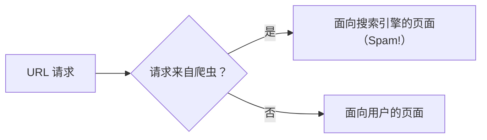
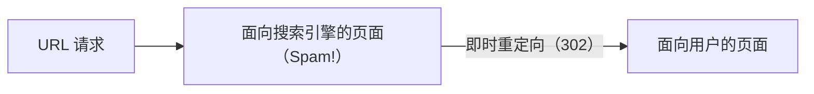

# CS 121: Information Retrieval — Week 2：网页语料、搜索引擎优化与网页爬取

## 目录

- [1. 语料与文本处理](#1-语料与文本处理)
- [2. 分词](#2-分词)
- [3. 网页图及其特征](#3-网页图及其特征)
- [4. 网页的演化与网页搜索的样子](#4-网页的演化与网页搜索的样子)
- [5. 网页用户：需求、查询与行为](#5-网页用户需求查询与行为)
- [6. 用户如何评价搜索引擎](#6-用户如何评价搜索引擎)
- [7. 商业模式：搜索广告](#7-商业模式搜索广告)
- [8. 搜索引擎优化（SEO）](#8-搜索引擎优化seo)
- [9. 作弊手法与垃圾信息](#9-作弊手法与垃圾信息)
- [10. 垃圾信息之战与 SEO 技巧的短命](#10-垃圾信息之战与-seo-技巧的短命)
- [11. 排名到底用了什么：Yandex 泄露](#11-排名到底用了什么yandex-泄露)
- [12. URI、URL 与 URN](#12-uriurl-与-urn)
- [13. 网页数据采集的几种方式](#13-网页数据采集的几种方式)
- [14. 迈向网页爬取：什么是算法](#14-迈向网页爬取什么是算法)
- [15. 课堂笔记与作业提示](#15-课堂笔记与作业提示)
- [16. 带解答的例题](#16-带解答的例题)
- [17. 速查与必记的 5 条要点](#17-速查与必记的-5-条要点)

> UCI CS 121 / IN4MATX 141: Information Retrieval — Prof. Alberto Krone-Martins, Fall 2026, week of Oct 7
> 根据第 3.5、4、5、6 讲的幻灯片整理（课堂讲授内容；YuJa 视频未包含）。按概念组织，而不是按讲次组织。
> 幻灯片致谢 C. Lopes、A. Krone-Martins、C. Manning、P. Nayak、H. Schütze 等教授，以及 Addison Wesley 出版社。
> 📖 本周阅读：[Croft et al., *Search Engines: IR in Practice*，第 3 章 Crawls and Feeds](https://ciir.cs.umass.edu/downloads/SEIRiP.pdf) · [Yandex 泄露的因子文件（Canvas，“如果你感兴趣”）](https://canvas.eee.uci.edu/courses/87165/files/37013257)

> 📅 **课程安排**：**作业 1（从零实现分词器）截止于周五，10 月 9 日。**
> 如需答疑，请提前预约时段；教授若有必要可以另找时间（L4 p48）。
> 本周在 YuJa 上有三段视频（周一、周三、周五）；周三的课程会复习这些视频，然后进入 A1 答疑和作业讨论（L3.5 p3、p30）。

---

## 1. 语料与文本处理

本周从架构图中的**文本转换/处理**模块开始（L4 p3–4，高亮）。整张架构图在[第 1 周第 10 节](week-01.zh-CN.md#10-搜索引擎架构)中有说明。

- **语料**（corpus，L4 p5–6）：可供搜索的全部文档的集合。在网页搜索中，它就是搜索引擎会考虑的全部网页，也就是文本获取（Text Acquisition）放入本地文档库（Local Document Store）的内容。
- **文本处理**（text processing，L4 p7）：在搜索引擎使用语料中的文档之前，对它们进行加工的阶段。它**发生在建立索引之前**，目的是提高效率和性能。
- 它通常包含**两个主要步骤**（L4 p8）：
  1. **分词**（tokenization，又称词法分析）：把文本切分成词元（token）。
  2. **语言学预处理**（linguistic pre-processing）：对词元应用规则，以提高索引的效率（第 1 周提到了其中两种：停用词过滤（stopping）与词干提取（stemming））。

> 🔗 **深入阅读**：[Croft §3.1 Deciding What to Search（书中第 31 页）](https://ciir.cs.umass.edu/downloads/SEIRiP.pdf)

---

## 2. 分词

### 2.1 分词器做什么

分词会**把输入切分成有简单含义的单元**（L4 p9–10）。词元可以是一个单词，也可以不是，这取决于你选择如何创建词元。分词器（tokenizer）也称为**词法分析器**（lexer）或**扫描器**（scanner），它把**字符流转换为词元流**。同一种机制会出现在两个地方：

| 位置 | 分词器的输出交给谁 |
|---|---|
| 编译器前端 | 语法分析器（parser） |
| 信息检索的预处理器 | 检索系统 |

### 2.2 什么是词元？视情况而定

"按空白切分，再丢掉标点？"（L4 p11–12）幻灯片列出了这条简单规则必须做出选择的情况：

| 问题 | 幻灯片中的例子 |
|---|---|
| 撇号 | O'Neill, Aren't |
| 连字符 | clear-headed 与 clearheaded；mother-in-law |
| 多个词算一个词元？ | San Francisco；white space；New York University 与 York University |
| 不是单词的词元 | `info@uci.edu`、`http://www.ics.uci.edu/`、`192.168.0.1` |

没有普遍正确的答案：每种选择都决定了哪些查询能够匹配（如果把 New York University 切成三个词元，那么查询 "York University" 也会匹配到它）。

### 2.3 早期的分词方法

早期的 IR 系统使用一条非常简单的规则（L4 p13–15）：

- 词元是**由 3 个或以上字母数字字符组成的序列**。
- **空格或特殊字符**会结束一个词元。
- 所有字符都转换为**小写**。

对幻灯片中的句子，它得到的结果是：

```text
"Bigcorp's 2007 bi-annual report showed profits rose 10%."
        ↓
"bigcorp 2007 annual report showed profits rose"
```

`s`、`bi` 和 `10` 都不足 3 个字符，因此被丢弃了。幻灯片的结论是：**过于粗糙，丢失了大量信息**（幻灯片原文："To generic"）。

逐字符演示这条规则，也可以输入你自己的文本：

```viz tokenize
{"title": "早期分词方法（L4 p13–15）", "text": "Bigcorp's 2007 bi-annual report showed profits rose 10%.", "interactive": true}
```

> ⚠️ **易错点**：这是幻灯片批评的*历史*规则，而不是作业 1（A1）的规则。A1 的规则来自 A1 题目说明：请阅读题目，不要照搬本演示的选择。

> 📝 **练习**：[例题 16.1](#161-bigcorp-句子的早期分词l4-p1315) · [例题 16.2](#162-棘手的词元会怎样l4-p1112)

> 🔗 **深入阅读**：[Croft §4.3.2 Tokenizing（书中第 87 页；后续阅读）](https://ciir.cs.umass.edu/downloads/SEIRiP.pdf)

---

## 3. 网页图及其特征

"再谈网页"（L4 p19）。第 1 周中用户侧的搜索流程提出了一个问题：**为什么这个蜘蛛能够爬取网页？**（L4 p20）因为网页构成了一张图（L4 p21–22）：

- **页面是节点。**
- **超链接是有向边。** 从 A 指向 B 的链接让你能从 A 到达 B，但不能反过来。

**爬虫**（crawler）沿着这些边从一个页面走到另一个页面。这张图是什么样子的？（L4 p23–30）

| 特征 | 幻灯片的说法 |
|---|---|
| **大量重复** | 某些研究中有 30%–40% 的页面重复 [Brod97, Shiv99]；谷歌 2013 年给出的数字是 25%–30%；copyscape.com 能找到某个页面的副本 |
| **高度链接** | 每页超过 8 个链接 |
| **规模巨大** | 主机数为 $O(10^9)$；页面数为 $O(???)$ —— 幻灯片没有给出答案 |
| **垃圾、误导与虚假信息** | 其中有 $O(10^{8\text{–}9}?)$ 个页面 |
| **变化频繁** | 见下面的三项研究 |

**规模**——Netcraft 的调查（L4 p24，2020 年图表；课堂上更新过，L3.5 p5）。在对数刻度上，网站数从 1995 年的约 $10^4$ 增长到 2018 年 2 月约 18 亿的峰值，之后在 2024 年 3 月降至**约 11 亿**。2026 年 2 月：**1,419,977,535 个主机名**，其中只有 **208,200,947 个活跃网站**（约 14.7%）。

**变化速率**（L4 p27–30；幻灯片先让你猜一猜）：

| 研究 | 样本 | 发现 |
|---|---|---|
| [Cho00] | 1999 年对 270 个热门网站的 720k 个页面进行了为期 5 个月的每日采样 | **40% 每周变化，23% 每天变化** |
| [Fett02] | 检查了 151M 个页面，历时数月 | 显著变化：每周 7%；一些变化：每周 25% |
| [Ntul04] | 每周从头重新爬取 154 个**大型**网站 | 8% 每周都有新页面；8% 消失；5% 有新内容；25% 有新链接 |

> 💡 **关键洞见**：每一行都对应爬虫/索引的一个问题：重复浪费空间，规模大意味着无法全部抓取，垃圾信息意味着抓取到的内容不可信，而变化会让每一份副本都过时。

> 🔗 **深入阅读**：[谷歌 2013 年重复率数字的来源（YouTube）](https://www.youtube.com/watch?v=mQZY7EmjbMA) · [Copyscape](https://www.copyscape.com) · [Netcraft 网站服务器调查（2020 年 9 月）](https://news.netcraft.com/archives/2020/09/23/september-2020-web-server-survey.html) · [Netcraft 网站服务器调查（2026 年 3 月）](https://www.netcraft.com/blog/march-2026-web-server-survey/) · [Croft §3.2 Crawling the Web（书中第 32 页）](https://ciir.cs.umass.edu/downloads/SEIRiP.pdf) · [Croft §3.7 Detecting Duplicates（书中第 60 页）](https://ciir.cs.umass.edu/downloads/SEIRiP.pdf)

---

## 4. 网页的演化与网页搜索的样子

**演化**（L4 p31–32），分为五个阶段：

1. 静态内容（文档）
2. 动态内容（应用；幻灯片展示的是日历和天气应用）
3. 用户生成内容（社交，如 Wikipedia、LinkedIn、Facebook）
4. 移动端
5. ??? AR？VR？脑机接口？

> 💡 **关键洞见**：贯穿每个阶段，有一种需求始终不变：**找到信息**。当今的解决方案是用于**搜索与排序**的 IR 系统（L4 p32）。

**网页搜索的特点**（L4 p33）：**热门的宽泛查询很少，而罕见的具体查询很多**。幻灯片的例子是所有与癌症相关的搜索，它是一张饼图：只有少数几块可见（"cancer"、"breast cancer"、"skin cancer"、"prostate cancer"、"lung cancer"、"colon cancer"、"leukemia"、"lymphoma"），其余是数百个很小的切片。

**热门搜索**（L4 p34）：可以在 Google Trends 上查看词语的关注度，搜索引擎会**利用趋势信息**来：

| 用途 | 趋势如何帮助 |
|---|---|
| 自动补全 | 改善用户体验；纠正拼写错误 |
| 优化搜索结果 | "你附近"正在流行的内容可以帮助相关性打分 |
| 智能缓存搜索结果 | 如果某个搜索正在流行，就把它的结果保留在缓存中 |

> 🔗 **深入阅读**：[Google Trends](https://www.google.com/trends/)

---

## 5. 网页用户：需求、查询与行为

**人们为什么搜索**[Jansen et al. 2008]（L4 p35）：

| 需求 | 占比 | 用户想要…… |
|---|---|---|
| 信息型 | 约 80% | 了解某件事 |
| 导航型 | 约 10% | 去往某个页面（饼图称之为 "URL Search"） |
| 交易型 | 约 10% | 做某件事 |
| 其他 | （较少） | 探索、社交等 |

**他们如何书写查询**（L4 p36–39）：大多数查询都是**定义不清的**：

- **很短**：80% 的查询少于 3 个词
- **用词不精确**
- **不使用逻辑运算符**
- **投入很少**：有拼写错误

**他们是谁**（L4 p40–44）：他们在**需求、期望、知识和带宽**方面差异很大（"如果你认真对待这些要点，你的搜索引擎会更好"）。**行为方面**：

- **85% 的人只看一屏结果**（!!!）
- 78% 的查询没有被修改
- 他们会顺着链接走——"信息的气味"（the scent of information）

**人们会看多远？**（L4 p49，一项 iProspect 调查："如果你没有找到想要的内容，你会在什么时候转向另一个搜索引擎，或在同一搜索引擎中换一个搜索？"）

| 用户转向的时机 | 占比 |
|---|---|
| 看完前几条之后 | 22.6% |
| 看完第一页之后 | 18.6% |
| 看完前两页之后 | 25.8% |
| 看完前三页之后 | 14.7% |
| 超过三页之后 | 10.8% |
| 看完整个列表（除非有几十页） | 7.4% |

所以，41.2% 的人在第一页结束时放弃，67.0% 的人在第二页结束时放弃（由于四舍五入，各项相加为 99.9%）。

**信息需求链条**（L4 p45）：查询是这条链条的最后一环，每一步都会损失一部分含义。

| 阶段 | 幻灯片中的例子 |
|---|---|
| 任务 | 制止庭院里嘈杂的风扇 |
| 信息需求 | 关于 EPA 法规的信息 |
| 口头表达 | EPA 关于噪声污染的规定是什么？ |
| 查询 | EPA Sound Pollution |

**回应查询背后的需求**（L4 p46–47）。查询往往只是用户真正想要什么的一个**不精确的指示**。我们能做什么？

- 设计检索模型，以及**相关性分数**的数学定义，它们通用，但未必对每个具体主题都理想（相关性与检索模型：[第 1 周第 6 节](week-01.zh-CN.md#6-核心问题相关性与检索模型)）
- 利用**用户上下文**：谁、在哪里、做什么
- **猜测用户想要的信息类型**（图片、地图、数学，等等）
- **纠正和/或扩展**查询

> ⚠️ **易错点**：两个不同的 80%：约 80% 的搜索是*信息型*的；80% 的查询*少于 3 个词*。85% 指一屏结果；78% 指查询未被修改。

---

## 6. 用户如何评价搜索引擎

**最主要的标准是返回页面的质量**（L5 p2–5）。在经典 IR 中，这就是相关性 $R(Q, D)$；真实搜索引擎的相关性是 $R(Q, D, \dots)$——查询、文档*以及更多*——而它究竟如何定义，正是各家引擎的机密之一。对用户同样重要的还有：

- 可信度
- 去重（并提供"显示相似结果"选项）
- 可读性
- 快速访问
- 没有弹窗

### 6.1 精确率与召回率

（L5 p6–11 · L3.5 p7–14，课堂上作为一次投票提出）

- **精确率**（precision）：*最前面几条*结果的相关程度如何？
- **召回率**（recall）：相关结果中有*多少*被展示出来？

**对网页搜索而言，精确率比召回率更重要。** 尼尔森诺曼集团（Nielsen Norman Group）的眼动热力图（L5 p9）在"关于我们"页、产品页和搜索结果页上都显示出 **F 形**：先横扫顶部，再横扫一次，然后沿左边缘向下。

**何时召回率重要？当需要完整性时**（L5 p11）：此时是**承诺式阅读模式**（整页都会被读完）——信源事先就被信任，用户动机强。例如：**法律和科学**领域的搜索引擎。

> 📝 **练习**：[例题 16.3](#163-精确率还是召回率l5-p611--l35-p714)

### 6.2 界面与工具

**好的界面：简洁，没有杂乱**（L5 p12–15；展示了 Google、DuckDuckGo、Bing、Yandex、Baidu 和 Yahoo! 的截图）。此外还有**前处理和后处理工具**（L5 p16）：

- 拼写检查 / 自动纠正
- 推荐的替代搜索
- 指向资源的链接（地图、图片等）
- 处理句法线索，例如搜索框中输入的 URL，或数学公式

> 🔗 **深入阅读**：[尼尔森诺曼集团（眼动研究，见 L5 p9、p11）](https://www.nngroup.com)

---

## 7. 商业模式：搜索广告

第 1 周说明了搜索是网络广告收入中占比最大的部分（[第 1 周第 4 节](week-01.zh-CN.md#4-为什么网络搜索引擎重要)）。本周讲的是它的历史与机制（L5 p17–21）：

1. **早期的协同**：基于关键词的搜索引擎——Altavista（1995–1997）、Excite、InfoSeek、Inktomi——以及**付费排名**（paid placement ranking），即广告基于**关键词拍卖**投放（Goto.com → Overture.com → Yahoo! → Google）。
2. **基于链接的排名**，由 Google 开创（1998 年起）：链接为相关性增加了**权威性**，大幅超越了只看关键词的搜索引擎。用户体验很好，但还没有商业模式——与此同时，Goto/Overture 的年收入接近 10 亿美元。
3. **Google 加入了付费广告**，并与搜索结果明确区分。**Yahoo!** 收购 Inktomi 以获取搜索技术（几亿美元），收购 Overture 以获取付费排名技术（16 亿美元，2003 年）：赞助链接与客观结果并列展示。Google 则授权使用了 Yahoo! 的付费排名技术，多年来它一直是 Google 的广告引擎（现在是否仍然如此，无人确知）。
4. **今天**：各引擎宣称广告**不会**影响广告主的排名（无人能完全确定）。广告投放是**全自动**的，**在竞价价格与相关性之间取得平衡**，并且是**定向**的。

### 7.1 企业如何付费

（L5 p22）

| 模式 | 广告主付费…… | 适合 |
|---|---|---|
| **CPM**——千次展示成本（Cost Per Mil） | 每 $10^3$ 次展示（曝光）时付费 | 品牌推广活动 |
| **CPC**——点击成本（Cost Per Click） | 用户点击广告时付费 | 销售类活动 |
| **CPA**——行动成本（Cost Per Action/Acquisition） | 只有点击触发了某个行为时才付费（例如 DuckDuckGo + Amazon） | 为结果付费 |

**这对业务为何说得通**（L3.5 p16–17）：在搜索引擎的示意图中，爬取、索引和自然结果**更有意思，但经济价值更低**；广告索引**没那么有意思，但价值约高 10 倍**。

### 7.2 点击欺诈

（L5 p23）

- **2016 至 2018 年间损失了 72 亿美元**（《卫报》）。
- Google 称之为**"无效点击"**（invalid clicks）。
- 搜索引擎有复杂的工具来检测欺诈。

> ⚠️ **易错点**：CPM 中的 M 是 *mil(le)*——即一千次展示，而不是一百万次。点击欺诈会损害按点击计费的定价：每一次虚假点击都会被计费。

---

## 8. 搜索引擎优化（SEO）

**付费广告投放要花钱。于是……**（L5 p24–26）——**SEO** 是**为了在特定查询的搜索结果中获得高排名而对网页/网站/应用进行的调优**。它是付费广告投放的替代方案，并附带一个好处：**通过排名获得的可见度 = 更高的信任**。简而言之，**它就是营销**：让你的内容抵达你的受众。

| 问题（L5 p27–28） | 答案 |
|---|---|
| 动机 | 商业、政治、宗教、游说 |
| 谁来做 | 内部：网站管理员、写作者。商业化：公司、顾问。托管服务。流行 CMS 的插件 |

SEO 本质上是一个**营销与技术的交叉领域**（L5 p29）。如何做：Google 的站长指南、WebmasterWorld 的 SEO 工具，以及许多书籍（幻灯片展示的是 Enge、Spencer 和 Stricchiola 合著、O'Reilly 出版的 *The Art of SEO*）。

**合乎道德与不合乎道德的做法**（L5 p30–31）：

| 合法 | 不道德（即 "spam"） |
|---|---|
| 页面的收录时间（越早越好） | 虚假页面 |
| 优质的入链 | 指向你网站的虚假网站 |
| 优质内容：写得好、组织得好、保持更新 | 虚假评论 / 互动（机器人！） |
| 良好地使用网络标准与实践 | 简而言之："替代事实"，即谎言 |
| 快速的服务器（响应迅速） | |

有时合法与非法之间的界线很难划清——存在一个**很大的灰色地带**。

**地点也很重要**（L5 p32）：结果还取决于查询由**哪个数据中心**接收。google.com、google.fr 和 google.pt 对同一个查询（例如 "Paris"）会显示不同的结果，因此可以针对每个国家考虑不同的 SEO 策略。

> 🔗 **深入阅读**：[Google 站长指南（答案 40349）](https://support.google.com/webmasters/answer/40349?hl=en) · [WebmasterWorld SEO 工具](http://freetools.webmasterworld.com/category/seo-tools)

---

## 9. 作弊手法与垃圾信息

### 9.1 作弊技术

（L6 p2–7 · L3.5 p19–22）

**关键词堆砌。** 第一代搜索引擎严重依赖文本内容和词频，于是 SEO 在关键词上做文章（L6 p3–4）：

- **误导性元标签**：幻灯片展示了一个旅游网站的 `<head>`，其中的 `<meta name="keywords">` 标签列出了 "Expedia, Travel, Cheap Airfare, Car, Hotels, Vacations, Airfare, Car Rental, Cruises, …"，描述标签也以同样的方式堆砌关键词
- **反复重复词语**
- **在颜色上做文章**（白字写在白底上）：爬虫和索引器能看到，但用户看不到

**伪装**（cloaking，L6 p5）：向爬虫提供与向浏览器提供的不同内容。服务器会检查请求者是谁：



幻灯片的说明：这种架构与**动态内容引擎**相同，它可以针对不同的搜索引擎做出调整。

**过渡页**（doorway page）：与伪装类似，但使用的是**重定向（302）**（L6 p6）。HTTP 302 表示"所请求的资源**暂时**位于另一个 URI 下。由于重定向可能会偶尔改变，客户端应继续使用 Request-URI 发起后续请求"。最初的页面针对爬虫进行了优化；随后一个即时重定向把用户带到真正的内容，因此**用户看到的是最终页面**。



**链接交换**（L6 p7）："我链接你，你链接我"；"翻译版本"；以及**大学和教授是被针对的目标**——本质上是因为在链接分析层面，**信任的转移**至关重要。

### 9.2 垃圾信息

（L6 p8–11）

| 两大主要类型 | 含义 |
|---|---|
| **链接垃圾**（link spamming） | 自动程序搜索博客并留下带链接的评论 |
| **点击机器人**（clicker bots） | 自动程序发出查询，并"点击"针对性查询的结果 |

整个**垃圾信息产业**都存在（L6 p10：有的网站售卖 “First Page of Google GUARANTEED”（保证上 Google 首页）、“How To Get On The First Page of Google In 24 hours”（如何在 24 小时内上 Google 首页）等服务），网络比赛也会被灌水（L6 p11）。

### 9.3 伪造 User-Agent

（L3.5 p23–24）最重要的一类是 `urllib.request.Request()`：通过设置 **User-Agent** 请求头，一个简单的 Python 脚本可以让服务器以为它是 iPhone 上的 Chrome。这就是**"伪造"（spoofing）**，它被广泛用于访问那些拒绝脚本或爬虫的网站——**但要小心！** 幻灯片中的 `print_url_3.py`：

```python
#
# Example 3 of urllib.request.open()
#
import sys
import urllib.request


def print_data_url(url_name: str) -> None:
    # First we spoof an user agent
    headers = {'User-Agent': "Mozilla/5.0 (iPhone; CPU iPhone OS 16_3 like "
                             "Mac OS X) AppleWebKit/605.1.15 (KHTML, like "
                             "Gecko) CriOS/110.0.5481.83 Mobile/15E148 "
                             "Safari/604.1"}
    request = urllib.request.Request(url_name, headers=headers)
    # Now we can retrieve data
    response = urllib.request.urlopen(request)
    response_data = response.read()
    response_data = response_data.decode(encoding = 'utf-8')
    response.close()
    print(response_data)


if __name__ == "__main__":
    print_data_url(sys.argv[1])
```

幻灯片上，一个"我的 user agent 是什么"的页面会报告那个 iPhone 字符串：

```bash
$ python3 print_url_3.py https://www.whatismybrowser.com/detect/what-is-my-user-agent/ | grep -i "Mozilla"
```

用一个会回显请求头的本地服务器检验：脚本发出的请求带的是上面的 iPhone 字符串；而普通的 `urlopen(url)` 带的是 `Python-urllib/3.x`，这正是伪装服务器或机器人拦截器所查找的默认值。

> ⚠️ **易错点**：伪装和过渡页都向引擎展示了用户看不到的东西；区别在于机制。伪装 = **服务器根据请求者是谁来分支**。过渡页 = **对所有人是同一个页面，然后用 302 重定向**，只有浏览器会跟随这个重定向到真正的内容。

> 🔗 **深入阅读**：[如何赢得（或作弊赢得）任何网络投票比赛](https://www.wholewhale.com/tips/how-to-win-or-cheat-any-online-voting-contest/) · [Croft §4.5.3 Link Quality（书中第 111 页；后续阅读）](https://ciir.cs.umass.edu/downloads/SEIRiP.pdf)

---

## 10. 垃圾信息之战与 SEO 技巧的短命

**搜索引擎如何反击**（L6 p12–15）：

| 武器 | 细节 |
|---|---|
| 质量指标 | 对链接做统计分析；对投票做统计分析 |
| 使用指标 | 分析数据 |
| 反机器人机制 | 验证码（幻灯片展示的是 reCAPTCHA "输入这两个词"） |
| 对元关键词的限制 | |
| 适合家庭的过滤器 | |
| **稳健的链接分析** | 忽略统计上不可能的链接（例如，来自葡萄牙的葡萄牙语页面链接到来自中国的中文页面）；检测环路；用链接分析来识别垃圾信息发布者，一条非常简单的规则：**"因关联而有罪"**（guilt by association） |
| 人工编辑干预 | 黑名单，以及为监督式机器学习创建训练集 |
| 机器学习识别垃圾信息 | |

**站长指南**（L6 p16）：搜索引擎会发布 SEO 政策，说明哪些做法被允许，哪些不被允许。它们**不可忽视**：一旦网站被搜索引擎列入黑名单，它实际上就会**从网络上消失**。

**SEO "技巧"容易失效**（L6 p17–19），因为它们依赖于引擎的工作方式，而这些方法一直在变：

| 时代 | Google 的方法 | 它们关注的内容 |
|---|---|---|
| 1996 年 – ? | PageRank；随后是 Panda（2011）、Penguin（2012）、Hummingbird（2013）、Pigeon（2014），…… | **词语与链接** |
| 2016 年起 | RankBrain，基于机器学习 | **概念** |
| 2019 年 10 月起 | BERT，自然语言处理与机器学习 | |
| 现在 | RankBrain + BERT + …… ，**超过 200 种方法与信号**（!） | |

能为 BERT 做优化吗？Google 说不能（但现在下结论还为时过早）。

> 💡 **关键洞见**：幻灯片给出的解答（L6 p20 · L3.5 p25）：**为用户优化，就必然会为优秀的搜索引擎优化。** 各种技巧利用的是引擎所测量的东西与用户真正想要的东西之间的缝隙；而这些缝隙也在不断被填补。

---

## 11. 排名到底用了什么：Yandex 泄露

（L3.5 p37–43，仅限课堂）

**Yandex** 是俄罗斯和前苏联国家中最大的互联网与技术公司。它成立于 1997 年，比 Google（1998 年）早一年，现在可能是俄罗斯最大的搜索引擎；战争之前，它在俄罗斯的市场份额约为 42%。在全球范围内，它排名第 4（搜索引擎市场份额，2023 年 3 月）：

| 引擎 | Google | Bing | Yahoo! | **Yandex** | DuckDuckGo | Baidu |
|---|---|---|---|---|---|---|
| 份额 | 93.18% | 2.87% | 1.12% | **1.02%** | 0.52% | 0.42% |

**泄露事件**（L3.5 p41）：Yandex 自 1993 年起就在开发搜索技术。2023 年 1 月 25 日，一名（现已离职的）员工泄露了软件信息：44 GB 的数据，可通过 torrent 获取，内容不仅涵盖搜索，还包括地图、邮件和云服务。

**三大类因子**（L3.5 p42）：

| 因子类型 | 取决于 | 示例 |
|---|---|---|
| **静态** | 只取决于网站本身 | 链接、标题、广告比例 |
| **动态** | 网站 + 查询 | 文本相关性，tf-idf 排名 |
| **用户搜索** | 只取决于用户 | 用户位置，查询语言 |

**排名中使用的信号**（L3.5 p43）：

- MatrixNet + Palekh + Korolyov + CatBoost（机器学习排名模型）
- PageRank
- tf-idf
- 页面质量评分
- 权威性的链接继承
- 历史服务器响应质量
- 页面年龄、新鲜度、更新频率
- **爬取层级**：更看重那些直接从第一页链接到达的页面
- **点击历史**：页面出现在结果列表中时，用户点击它的频率，并经过滤除机器人！
- 医疗、法律、金融（以及可能的政治）话题的专门因子
- **URL 字符串**：数字、结尾斜杠、大写字母，全都是负面因素！
- 用户之间的相似性
- 字体大小（是否适合移动端？）
- ……

> 💡 **关键洞见**：这次泄露与本周内容相互印证："快速服务器"（第 8 节）= *历史服务器响应质量*；经过机器人过滤的点击历史 = 对点击机器人的防御（第 9 节）；静态、动态、用户因子 = 把 $R(Q, D, \dots)$ 具体展开。

> 🔗 **深入阅读**：[Yandex 泄露的因子文件（Canvas，选读）](https://canvas.eee.uci.edu/courses/87165/files/37013257)

---

## 12. URI、URL 与 URN

"从网络获取数据"（L6 p21）：架构图现在圈出了**网页 + 文本获取**（L6 p22），也就是爬取的起点。

> 🗣️ **课堂上**："注意 URI、URN 和 URL 之间的区别"（L3.5 p3–26）。

### 12.1 定义

（L6 p23–24 · L3.5 p27–29）

**URI** 是用来标识资源的字符串。（幻灯片把它展开为 "Universal Resource Identifier"；标准名称是 **Uniform** Resource Identifier。）

| 示例 URI | 类型 |
|---|---|
| `http://www.ics.uci.edu` | URL |
| ISBN 0-486-27777-3 | URN |
| `ftp://ftp.ics.uci.edu` | URL |

- **URL（定位符）**：必须指明资源**在哪里**。
- **URN（名称）**：只说明资源**是什么**。
- 课程关注的是 URL，但 "URI" 可能会被当作同义词使用。

### 12.2 URL 的组成

（L6 p25–28）

```text
scheme://domain:port/path?query_string#fragment_id
         \_________/
          authority
```

`scheme://domain` 是**必需的**；`:port/path?query_string#fragment_id` 是**可选的**。域名与端口合起来构成**授权部分**（authority）。完整情况稍微复杂一些（参见完整规范）。

幻灯片对两个 URL 做了标注：

| URL | 组成部分 |
|---|---|
| `http://www.ics.uci.edu/~lopes` | `http` = 位于 Web 服务器上 · `www.ics.uci.edu` = 没有端口，只有域名 · `~lopes` = 路径 |
| `http://calendar.ics.uci.edu/calendar.php?type=month&calendar=1&category=&month=02&year=2013` | 域名 `calendar.ics.uci.edu` · 路径 `calendar.php` · 查询 `type=month&calendar=1&category=&month=02&year=2013` |

**域名与子域名**：在 `calendar.ics.uci.edu` 中，**域名**是 `uci.edu`；`ics` 和 `calendar` 是子域名。

**绝对 URL 与相对 URL，对 A2 很重要！**（L3.5 p29）：`<a href="http://www.ics.uci.edu/~algol/somesite.html">` 是绝对 URL；`<a href="/somesite.html">` 是相对 URL，必须相对于它所在的页面来解析。

动手试一试：逐步查看解析过程、查询参数和相对路径的解析（编辑 URL 后点击运行）：

```viz web-demo
{"title": "URL 的组成（L6 p25–28 · L3.5 p29）", "html": "<p>See the console.</p>", "js": "const urls = [\n  \"http://www.ics.uci.edu/~lopes\",\n  \"http://calendar.ics.uci.edu/calendar.php?type=month&calendar=1&category=&month=02&year=2013\"\n];\nfor (const s of urls) {\n  const u = new URL(s);\n  console.log(s);\n  console.log({ scheme: u.protocol, host: u.hostname, port: u.port, path: u.pathname, query: u.search, fragment: u.hash });\n}", "steps": [{"note": "The query string is a list of name=value pairs; category is present but empty.", "js": "\nconst q = new URL(urls[1]).searchParams;\nfor (const [name, value] of q) console.log(name, \"=\", JSON.stringify(value));"}, {"note": "Relative links are resolved against the page they appear on: a leading / restarts at the domain.", "js": "\nconst page = \"http://www.ics.uci.edu/~algol/somesite.html\";\nconsole.log(new URL(\"/somesite.html\", page).href);\nconsole.log(new URL(\"somesite.html\", page).href);"}, {"note": "Every optional part filled in (illustrative URL): port, path, query, fragment.", "js": "\nconst full = new URL(\"http://www.ics.uci.edu:8080/~lopes/index.html?lang=en#top\");\nconsole.log({ host: full.hostname, port: full.port, path: full.pathname, query: full.search, fragment: full.hash });"}], "height": 60, "interactive": true}
```

在 Python（本课程使用的语言）中，`urllib.parse` 给出相同的各个部分：

```python
from urllib.parse import urlsplit, urljoin

p = urlsplit("http://calendar.ics.uci.edu/calendar.php"
             "?type=month&calendar=1&category=&month=02&year=2013")
print(p.scheme, p.hostname, p.port, p.path)
# http calendar.ics.uci.edu None /calendar.php
print(p.query)
# type=month&calendar=1&category=&month=02&year=2013

page = "http://www.ics.uci.edu/~algol/somesite.html"
print(urljoin(page, "/somesite.html"))
# http://www.ics.uci.edu/somesite.html
print(urljoin(page, "somesite.html"))
# http://www.ics.uci.edu/~algol/somesite.html
```

> ⚠️ **易错点**：幻灯片上的两个链接**并不是**同一个页面。在 `http://www.ics.uci.edu/~algol/somesite.html` 上，`href="/somesite.html"` 解析为 `http://www.ics.uci.edu/somesite.html`，开头的 `/` 去掉了 `~algol/`。在加入队列之前，先对每个链接做解析（`urljoin`）。

> 📝 **练习**：[例题 16.4](#164-拆解幻灯片中的-urll6-p2528) · [例题 16.5](#165-uriurl-还是-urnl6-p2324--l35-p2728)

> 🔗 **深入阅读**：[W3C：URL 规范](http://www.w3.org/Addressing/URL/url-spec.txt) · [Croft §3.2.1 Retrieving Web Pages（书中第 33 页）](https://ciir.cs.umass.edu/downloads/SEIRiP.pdf)

---

## 13. 网页数据采集的几种方式

如何获取数据？有四种方式（L6 p29–34）：

| 方式 | 工作原理 | 幻灯片中的说明 |
|---|---|---|
| **数据转储** | 网站定期打包自己的数据，并以"转储"的形式提供 | 维基百科（幻灯片建议用 torrent 下载）；arXiv 的批量全文访问 |
| **URL 下载** | 两步：（1）找出特定资源的 URL；（2）对这个列表运行下载器 | 例如从 SourceForge / GitHub"爬取"（!）源代码，或论文、网页等。一些网站使用规则的 URL：`http://link.springer.com/chapter/10.1007/978-3-642-34213-4_1`、`…_2`，…；Google Code 的 `http://code.google.com/p/python-for-android/downloads/list` |
| **Web API** | 网站提供（REST）接口来获取数据 | 通常是**更高层级的**（无需解析 HTML），但通常**限制较多**（只提供部分数据）。Facebook Graph API、YouTube API、Twitter API、arXiv API，…… |
| **网页爬取** | 像人一样：获取 HTML 页面和其他文档，并在过程中**发现新的 URL** | 适合**不断变化**的集合和**未知**的文档。网站管理员不喜欢爬虫：它们消耗了本应供人使用的资源（"稍后详述……"） |

> 💡 **关键洞见**：只有在你事先不知道 URL 时，爬取才行得通；URL 下载需要可预测的模式，例如 `…34213-4_1`、`…_2`。

> 🔗 **深入阅读**：[Wikipedia：数据库下载](http://en.wikipedia.org/wiki/Wikipedia:Database_download) · [arXiv 批量数据（S3）](https://arxiv.org/help/bulk_data_s3) · [arXiv API](https://arxiv.org/help/api/index) · [Facebook Graph API](https://developers.facebook.com/docs/reference/api/) · [Graph API 示例](https://developers.facebook.com/docs/reference/api/examples/) · [YouTube API](https://developers.google.com/youtube/)
> 🔗 **更多**：[Twitter API 文档](https://dev.twitter.com/docs) · [Croft §3.4 Document Feeds（书中第 47 页）](https://ciir.cs.umass.edu/downloads/SEIRiP.pdf)

---

## 14. 迈向网页爬取：什么是算法

第 6 讲结尾开启了下一个主题：**基本爬取算法**（L6 p35，一张标题幻灯片）。在写下它之前，幻灯片先问："算法？"，使用的是**Knuth 的定义**（L6 p36）。一个过程若满足下列性质，就是算法：

| 性质 | 要问的问题 |
|---|---|
| **有限性**（Finiteness） | 它是否会在有限步之后结束？ |
| **确定性**（Definiteness） | 每一步是否被严格且无歧义地规定？ |
| **输入**（Input） | 它是否有零个或多个输入？ |
| **输出**（Output） | 它是否有一个或多个与输入相关的输出？ |
| **有效性**（Effectiveness） | 操作是否基础到一个人只用纸和笔就能执行？ |

在设计爬取循环时请牢记这些性质：面对庞大且不断变化的网络（第 3 节），要考虑有限性。爬取算法本身（边界队列（frontier）、礼貌性（politeness）、robots.txt）在[第 3 周第 1 节](week-03.zh-CN.md#1-基本爬取算法)中讲解。

> 🔗 **深入阅读**：[Croft §3.2.2 The Web Crawler（书中第 35 页）](https://ciir.cs.umass.edu/downloads/SEIRiP.pdf)

---

## 15. 课堂笔记与作业提示

课堂笔记以 **"期望：本季度结束时……"** 开头（L3.5 p2；其余内容为课堂讲授）。

**作业 1（A1）：从零实现分词器**（L4 p16–18 · L3.5 p31–36；周五 10 月 9 日截止）：

- **Python**：L4 说 3.10+，课堂讲义说 3.6+；无论如何**最好使用 3.10**，这也是 `openlab.ics.uci.edu` 机器上的版本。
- **刻意留白**：自己做出选择，并能为之辩护。*但这不意味着什么都可以接受*；请遵循题目要求！
- **必须能从命令行运行**，例如 `python3 PartA.py /blabla/assignmentTestCase.txt`，文件名从命令行参数中获取（"是的，你可以 `import sys`"）。
- **充分注释**：测试方法是让别人在*没有题目*的情况下阅读你的代码；注释必须体现你的理解，包括复杂度分析。
- **方法/函数签名是非正式的**：你可以改名字，但不能改变它们的功能。
- **必须处理异常**：你的代码不能因为非英文字符、不存在的文件等情况而崩溃。
- **非常重要：你不能 `import assignment1`……**

**对于 A2**：绝对 URL 与相对 URL（[第 12 节](#12-uriurl-与-urn)）。

> 🔗 **深入阅读**：[第 1 周 A1 与 openlab 笔记](week-01.zh-CN.md#11-课堂笔记与作业提示)

---

## 16. 带解答的例题

### 16.1 Bigcorp 句子的早期分词（L4 p13–15）

用早期方法（词元 = 连续 3 个或以上字母数字字符；任何空格或特殊字符都会结束一个词元；所有字符转为小写）处理下面的句子：

`Bigcorp's 2007 bi-annual report showed profits rose 10%.`

> ✍️ **先自己试一试。**

**解答。** 在每个非字母数字字符处切分（`'`、空格、`-`、`%`、`.`），并转为小写：`bigcorp`、`s`、`2007`、`bi`、`annual`、`report`、`showed`、`profits`、`rose`、`10`。丢弃长度小于 3 的部分：`s`、`bi`、`10`。结果：`bigcorp 2007 annual report showed profits rose`，共 7 个词元，与幻灯片的答案一致。丢失的有：修饰 "annual" 的 "bi"，以及作为这条消息核心的 10%，即 "too generic"（过于粗糙）。返回[第 2 节](#2-分词)。

### 16.2 棘手的词元会怎样（L4 p11–12）

把幻灯片中的每个例子分别用 (a) "按空白切分，再丢掉标点" 和 (b) 早期方法处理。哪些会出错？错在哪里？

> ✍️ **先自己试一试。**

**解答。**

| 输入 | (a) 按空白切分 + 丢弃标点 | (b) 早期方法（3 个以上字母数字） |
|---|---|---|
| O'Neill | `oneill` | `neill`（`o` 被丢弃） |
| Aren't | `arent` | `aren`（`t` 被丢弃） |
| clear-headed | `clearheaded` | `clear`、`headed` |
| clearheaded | `clearheaded` | `clearheaded` |
| mother-in-law | `motherinlaw` | `mother`、`law`（`in` 被丢弃） |
| San Francisco | `san`、`francisco` | `san`、`francisco` |
| New York University | `new`、`york`、`university` | `new`、`york`、`university` |
| `info@uci.edu` | `infouciedu` | `info`、`uci`、`edu` |
| `http://www.ics.uci.edu/` | `httpwwwicsuciedu` | `http`、`www`、`ics`、`uci`、`edu` |
| `192.168.0.1` | `19216801` | `192`、`168`（`0`、`1` 被丢弃） |

规则 (a) 让 clear-headed 能匹配 clearheaded，但会把电子邮件、URL 和 IP 粘成没有意义的字符串；规则 (b) 把它们切碎，还丢掉了较短的部分。**两者都**无法把 O'Neill、"San Francisco" 或 "New York University" 保持为一个整体。每一种修补都是设计决策："什么是词元？视情况而定……"。请检查 (b) 这一列：

```viz tokenize
{"title": "棘手词元在早期方法下的表现（L4 p11）", "text": "O'Neill aren't clear-headed mother-in-law"}
```

返回[第 2 节](#2-分词)。

### 16.3 精确率还是召回率？（L5 p6–11 · L3.5 p7–14）

课堂投票：对于网页搜索引擎，哪个更重要，精确率（前几条结果的相关程度如何？）还是召回率（展示了多少相关结果？）？以及什么时候召回率才是重要的？

> ✍️ **先自己试一试。**

**解答。** 对于网页搜索，是**精确率**：用户以 F 形阅读，并且大多数人只看第一屏（85% 的人只看一屏结果；在 iProspect 调查中，41.2% 的人在第一页结束时放弃），因此*最靠前的*结果决定质量。**召回率**在**需要完整性时**重要：动机强的用户、可信的信源、承诺式阅读模式，即**法律**和**科学**领域的搜索引擎。返回[第 6 节](#61-精确率与召回率)。

### 16.4 拆解幻灯片中的 URL（L6 p25–28）

使用 `scheme://domain:port/path?query_string#fragment_id` 的结构，给出以下每个 URL 的各个部分：（a）`http://www.ics.uci.edu/~lopes` 和（b）`http://calendar.ics.uci.edu/calendar.php?type=month&calendar=1&category=&month=02&year=2013`。（b）中的域名是什么？哪些部分是必需的？

> ✍️ **先自己试一试。**

**解答。**

| 组成部分 | (a) | (b) |
|---|---|---|
| 协议（scheme） | `http` | `http` |
| 域名（主机） | `www.ics.uci.edu` | `calendar.ics.uci.edu` |
| 端口 | 未写出（"no port! just domain"） | 未写出 |
| 路径 | `/~lopes` | `/calendar.php` |
| 查询字符串 | 无 | `type=month&calendar=1&category=&month=02&year=2013`，共 5 对；`category` 为空 |
| 片段（fragment） | 无 | 无 |

（b）中的域名：`uci.edu`（`ics`、`calendar` 是子域名）。只有 `scheme://domain` 是必需的。结果与 `urlsplit` 的输出以及[第 12.2 节](#122-url-的组成)中的演示相同。

### 16.5 URI、URL 还是 URN？（L6 p23–24 · L3.5 p27–28）

判断 `http://www.ics.uci.edu`、ISBN 0-486-27777-3 和 `ftp://ftp.ics.uci.edu` 分别是哪一类。

> ✍️ **先自己试一试。**

**解答。** 三者都是 **URI**。`http://www.ics.uci.edu` 和 `ftp://ftp.ics.uci.edu` 是 **URL**，它们说明资源**在哪里**。ISBN 是 **URN**，它命名的是这本书**是什么**，而不是某一本副本在哪里。返回[第 12.1 节](#121-定义)。

---

## 17. 速查与必记的 5 条要点

| 术语 | 含义 |
|---|---|
| 语料 | 可供搜索的全部文档 |
| 分词器 / 词法分析器 / 扫描器 | 字符流 → 词元流 |
| 精确率 / 召回率 | 前几条结果的相关性 / 展示了多少相关结果 |
| CPM / CPC / CPA | 每千次展示 / 每次点击 / 每次行动 |
| URI / URL / URN | 标识符 / 在哪里 / 是什么 |

| 网页事实 | 数字 |
|---|---|
| 重复率 | 30–40%（研究）、25–30%（Google，2013） |
| 每页链接数 | 超过 8 个 |
| 网站数 | 约 1.8B 峰值（2018 年 2 月），约 1.1B（2024 年 3 月）；2026 年 2 月：1.42B 个主机名，208M 个活跃网站 |
| 变化（Cho00） | 每周 40%，每天 23% |
| 需求（Jansen 2008） | 约 80% 信息型，约 10% 导航型，约 10% 交易型 |
| 查询 | 80% 少于 3 个词；78% 未被修改 |
| 结果 | 85% 只看一屏结果 |
| 点击欺诈 | 2016–2018 年损失 USD 7.2B |

| 作弊技术 | 如何欺骗引擎 |
|---|---|
| 关键词堆砌 | 误导性元标签、重复词语、白底白字 |
| 伪装 | 服务器向爬虫发送的页面与浏览器看到的不同 |
| 过渡页 | 为爬虫优化的页面 + 对用户的即时 302 重定向 |
| 链接交换 / 链接垃圾 | 通过虚假链接与博客评论转移信任 |
| 点击机器人 | 对针对性结果发出虚假查询并点击 |

| URL 组成部分 | 是否必需？ | 示例 |
|---|---|---|
| `scheme://domain` | 是 | `http://calendar.ics.uci.edu` |
| `:port` | 否 | 省略时使用默认端口 |
| `/path` | 否 | `/calendar.php` |
| `?query_string` | 否 | `?type=month&…&year=2013` |
| `#fragment_id` | 否 | — |

**必记的 5 条要点**

1. 分词充满了选择；早期的"3 个以上字母数字、转为小写"规则会把 Bigcorp 句子变成 `bigcorp 2007 annual report showed profits rose`，并丢失信息。
2. 网络是一张有向图：规模庞大、重复率高（30–40%）、链接密集（每页 8 个以上）、充斥垃圾信息、变化迅速（每周 40%，Cho00）。
3. 对于网页搜索，**精确率胜过召回率**；只有在需要完整性时（法律、科学），召回率才重要。
4. CPM = 每千次展示，CPC = 每次点击，CPA = 每次行动；伪装根据请求者来分支，而过渡页使用 302 重定向。
5. URL 中只有 `scheme://domain` 是必需的；URL 说明*在哪里*，URN 说明*是什么*；像 `/somesite.html` 这样的相对链接要相对于它所在的页面来解析。
