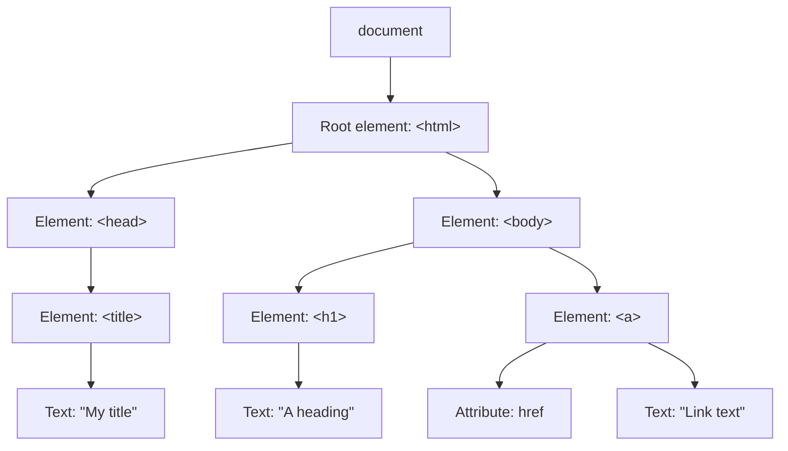

# IN4MATX 133: User Interface Software — Lecture 6：DOM 操作与包管理

## 目录

- [1. 客户端与服务器端的 JavaScript](#1-客户端与服务器端的-javascript)
- [2. 文档对象模型（DOM）](#2-文档对象模型dom)
- [3. 在页面中加入 JavaScript](#3-在页面中加入-javascript)
- [4. 选取元素](#4-选取元素)
- [5. 编辑元素](#5-编辑元素)
- [6. 修改 DOM 树](#6-修改-dom-树)
- [7. 事件与监听器](#7-事件与监听器)
- [8. 文档就绪与脚本顺序](#8-文档就绪与脚本顺序)
- [9. 客户端的用途：验证与收集数据](#9-客户端的用途验证与收集数据)
- [10. 包管理器](#10-包管理器)
- [11. npm](#11-npm)
- [12. 课堂问题与演示（附解答）](#12-课堂问题与演示附解答)
- [13. 速查与必记的 5 个要点](#13-速查与必记的-5-个要点)

> UCI IN4MATX 133: User Interface Software — Prof. Travis Linden Reid，2026 年秋季学期，10/13（周二）。内容整理自 Lecture 6 的幻灯片（共 53 页）和示例仓库文件夹 `W3_L1_Oct13_DOM`。按概念组织，而不是按来源组织。

> 📅 **课程安排**：尽快开始做 A2：大约 2 周后截止，有专门的 `#a2` Slack 频道，学生反映难度较大，所以千万不要拖到最后。
> A2 会用到三讲的内容：Lec 5（10/8，JavaScript 基础）、本讲（10/13，用 JavaScript 修改页面内容 + npm）以及 Lec 7（10/15，TypeScript 对象 + Vega-Lite 图表）。

---

## 1. 客户端与服务器端的 JavaScript

到目前为止（[Lecture 5](lec-05.zh-CN.md)），JavaScript 看起来和其他语言没什么区别。它之所以席卷了 Web，是因为它**内置了大量用于编辑网页的函数**。今天它运行在两个地方：

| | 客户端（你的浏览器） | 服务器端（Web 服务器） |
|---|---|---|
| 用户可见吗？ | 是 | 否 |
| 修改何时发生 | 在浏览器中实时发生 | 在服务器上，响应 HTTP 请求时发生 |
| 作用 | 编辑正在渲染的内容；触发或响应事件 | 以编程方式操作文件系统；动态生成页面或视图；传输、存储数据或与数据交互 |
| 例子 | AJAX、Angular、React、Vue.js | Node、ASP.NET |

浏览器发送**请求（request）**，服务器返回**响应（response）**（幻灯片 8 展示了一个服务器文件夹，里面有 `index.html`、`css/style.css`、`js/app.js`）。幻灯片的警告：如果两边都有 JavaScript，跟踪代码的执行可能会很混乱。

### 1.1 window 对象（仅客户端）

在客户端，`window` 就是浏览器本身；你可以读取它的属性并调用它的函数：

```js
/* example properties */
var width = window.innerWidth;   //viewport width
var height = window.innerHeight; //viewport height
/* example functions */
window.alert("Boo!");
var confirmed = window.confirm("Are you sure?");
var quest = window.prompt("What is your quest?");
```

幻灯片把 alert/confirm/prompt 弹窗标为**不好的做法**：应该把消息或输入框放在页面上。（幻灯片的小错误：prompt 那一行以弯引号 `?”);` 结尾，这是语法错误；上面的版本改用了直引号 `"`。）

**服务器端没有 `window`**：在服务器上没有可以滚动的页面，也没有人可以弹窗提醒。客户端与服务器之间的通信会在 A3 中再讲。

在这个演示中，弹窗以控制台输出的形式显示。`confirm` 返回 `true`，`prompt` 返回 `""`（空字符串）：

```viz web-demo
{"title": "Slide 10 · the window object (alerts go to the console here)", "html": "<p>See the console.</p>", "js": "/* example properties */\nvar width = window.innerWidth;   //viewport width\nvar height = window.innerHeight; //viewport height\nconsole.log(width > 0, height > 0);\n\n/* example functions */\nwindow.alert(\"Boo!\");\nvar confirmed = window.confirm(\"Are you sure?\");\nvar quest = window.prompt(\"What is your quest?\");\nconsole.log(confirmed, JSON.stringify(quest));", "height": 60}
```

---

## 2. 文档对象模型（DOM）

DOM 是“获取、修改、添加或删除 HTML 元素的标准”。你写的 HTML 会被浏览器解析并**转换成 DOM**，之后客户端 JavaScript 就可以编辑 DOM。服务器端 JavaScript 也许能决定发送什么 HTML，但它**不会编辑 DOM**。

页面加载时，浏览器会为页面构建一棵 DOM。DOM 是一棵**树**：HTML 元素是节点（文本和属性也作为节点挂在元素下面）。通过它，JavaScript 可以**响应事件**，并**修改结构、样式和内容**。幻灯片中的树如下：



> 💡 **关键点**：本讲后面所有的 DOM 调用都是树操作：找到一个节点、修改一个节点，或者添加/移动/删除子节点。

> 🔗 **延伸阅读**：[CSS-Tricks: What is the DOM?](https://css-tricks.com/dom/) · [Wikipedia: Document Object Model](https://en.wikipedia.org/wiki/Document_Object_Model)

---

## 3. 在页面中加入 JavaScript

你可以在 `<script>` 标签中直接写 JavaScript。用 `onclick` 属性绑定处理函数虽然可行，但幻灯片指出这是**不好的风格**：

```html
<head>
  <script>
    function buttonClicked() {
      alert("Button Clicked!");
    }
  </script>
</head>
<body>
  <!--Bad style! Don't do this-->
  <button onclick="buttonClicked()">Click me!</button>
</body>
```

和 CSS 一样，更好的做法是**加载外部脚本**（与 Lecture 5 的“Loading JavaScript”相同）：

```html
<head>
  <script src="js/script.js"></script>
</head>
```

绑定点击处理函数更好的方式是 `addEventListener`（[第 7 节](#7-事件与监听器)）。把脚本放在 `<head>` 中，只有在脚本等待页面加载完成的情况下才能正常工作（[第 8 节](#8-文档就绪与脚本顺序)）。

---

## 4. 选取元素

要修改一个元素，首先需要拿到它的引用，办法是在 `document` 上调用**选择器函数**：

```js
//element with id="foo"
var fooElem = document.getElementById('foo');
//elements with class="row"
var rowElems = document.getElementsByClassName('row');
//<li> elements
var liElems = document.getElementsByTagName('li');
```

注意这些名字。`getElementById` 是单数，返回**一个元素**（或 `null`）。`getElementsBy…` 是复数，返回一个**集合**（`HTMLCollection`），即使只匹配到一个元素也是如此。要使用其中的某个元素，需要用下标访问，比如 `liElems[0]`。

幻灯片 17 对 `<div id="foo">This is a div with ID 'foo'.</div>` 运行了第一段代码。控制台输出该 div 的 `innerHTML`，即 `This is a div with ID 'foo'.`（幻灯片的小错误：幻灯片代码里有弯引号 `‘foo'` / `“foo”`，这是 JavaScript 语法错误；还有 `console.Log`，会抛出 `TypeError: console.Log is not a function`。下面仓库中的版本使用 `'foo'` 和 `console.log`。）

**最简单的方法是复用 CSS 选择器。**[Lecture 3](lec-03.zh-CN.md) 中的任何选择器都可以使用。`.selectExample > p` 是子选择器：只匹配 `.selectExample` 的*直接*子元素 `<p>`，不包括孙子元素。

```js
/*easiest to select by reusing CSS selectors! */
var cssSelector = '.selectExample > p';
//selects FIRST element that matches css selector
var elem = document.querySelector(cssSelector);
//matches ALL elements that match css selector
var elems = document.querySelectorAll(cssSelector);
elems.forEach((elem) => {
    console.log(elem.innerHTML);
});
```

这个 `forEach` 循环来自 lectureExamples.js。在仓库的页面上它会输出一次 `CSS selector example!!`。`.selectExample` 里的第二个段落位于嵌套的 `<div>` 内，属于孙子元素，所以不会被匹配。

| 函数 | 返回值 | 有 `forEach` 吗？ |
|---|---|---|
| `getElementById` | 一个元素或 `null` | 不适用 |
| `getElementsByClassName`、`getElementsByTagName` | `HTMLCollection`（实时更新） | **没有**，所以要用 `for` 循环 |
| `querySelector` | 第一个匹配项或 `null` | 不适用 |
| `querySelectorAll` | `NodeList` | **有** |

仓库自带的注释（solution1.js）说的是同一件事：“HTMLCollection, which getElementsByTagName returns, does NOT have a foreach() method but NodeList, which querySelector returns, does”。这里指的其实是 `querySelectorAll`。在 Chromium 中，对 HTMLCollection 执行 `typeof collection.forEach` 得到 `undefined`，对 NodeList 则得到 `function`。

下面可以试试你自己的选择器；修改 JS 后点击 Run：

```viz web-demo
{"title": "Slides 16–18 · lectureExamples.html / .js (Selecting elements 1–2)", "interactive": true, "html": "<div id=\"foo\">This is a div with ID 'foo'.</div>\n<ol>\n    <li>List item</li>\n    <li>List item</li>\n    <li>List item</li>\n</ol>\n<div class=\"selectExample\">\n    <p>CSS selector example!!</p>\n    <div><p>Here's another paragraph that will not be selected... because it's not a direct descendent!</p></div>\n</div>", "js": "//element with id=\"foo\"\nvar fooElem = document.getElementById('foo');\nconsole.log(fooElem.innerHTML);\n\n//<li> elements\nvar liElems = document.getElementsByTagName('li');\nconsole.log(liElems.length);\n\n/*easiest to select by reusing CSS selectors! */\nvar cssSelector = '.selectExample > p';\nvar elem = document.querySelector(cssSelector);\nvar elems = document.querySelectorAll(cssSelector);\nelems.forEach((elem) => {\n    console.log(elem.innerHTML);\n});\nconsole.log(elems.length);", "height": 200}
```

> 🧪 **示例文件**：[lectureExamples.html](https://github.com/travislindenreid/INF33-Demos/blob/main/W3_L1_Oct13_DOM/lectureExamples/lectureExamples.html) · [lectureExamples.js](https://github.com/travislindenreid/INF33-Demos/blob/main/W3_L1_Oct13_DOM/lectureExamples/lectureExamples.js)

> ⚠️ **易错点**：对集合直接写属性（`getElementsByClassName("para").innerHTML = …`）不会报错，也不会改变页面上的任何内容。必须先用下标取元素：`[0].innerHTML`。

> 📝 **练习**：[问题 1](#121-问题-1哪段代码能修改-p幻灯片-23) 考的正是这一点。

---

## 5. 编辑元素

拿到元素之后，通过**设置它的属性**来修改它。

```js
/* properties to access the CONTENT of the element */
var elem = document.querySelector('p.queryTest');
//the text content of the elem
elem.textContent = "I'm different!"; //change the content
//content including tags
elem.innerHTML = "I'm <strong>different</strong>";
var parent = elem.parentNode; //get the parent node
```

- `textContent` 是纯文本。字符串中的标签**不会**被解析，而是原样显示在页面上（在 Chromium 中存储的 HTML 是 `I'm &lt;strong&gt;different&lt;/strong&gt;`）。
- `innerHTML` 会被当作 HTML 解析，所以 `different` 会变成粗体。
- `parentNode` 沿着树向上移动。这里它是 `<body>`，其 `tagName` 为 `BODY`。

（幻灯片的小错误：`‘p.queryTest’` 用了弯引号；请使用 `'p.queryTest'`。）

你还可以**添加或移除 class、ID 以及行内样式**：

```js
var elements = document.getElementsByTagName("h1");
for(var i = 0; i < elements.length; i++) {
  elements[i].classList.add("title");
  elements[i].style.color="blue";
}
```

使用仓库中的 CSS `.title { font-style: italic; }` 后，标题 “Hello, IN4MATX 133!” 会变成**蓝色斜体**。这是幻灯片里的截图，我运行 lectureExamples.html 得到的结果也是如此。`classList.add` 把样式保留在 CSS 文件里，而 `style.color` 则是在元素上写入行内样式。这里用 `for` 循环，是因为结果是一个 `HTMLCollection`（[第 4 节](#4-选取元素)）。

一步步来看：

```viz web-demo
{"title": "Slides 19–20 · lectureExamples.js (Editing elements 1–2)", "css": ".title {\n    font-style: italic;\n}", "html": "<h1>Hello, IN4MATX 133!</h1>\n<p class=\"queryTest\">Editing inner HTML...</p>", "js": "var elem = document.querySelector('p.queryTest');", "steps": [{"note": "textContent replaces the text; tags in the string would show literally.", "js": "\nelem.textContent = \"I'm different!\"; //change the content"}, {"note": "innerHTML parses the string as HTML, so <strong> becomes bold.", "js": "\nelem.innerHTML = \"I'm <strong>different</strong>\";\nvar parent = elem.parentNode; //get the parent node\nconsole.log(parent.tagName);"}, {"note": "Add the class \"title\" (italic, from the CSS) and an inline blue color to every h1.", "js": "\nvar elements = document.getElementsByTagName(\"h1\");\nfor(var i = 0; i < elements.length; i++) {\n    elements[i].classList.add(\"title\");\n    elements[i].style.color=\"blue\";\n}"}], "height": 150}
```

> 🧪 **示例文件**：[lectureExamples.js](https://github.com/travislindenreid/INF33-Demos/blob/main/W3_L1_Oct13_DOM/lectureExamples/lectureExamples.js) · [lectureExamples.css](https://github.com/travislindenreid/INF33-Demos/blob/main/W3_L1_Oct13_DOM/lectureExamples/lectureExamples.css)

---

## 6. 修改 DOM 树

除了编辑已经存在的元素，你还可以创建新节点，并把它们附加、插入、替换或删除：

```js
//create a new <p> (not yet in the tree)
var newP = document.createElement('p');
newP.textContent = "I'm new!";
//create Node of textContent only
var newText = document.createTextNode("I'm blank");
var div = document.querySelector('div#container');
div.appendChild(newP); //add element INSIDE (at end)
div.appendChild(newText);
//add node BEFORE element (new, old)
div.insertBefore(document.createTextNode("First!"), newP);
//replace node (new, old)
div.replaceChild(document.createTextNode('boo'), newText);
//remove node
div.removeChild(div.querySelector('p'));
```

你创建的节点**在被 append 或 insert 到某处之前，并不会出现在页面上**。按顺序执行这些调用，`div.innerHTML` 的变化如下（Chromium 的输出）：

| 执行后 | `div.innerHTML` |
|---|---|
| `appendChild(newP)` | `<p>I'm new!</p>` |
| `appendChild(newText)` | `<p>I'm new!</p>I'm blank` |
| `insertBefore("First!", newP)` | `First!<p>I'm new!</p>I'm blank` |
| `replaceChild('boo', newText)` | `First!<p>I'm new!</p>boo` |
| `removeChild(p)` | `First!boo` |

参数顺序是个陷阱：`insertBefore` 和 `replaceChild` 都是 **(new, old)**。仓库的 lectureExamples.js 把第一个 `appendChild` 之后的所有调用都注释掉了，所以它的页面只显示 “I'm new!”。下面的演示会把它们全部运行一遍：

```viz web-demo
{"title": "Slide 21 · Changing the DOM, one call per step", "html": "<div id=\"container\"></div>", "js": "//create a new <p> (not yet in the tree)\nvar newP = document.createElement('p');\nnewP.textContent = \"I'm new!\";\n//create Node of textContent only\nvar newText = document.createTextNode(\"I'm blank\");\nvar div = document.querySelector('div#container');", "steps": [{"note": "appendChild adds the new p inside the div, at the end.", "js": "\ndiv.appendChild(newP); //add element INSIDE (at end)\nconsole.log(div.innerHTML);"}, {"note": "A text node is appended after the p.", "js": "\ndiv.appendChild(newText);\nconsole.log(div.innerHTML);"}, {"note": "insertBefore(new, old) puts \"First!\" before the p.", "js": "\ndiv.insertBefore(document.createTextNode(\"First!\"), newP);\nconsole.log(div.innerHTML);"}, {"note": "replaceChild(new, old) swaps \"I'm blank\" for \"boo\".", "js": "\ndiv.replaceChild(document.createTextNode('boo'), newText);\nconsole.log(div.innerHTML);"}, {"note": "removeChild removes the p; only the two text nodes are left.", "js": "\ndiv.removeChild(div.querySelector('p'));\nconsole.log(div.innerHTML);"}], "height": 120}
```

课堂上的 **DOM 操作演示**（幻灯片 22：`setup1.html`、`setup1.css`、`setup1.js`）用定时器把第 4–6 节的内容串了起来。详见 [演示 1](#122-演示-1用定时器修改页面幻灯片-22--setup1--solution1)。

> 📝 **练习**：[演示 1](#122-演示-1用定时器修改页面幻灯片-22--setup1--solution1)

---

## 7. 事件与监听器

*如何让页面具有交互性？* 你给元素附加一个**监听器（listener）**：当该元素触发事件时被调用的函数。通常它是一个匿名回调函数（回调在 [Lecture 5](lec-05.zh-CN.md) 中讲过）：

```js
//often use an anonymous callback function
elem.addEventListener('click', function(){
  console.log('clicky clicky!');
});
```

回调函数会收到一个 **event** 参数。它有时很有用，但通常可以忽略，因为 JavaScript 的所有参数都是可选的。`event.target` 是触发事件的元素：

```js
elem.addEventListener('click', function(event) {
   console.log('You clicked me!');
   //get what was clicked;
   var clickedElem = event.target;
});
```

你可以给同一个元素添加多个监听器，它们会按添加的顺序依次运行。在仓库的页面上，点击一次 `#buttonTest` 会先输出 `clicky clicky!`，再输出 `You clicked me!`，后面跟着按钮元素本身。

幻灯片上列出的事件类型：

| 类型 | 触发时机 |
|---|---|
| `'click'` | 鼠标点击或按钮被点击 |
| `'dblclick'` | 双击 |
| `'hover'` | 鼠标悬停（见下面幻灯片的小错误） |
| `'focus'` | 元素获得焦点（幻灯片标注这一项很重要） |
| `'mouseenter'` / `'mouseleave'` | 鼠标移入 / 离开元素 |
| `'mousedown'` | 鼠标按键被按下 |
| `'keydown'` | 键盘按键被按下 |

幻灯片的小错误：**并不存在 `'hover'` 事件**。我在 Chromium 中附加了一个 `'hover'` 监听器并把鼠标悬停在元素上，它从未触发，而 `'mouseenter'` 会触发。请使用 `mouseenter`/`mouseleave`（或者用 CSS 的 `:hover` 选择器来设置样式）。

点击按钮，观察控制台：

```viz web-demo
{"title": "Slides 27–28 · lectureExamples.js (Listeners 1–2) — click the button", "interactive": true, "html": "<button id=\"buttonTest\">click me!</button>", "js": "var elem = document.getElementById('buttonTest');\n\n//often use an anonymous callback function\nelem.addEventListener('click', function(){\n    console.log('clicky clicky!');\n});\n\nelem.addEventListener('click', function(event) {\n    console.log('You clicked me!');\n    // get what was clicked\n    var clickedElem = event.target;\n    console.log(clickedElem);\n});", "height": 80}
```

> 🧪 **示例文件**：[lectureExamples.js](https://github.com/travislindenreid/INF33-Demos/blob/main/W3_L1_Oct13_DOM/lectureExamples/lectureExamples.js)（“Listeners (1)” 和 “Listeners (2)” 部分）

> 🔗 **延伸阅读**：[MDN: Event reference](https://developer.mozilla.org/en-US/docs/Web/Events)

---

## 8. 文档就绪与脚本顺序

你的脚本应该**等页面加载完成后再运行**。否则它要访问的元素可能还不存在：

```js
document.addEventListener('DOMContentLoaded', function (event) {
  alert("Page loaded!");
});
```

lectureExamples.js 就是这样工作的：尽管它是在 `<head>` 中加载的，整个脚本主体都放在一个 `DOMContentLoaded` 监听器里。没有这个监听器的话，`<head>` 中的脚本会在 `<body>` 被解析之前运行。在这样的脚本顶层，`document.querySelector('h1')` 返回 `null`；放在监听器内部则能找到标题。示例文件使用较老的 `<body onload="runJS()">` 来达到同样的目的。

**引入 JavaScript。**当脚本使用 document ready 时，惯例是把它加载在 `<head>` 中。**顺序很重要**，尤其是对库来说：要在使用 Math.js 的脚本*之前*先加载 Math.js。

```html
<head>
  <script src="https://cdnjs.cloudflare.com/ajax/libs/mathjs/9.0.0/math.js"></script>
  <script src="index.js"></script>
</head>
```

（幻灯片中第一个 `src` 以弯引号 `“` 开头；它必须是直引号 `"`。）

> ⚠️ **易错点**：选择器报 `Cannot read properties of null`，几乎总是意味着脚本运行时元素还不存在。把你的代码包在 `DOMContentLoaded` 里。

---

## 9. 客户端的用途：验证与收集数据

**验证数据。**在把表单发送给服务器*之前*先检查字段。用户能立刻得到反馈，也减少了与服务器之间的来回通信：

```html
<script>
function validateForm() {
  var x = document.forms["myForm"]["fname"].value;
  if(x==null || x=="") {
    alert("Name must be filled out");
    return false;
  }
}
</script>
<form name="myForm" onsubmit="return validateForm()" method="post">
  <label>Name: </label>
  <input type="text" name="fname">
  <input type="submit" value="Submit">
</form>
```

`onsubmit` 处理函数中的 `return false` 会**取消提交**。字段为空时，它会弹出 `Name must be filled out`，页面保持不变。`document.forms["myForm"]["fname"]` 先按 `name` 找到表单，再按 `name` 找到输入框。

两种情况都一步步看一遍（先为空，再填写），或者你自己在输入框里输入后点击 Submit。这个演示不会真正发送表单；它会输出 `[form submitted]`：

```viz web-demo
{"title": "Slide 32 \u00b7 validating a form before it is sent \u2014 step through, or type and press Submit", "interactive": true, "html": "<form name=\"myForm\" onsubmit=\"return validateForm()\" method=\"post\">\n<label>Name: </label>\n<input type=\"text\" name=\"fname\">\n<input type=\"submit\" value=\"Submit\">\n</form>", "js": "function validateForm() {\n    var x = document.forms[\"myForm\"][\"fname\"].value;\n    if(x==null || x==\"\") {\n        alert(\"Name must be filled out\");\n        return false;\n    }\n}", "height": 80, "steps": [{"note": "Submit with the field empty: validateForm alerts and returns false, so the submit is cancelled.", "js": "\n// simulate pressing Submit with an empty field\ndocument.forms[\"myForm\"].requestSubmit();"}, {"note": "Fill in a name and submit again: validateForm returns nothing, so the form would be sent.", "js": "\ndocument.forms[\"myForm\"][\"fname\"].value = \"Peter\";\ndocument.forms[\"myForm\"].requestSubmit();"}]}
```

**收集并使用信息。**客户端代码可以读取只有浏览器才知道的信息，比如用户的位置：

```html
<script>
var x = document.getElementById("demo");
function getLocation() {
    if (navigator.geolocation) {
        navigator.geolocation.getCurrentPosition(showPosition);
    } else {
        x.innerHTML = "Geolocation is not supported by this browser.";
    }
}
function showPosition(position) {
    x.innerHTML = "Latitude: " + position.coords.latitude +
    "<br>Longitude: " + position.coords.longitude;
}
</script>
```

`getCurrentPosition` 接收 `showPosition` 作为回调，稍后用位置信息调用它。幻灯片想强调的是：**这是客户端的行为**，是用户的浏览器（和设备）知道位置。（这里没有运行，因为它需要弹出位置权限提示。）

---

## 10. 包管理器

*换个话题。*到目前为止，我们用两种方式导入包（[Lecture 4](lec-04.zh-CN.md) 在引入 Bootstrap 时用过）：

- 通过 **CDN**，在 `<head>` 中粘贴一个 `<script>` 标签，例如 `<script src="https://cdnjs.cloudflare.com/ajax/libs/mathjs/9.0.0/math.min.js"></script>`；
- **从源头下载**（例如下载 Bootstrap，而不是使用 CDN）。

**包管理器（package manager）**提供了一种在你的电脑上安装软件的简便方式，既能装新程序，也能装库。它们还能让你轻松地把软件更新到最新版本。难点在于包会依赖其他包，而且常常依赖不同的版本，包管理器应该替你处理好这些。它们本质上就是**所有内容都免费的应用商店**。

| 层级 | 例子 |
|---|---|
| 操作系统级 | apt-get（Unix）、homebrew（macOS）、winget（Windows） |
| 语言级 | pip（Python）、npm（JavaScript）、yarn（同样是 JavaScript）、RubyGems（Ruby） |

**为什么有这么多？**保持特定语言或领域的环境有一定价值。某些语言搭配某些文件格式效果更好，大多数管理器由社区驱动，而且每个新的管理器都在解决前人留下的某个问题。幻灯片的结论是：“很多都只是借口；现实中，它常常是一团令人沮丧的乱麻。”

> 🔗 **延伸阅读**：[Quora: Why do so many programming languages have their own package manager?](https://www.quora.com/Why-do-so-many-different-programming-languages-have-their-own-package-manager)

---

## 11. npm

### 11.1 npm 与 Yarn

- **npm** 是作为 **Node.js**（服务器端 JavaScript）的包管理器推出的。
- **Yarn** 出现得更晚，由 Facebook 开源发布。它使用**同一个注册表（registry）**（即包的列表）。
- 两者都有大量用于构建网页和 Web 界面的实用库，既适用于服务器端 JavaScript，也适用于客户端 JavaScript。它们偶尔也被用来安装系统级软件。
- “包（package）”和“库（library）”经常被混用，这可能会造成误导。

一些常见的 Web 库：

| 库 | 用途 |
|---|---|
| Moment.js* | 管理时间和时区（*幻灯片链接了一篇文章，说你现在可能已经不需要它了） |
| Math.js | 各种数学运算、单位换算等 |
| Express | 把你的网站路由到不同内容（其他页面或文件） |

> 🔗 **延伸阅读**：[Moment.js docs](https://momentjs.com/docs/) · [DockYard: You probably don't need Moment.js anymore](https://dockyard.com/blog/2020/02/14/you-probably-don-t-need-moment-js-anymore) · [Math.js docs](http://mathjs.org/docs/) · [Express](https://expressjs.com/)

### 11.2 npm 的三个文件与 git

| 项目 | 它是什么 | 提交到 git 吗？ |
|---|---|---|
| `package.json` | 本项目安装的库；按惯例放在项目根文件夹 | **是** |
| `package-lock.json` | *你的*库所需要的各个库的具体版本（“库的库”） | **是** |
| `node_modules/` | 所有已安装的库本身 | **否**：把它加入 `.gitignore` |

`.gitignore` 列出不应被提交的文件。你提交这两个 JSON 文件，是为了让别人能安装与你**相同版本的包**。你不提交 `node_modules/`，是因为它既冗余（`package.json` 已经说明了要下载什么），又庞大（里面装的是包本身）。

### 11.3 使用 npm

npm 在你操作系统的命令行中运行，要在项目的**根目录**下执行：

```bash
cd path/to/project
npm install packagename   # installs into this project's node_modules/
npm update                # get the latest versions (important for security patches)
```

**克隆项目。**比如要运行课程网页：先安装 npm，克隆仓库，然后在根目录运行不带包名的 `npm install`。这会把项目依赖的所有库（列在 `package.json` 中）安装到 `node_modules/`。

**全局包（global package）**就是你电脑上的软件，通常是命令行程序：

```bash
npm install -g packagename
```

全局包是程序而不是库，所以**不会被添加到 `package.json` 或 `node_modules/`**，尽管你的项目运行时可能依赖它们。它们常常和操作系统级包管理器提供的东西重叠。**A2 只需要全局包。**

> 🔗 **延伸阅读**：[npm: Get npm](https://www.npmjs.com/get-npm)

### 11.4 package.json 与版本范围

“除非你清楚自己在做什么，否则不要手动编辑！”幻灯片中的例子（一个旧的课程网站，一个 Angular 项目）：

```json
{
  "name": "inf133-wi22",
  "version": "0.0.0",
  "scripts": {
    "ng": "ng",
    "start": "ng serve",
    "build": "ng build"
  },
  "dependencies": {
    "@angular/animations": "~7.2.0",
    "@angular/common": "~7.2.0",
    "@angular/compiler": "~7.2.0",
    "@angular/core": "~7.2.0",
    "@angular/forms": "~7.2.0",
    "@angular/platform-browser": "~7.2.0",
    "@angular/platform-browser-dynamic": "~7.2.0",
    "@angular/router": "~7.2.0",
    "bibtex-parse-js": "0.0.24",
    "component": "^1.1.0",
    "core-js": "^2.5.4",
    "moment": "^2.24.0",
    "ngx-moment": "^3.4.0",
    "rxjs": "~6.3.3",
    "tslib": "^1.10.0",
    "zone.js": "~0.8.26"
  }
}
```

（幻灯片的小错误：`“inf133-wi22"` 以弯引号开头，而且 `"build": "ng build"` 后面多了一个逗号。这两处都是无效的 JSON，所以上面已经修正。）

| 前缀 | 含义 | `"~7.2.0"` / `"^1.1.0"` 接受的版本 |
|---|---|---|
| `^` | “兼容于” | `^1.1.0` → 1.X.X |
| `~` | “大致等同于” | `~7.2.0` → 7.2.X |
| 无 | 恰好是该版本 | `"0.0.24"` |
| `>`、`<`、`>=`、`=` | 显式比较 | |

`scripts` 给出可以通过 npm 运行的命令名（例如 `npm start` 会运行 `ng serve`）。在一个空项目里，`npm install moment`（npm 10.9.4）会在 `package.json` 中写入 `"moment": "^2.31.0"`，创建 `package-lock.json`，并下载到 `node_modules/`。

> 📝 **练习**：[问题 2](#123-问题-2npm-install-与-npm-install--g幻灯片-49)

---

## 12. 课堂问题与演示（附解答）

### 12.1 问题 1：哪段代码能修改 p？（幻灯片 23）

下面哪段代码可以把 `p` 修改为显示 “1, 2, 3, 4, 5”？

```html
<p class="para" id="intro">1, 2, 3</p>
```

- **A** `document.getElementById("intro").append(", 4, 5");`
- **B** `document.getElementsByClassName(“para").innerHTML = "1, 2, 3, 4, 5";`
- **C** `document.getElementsByTagName(“p")[0].innerHTML = "1, 2, 3, 4, 5";`
- **D** 以上有两个
- **E** 以上全部

> ✍️ **先自己试试。**

**答案：D**（A 和 C；幻灯片 25 的揭晓页高亮了 A、C 和 D）。

- **A 可行。**`getElementById` 返回该元素，`append` 在末尾追加文本，得到 `1, 2, 3, 4, 5`。
- **B 静默失败。**`getElementsByClassName` 返回一个 `HTMLCollection`。对集合设置 `.innerHTML` 只是给它创建了一个没用的属性，所以 `<p>` 仍然显示 `1, 2, 3`，而且不会抛出错误。
- **C 可行。**它同样是集合，但 `[0]` 从中取出第一个 `<p>`，然后设置它的 `innerHTML`。

（幻灯片中 B 和 C 的字符串以弯引号 `“` 开头，在真实代码里会是语法错误。仓库的 `q1.js` 使用直引号；答案按直引号来算。）把 q1.js 中的每个选项分别取消注释后运行，输出与下面这段检查相同：

```viz web-demo
{"title": "Question 1 · each option run on a fresh copy of the p (q1.js)", "html": "<p class=\"para\" id=\"intro\">1, 2, 3</p>", "js": "var p = document.getElementById(\"intro\");\n\n// A\ndocument.getElementById(\"intro\").append(\", 4, 5\");\nconsole.log(\"A:\", p.innerHTML);\np.innerHTML = \"1, 2, 3\"; // reset\n\n// B\ndocument.getElementsByClassName(\"para\").innerHTML = \"1, 2, 3, 4, 5\";\nconsole.log(\"B:\", p.innerHTML);\np.innerHTML = \"1, 2, 3\"; // reset\n\n// C\ndocument.getElementsByTagName(\"p\")[0].innerHTML = \"1, 2, 3, 4, 5\";\nconsole.log(\"C:\", p.innerHTML);", "height": 60}
```

> 🧪 **示例文件**：[q1.html](https://github.com/travislindenreid/INF33-Demos/blob/main/W3_L1_Oct13_DOM/q1/q1.html) · [q1.js](https://github.com/travislindenreid/INF33-Demos/blob/main/W3_L1_Oct13_DOM/q1/q1.js)

回到 [4. 选取元素](#4-选取元素)。

### 12.2 演示 1：用定时器修改页面（幻灯片 22 · setup1 → solution1）

起始页面显示 “Hello, IN4MATX 133!” 和 “Fill in this paragraph and add another one.”。任务来自 `setup1.js`：

- 1 秒后，给 h1 标签添加 “title” 类，并把它的颜色改为蓝色。
- 2 秒后，把第一个段落（id 为 “first”）的文本改为 “Lorem ipsum amet”。
- 3 秒后，给 div（id 为 “body”）添加一个新段落，文本为 “A new paragraph!”

起始代码（`setup1.html` 通过 `<body onload="runJS()">` 调用 `runJS()`；`setup1.css` 定义了 `.title { font-style: italic; }` 和 `#body { font-family: 'Arial'; }`）：

```js
function runJS() {

}
function makeTitleBlue () {

}
function addLoremIpsum () {

}
function addNewParagraph () {

}
```

> ✍️ **先自己试试。**

**答案**（来自 `solution1.js`）：

```js
function runJS() {
    setTimeout(makeTitleBlue, 1000);
    setTimeout(addLoremIpsum, 2000);
    setTimeout(addNewParagraph, 3000);
}

function makeTitleBlue () {
    var h1Tags = document.getElementsByTagName('h1');
    // interesting note: HTMLCollection, which getElementsByTagName returns, does NOT have a foreach() method
    // but NodeList, which querySelector returns, does
    for(var i = 0; i< h1Tags.length; i++) {
        h1Tags[i].classList.add('title');
        h1Tags[i].style.color = 'blue';
    }
}

function addLoremIpsum () {
    var firstTag = document.getElementById('first');
    firstTag.textContent = 'Lorem ipsum';
}

function addNewParagraph () {
    var div = document.getElementById('body');
    var newEl = document.createElement('p');
    newEl.textContent = 'A new paragraph';
    newEl.classList.add('title');
    div.appendChild(newEl);
}
```

要点：

- `setTimeout(fn, ms)` 接收的是函数**本身**（`makeTitleBlue`，而不是 `makeTitleBlue()`），并在 `ms` 毫秒后调用它。
- 每一步都是第 4–6 节中的一种操作：按标签选取并循环、按 id 选取并设置 `textContent`，以及创建、设置再 `appendChild`。

3.5 秒后，页面显示蓝色的 “Hello, IN4MATX 133!”、“Lorem ipsum” 和 “A new paragraph”。仓库里有两个小出入：解答写的是 `'Lorem ipsum'` 和 `'A new paragraph'`（任务描述是 “Lorem ipsum amet” 和 “A new paragraph!”），而且它还把新段落设为了斜体。另外，`solution1.html` 链接了 `solution1.css`，但仓库里没有这个文件（404），所以在仓库页面上标题是**蓝色但不是斜体**。使用 `setup1.css`（如下面的演示）时，标题和新段落是斜体，div 使用 Arial 字体。

```viz web-demo
{"title": "Demo 1 · solution1.js (runJS() called directly instead of body onload)", "css": ".title {\n    font-style: italic;\n}\n\n#body {\n    font-family: 'Arial';\n}", "html": "<h1>Hello, IN4MATX 133!</h1>\n<div id=\"body\">\n    <p id=\"first\">Fill in this paragraph and add another one.</p>\n</div>", "js": "\nfunction runJS() {\n    setTimeout(makeTitleBlue, 1000);\n\n    setTimeout(addLoremIpsum, 2000);\n\n    setTimeout(addNewParagraph, 3000);\n}\n\nfunction makeTitleBlue () {\n    var h1Tags = document.getElementsByTagName('h1');\n    // interesting note: HTMLCollection, which getElementsByTagName returns, does NOT have a foreach() method\n    // but NodeList, which querySelector returns, does\n    for(var i = 0; i< h1Tags.length; i++) {\n        h1Tags[i].classList.add('title');\n        h1Tags[i].style.color = 'blue';\n    }\n}\n\nfunction addLoremIpsum () {\n    var firstTag = document.getElementById('first');\n    firstTag.textContent = 'Lorem ipsum';\n}\n\nfunction addNewParagraph () {\n    var div = document.getElementById('body');\n    var newEl = document.createElement('p');\n    newEl.textContent = 'A new paragraph';\n    newEl.classList.add('title');\n    div.appendChild(newEl);\n}\n\nrunJS(); // in the repo: <body onload=\"runJS()\">", "height": 160}
```

> 🧪 **示例文件**：[setup1.html](https://github.com/travislindenreid/INF33-Demos/blob/main/W3_L1_Oct13_DOM/demo1/setup1.html) · [setup1.css](https://github.com/travislindenreid/INF33-Demos/blob/main/W3_L1_Oct13_DOM/demo1/setup1.css) · [setup1.js](https://github.com/travislindenreid/INF33-Demos/blob/main/W3_L1_Oct13_DOM/demo1/setup1.js) · [solution1.html](https://github.com/travislindenreid/INF33-Demos/blob/main/W3_L1_Oct13_DOM/demo1/solution1.html) · [solution1.js](https://github.com/travislindenreid/INF33-Demos/blob/main/W3_L1_Oct13_DOM/demo1/solution1.js)

回到 [6. 修改 DOM 树](#6-修改-dom-树)。

### 12.3 问题 2：npm install 与 npm install -g（幻灯片 49）

哪个是正确的？四种效果如下：

1. 把包下载到 `node_modules`
2. 把包添加到 `package.json`
3. 把包的依赖添加到 `package-lock.json`
4. 该包可以作为命令行程序使用

| 选项 | `npm install packagename` | `npm install -g packagename` |
|---|---|---|
| A | 1, 2, 3, 4 | 1, 4 |
| B | 1, 2, 3 | 4 |
| C | 1 | 4 |
| D | 1, 2, 3 | 2, 3, 4 |
| E | 1 | 1, 4 |

> ✍️ **先自己试试。**

**答案：B**（幻灯片 51 揭晓）。

- **本地安装**会改动项目：下载到 `node_modules/`（1），在 `package.json` 中记录该包（2），并在 `package-lock.json` 中锁定它的依赖（3）。我测试 `npm install moment` 时这三件事都发生了。
- **全局安装**是“只是你电脑上的软件”：它给你一个命令行程序（4），并且**不会改动**项目的任何文件。这就排除了 A 和 E（全局安装不使用项目的 `node_modules`）以及 D（全局安装不会编辑 `package.json` 或 lock 文件）。C 没有考虑到本地安装还会更新那两个 JSON 文件。

回到 [11. npm](#11-npm)。

---

## 13. 速查与必记的 5 个要点

**选取**

| 调用 | 返回值 |
|---|---|
| `document.getElementById('foo')` | 一个元素 / `null` |
| `document.getElementsByClassName('row')` | `HTMLCollection`（用下标访问；没有 `forEach`） |
| `document.getElementsByTagName('li')` | `HTMLCollection` |
| `document.querySelector('.a > p')` | 第一个匹配项 / `null` |
| `document.querySelectorAll('.a > p')` | `NodeList`（有 `forEach`） |

**编辑与修改树**

| 调用 | 效果 |
|---|---|
| `el.textContent = "…"` | 设置纯文本（标签原样显示） |
| `el.innerHTML = "…"` | 设置内容，并按 HTML 解析 |
| `el.parentNode` | 父节点 |
| `el.classList.add("title")` | 添加一个 class |
| `el.style.color = "blue"` | 行内样式 |
| `document.createElement('p')` / `createTextNode("…")` | 新节点，尚未加入树中 |
| `parent.appendChild(node)` | 添加到内部末尾 |
| `parent.insertBefore(new, old)` | 添加到 `old` 之前 |
| `parent.replaceChild(new, old)` | 替换 |
| `parent.removeChild(node)` | 删除 |

**事件**

| 代码 | 用途 |
|---|---|
| `el.addEventListener('click', function(event) {…})` | 响应事件；`event.target` = 事件来源 |
| `document.addEventListener('DOMContentLoaded', …)` | 页面解析完成后运行 |
| `click`、`dblclick`、`focus`、`mouseenter`、`mouseleave`、`mousedown`、`keydown` | 常见类型（没有 `hover` 事件） |

**npm**

| 命令 / 文件 | 作用 |
|---|---|
| `npm install` | 把 `package.json` 中的所有内容安装到 `node_modules/` |
| `npm install pkg` | 添加 `pkg`：node_modules + package.json + package-lock.json |
| `npm install -g pkg` | 全局安装一个命令行程序；不涉及项目文件 |
| `npm update` | 更新到允许的最新版本（安全补丁） |
| `^1.1.0` / `~7.2.0` | 1.X.X / 7.2.X |
| 提交 | `package.json`、`package-lock.json`；`.gitignore` 忽略 `node_modules/` |

**必记的 5 个要点**

1. `getElementsBy…` 返回的是**集合**：设置 `innerHTML` 之前要先用下标（`[0]`）取元素。直接对集合设置属性什么也不会发生，也不会报错。
2. `textContent` 只处理文本，而 `innerHTML` 会解析标签。
3. `insertBefore` 和 `replaceChild` 的参数是 **(new, old)**，而且创建出来的节点在 append 或 insert 之前是看不见的。
4. `<head>` 中的脚本必须等待 `DOMContentLoaded`，而且库必须在使用它们的脚本之前加载。
5. `npm install pkg` 会更新 `node_modules` + `package.json` + `package-lock.json`，而 `-g` 只安装命令行程序。提交那两个 JSON 文件，永远不要提交 `node_modules/`。
