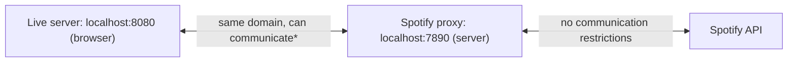

# IN4MATX 133: User Interface Software — Lecture 8：AJAX、Fetch 与 Promise

## 目录

- [1. Web API](#1-web-api)
- [2. Web 请求的结构：URI](#2-web-请求的结构uri)
- [3. HTTP 动词与响应](#3-http-动词与响应)
- [4. URL 中的字符转义](#4-url-中的字符转义)
- [5. AJAX、XML 与 JSON](#5-ajaxxml-与-json)
- [6. XMLHttpRequest](#6-xmlhttprequest)
- [7. fetch()](#7-fetch)
- [8. 异步请求](#8-异步请求)
- [9. Promise 与 .then()](#9-promise-与-then)
- [10. 取出数据：response.json() 与链式调用](#10-取出数据responsejson-与链式调用)
- [11. 客户端与服务端 JS，以及同源策略](#11-客户端与服务端-js以及同源策略)
- [12. 使用 .catch() 捕获错误](#12-使用-catch-捕获错误)
- [13. 使用 Promise.all 处理多个 Promise](#13-使用-promiseall-处理多个-promise)
- [14. 课堂问题与演示（附解答）](#14-课堂问题与演示附解答)
- [15. 速查与必记的 5 个要点](#15-速查与必记的-5-个要点)

> UCI IN4MATX 133: User Interface Software — Prof. Travis Linden Reid，2026 年秋季学期，第 5 周
> 内容整理自 Lecture 8 的幻灯片和 demo 仓库文件夹 `W4_L1_Oct20_Ajax`。按概念组织，而不是按来源组织。

> 📅 **课程安排**：A1 成绩即将完成，预计下周初公布。
> A3 将于周四课堂上发布（已更新为 2026 版）；截止日期为 **11 月 11 日（周三）**（已推迟）。
> 周五的 discussion 内容是 Angular。

本讲目标：说明程序如何访问 Web 资源以及这些资源如何响应，用 `fetch` 请求从 Web API 获取资源，并使用 Promise 处理异步请求。

---

## 1. Web API

许多 Web 服务和数据源允许你通过 HTTP（Web）请求访问其数据。它们为此提供了 **Web API**。

**API = Application Programming Interface（应用程序编程接口）**：通过编程与应用程序交互的接口。接口就是一组定义好的函数——幻灯片给出的“接口”示例如下：

```js
function doSomething(param1, param2) {
  //...
}
```

Web API 的思路相同，只是每个“函数”变成了你发送 HTTP 请求的一个 URL。幻灯片上的例子包括：**PokeAPI**（今天所有演示都用它）、**GitHub**、**Spotify**（A3）、**OC Transpo**、**Google Maps**、**Stripe**、**US Census Bureau**（美国人口普查局）。

幻灯片中的 GitHub 例子：原始仓库是普通网页，而 API 以数据的形式返回同类信息：

- 原始仓库：`https://github.com/travislindenreid/GDIM32-Final`
- 该仓库的所有 fork，按星标排序，最多 100 个：`https://api.github.com/repos/travislindenreid/GDIM32-Final/forks?sort=stargazers&per_page=100`

> 🔗 **延伸阅读**：[PokeAPI](https://pokeapi.co/) · [GDIM32-Final 仓库](https://github.com/travislindenreid/GDIM32-Final) · [GitHub API：GDIM32-Final 的 fork](https://api.github.com/repos/travislindenreid/GDIM32-Final/forks?sort=stargazers&per_page=100)

## 2. Web 请求的结构：URI

**使用互联网**（幻灯片 7）：你的浏览器向 Web 服务器发送一个**请求**，并收到一个**响应**。地址栏中的 URL `https://en.wikipedia.org/wiki/Donald_Bren_School_of_Information_and_Computer_Sciences` 可以拆分为三部分——意思是“Hey Wikipedia，我想看 ICS 学院的页面！”：

| 部分 | 示例 | 含义 |
|---|---|---|
| 协议 | `https://` | 如何处理这些信息 |
| 主机 | `en.wikipedia.org` | 谁拥有这些信息 |
| 资源 | `/wiki/Donald_Bren_School_…` | 你想要的信息 |

### 2.1 URI 与 URL

**URI**（幻灯片将其展开为“Uniform Resource Indicator”，标准名称是 Uniform Resource *Identifier*，即统一资源标识符）。所有 URL 都是 URI，但 URL 还指明了**访问机制**（`http://`、`file://`）。URI 返回一个**资源**——网页、图片文件等，或者只是数据。

- `http://www.domain.com/users` → 返回用户列表。这个用户列表就是资源。
- 资源可以有**子资源**：`http://www.domain.com/users/shawna` → 返回某一个特定用户。

### 2.2 基础 URI 与端点

- **基础 URI**：每个针对该 API 的请求都以它开头——`https://pokeapi.co/api/`
- **端点（endpoint）**：可通过 API 访问的一个具体资源——`v2/pokemon/ditto`、`v2/type/3`。端点通常包含 **API 版本号**（`v2`）。

### 2.3 查询参数

有些 API 会在 URI 之后接收**键/值对**——即对资源的参数，用来精确指定返回什么内容或以什么格式返回：`?key=value&key=value`。PokeAPI 不支持这一点，但 Spotify 支持（A3 会用到）。幻灯片中的 Twitter 例子：

```
https://api.twitter.com/1.1/search/tweets.json?q=UCI&lang=en
```

`q=UCI` 即“query”（查询）——在 Twitter 中，就是要搜索的文本或话题标签；`lang=en` 表示语言 = 英语。

> 🔗 **延伸阅读**：[PokeAPI](https://pokeapi.co/) · [X API：搜索过滤运算符](https://docs.x.com/x-api/posts/search/introduction#filter-operators)

## 3. HTTP 动词与响应

HTTP 请求包含一个**目标资源**和一个说明要对其执行什么操作的**动词**（方法）：

| 动词 | 含义 |
|---|---|
| `GET` | 返回资源当前状态的表示 |
| `POST` | 添加一个新资源（例如一条记录、一个条目） |
| `PUT` | 将已有资源更新为新状态 |
| `PATCH` | 更新资源状态的一部分 |
| `DELETE` | 删除该资源 |
| `OPTIONS` | 返回可对该资源执行的方法集合 |

**响应**包含一个**状态码**（是否按预期工作）和一个**主体**（实际的响应内容）：

| 状态码 | 含义 |
|---|---|
| `200` | OK（成功） |
| `201` | Created（已创建，用于 `POST`） |
| `400` | Bad request（请求错误，你的 URI 有问题） |
| `403` | Forbidden（禁止访问，存在某种访问或身份验证问题） |
| `404` | Not found（资源不存在） |
| `500` | Internal server error（通用的服务端错误） |

**综合起来**（幻灯片 14）：`HTTP GET https://pokeapi.co/api/v2/pokemon/ditto` ——使用 GET 动词访问宝可梦“Ditto”；我们期望/希望得到状态 `200`（OK），然后再读取主体。（第 8 节的演示正是发出这个请求，并输出 `status: 200 ok: true`。）

> 🔗 **延伸阅读**：[REST API Tutorial：HTTP 状态码](https://www.restapitutorial.com/httpstatuscodes.html)

## 4. URL 中的字符转义

URL 中有一些字符是**保留字符**，因此必须以 `%` 加上该字符十六进制编码的形式进行**编码**。下表来自幻灯片（取自 w3schools；对这些字符而言，Windows-1252 与 UTF-8 的结果一致）：

| 字符 | 编码后 |
|---|---|
| 空格 | `%20` |
| `!` | `%21` |
| `"` | `%22` |
| `#` | `%23` |
| `$` | `%24` |
| `%` | `%25` |
| `&` | `%26` |
| `'` | `%27` |

“这是哪只宝可梦？是 Farfetch'd！”严格来说，我们应该对撇号进行编码，但 PokeAPI 会直接去掉它：`HTTP GET https://pokeapi.co/api/v2/pokemon/farfetchd`（返回 200）。

> 📝 **练习**：[问题 1——给 Mr. Mime 编码](#141-问题-1从-pokeapi-读取-mr-mime幻灯片-1618)

> 🔗 **延伸阅读**：[w3schools：HTML URL 编码参考](https://www.w3schools.com/tags/ref_urlencode.asp)

## 5. AJAX、XML 与 JSON

那么 *JavaScript* 如何发出 Web 请求？答案是 **AJAX：Asynchronous JavaScript and XML**（异步 JavaScript 与 XML）。

### 5.1 XML

**XML（可扩展标记语言，Extensible Markup Language）**：一种用于语义化定义结构化内容的通用语法。HTML 是一组固定标签的 XML；而在 XML 中，你可以自己定义标签：

```html
<person>
   <firstName>Alice</firstName>
   <lastName>Smith</lastName>
   <favorites>
      <music>jazz</music>
      <food>pizza</food>
   </favorites>
</person>
```

幻灯片 22 以纯文本和 XML 两种形式展示了一份早餐菜单（此处只显示第一项；幻灯片上共五项：Belgian Waffles、Strawberry Belgian Waffles、Berry-Berry Belgian Waffles、French Toast、Homestyle Breakfast）：

```html
<breakfast_menu>
  <food>
    <name>Belgian Waffles</name>
    <price>$5.95</price>
    <description>
      Two of our famous Belgian Waffles with plenty of real maple syrup
    </description>
    <calories>650</calories>
  </food>
  <!-- ... four more <food> entries ... -->
</breakfast_menu>
```

### 5.2 同一份数据的 JSON 形式

```json
{
  "breakfast_menu": {
    "food": [
    {
      "name": "Belgian Waffles",
      "price": "$5.95",
      "description": "Two of our famous Belgian Waffles with plenty of real maple syrup",
      "calories": "650"
    }
    ]
  }
}
```

（幻灯片中的数组包含全部五种食物。）注意这种映射关系：重复出现的 `<food>` 元素变成了数组，子元素变成了键。

**XML 与 JSON 对比**（幻灯片 24）：它们表示的是同样的数据，但

- JSON **更简洁** → 在 Web 上需要传输的数据更少；
- JSON **更易读**——XML 的闭合标签是冗余的；
- JSON 已经**取代**了 XML，成为 Web 请求的典型格式。

所以在实践中，AJAX 其实是“Asynchronous JavaScript and ~~XML~~ JSON”（幻灯片 25）——这个名字沿用了下来，尽管现在 X 通常代表的是 JSON。

## 6. XMLHttpRequest

AJAX 请求内置于浏览器提供的一个对象 `XMLHttpRequest` 中——这是最早的实现方式（幻灯片 27–28）：

```js
var xhttp = new XMLHttpRequest();
xhttp.onreadystatechange = function() {
    if (xhttp.readyState == 4 && xhttp.status == 200) {
       // Action to be performed when the document is read;
       var xml = xhttp.responseXML;
       var movie = xml.getElementsByTagName("track");
       //...
    }
};
xhttp.open("GET", "filename", true);
xhttp.send();
```

可以这样理解：创建请求对象 → 注册一个回调，每当请求的状态改变时都会触发 → 在回调中，只有当 `readyState == 4`（完成）**且** `status == 200`（OK）时才执行操作 → `open` 请求（动词、URL，以及 `true` 表示异步）→ `send` 发送请求。响应的 XML 使用与操作页面时相同的 DOM 方法进行查找（`getElementsByTagName`，来自 [Lecture 6](lec-06.zh-CN.md)）。它能工作，但写起来很啰嗦——这正是 `fetch` 存在的原因。

## 7. fetch()

**`fetch`** 是一种较新的现代方法，用于发出这类请求，大多数浏览器都支持（幻灯片上的 MDN Baseline 框写着：“自 2017 年 3 月起在各浏览器中广泛可用……”）。基本形式：`fetch('url')`。

- `fetch('some-url')` **默认发出 GET** 请求。
- `fetch` 可选地接受**第二个“选项”参数**（一个字典/对象）：
  - `method`：使用的方法（例如 `POST`、`PUT`、`DELETE`）
  - `headers`：内容类型格式等（下周会详细介绍 headers）
  - `body`：对于 `POST`/`PUT` 请求要发送的内容

```js
// For a GET request
fetch('some-url');

// For a POST request
fetch('some-url', {
  method: 'POST',
  headers: {'Content-Type': 'application/json'},
  body: JSON.stringify(data-to-send)
});
```

`data-to-send` 是占位符，不是真正的 JS——按原样写的话，它会被解释为减法 `data - to - send`。请使用类似 `dataToSend` 的变量名。幻灯片 29 中也写的是弯引号的 `fetch('url')`；在真实代码中必须使用直引号 `'url'`。

`body` 必须是字符串，因此对象要先经过 `JSON.stringify` 处理，并且 `Content-Type` 头声明它是 JSON。

> 🔗 **延伸阅读**：[MDN：Window.fetch()](https://developer.mozilla.org/en-US/docs/Web/API/Window/fetch) · [CSS-Tricks：使用 fetch](https://css-tricks.com/using-fetch/)

## 8. 异步请求

AJAX 请求是**异步的**：它与你代码的其余部分同时进行。请求发出后，**下一行会立即执行，而不会等待请求完成**：

```js
console.log('About to send request');   // (1)
//send request for data to the url
fetch(url);                             // (2) Does NOT return the data
console.log('Sent request');            // (3)
                                        // (4) Data is actually received sometime later!
```

为什么要这样做？请求需要多长时间是不确定的。以异步方式处理，意味着用户可以**继续与你的页面交互**——请求不会阻塞用户的界面操作。如果你在导航页面时页面却卡住了，那是很糟糕的体验。

如果你熟悉 Python 的 `requests.get(url)`（会阻塞直到响应到达），那么 `fetch` 恰恰相反：它会立即返回一个占位对象。

试一试——对 PokeAPI 发起一个真实请求。注意第三行输出的是一个 **Promise**，而不是 Ditto 的数据，并且状态行只会在 `Sent request` 之后才出现：

```viz web-demo
{"title": "Slides 32–35 · fetch is asynchronous (live PokeAPI)", "interactive": true, "height": 60, "html": "<p>See the console.</p>", "js": "var url = 'https://pokeapi.co/api/v2/pokemon/ditto';\n\nconsole.log('About to send request');\nvar thePromise = fetch(url);   // does NOT return the data\nconsole.log('Sent request');\nconsole.log(thePromise);\n\nthePromise.then(function(response) {\n  console.log('status:', response.status, 'ok:', response.ok);\n});"}
```

输出：

```
About to send request
Sent request
Promise
status: 200 ok: true
```

## 9. Promise 与 .then()

因为 `fetch()` 是异步的，它会返回一个 **Promise**：这是对未来将从 AJAX 请求中得到的数据的一个“占位符”。

```js
//fetch() returns a Promise
var thePromise = fetch(url);
```

使用 **`.then()`** 方法可以提供一个**回调函数**，它会在 Promise 被**兑现（fulfilled）**（即异步请求完成）时运行。回调会收到请求的响应。`.then` 还可以接受一个可选的第二个回调，用于 Promise 被**拒绝（rejected）**的情况：

```js
//what to do when we get the response
function successCallback(response) {
   console.log(response);
}
//when fulfilled, execute the callback function
//(which will be passed the fetched data)
var promise = fetch(url);
promise.then(successCallback, rejectCallback);   // rejectCallback is optional

//more common to use anonymous variables/callbacks:
fetch(url).then(function(response) {
   console.log(response);
});
```

### 9.1 自己写一个 Promise（演示 1）

幻灯片 36（`setup1.js`）使用一个根本不涉及 fetch 的 Promise，仅用来演示 `.then()`：脚本加载 5 秒后打印 “Hello from the future!”，并把该字符串作为 Promise 的结果返回。仓库中的参考答案如下：

```js
var hello = new Promise((resolve, reject) => {
	setTimeout(() => {
		resolve("Hello from the future!");
	}, 5000);
});

console.log("Hello from the present!");

hello.then((text) => {
	console.log(text);
});
```

`new Promise(...)` 接收一个函数，该函数会拿到 `resolve` 和 `reject`。调用 `resolve(value)` 会兑现该 Promise；你传入的值会成为 `.then` 回调的参数。输出（幻灯片 36 的控制台截图显示的是相同的两行）：

```
Hello from the present!
Hello from the future!     ← 5 seconds later
```

```viz web-demo
{"title": "Slide 36 · solution1.js (Demo 1)", "height": 60, "html": "<p>See the console — the second line arrives after 5 seconds.</p>", "js": "var hello = new Promise((resolve, reject) => {\n\tsetTimeout(() => {\n\t\tresolve(\"Hello from the future!\");\n\t}, 5000);\n});\n\nconsole.log(\"Hello from the present!\");\n\nhello.then((text) => {\n\tconsole.log(text);\n});"}
```

> 🧪 **演示文件**：[setup1.js](https://github.com/travislindenreid/INF33-Demos/blob/main/W4_L1_Oct20_Ajax/demo1/setup1.js) · [solution1.js](https://github.com/travislindenreid/INF33-Demos/blob/main/W4_L1_Oct20_Ajax/demo1/solution1.js)

> 📝 **练习**：[演示 1——来自未来的问候](#143-演示-1来自未来的问候幻灯片-36--setup1--solution1)

> 🔗 **延伸阅读**：[MDN：Promise.prototype.then()](https://developer.mozilla.org/en-US/docs/Web/JavaScript/Reference/Global_Objects/Promise/then)

## 10. 取出数据：response.json() 与链式调用

### 10.1 响应不是数据

传给 `fetch` 的 `.then()` 回调的参数是 **Response**（响应对象），而不是你想要的数据。Fetch API 为响应提供了 `.json()` 方法来提取数据——但 **`.json()` 同样是异步的，并且会返回另一个 Promise**：

```js
fetch(url).then(function(response) {
   var newPromise = response.json();   // another promise, not the data
   //... what now?
});
```

### 10.2 链式调用 Promise

**`.then()` 本身也会返回一个 Promise**，其中包含回调的返回值。因此你可以**链式**调用多个回调——每个回调都会在前一个 Promise 被兑现之后运行：

```js
function makeString(data) {
   return data.join(", "); //a value to put in Promise
}
function makeUpper(string) {
   return string.toUpperCase(); //a value to put in Promise
}

var promiseA = getData();                  // when completed, promiseA => json data
var promiseB = promiseA.then(makeString);  // promiseB => comma-separated string
var promiseC = promiseB.then(makeUpper);   // promiseC => uppercase string
promiseC.then(function(data) {
   console.log(data);                      // an uppercase, comma-separated string
});

//more common to use anonymous variables and chain functions
getData()
   .then(makeString)
   .then(makeUpper)
   .then(function(d) { console.log(d); });
```

幻灯片第 38–39 页的两个版本都以 `};` / `};` 结束——缺少了闭合 `.then(` 的 `)`；上面已修正。`getData()` 是任意返回 Promise 的函数的占位。如果回调返回的是一个 **Promise**（例如 `response.json()`），下一个 `.then` 会等待它完成，并接收它的*值*——这正是下一种写法得以成立的原因。

### 10.3 提取 fetch() 数据的标准写法

```js
fetch(url)
   .then(function(response) {
      var dataPromise = response.json();
      return dataPromise;
   })
   .then(function(data) {
      //do something with data
   });
```

两个 `.then`：第一个把 Response 转换为数据 Promise；第二个拿到解析后的 JSON 对象。

### 10.4 获取宝可梦（演示 2）

幻灯片 41（`setup2.js`）：使用 `fetch()` 从 PokeAPI 获取前 25 只宝可梦，并将它们显示在列表中——并且要**按顺序**获取。初始代码提供了一个构建 DOM 的辅助函数（Lecture 6 风格），以及一个空的 `getPokemon`：

```js
function addPokemonToList(id, name, sprite) {
    var listItem = document.createElement('li');
	var nameSpan = document.createElement('span');
	nameSpan.textContent = '#' + id + ': ' + name;
    var spriteImg = document.createElement('img');
	spriteImg.src = sprite;
	listItem.appendChild(nameSpan);
	listItem.appendChild(spriteImg);
    document.getElementById('pokemon_list').appendChild(listItem);
}
```

仓库中的参考答案把 `.json()` 嵌套在第一个 `.then` 内部（而不是返回它），并且只有在当前宝可梦到达之后才请求**下一个**宝可梦：

```js
function getPokemon(pokedexNumber) {
	fetch(base_url + 'pokemon/' + pokedexNumber).then((response) => {
		response.json().then((pokemon_json) => {
			addPokemonToList(pokemon_json.id, pokemon_json.name, pokemon_json.sprites.front_default);
			if(pokemon_json.id < 25) {
				getPokemon(pokemon_json.id + 1);
			}
		});
	});
}
```

结果：`#1: bulbasaur` … `#25: pikachu`，每只都带有其图片，并且始终按顺序排列（与幻灯片截图一致）。

```viz web-demo
{"title": "Slide 41 · solution2.js (Demo 2, live PokeAPI)", "interactive": true, "height": 420, "html": "<h1>First 25 pokemon</h1>\n<ul id=\"pokemon_list\">\n</ul>", "js": "function addPokemonToList(id, name, sprite) {\n    var listItem = document.createElement('li');\n\tvar nameSpan = document.createElement('span');\n\tnameSpan.textContent = '#' + id + ': ' + name;\n    var spriteImg = document.createElement('img');\n\tspriteImg.src = sprite;\n\tlistItem.appendChild(nameSpan);\n\tlistItem.appendChild(spriteImg);\n    document.getElementById('pokemon_list').appendChild(listItem);\n}\n\nfunction getPokemon(pokedexNumber) {\n\tfetch(base_url + 'pokemon/' + pokedexNumber).then((response) => {\n\t\tresponse.json().then((pokemon_json) => {\n\t\t\taddPokemonToList(pokemon_json.id, pokemon_json.name, pokemon_json.sprites.front_default);\n\t\t\tif(pokemon_json.id < 25) {\n\t\t\t\tgetPokemon(pokemon_json.id + 1);\n\t\t\t}\n\t\t});\n\t});\n}\n\nvar base_url = 'https://pokeapi.co/api/v2/';\n\ngetPokemon(1); // demo script runs after the list exists, so no DOMContentLoaded needed"}
```

> ⚠️ **易错点**：幻灯片中被注释掉的循环 `for (var i = 1; i <= 25; i++) getPokemon(i);` 会同时发出全部 25 个请求，而响应则按**服务器返回的任意顺序**到达。一次真实运行的完成顺序为 `2 3 1 5 4 6 7 9 10 8 11 12 13 14 16 15 17 18 20 19 21 22 24 23 25`。异步代码除非你让它等待，否则永远不保证顺序。

> 🧪 **演示文件**：[setup2.js](https://github.com/travislindenreid/INF33-Demos/blob/main/W4_L1_Oct20_Ajax/demo2/setup2.js) · [solution2.js](https://github.com/travislindenreid/INF33-Demos/blob/main/W4_L1_Oct20_Ajax/demo2/solution2.js) · [solution2.html](https://github.com/travislindenreid/INF33-Demos/blob/main/W4_L1_Oct20_Ajax/demo2/solution2.html)

> 📝 **练习**：[演示 2——按顺序获取前 25 只宝可梦](#144-演示-2按顺序获取前-25-只宝可梦幻灯片-41--setup2--solution2)

> 🔗 **延伸阅读**：[MDN：Response](https://developer.mozilla.org/en-US/docs/Web/API/Response)

## 11. 客户端与服务端 JS，以及同源策略

### 11.1 JavaScript 运行的两个地方

幻灯片 42：在请求/响应的示意图中，客户端 JS 位于**你的浏览器**中，可以编辑正在渲染的内容，并触发或响应事件。服务端 JS 位于 **Web 服务器**上，可以以编程方式浏览文件系统、动态生成页面或视图，并传输、存储数据或与数据交互。

| | 客户端 | 服务端 |
|---|---|---|
| 运行位置 | 浏览器中 | 命令行等（但仍可能从浏览器访问） |
| 变化发生 | 浏览器中实时发生 | 响应 HTTP 请求时 |
| HTTP 请求 | **不能**向许多 API 发出 | **可以**向大多数 API 发出 |
| 示例 | AJAX、Angular、React、Vue.js | Node、ASP.NET |

### 11.2 同源策略

许多浏览器**不允许** AJAX 请求发送到不同的服务器。这样可以防止恶意脚本访问 DOM 中的数据。变通方法（幻灯片 43 的示意图）：浏览器中的 Web 应用不能直接 GET Yahoo（“No”），但它可以与**充当代理的自有 Web 服务器**通信，而这个非浏览器的代理可以与 Yahoo 通信（“OK”）。

为什么这很重要（幻灯片 44–45）：

- 两个浏览器标签页：一个是银行应用，另一个是恶意应用。两者都运行 JavaScript，并且运行在**同一个 JavaScript 引擎**上。
- 银行的脚本读取/编辑你的银行数据。**origin（源）**是打开该 JavaScript 文件的 HTML 页面，因此每个标签页都是一个独立的源。
- 如果没有该策略，恶意应用的脚本就能读取并编辑你的银行数据。有了它，每个脚本只能在自己的标签页（源）内操作。

有两个例外：

1. 应用始终可以与**同一域名**下的其他应用通信（例如，localhost 上的应用可以与其他 localhost 应用通信\*）。
2. **服务器可以指定**接受来自特定源（或任何源）的连接。

你*可以*在浏览器中禁用该策略，但最好不要这样做。

### 11.3 localhost 上的服务器（A3 的设置）

**localhost** = “这台计算机”。幻灯片 47 的示意图：



- **浏览器**（Live Server 页面）实施同源策略，以保护你在其中打开的其他数据。
- **Spotify 代理**作为服务器运行，因此不受同源限制，可以与 Spotify 通信。
- 两者都在 localhost 上，因此可以相互通信\*。

（\*星号的说明见 Lecture 9 的幻灯片：不同端口在技术上是不同的源；代理被配置为允许它们之间的通信。）

> 📝 **练习**：[问题 2——谁可以调用 Spotify API？](#142-问题-2哪些主体可以向-spotify-api-发出-http-请求幻灯片-4850)

> 🔗 **延伸阅读**：[Wikipedia：同源策略](https://en.wikipedia.org/wiki/Same-origin_policy) · [Security StackExchange：为什么同源策略如此重要？](https://security.stackexchange.com/questions/8264/why-is-the-same-origin-policy-so-important)

## 12. 使用 .catch() 捕获错误

`.catch()` 提供一个回调，当 Promise 被**拒绝**（发生错误）时运行。它会捕获**此前所有 `.then()`** 中的错误；位于 `.catch` 之后的 `.then` 仍然会运行：

```js
getData(fooSrc)
  .then(firstCallback)
  .then(secondCallback)
  .catch(function(error) {
     //called if EITHER previous callback
     //has an error
     //param is object representing the error itself
     console.log(error.message);
  })
  .then(thirdCallback) //will only do this if
                       //no previous errors
```

对幻灯片最后一条注释做一处更正：`thirdCallback` 在没有错误时运行，**并且**在 `.catch` 处理了某个错误之后也会运行——正常返回的 `.catch` 会让链条回到成功路径。下面的第二条链在其第一个回调中抛出了错误：下一个 `.then` 被跳过，`.catch` 输出错误信息，而它之后的 `.then` 仍然会运行。

```viz web-demo
{"title": "Slides 38–39, 51 · chaining and .catch()", "interactive": true, "height": 60, "html": "<p>See the console.</p>", "js": "// getData() stands in for any function that returns a Promise\nfunction getData() { return Promise.resolve(['ditto', 'pikachu', 'mew']); }\nfunction makeString(data) { return data.join(', '); }\nfunction makeUpper(string) { return string.toUpperCase(); }\n\ngetData()\n  .then(makeString)\n  .then(makeUpper)\n  .then(function(d) { console.log(d); });\n\ngetData()\n  .then(function(d) { return d.foo.bar; })   // throws: d.foo is undefined\n  .then(function() { console.log('skipped'); })\n  .catch(function(error) { console.log('caught:', error.message); })\n  .then(function() { console.log('runs after catch'); });"}
```

输出：

```
DITTO, PIKACHU, MEW
caught: Cannot read properties of undefined (reading 'bar')
runs after catch
```

## 13. 使用 Promise.all 处理多个 Promise

Promise 只是“去做某件事”的指令，因此你可以启动多个 Promise，并**等待它们全部完成**——请求会并发运行：

```js
var foo = fetch(fooUrl);
var bar = fetch(barUrl);

//a promise for when all commands ready
Promise.all(foo, bar)
  .then(function(fooRes, barRes) {
     //do something both both responses, e.g.,
     return Promise.all(fooRes.json(), barRes.json());
  })
  .then(function(fooData, barData){
     //now have both data sets!
  })
```

> ⚠️ **易错点**：幻灯片上的代码无法运行。`Promise.all` 接收的是**一个数组**形式的 Promise 列表，并以**一个数组**形式的结果兑现。`Promise.all(foo, bar)` 会以 `object is not iterable` 拒绝，并且 `.then` 回调只会接收到一个参数。修正版本：`Promise.all([foo, bar]).then(function([fooRes, barRes]) { return Promise.all([fooRes.json(), barRes.json()]); }).then(function([fooData, barData]) { … })`。

两个版本并排对比（对宝可梦 #1 和 #4 发出真实请求）：

```viz web-demo
{"title": "Slide 52 · Promise.all — slide version vs fixed (live PokeAPI)", "interactive": true, "height": 60, "html": "<p>See the console.</p>", "js": "var foo = fetch('https://pokeapi.co/api/v2/pokemon/1');\nvar bar = fetch('https://pokeapi.co/api/v2/pokemon/4');\n\n// Slide version: two separate arguments\nPromise.all(foo, bar)\n  .then(function(fooRes, barRes) { console.log('never gets here'); })\n  .catch(function(e) { console.log('slide version rejected:', e.message); });\n\n// Fixed: pass ONE array, destructure ONE array\nPromise.all([foo, bar])\n  .then(function([fooRes, barRes]) {\n    return Promise.all([fooRes.json(), barRes.json()]);\n  })\n  .then(function([fooData, barData]) {\n    console.log(fooData.name, barData.name);\n  });"}
```

输出：

```
slide version rejected: object is not iterable (cannot read property Symbol(Symbol.iterator))
bulbasaur charmander
```

## 14. 课堂问题与演示（附解答）

### 14.1 问题 1：从 PokeAPI 读取 Mr. Mime（幻灯片 16–18）

*如果我们确实需要编码……我们该如何读取 PokeAPI 中 Mr. Mime 的条目？*

- A. `HTTP GET https://pokeapi.co/api/v2/pokemon/mr. mime`
- B. `HTTP GET https://pokeapi.co/api/v2/pokemon/mrmime`
- C. `HTTP GET https://pokeapi.co/api/v2/pokemon/mr%2E%20mime`
- D. `HTTP POST https://pokeapi.co/api/v2/pokemon/mr. mime`
- E. `HTTP POST https://pokeapi.co/api/v2/pokemon/mr%2E%20mime`

> ✍️ **先自己试一试。**

**答案：C。** 有两个决定：动词和编码。

- *读取*资源用 **GET**；POST 用于添加新资源 → D 和 E 排除。
- “如果我们确实需要编码”：空格变为 `%20`，句点变为 `%2E` → C。A 中留下了未经转义的空格；B 去掉了字符，这正是 PokeAPI 对 Farfetch'd 的做法，但那不是“编码”。

（脱离假设：PokeAPI 中这只宝可梦的实际名称是 `mr-mime`；`/pokemon/mrmime` 会返回 404。）返回 [第 4 节](#4-url-中的字符转义)。

### 14.2 问题 2：哪些主体可以向 Spotify API 发出 HTTP 请求？（幻灯片 48–50）

*（假设浏览器使用默认设置。）*

1. 打开 spotify.com 的浏览器
2. 在 localhost:8888 上运行、带有客户端 JavaScript 的浏览器
3. 在 localhost:8888 上运行、带有服务端 JavaScript 的浏览器
4. 运行在 Spotify 域名下的服务器

- A. 4
- B. 1, 4
- C. 1, 2, 4
- D. 1, 3, 4
- E. 1, 2, 3, 4

> ✍️ **先自己试一试。**

**答案：B（1, 4）。** 幻灯片并未显示投票结果；这是根据幻灯片 43–47 推导出的答案。

- (1) ✅ 页面来自 Spotify 自己的域名，因此它的脚本在同一域名内与 Spotify 通信（例外 1）。
- (2) ❌ localhost 上的客户端 JS 与 Spotify 属于不同的源；浏览器的同源策略会阻止它——这正是 A3 需要代理的原因。
- (3) ❌ 陷阱：服务端 JavaScript 并不在浏览器*中*运行（它运行在命令行中，例如 Node）。“带有服务端 JS 的浏览器”仍然受该策略约束。
- (4) ✅ 服务器不受同源限制（而且它本身就在 Spotify 的域名下）。

返回 [第 11 节](#11-客户端与服务端-js以及同源策略)。

### 14.3 演示 1：来自未来的问候（幻灯片 36 · setup1 → solution1）

任务（`setup1.js` 只有这一行注释）：*使用一个 Promise，在 JavaScript 加载 5 秒后，通过将字符串作为 Promise 的结果返回，打印 “Hello from the future!”。这里不使用 `fetch()`——只在 Promise 完成后使用 `.then()`。*

> ✍️ **先自己试一试。**

**答案**（`solution1.js`）：

```js
var hello = new Promise((resolve, reject) => {
	setTimeout(() => {
		resolve("Hello from the future!");
	}, 5000);
});

console.log("Hello from the present!");

hello.then((text) => {
	console.log(text);
});
```

输出：`Hello from the present!` 立即出现，`Hello from the future!` 在 5 秒后出现。关键点：`.then` 会立即注册，但其回调只有在调用 `resolve` 之后才会运行；与此同时，脚本的其余部分会继续执行。返回 [第 9.1 节](#91-自己写一个-promise演示-1)。

### 14.4 演示 2：按顺序获取前 25 只宝可梦（幻灯片 41 · setup2 → solution2）

任务：补全 `getPokemon(pokedexNumber)`——在循环中使用 `fetch()`，从 `https://pokeapi.co/api/v2/` 获取前 25 只宝可梦，并用 `addPokemonToList(id, name, sprite)` 添加每一只；等它们出现后，**按顺序**获取。初始代码：

```js
function getPokemon(pokedexNumber) {
	// write fetch call here!
    // use addPokemonToList to create HTML once have pokemon
}

var base_url = 'https://pokeapi.co/api/v2/';

document.addEventListener('DOMContentLoaded', () => {
    // for(var i = 1; i <= 25; i++) {
    //     getPokemon(i);
    // }
    getPokemon(1);
});
```

> ✍️ **先自己试一试。**

**答案**（`solution2.js`）：

```js
function getPokemon(pokedexNumber) {
	fetch(base_url + 'pokemon/' + pokedexNumber).then((response) => {
		response.json().then((pokemon_json) => {
			addPokemonToList(pokemon_json.id, pokemon_json.name, pokemon_json.sprites.front_default);
			if(pokemon_json.id < 25) {
				getPokemon(pokemon_json.id + 1);
			}
		});
	});
}
```

而 `DOMContentLoaded` 处理函数只调用 `getPokemon(1)`。用到的字段：`id`、`name`、`sprites.front_default`（图片 URL）。为什么要用递归：如果用循环，全部 25 个请求会同时在途，并且乱序到达；而在第 n 个的回调中请求第 n+1 个，就把它们**串行化**了，因此列表始终是 1 → 25（代价是更慢——一次只有一个请求）。返回 [第 10.4 节](#104-获取宝可梦演示-2)。

## 15. 速查与必记的 5 个要点

**HTTP**

| 动词 | 用途 | | 状态码 | 含义 |
|---|---|---|---|---|
| `GET` | 读取 | | `200` | OK |
| `POST` | 添加新资源 | | `201` | Created |
| `PUT` | 替换/更新 | | `400` | 请求错误 |
| `PATCH` | 更新部分内容 | | `403` | 禁止访问 |
| `DELETE` | 删除 | | `404` | 未找到 |
| `OPTIONS` | 列出允许的方法 | | `500` | 服务器内部错误 |

**URI 组成部分**：基础 URI `https://pokeapi.co/api/` + 端点 `v2/pokemon/ditto` + 可选查询 `?key=value&key=value`。对保留字符进行编码：空格 `%20`、`'` `%27`、`&` `%26`。

**fetch 与 Promise**

| 代码 | 得到的结果 |
|---|---|
| `fetch(url)` | 一个 Response 的 Promise（GET） |
| `fetch(url, {method, headers, body})` | 其他动词；`body: JSON.stringify(obj)` |
| `p.then(onOk, onFail)` | 一个新 Promise，其值为回调的返回值 |
| `response.json()` | 解析后数据的 Promise |
| `p.catch(fn)` | 处理之前任何步骤的拒绝 |
| `new Promise((resolve, reject) => …)` | 你自己的 Promise；`resolve(v)` 会兑现它 |
| `Promise.all([p1, p2])` | 全部完成后为 `[v1, v2]` 的 Promise |

**必记的 5 个要点**

1. `fetch` 会立即返回一个 **Promise**——它之后的那一行会在任何数据到达之前运行。
2. 获取数据需要两步：`.then(response => response.json())`，然后 `.then(data => …)`；response 并不是数据。
3. `.then` 会返回一个新的 Promise，因此要链式调用；`.catch` 会处理**每一个**先前 `.then` 中的错误。
4. 读取 = GET，添加 = POST；对保留字符进行编码（空格 → `%20`）。
5. 浏览器的**同源策略**会阻止客户端对许多 API 的请求；服务器（或同域页面）不受限制——这也是 A3 使用 localhost 代理的原因。
