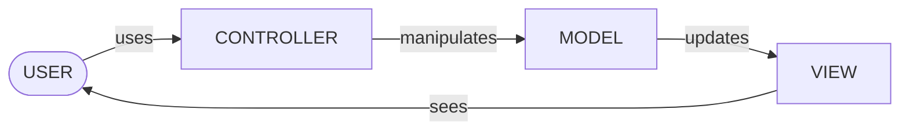

# IN4MATX 133: User Interface Software — Lecture 10: Components in Angular

## Table of Contents

- [1. Small vs large client interfaces, and frameworks](#1-small-vs-large-client-interfaces-and-frameworks)
- [2. Angular and installing it](#2-angular-and-installing-it)
- [3. Model-View-Controller](#3-model-view-controller)
- [4. MVC in Angular: binding](#4-mvc-in-angular-binding)
- [5. Angular components](#5-angular-components)
- [6. The root template and root component](#6-the-root-template-and-root-component)
- [7. One-way binding: interpolation, property, event](#7-one-way-binding-interpolation-property-event)
- [8. Two-way binding with ngModel](#8-two-way-binding-with-ngmodel)
- [9. Control flow: @if and @for](#9-control-flow-if-and-for)
- [10. Using components: nesting, inputs and outputs](#10-using-components-nesting-inputs-and-outputs)
- [11. In-class Questions & Demos (with Solutions)](#11-in-class-questions--demos-with-solutions)
- [12. Quick Reference & Top 5 Things to Remember](#12-quick-reference--top-5-things-to-remember)

> UCI IN4MATX 133: User Interface Software — Prof. Travis Linden Reid, Fall 2026, Thursday 10/29 (Week 5)
> Built from the Lecture 10 slides and the demo repo folder `W5_L2_Oct29_AngularComponents` (one Angular project, `w5l2-example`). Organized by concept, not by source.

> 📅 **Class logistics**: Friday's discussion goes deeper into Angular — how to start an Angular project, plus another coding demo. (The slide says "Friday (2/6)", a date left over from an earlier offering; it means Friday 10/30.)
> Declare your A3 partner on Canvas by **Monday 11/2**.

Goals for today: explain a Model-View-Controller architecture and how Angular implements it, describe the role of an Angular component, and implement an Angular component that follows MVC.

> 💡 **Key Insight**: Angular can't run inside these notes' demo boxes (they run plain HTML/CSS/JS, and Angular needs its compiler). So the demos below re-create each Angular example **by hand in plain JavaScript**, labelled as such. That turns out to be a good way to see what Angular does for you: every line of manual wiring in a demo is something a binding replaces. The Angular code itself is shown in code blocks, and the outputs quoted for it come from building the repo's components with Angular 22.

---

## 1. Small vs large client interfaces, and frameworks

The slides contrast two kinds of front end:

| | "Small" client (slide 4: your A2 Runkeeper report) | "Large" client (slide 5: Instagram) |
|---|---|---|
| Pages | 3 | Hundreds, with many ways to navigate between them |
| Interactivity between pages | None | Lots |
| Data / UI | Data is dynamic, UI fairly static | Repeated UI components (status updates); different content and links for each person |
| Computation | A lot behind each page, but each page is self-contained | — |

*How do we develop large client applications?* (slide 6) With a **framework**, which:

- adds structure and organization,
- makes UI components reusable,
- supports modularity,
- imports packages, UIs, etc. when needed.

Angular, React, Vue.js (and "insert your favorite other framework here") all support the same overall goal and have a lot in common in how they work. This course uses Angular.

## 2. Angular and installing it

Angular (slide 9):

- first released in 2009,
- uses **TypeScript, HTML and CSS** ([Lecture 7](lec-07.en-US.md) covered TypeScript),
- doesn't dictate what framework is used server-side,
- has a major release every year (the demo repo's project uses Angular CLI 22.2.3).

Installing and running (slide 10):

```bash
npm install -g @angular/cli   # the Angular command-line tool, installed globally
ng new example                # create a new app named "example"
cd example
ng serve                      # run it; add --open to open the browser too
```

The app runs on **localhost:4200** by default, and reloads whenever you change a source file. The `-g` matters: as in [Lecture 6](lec-06.en-US.md), a global install is what makes the `ng` command available on the command line.

> 🧪 **Demo files**: [w5l2-example/README.md](https://github.com/travislindenreid/INF33-Demos/blob/main/W5_L2_Oct29_AngularComponents/w5l2-example/README.md) · [package.json](https://github.com/travislindenreid/INF33-Demos/blob/main/W5_L2_Oct29_AngularComponents/w5l2-example/package.json)

## 3. Model-View-Controller

**MVC** is an approach for structuring the code behind interfaces. It splits an app into three roles:

- **Model** — the data behind an app.
  - Notifies views when it changes.
  - Lets views query it for data.
  - Lets the controller manipulate its data.
- **View** — the visual interface of an app.
  - Renders the contents of the model, and specifies how the model's data should be presented.
  - When the model changes, the view must update its presentation, either by **push** (the view waits for change notifications — a live-updating feed) or by **pull** (the view asks when it wants new data — pull to refresh).
  - Forwards input to the controller.
- **Controller** — the interaction with an app.
  - Interprets user input and maps it to actions.
  - Tells the model what actions to perform.
  - *Indirectly* tells the view (through the model) whether the page should be rendered differently.

The slides' diagram is a loop:



> ⚠️ **Pitfall**: The controller never draws anything itself. It changes the model, and the model's change is what updates the view.

> 🔗 **Go deeper**: [Wikipedia: Model–view–controller](https://en.wikipedia.org/wiki/Model%E2%80%93view%E2%80%93controller)

## 4. MVC in Angular: binding

How Angular maps MVC onto files (slide 16):

| MVC role | In Angular |
|---|---|
| View | HTML and CSS |
| Model & Controller | TypeScript |
| The glue between the three | Angular itself |

The key term is **binding** (slide 17):

- Variables in a view can be *bound* to variables and functions in a model or controller.
- When a variable in the model changes, every reference to it in the view changes too — Angular uses the **"push"** model.
- When the view receives input from a user, it passes it to the controller function bound to that input.

Sections 7–8 show the four kinds of binding; the demo in [7.4](#74-one-way-binding-in-the-demo-app) wires them by hand.

## 5. Angular components

A **component** is an interface element — usually larger than "a button" but smaller than "a page", and usually one that repeats across the interface. Each component defines the model, view and controller for that element.

Component terms (slide 20):

- **template** — the HTML file representing the view,
- **style** — the CSS file(s) saying how the component is styled,
- **selector** — a CSS selector Angular uses to find every place this component goes (e.g. every `<app-week>` tag).

Make a new component with:

```bash
ng generate component hello
```

This makes a folder with four files:

| File | Role |
|---|---|
| `hello.css` | view |
| `hello.html` | view |
| `hello.spec.ts` | automated testing (we'll mostly ignore it) |
| `hello.ts` | model and controller |

Every app has at least one component, the **root** component — by default `app.html` / `app.css` / `app.ts` / `app.spec.ts`. It is essentially the "main" page of your app. The repo shows how it gets on the page: `index.html` contains just `<app-root></app-root>`, and `main.ts` starts the app with the root class:

```ts
// src/main.ts (from the repo)
import { bootstrapApplication } from '@angular/platform-browser';
import { appConfig } from './app/app.config';
import { App } from './app/app';

bootstrapApplication(App, appConfig)
  .catch((err) => console.error(err));
```

**Constructor vs `ngOnInit()` (extra slide 54, not covered in class).** Most components have both a constructor and an init function; put setup code in `ngOnInit()`, which runs later:

```ts
import { Component, OnInit } from '@angular/core';

@Component({
  selector: 'app-hello',
  templateUrl: './hello.component.html',
  styleUrls: ['./hello.component.css']
})
export class HelloComponent implements OnInit {
  constructor() { }
  ngOnInit() {
  }
}
```

The slide's title calls it `onInit()`, but the interface is `OnInit` and the method must be named `ngOnInit`. Why "later" matters: given `<app-hello name="Kazuha">` with `@Input() name = ""`, logging `name` in each prints `constructor: name = ''` then `ngOnInit: name = 'Kazuha'` — inputs aren't set yet when the constructor runs. (The slide's `hello.component.*` file names are the older CLI naming; the current CLI generates `hello.html`, `hello.ts`.)

> 🔗 **Go deeper**: [Stack Overflow: Difference between constructor and ngOnInit](https://stackoverflow.com/questions/35763730/difference-between-constructor-and-ngoninit)

## 6. The root template and root component

Slide 23 ("Hello Angular") shows the running demo app: the tomato cat image, **"Hello, INF 133"**, "Congratulations! Your app is running. 🎉", and on the right three link pills (INF 133 Canvas, INF 133 Slack, Angular tutorials) plus GitHub / X / YouTube icons.

### 6.1 Root template: app.html

The root template looks like any other HTML page; the only difference is that it can use **data binding**:

```html
<div class=“left-side”>
  
  <h1>
    Hello, {{title}}!
  </h1>
  <p>Congratulations! Your app is running. 🎉</p>
</div>
```

`{{title}}` binds that text to the variable `title`. (Slide typo: `class=“left-side”` uses curly quotes — write `class="left-side"`.)

### 6.2 Root component: app.ts

```ts
import { Component } from '@angular/core';    // import Angular's component library

@Component({                                  // designates the class as a component
  selector: 'app-root',                       // replace all occurrences of <app-root> with this
  templateUrl: './app.html',                  // designate the template
  styleUrls: ['./app.css']                    // designate the style(s)
})
export class App {                            // all code for the component
  title = 'example';
}
```

Slide 27 draws the arrow: `{{title}}` in `app.html` ↔ `title = 'example'` in `app.ts`, so the page says "Hello, example!".

The repo's `app.ts` (the version that produces "Hello, INF 133") differs in two ways worth knowing:

```ts
@Component({
  imports: [FormsModule, RouterOutlet, Week, Dice],
  selector: 'app-root',
  styleUrl: './app.css',
  templateUrl: './app.html',
})
export class App {
  title = "INF 133";
  // ...
}
```

- `styleUrl` (one file, a string) vs the slide's `styleUrls` (an array) — both are accepted.
- `imports: [...]` lists what the template uses that isn't plain HTML: `FormsModule` for `ngModel` (Section 8) and the child components `Week` and `Dice` (Section 10).

> 🧪 **Demo files**: [app.html](https://github.com/travislindenreid/INF33-Demos/blob/main/W5_L2_Oct29_AngularComponents/w5l2-example/src/app/app.html) · [app.ts](https://github.com/travislindenreid/INF33-Demos/blob/main/W5_L2_Oct29_AngularComponents/w5l2-example/src/app/app.ts) · [main.ts](https://github.com/travislindenreid/INF33-Demos/blob/main/W5_L2_Oct29_AngularComponents/w5l2-example/src/main.ts) · [index.html](https://github.com/travislindenreid/INF33-Demos/blob/main/W5_L2_Oct29_AngularComponents/w5l2-example/src/index.html)

## 7. One-way binding: interpolation, property, event

There are four types of binding (slide 28):

| Binding | Syntax |
|---|---|
| Interpolation | `{{ }}` |
| Property | `[ ]` |
| Event | `( )` |
| Two-way | `[( )]` |

### 7.1 Interpolation binding {{ }}

"Weave calculated strings into the text between HTML element tags and within attribute assignments." It also evaluates expressions:

```html
<h1>
  Hello, {{title}}
</h1>

<!-- "The sum of 1 + 1 is 2" -->
<p>The sum of 1 + 1 is {{1 + 1}}</p>
```

### 7.2 Property binding [ ]

"Set an element property to a component property value." The square brackets around the attribute name mean "the value in quotes is a TypeScript expression, not a string":

```html

```

With `tomatoCatUrl = "tomatoCat.png"` in `app.ts`, this shows the tomato cat (slide 30). Without the brackets, `src="tomatoCatUrl"` would ask for a file literally named `tomatoCatUrl`. (Slide typo: the opening `“` is a curly quote.)

### 7.3 Event binding ( )

"Listen for certain events such as keystrokes, mouse movements, clicks, and touches." Parentheses around an event name run the quoted statement when the event fires:

```html
<!--When clicked, will run the onSave() function in
component.ts file-->
<button (click)=“onSave()">Save</button>
```

The event names are the DOM's (`click`, `input`, … — the same ones you passed to `addEventListener` in [Lecture 6](lec-06.en-US.md)), and the statement includes the call parentheses `onSave()`.

### 7.4 One-way binding in the demo app

Interpolation, property and event bindings are all **one-way** (read-only):

| Data direction | Syntax (slide 32's table) |
|---|---|
| One-way, data source (`.ts`) → view target (`.html`) | `{{expression}}`, `[target]="expression"`, `bind-target="expression"` |
| One-way, view target (`.html`) → data source (`.ts`) | `(target)="statement"`, `on-target="statement"` |
| Two-way | `[(target)]="expression"`, `bindon-target="expression"` |

Slide 33 connects the three one-way bindings in the demo app:

```html
<!-- app.html -->
{{title}}

<button (click)="clickExample()">Click me and read the console!</button>
```

```ts
// app.ts
@Component({
  selector: 'app-root',
  styleUrl: './app.css',
  templateUrl: './app.html'
})
export class App {
  title = 'INF 133';
  tomatoCatUrl = "tomatoCat.png";
  clickExample() {
    console.log("clicked button!");
  }
}
```

`{{title}}` → `title`, `[src]` → `tomatoCatUrl`, `(click)` → `clickExample()`. Clicking the button logs `clicked button!`. (The slide's code uses curly quotes throughout; the code above is the repo's.)

Try it below: the same page, with the model / view / controller wiring written out by hand. Step through, or edit and press Run:

```viz web-demo
{"title": "Slides 29–38 · the four bindings of app.html, wired by hand in plain JS (Angular does this wiring for you)", "html": "<p><b>Property binding:</b></p>\n\n<h1 id=\"hello\"></h1>\n<p><b>Interpolation with math:</b> <span id=\"sum\"></span></p>\n<p><b>Event binding:</b> <button id=\"btn\">Click me and read the console...</button></p>\n<p><b>Two-way binding:</b> <input id=\"box\"></p>", "css": "body { font-family: system-ui, sans-serif; } h1 { margin: 4px 0; }", "js": "// MODEL: the data (the fields of class App in app.ts)\nconst model = { title: \"INF 133\", tomatoCatUrl: \"https://raw.githubusercontent.com/travislindenreid/INF33-Demos/main/W5_L2_Oct29_AngularComponents/w5l2-example/public/tomatoCat.png\", enteredText: \"placeholder\" };\n\n// VIEW: render the model (what {{ }} and [ ] do)\nfunction render() {\n  document.getElementById(\"hello\").textContent = \"Hello, \" + model.title;   // {{title}}\n  document.getElementById(\"sum\").textContent = \"The sum of 1 + 1 is \" + (1 + 1); // {{1 + 1}}\n  document.getElementById(\"cat\").src = model.tomatoCatUrl;                    // [src]=\"tomatoCatUrl\"\n  document.getElementById(\"box\").value = model.enteredText;                   // [(ngModel)] model -> view\n}\n\n// CONTROLLER: map user input to actions (what ( ) does)\nfunction clickExample() { console.log(\"clicked button!\"); }\nfunction textChanged() { console.log(\"you wrote: \" + model.enteredText); }\ndocument.getElementById(\"btn\").addEventListener(\"click\", clickExample);     // (click)=\"clickExample()\"\ndocument.getElementById(\"box\").addEventListener(\"input\", (e) => {\n  model.enteredText = e.target.value;                                         // [(ngModel)] view -> model\n  textChanged();                                                              // (input)=\"textChanged()\"\n});\n\nrender();\n", "steps": [{"note": "Event binding: a click runs the controller function (view → .ts).", "js": "document.getElementById(\"btn\").click();"}, {"note": "Two-way binding, view → model: typing updates enteredText, then (input) logs it.", "js": "const box = document.getElementById(\"box\");\nbox.value = \"abc\";\nbox.dispatchEvent(new Event(\"input\"));"}, {"note": "Model → view (\"push\"): change the model, and every bound spot in the view updates.", "js": "model.title = \"IN4MATX 133\";\nmodel.enteredText = \"set from the model\";\nrender();\nconsole.log(\"title is now \" + model.title);"}], "height": 330, "interactive": true}
```

The console shows `clicked button!`, then `you wrote: abc`, then `title is now IN4MATX 133` while the heading changes to "Hello, IN4MATX 133". In Angular, that last `render()` call doesn't exist: changing `this.title` is enough.

> ⚠️ **Pitfall**: The brackets decide the direction. `[x]` reads *from* the `.ts` into the page; `(x)` sends an event *to* the `.ts`. `(href)="url"` is therefore an event listener for an event named "href" — it never sets the link. That's the trap in [Question 1](#111-question-1-which-will-bind-the-links-href-to-url-slides-3436).

> 📝 **Practice**: [Question 1](#111-question-1-which-will-bind-the-links-href-to-url-slides-3436)

> 🔗 **Go deeper**: [Angular: Templates](https://angular.dev/guide/templates) · [Angular: Binding](https://angular.dev/guide/templates/binding) · [Angular: Event listeners](https://angular.dev/guide/templates/event-listeners) · [MDN: click event](https://developer.mozilla.org/en-US/docs/Web/API/Element/click_event)

## 8. Two-way binding with ngModel

"You often want to both display a data property and update that property when the user makes changes." The most common use is binding to user input. The **`ngModel` directive** enables two-way binding to input fields, written with "banana in a box" brackets `[( )]`:

```html
<!--enteredText variable contains inputted text-->
<!--textChanged() is called after every keystroke-->
<input [(ngModel)]="enteredText" (input)=“textChanged()">
```

With the repo's `app.ts`:

```ts
enteredText = "placeholder";

textChanged () {
  console.log("you wrote: " + this.enteredText);
}
```

The box starts out showing `placeholder` (model → view); typing replaces `enteredText` (view → model), and the `(input)` event binding then logs it — typing `abc` into an emptied box logs `you wrote: abc`. To use `ngModel` the component must have `FormsModule` in its `imports` (the repo's `app.ts` does: `import {FormsModule} from '@angular/forms';`).

Slide 38 collects all the bindings:

```html
<!--enteredText variable contains inputted text-->
<!--textChanged() is called after every keystroke-->
<input [(ngModel)]="enteredText" (input)=“textChanged()">
<!--When clicked, will run the onSave() function in app.ts file-->
<button (click)=“clickExample()">Click me and read the console…</button>
<h3>
  <!--will display the title-->
  {{title}}
  <!--will display the image at tomatoCatUrl—>
  
</h3>
```

> ⚠️ **Pitfall**: Slide 38's last comment ends with an em dash `—>` instead of `-->`, so the comment never closes. Angular refuses to compile that template ("Unexpected character "EOF""); in a plain HTML page it would silently hide everything up to the next `-->`. Also: the comment says `onSave()` but the button calls `clickExample()`, and two attributes use curly quotes.

The two-way step in the [Section 7.4 demo](#74-one-way-binding-in-the-demo-app) shows both directions.

> 🔗 **Go deeper**: [Angular: Two-way binding](https://angular.dev/guide/templates/two-way-binding) · [MDN: change event](https://developer.mozilla.org/en-US/docs/Web/API/HTMLElement/change_event)

## 9. Control flow: @if and @for

Templates can decide *whether* and *how many times* to render something with `@if` and `@for`, using parentheses for the condition and braces for what's covered. They replaced `*ngIf` and `*ngFor` in 2024 — older examples online still use the old syntax.

### 9.1 @if

Render a tag only if a condition is true:

```html
@if(isHalloween()) {
  <p>
    It’s Halloween!!!
  </p>
} @else {
  <p>
    Just another regular ole day…
  </p>
}
```

The condition calls a controller function from the repo's `app.ts` (months count from 0, so 9 is October):

```ts
isHalloween () {
  const today = new Date();
  if(today.getMonth() == 9 && today.getDate() == 31)
  {
    return true;
  }
  return false;
}
```

On lecture day (10/29) the page shows "Just another regular ole day..." (slide 40's screenshot).

### 9.2 @for

Repeat an item for every element of an array:

```ts
// In app.ts
days = ["Sunday", "Monday", "Tuesday", "Wednesday", "Thursday", "Friday", "Saturday"];
```

```html
<ul>
  @for(day of days; track day) {
    <li>
      {{day}}
    </li>
  }
</ul>
```

- `track` is for performance: it should be a unique property of each item, so Angular can tell items apart when the array changes.
- You can optionally get the index with `let i = $index`:

```html
<ul>
  @for(day of days; track day; let i = $index) {
    <li>
      {{i+1}}: {{day}}
    </li>
  }
</ul>
```

The first renders Sunday … Saturday; the second renders "1: Sunday" … "7: Saturday". It's the template version of a Python `for i, day in enumerate(days)`. The repo's `app.html` also loops over an inline array of objects with `track item.title` to build the three link pills on the right of the page.

> 🔗 **Go deeper**: [angular.love: Diving into the new Angular control flow](https://angular.love/diving-into-the-new-angular-control-flow-internals) · [Angular: @if](https://angular.dev/api/core/@if) · [Angular: @for](https://angular.dev/api/core/@for)

## 10. Using components: nesting, inputs and outputs

### 10.1 Nesting a component

Components can include other components: put the child's **selector** (defined in its `.ts`) in the parent's template. In `app.html`:

```html
<div>
  <p class=“exampleTitle”>
    Component nesting example:
  </h1>
  <app-week></app-week>
</div>
```

(Slide bugs: the `<p>` is closed with `</h1>`, and the class uses curly quotes — the repo has `<p class="exampleTitle">Component nesting example:</p>`.) The parent must also list the child class in its `imports` (`imports: [FormsModule, RouterOutlet, Week, Dice]` in the repo's `app.ts`).

### 10.2 Inputs

Components can declare **inputs**, values the parent hands in. `week.ts` and `week.html` (the repo's versions, which match slide 43):

```ts
import { Component, OnInit, Input } from '@angular/core';

@Component({
  selector: 'app-week',
  styleUrl: '../app.css',
  templateUrl: './week.html',
})
export class Week {
    @Input() today:string = "";
    days = ["Sunday", "Monday", "Tuesday", "Wednesday", "Thursday", "Friday", "Saturday"];
}
```

```html
<ul>
    @for(day of days; track day){
        <li>
            {{day}}
            @if(day == today) {
                <strong>Today!</strong>
            }
        </li>
    }
</ul>
```

`@Input()` marks `today` as an input; the template uses it like any other field. The parent passes it (slide 44):

- **as a property binding** if it's dynamic: `<app-week [today]="dayOfWeek()"></app-week>` — `dayOfWeek()` is a function in `App`;
- **like any other attribute** if it's a static value: `<app-week today="Friday"></app-week>`.

```ts
// app.ts
dayOfWeek():string {
  const day = new Date().getDay();
  return ["Sunday", "Monday", "Tuesday", "Wednesday", "Thursday", "Friday", "Saturday"][day];
}
```

Both render the seven days with **Today!** after the matching one. (Slide 44's bugs: it closes `<app-week>` with `</app-day>`, and its labels say "Sets day property" — the input is named `today`.)

Try it — the Week component as a plain JS function whose parameter plays the role of `@Input() today`:

```viz web-demo
{"title": "Slides 41–44 · week.html's @for + @if, and the today input, by hand in plain JS", "html": "<p><b>today=\"Friday\" (static):</b></p>\n<div id=\"static\"></div>\n<p><b>[today]=\"dayOfWeek()\" (bound):</b></p>\n<div id=\"bound\"></div>", "css": "body { font-family: system-ui, sans-serif; } ul { margin: 2px 0 8px; }", "js": "const days = [\"Sunday\", \"Monday\", \"Tuesday\", \"Wednesday\", \"Thursday\", \"Friday\", \"Saturday\"];\n\n// The Week component: today is its @Input()\nfunction appWeek(today) {\n  const ul = document.createElement(\"ul\");\n  for (const day of days) {                       // @for(day of days; track day)\n    const li = document.createElement(\"li\");\n    li.textContent = day + \" \";                  // {{day}}\n    if (day == today) {                           // @if(day == today)\n      li.insertAdjacentHTML(\"beforeend\", \"<strong>Today!</strong>\");\n    }\n    ul.append(li);\n  }\n  return ul;\n}\n\nfunction dayOfWeek() {                            // from App in app.ts\n  return days[new Date().getDay()];\n}\n\ndocument.getElementById(\"static\").append(appWeek(\"Friday\"));\ndocument.getElementById(\"bound\").append(appWeek(dayOfWeek()));\nconsole.log(\"dayOfWeek() = \" + dayOfWeek());\n", "height": 400, "interactive": true}
```

The static list always marks Friday; the bound one marks whatever day you open the page (the console prints it).

> ⚠️ **Pitfall**: `today="Friday"` passes the *string* `"Friday"`; `[today]="Friday"` would look for a field named `Friday` in the parent. Use brackets only when the value is an expression.

### 10.3 Outputs (extra slide 53, not covered in class)

A component can also declare **output properties** — events it sends up to its parent:

```ts
@Output('myClick') clicks = new EventEmitter<string>();
```

The parent listens with an event binding, and the handler runs in the **parent** component:

```html
<app-button (myClick)="clickMessage">click with myClick</app-button>
```

```ts
clickMessage() {
  console.log("clicked!");
}
```

Slide bug: the statement must call the function, `(myClick)="clickMessage()"`. With the slide's `"clickMessage"` (no parentheses) nothing is logged when the child emits; with `clickMessage()` it logs `clicked!`. Inputs go parent → child, outputs go child → parent.

> 📝 **Practice**: [Question 2](#112-question-2-improving-your-portfolio-with-components-slides-4547) · [Demo: Rolling Dice](#113-demo-rolling-dice-slide-48--dicets--dicefinishedtxt)

> 🧪 **Demo files**: [week.ts](https://github.com/travislindenreid/INF33-Demos/blob/main/W5_L2_Oct29_AngularComponents/w5l2-example/src/app/week/week.ts) · [week.html](https://github.com/travislindenreid/INF33-Demos/blob/main/W5_L2_Oct29_AngularComponents/w5l2-example/src/app/week/week.html)

---

## 11. In-class Questions & Demos (with Solutions)

### 11.1 Question 1: Which will bind the link's href to url? (slides 34–36)

*Which will bind the link's `href` to the variable `url`?*

- A. `<a href=“{{url}}”>link</a>`
- B. `<a (href)=“url”>link</a>`
- C. `<a [href]=“url”>link</a>`
- D. A and B
- E. A and C

> ✍️ **Try it first.**

**Answer: E (A and C).** The slides don't show the poll result; this was checked by compiling the three links (with straight quotes) in Angular 22 with `url = "https://example.com/page"`:

| Option | Resulting `href` |
|---|---|
| A `href="{{url}}"` | `https://example.com/page` ✅ — interpolation works inside attribute values too ("within attribute assignments", slide 29) |
| B `(href)="url"` | none ❌ — this is an *event* binding listening for an event called "href"; it never sets anything |
| C `[href]="url"` | `https://example.com/page` ✅ — property binding |

So D is wrong because of B. The repo's `app.html` uses form C for its link pills: `[href]="item.link"`. (Curly quotes on the slide would make the browser treat `“` as part of the value — always type straight quotes.) Back to [Section 7](#7-one-way-binding-interpolation-property-event).

### 11.2 Question 2: Improving your portfolio with components (slides 45–47)

*With a partner, discuss an idea for how you could improve your portfolio website with Angular components.*

> ✍️ **Try it first.**

**The slide's example answer**: an old course website (linked below) where the entire site is inside an Angular component, and the header, body and footer are their own components — which makes re-using the header and footer content easy. For an A1-style portfolio, the same idea applies to anything repeated: a header/nav and footer used on every page, or a project card component with inputs (title, image, link) rendered once per project with `@for`. Back to [Section 10](#10-using-components-nesting-inputs-and-outputs).

> 🔗 **Go deeper**: [Example: an earlier IN4MATX 133 course website built with Angular](https://inf133-wi26.depstein.net/)

### 11.3 Demo: Rolling Dice (slide 48 · dice.ts → diceFinished.txt)

**Task**: inside the demo app, make a `Dice` component that shows two dice and a button; clicking it rolls both dice and shows the total. Slide 48 shows the result: "Hello!", a "Click to roll the dice!" button, two dice images and "Total: 8".

Starter (`src/app/dice/`, generated by `ng generate component dice`): `dice.html` is `<p>TODO: this!</p>` and the class is empty:

```ts
import { Component } from '@angular/core';

@Component({
  imports: [],
  selector: 'app-dice',
  styleUrl: './dice.css',
  templateUrl: './dice.html',
})
export class Dice {

}
```

The app already places it: `app.html` has `<app-dice></app-dice>`, and `app.ts` imports `Dice`. The images `dice_1.png` … `dice_6.png` are in the project's `public/` folder.

> ✍️ **Try it first.**

**Solution** (from `diceFinished.txt`). Model + controller, `dice.ts`:

```ts
export class Dice {
    diceUrl1 = "dice_1.png";
    diceUrl2 = "dice_1.png";
    total = 2;

    rollDice () {
        var random = Math.floor(Math.random() * 6 + 1);
        this.diceUrl1 = `dice_${random}.png`;

        var random2 = Math.floor(Math.random() * 6 + 1);
        this.diceUrl2 = `dice_${random2}.png`;

        this.total = random + random2;

        console.log(this.diceUrl1);
        console.log(this.diceUrl2);
        console.log(this.total);
    }
}
```

View, `dice.html`:

```html
<p>Hello!</p>
<button (click)="rollDice()">Click to roll the dice!</button>
<p></p>
<p>Total: {{total}}</p>
```

Every binding type from today shows up: `(click)` sends the click to the controller, `rollDice()` updates the model (`this.diceUrl1`, `this.total` — note `this.`, unlike a template), and `[src]` / `{{total}}` push the new values to the view. One click logs three lines like `dice_5.png`, `dice_3.png`, `8`. `Math.floor(Math.random() * 6 + 1)` gives an integer 1–6 (like Python's `random.randint(1, 6)`).

`diceFinished.txt` is labelled `diceComponent.cs` and points at `templateUrl: './dice.component.html'` and `styleUrl: '../app.css'`; the generated files in this project are `dice.html` and `dice.css`, so keep the starter's `@Component({...})` and paste in only the class body.

The same component by hand in plain JS — press Next to roll:

```viz web-demo
{"title": "Slide 48 · the finished Dice component (diceFinished.txt), by hand in plain JS", "html": "<p>Hello!</p>\n<button id=\"roll\">Click to roll the dice!</button>\n<p></p>\n<p id=\"total\"></p>", "css": "body { font-family: system-ui, sans-serif; }", "js": "const IMG = \"https://raw.githubusercontent.com/travislindenreid/INF33-Demos/main/W5_L2_Oct29_AngularComponents/w5l2-example/public/\";  // the repo's public/ folder\n// model (fields of class Dice)\nlet diceUrl1 = \"dice_1.png\";\nlet diceUrl2 = \"dice_1.png\";\nlet total = 2;\n\n// view: [src]=\"diceUrl1\", [src]=\"diceUrl2\", Total: {{total}}\nfunction render() {\n  document.getElementById(\"d1\").src = IMG + diceUrl1;\n  document.getElementById(\"d2\").src = IMG + diceUrl2;\n  document.getElementById(\"total\").textContent = \"Total: \" + total;\n}\n\n// controller: (click)=\"rollDice()\"\nfunction rollDice() {\n  var random = Math.floor(Math.random() * 6 + 1);\n  diceUrl1 = `dice_${random}.png`;\n  var random2 = Math.floor(Math.random() * 6 + 1);\n  diceUrl2 = `dice_${random2}.png`;\n  total = random + random2;\n  console.log(diceUrl1);\n  console.log(diceUrl2);\n  console.log(total);\n  render();  // Angular re-renders for you; by hand we must call it\n}\ndocument.getElementById(\"roll\").addEventListener(\"click\", rollDice);\nrender();\n", "steps": [{"note": "Click the button: rollDice() picks two random faces, updates the model, the view follows.", "js": "document.getElementById(\"roll\").click();"}], "height": 230, "interactive": true}
```

> 🧪 **Demo files**: [dice.ts](https://github.com/travislindenreid/INF33-Demos/blob/main/W5_L2_Oct29_AngularComponents/w5l2-example/src/app/dice/dice.ts) · [dice.html](https://github.com/travislindenreid/INF33-Demos/blob/main/W5_L2_Oct29_AngularComponents/w5l2-example/src/app/dice/dice.html) · [diceFinished.txt](https://github.com/travislindenreid/INF33-Demos/blob/main/W5_L2_Oct29_AngularComponents/w5l2-example/src/app/dice/diceFinished.txt)

Back to [Section 10](#10-using-components-nesting-inputs-and-outputs).

---

## 12. Quick Reference & Top 5 Things to Remember

**MVC in Angular**

| Role | What it does | Angular file |
|---|---|---|
| Model | The data; notifies the view when it changes | `.ts` (class fields) |
| View | Renders the model; forwards input | `.html` + `.css` |
| Controller | Maps user input to actions on the model | `.ts` (class methods) |

**Bindings and control flow**

| Syntax | Name | Direction | Example |
|---|---|---|---|
| `{{expr}}` | Interpolation | `.ts` → `.html` | `Hello, {{title}}` |
| `[prop]="expr"` | Property | `.ts` → `.html` | `[src]="tomatoCatUrl"` |
| `(event)="stmt()"` | Event | `.html` → `.ts` | `(click)="clickExample()"` |
| `[(ngModel)]="field"` | Two-way | both | `[(ngModel)]="enteredText"` (needs `FormsModule`) |
| `@if(cond) { } @else { }` | Conditional | — | `@if(isHalloween())` |
| `@for(x of xs; track x; let i = $index) { }` | Loop | — | `@for(day of days; track day)` |

**Components and CLI**

| Thing | Syntax |
|---|---|
| Install CLI / new app / run | `npm install -g @angular/cli` · `ng new example` · `ng serve` (localhost:4200) |
| New component | `ng generate component hello` → `hello.html`, `hello.css`, `hello.ts`, `hello.spec.ts` |
| Component metadata | `@Component({ selector, templateUrl, styleUrl(s), imports })` |
| Use a child | `<app-week>` in the template + `Week` in `imports` |
| Input (parent → child) | `@Input() today = "";` · `<app-week today="Friday">` / `[today]="dayOfWeek()"` |
| Output (child → parent) | `@Output('myClick') clicks = new EventEmitter<string>();` · `(myClick)="clickMessage()"` |
| Setup code | `ngOnInit()` (runs after inputs are set), not the constructor |

**Top 5 things to remember**

1. MVC: the controller changes the model, the model updates the view; in Angular the view is `.html`/`.css` and the model + controller are the `.ts` class.
2. Square brackets read from the `.ts` (`[src]`), parentheses send events to it (`(click)`), both together are two-way (`[(ngModel)]`) — so `(href)="url"` binds nothing.
3. `{{ }}` works in text and inside attribute values, and it evaluates expressions (`{{1 + 1}}` → 2).
4. A component = selector + template + style + class; to use one, write its selector tag in the parent and add its class to the parent's `imports`.
5. Inputs: static values go in as plain attributes (`today="Friday"`), dynamic ones in brackets (`[today]="dayOfWeek()"`); `@for` needs `track`, and `@if`/`@for` replaced `*ngIf`/`*ngFor`.
