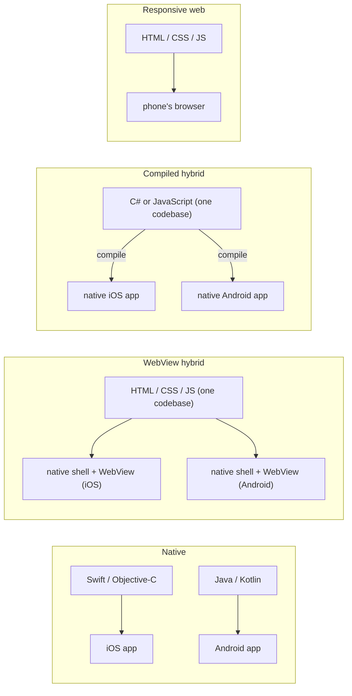

# IN4MATX 133: User Interface Software — Lecture 12: Hybrid and Native Architectures

## Table of Contents

- [1. Mobile-first design](#1-mobile-first-design)
- [2. Ways to build a mobile app](#2-ways-to-build-a-mobile-app)
- [3. Native apps](#3-native-apps)
- [4. Hybrid apps: one codebase, many platforms](#4-hybrid-apps-one-codebase-many-platforms)
- [5. WebView apps](#5-webview-apps)
- [6. Compiled hybrid apps](#6-compiled-hybrid-apps)
- [7. Choosing a development approach](#7-choosing-a-development-approach)
- [8. Pros and cons: hybrid vs native](#8-pros-and-cons-hybrid-vs-native)
- [9. Ionic and Capacitor](#9-ionic-and-capacitor)
- [10. Testing and deploying Ionic apps](#10-testing-and-deploying-ionic-apps)
- [11. What Ionic adds over Angular: components](#11-what-ionic-adds-over-angular-components)
- [12. In-class Questions & Demos (with Solutions)](#12-in-class-questions--demos-with-solutions)
- [13. Quick Reference & Top 5 Things to Remember](#13-quick-reference--top-5-things-to-remember)

> UCI IN4MATX 133: User Interface Software — Prof. Travis Linden Reid, Fall 2026, Thursday 11/5 (Week 6)
> Built from the Lecture 12 slides (53 pages). "No code today!" — this lecture has no demo folder in the course repo. Organized by concept, not by source.

> 📅 **Class logistics**: No code today — we're on to A4 concepts.
> A2 grades will be posted early next week.
> A3 is due this upcoming **Wednesday, Nov 11**.
> A4 unlocks Tuesday; due **Monday, Nov 23 at midnight**.

Goals for today: differentiate approaches to developing mobile interfaces; describe advantages and disadvantages of developing native, hybrid, and web applications; explain which approach Ionic takes to app development.

---

## 1. Mobile-first design

The deck opens by repeating the mobile-first idea from [Lecture 4](lec-04.en-US.md#6-mobile-first-design):

- **Plan your design for mobile.**
- **Then make your app *better* with more real estate**: add more features, and make existing features easier to navigate.
- A lot of businesses make **mobile-friendly websites before making dedicated apps**.

The slide's figure contrasts the two directions. *Mobile last* (desktop → tablet → phone → flip phone) is labelled "degraded, shoe-horned, short-sighted, crappy"; *mobile first* (flip phone → phone → tablet → desktop) is "progressively enhanced, future-friendly, awesome".


In CSS, mobile-first means the base rules *are* the phone design, and `min-width` media queries add to it. In the example below (mine, not the slide's), the 375px page shows only the essentials with a menu button; from 768px up (shown at 1024px) the query shows the nav links (easier to navigate) and a sidebar (more features):

```viz web-demo
{"title": "Mobile-first design (slide 4) · hand-made example", "html": "<header>\n  <h1>Anteater Eats</h1>\n  <button class=\"menu\">☰ Menu</button>\n  <nav><a href=\"#\">Menu</a> <a href=\"#\">Order</a> <a href=\"#\">Hours</a></nav>\n</header>\n<div class=\"layout\">\n  <main>\n    <h2>Today's special</h2>\n    <p>Spicy tofu bowl — $9</p>\n    <button>Order now</button>\n  </main>\n  <aside>\n    <h2>Extra for big screens</h2>\n    <p>Weekly calendar, map, reviews…</p>\n  </aside>\n</div>", "css": "/* Base styles = the phone design */\nbody { font-family: sans-serif; margin: 0; }\nheader { display: flex; justify-content: space-between; align-items: center; padding: 8px 12px; background: #0064a4; color: white; }\nh1 { font-size: 18px; margin: 0; }\nnav { display: none; }           /* phone: links hidden behind the menu button */\nnav a { color: white; margin-left: 12px; }\nmain, aside { padding: 12px; }\naside { display: none; }         /* phone: no room for extras */\n\n/* Then make it better with more real estate */\n@media (min-width: 768px) {\n  .menu { display: none; }\n  nav { display: block; }        /* easier to navigate */\n  .layout { display: grid; grid-template-columns: 2fr 1fr; }\n  aside { display: block; background: #fff4cc; }  /* more features */\n}", "width": 375, "height": 260, "steps": [{"note": "At 1024px the media query adds the visible nav links and the extra sidebar.", "width": 1024}], "interactive": true}
```

The deck then asks why a business would want a mobile *app* over a mobile *website* — an open discussion; see [Question 1](#121-question-1-why-a-mobile-app-over-a-mobile-website-slide-5).

> 📝 **Practice**: [Question 1](#121-question-1-why-a-mobile-app-over-a-mobile-website-slide-5)
> 🔗 **Go deeper**: [Brad Frost: Mobile first responsive web design (source of the slide's figure)](https://bradfrostweb.com/blog/web/mobile-first-responsive-web-design)

## 2. Ways to build a mobile app

There are a variety of ways to build mobile apps. The four **mobile development methods** the lecture compares:

| Method | What you build | Where it's covered |
|---|---|---|
| **Native** | A separate app per platform, with the platform maker's tools and languages | [Section 3](#3-native-apps) |
| **WebView** (a kind of hybrid) | A website, run inside a thin native app that opens the phone's browser | [Section 5](#5-webview-apps) |
| **Hybrid** (slide 18 splits hybrid into WebView and compiled; this row is the compiled kind) | One codebase compiled to a native app for each platform | [Section 6](#6-compiled-hybrid-apps) |
| **Responsive** | A website that adapts to the screen, opened in the phone's browser | [Lecture 4](lec-04.en-US.md#2-adaptive-vs-responsive-design) |



## 3. Native apps

### 3.1 What a native app is

A **native app** is an app designed to work on a specific piece of hardware, usually built with tools created by the hardware or platform manufacturer:

- **Android Studio** for Android, in **Java**
- **Xcode** for iOS, in **Swift** or **Objective-C**

Native apps as we think of them today **started with the first iPhone**: Apple released a development platform alongside the hardware (the slide shows the iPhone's introduction on stage).

### 3.2 iOS

| | iOS |
|---|---|
| Languages | **Objective-C**, **Swift**, plus **Cocoa Touch** (the API) |
| Tools | **Xcode**, the **iOS Software Development Kit (SDK)** |
| What the SDK gives you | Access to the phone's storage, camera, sensors, etc. |

These languages were either developed by, or pretty much only used by, Apple. The slide asks: **developer lock-in is a… disadvantage? Advantage? Both?** (One way to see it: lock-in means your iOS skills and code stay on Apple's platform — a cost if you want to leave, but everything is designed to fit together.)

### 3.3 Android

| | Android |
|---|---|
| Languages | Primarily **Java**; **C and C++** via the **Android Native Development Kit (NDK)**; more recently **Kotlin** |
| Tools | **Android Studio**, the Android SDK (the slide spells it "Android Source Development Kit"), various IDEs like Rider or VS |

Android's languages align more closely with languages used in other contexts — the slide asks whether that's an advantage or a disadvantage (one way to see it — the mirror image of iOS lock-in: easier to bring existing skills and code in, less tailored to the platform).

### 3.4 Platform-specific codebases

The catch with native: **platform-specific codebases**.

- Android is in Java, iOS is in Objective-C or Swift.
- Both use different libraries to communicate with the hardware.
- Supporting a platform usually requires **starting to code from scratch**.

> ⚠️ **Pitfall**: "Native" means *per platform*. An iOS app and an Android app of the same product are two separate programs in two languages with two toolchains — which is exactly the cost hybrid apps try to avoid.

## 4. Hybrid apps: one codebase, many platforms

Two questions motivate the alternative:

- What if we already made a **website** for our app? Or have some other existing codebase?
- What if we want to **share code across phone platforms**?

**Solution: hybrid apps** — "Use a common code base to deploy native-like apps on a wide range of platforms". There are two primary approaches:

1. **WebView app** ([Section 5](#5-webview-apps))
2. **Compiled hybrid app** ([Section 6](#6-compiled-hybrid-apps))

## 5. WebView apps

### 5.1 How a WebView app works

- **Load the phone's internal browser** in a lightweight native app.
- **Run a webpage** written in HTML/CSS/JavaScript on that browser.
- Ideally, **expose some native APIs** to the browser.

Essentially, **the app is just a website**. That allows the same or similar code to be used across an app and a website.

### 5.2 WebView app frameworks

**Ionic** and **NativeScript**. These frameworks use web technologies (HTML, CSS, TypeScript, JavaScript) rather than platform-specific technologies.

If WebView apps are just websites, what do these frameworks provide?

- **Common mobile interface elements** like sliders and buttons (more on that next week)
- **The native app** for running the website
- **Some APIs for communicating with platform SDKs**

## 6. Compiled hybrid apps

### 6.1 How compiled hybrid works

"Write code in one language, such as C# or JavaScript, and compile it to native code supported by each platform."

- **Result**: a native app for each platform.
- **Challenge**: less freedom in development.

### 6.2 Compiled hybrid app frameworks

| Framework | Language | What the slides say |
|---|---|---|
| **Unity** | C# | Leading game development platform; supports consoles, web, and mobile ("Build once, deploy anywhere"); you will need to import or use platform-specific SDKs |
| **React Native** | JavaScript | Uses **React**, a web framework similar to Angular; compiles a webpage to a native app. The slide's "Who's using React Native?" panel shows Facebook, Instagram, Airbnb, Skype, Tesla and Walmart among others |

React is one of the frameworks named next to Angular in [Lecture 10](lec-10.en-US.md#1-small-vs-large-client-interfaces-and-frameworks).

> 💡 **Key Insight**: WebView and compiled hybrid both start from one codebase; the difference is what ends up on the phone. A WebView app ships a *website plus a browser shell*; a compiled hybrid app ships *native code*.

> 📝 **Practice**: [Question 2](#122-question-2-best-and-worst-performance-slides-2729) — which of native, WebView and compiled hybrid performs best and worst?

## 7. Choosing a development approach

Performance is just one factor. How do we choose a development approach? The slides group the considerations three ways:

| Business | UX and design | Technical |
|---|---|---|
| Development time | Consistency with platform | Programming languages |
| Development cost | Device capabilities | Integration with device |
| Maintenance concerns | Interaction models supported | Performance |
| Available infrastructure | Performance and usability | Upkeep and maintenance |
| | | Flexibility |

## 8. Pros and cons: hybrid vs native

### 8.1 Hybrid apps

| Strengths | Weaknesses |
|---|---|
| Can share a codebase between web and mobile | Performance issues |
| Can save time and effort (sometimes) | Incongruence with platform |
| Access to some device capabilities | Limited access to device capabilities |

### 8.2 Native apps

| Strengths | Weaknesses |
|---|---|
| Congruent experience with platform | Need to support separate development for each platform |
| Leverages full device capabilities | Cost of app development and maintenance |
| Uses native UI elements | Need to learn/manage multiple programming languages |
| | Need to manage multiple sets of tools |

The native-UI example on the slide is the **iOS context menu** (long-press a photo: Copy, Share, Favorite, Show in All Photos, Remove). React Native and Unity do **not** have context menu capabilities — the exception being community-made packages.


### 8.3 The bottom line

- **Native apps are great when performance and consistency with the platform are major concerns.**
- **Hybrid apps are great when time or money is a concern and you need to deploy on multiple platforms.**
- But also: many apps are built **partially native, partially hybrid**.

> 📝 **Practice**: [Question 3](#123-question-3-what-would-you-build-for-an-open-ended-a5-slides-4041)

## 9. Ionic and Capacitor

### 9.1 Ionic

One hybrid (WebView) framework:

- A **WebView app framework**, launched in **2013**
- Interface implemented in **Angular**; later added support for **React and Vue**
- **Capacitor** is the recommended hybrid app runtime for Ionic

### 9.2 Capacitor

- It provides **the native app which opens the WebView**.
- It also provides **plugins for connecting to device resources** — hundreds of them, both official and community.

| Official plugin examples | Community plugin examples |
|---|---|
| Geolocation | Facebook |
| Push Notifications | LinkedIn |
| Camera | WeChat |
| Motion | Apple Pay |
| Haptic | Google Maps |
| | YouTube |

So in the terms of [Section 5.2](#52-webview-app-frameworks): Ionic gives you the mobile interface elements, Capacitor gives you the native app and the APIs to the platform SDKs.

> 🔗 **Go deeper**: [Ionic: Capacitor vs Cordova, modern hybrid app development](https://ionicframework.com/resources/articles/capacitor-vs-cordova-modern-hybrid-app-development) · [Capacitor: APIs (official plugins)](https://capacitorjs.com/docs/apis) · [Capacitor Community on GitHub](https://github.com/capacitor-community/) · [Ionic: Native](https://ionicframework.com/docs/native/) · [Capacitor: Community plugins](https://capacitorjs.com/docs/plugins/community)

## 10. Testing and deploying Ionic apps

### 10.1 Ionic Dev: test in a browser

Ionic Dev provides a WebView to open up Ionic apps and lets you **test your Ionic app in a browser**. The slide's screenshot shows the Ionic tabs starter at `localhost:8101/tabs/tab1` in Chrome's responsive mode (465 × 938), with the Elements panel open: the page is ordinary DOM — Ionic's components show up as elements such as `<ion-router-outlet>`, `<ion-header>`, `<ion-content>` and `<ion-tab-bar>`, plus the usual `runtime.js`, `polyfills.js`, `vendor.js`, `main.js` scripts.


Because a WebView app is just a web page, the same starter screen can be rebuilt with plain HTML, CSS and DOM events. Try the tabs, or edit the code and press Run:

```viz web-demo
{"title": "A WebView app is just a web page: the Ionic tabs starter (slides 47, 49) re-created by hand in plain HTML/CSS/JS — not Ionic", "html": "<div class=\"app\">\n  <header id=\"title\">Tab 1</header>\n  <section class=\"page\">\n    <strong id=\"page\">Tab 1 page</strong>\n    <span>Explore <a href=\"#\">UI Components</a></span>\n  </section>\n  <footer class=\"tabbar\">\n    <button class=\"tab active\" data-n=\"1\">▲<br>Tab 1</button>\n    <button class=\"tab\" data-n=\"2\">●<br>Tab 2</button>\n    <button class=\"tab\" data-n=\"3\">■<br>Tab 3</button>\n  </footer>\n</div>", "css": "body { margin: 0; font-family: -apple-system, sans-serif; }\n.app { display: flex; flex-direction: column; height: 100vh; background: #121212; color: white; }\nheader { padding: 14px 16px; font-size: 20px; background: #1f1f1f; }\n.page { flex: 1; display: flex; flex-direction: column; align-items: center; justify-content: center; gap: 4px; }\n.page span { color: #aaa; font-size: 14px; }\na { color: #4d8dff; text-decoration: none; }\n.tabbar { display: flex; background: #1f1f1f; }\n.tab { flex: 1; padding: 6px 0; border: none; background: none; color: #888; font-size: 12px; }\n.tab.active { color: #4d8dff; }", "js": "for (const tab of document.querySelectorAll('.tab')) {\n  tab.addEventListener('click', () => {\n    const n = tab.dataset.n;\n    document.querySelector('.tab.active').classList.remove('active');\n    tab.classList.add('active');\n    document.getElementById('title').textContent = 'Tab ' + n;\n    document.getElementById('page').textContent = 'Tab ' + n + ' page';\n    console.log('showing Tab ' + n);\n  });\n}", "width": 375, "height": 520, "steps": [{"note": "Tap Tab 2: plain DOM code swaps the title and page — no native code involved.", "js": "document.querySelectorAll('.tab')[1].click();"}], "interactive": true}
```

Tapping Tab 2 changes the header and the page text to "Tab 2" and logs `showing Tab 2`.

### 10.2 Deploying to the app stores

- Deploying involves **packaging up an app and "signing" it** as a developer.
- For **Android**, this requires installing **Android Studio**.
- For **iOS**, this requires installing **Xcode** and getting a **developer account**.
- You can then "deploy" the app to the app store.
- The iOS app store includes features for **"beta" deployment** with a small group of developers.
- This process is often a pain.

### 10.3 Capacitor embraces the native tools

"The key mantra of Capacitor is that developers should embrace native tools like Android Studio and Xcode."

- Capacitor **pre-builds projects** to be used in Xcode and Android Studio.
- That lets you test your Ionic app on an **actual device or emulators**.
- **Emulators have limited use of plugins.**


> ⚠️ **Pitfall**: The browser (Ionic Dev) and emulators are for testing the interface. Plugins that talk to device hardware are limited in emulators, so test those on an actual device.

> 🔗 **Go deeper**: [Ionic CLI: ionic serve](https://ionicframework.com/docs/cli/commands/serve) · [Ionic: Building for iOS](https://ionicframework.com/docs/building/ios) · [Ionic: Building for Android](https://ionicframework.com/docs/building/android) · [Ionic: Developing — starting](https://ionicframework.com/docs/developing/starting)

## 11. What Ionic adds over Angular: components

Ionic provides **Angular-style components** for a lot of interface elements common in mobile interfaces: **lists, buttons, sliders, tabs, modal dialogs, search bars**, and much more. These are the focus of the next lecture.

The slide shows two of them: a **List** ("Recent conversations" / "Online" sections, each row with an avatar, a name and a preview line) and **Range** sliders ("Adjust display", with icons at both ends).


> 🔗 **Go deeper**: [Ionic: UI Components](https://ionicframework.com/docs/components/)

## 12. In-class Questions & Demos (with Solutions)

This lecture has no coding demos ("No code today!"). Slide 28 shows 0% on every option and slide 41 shows no responses yet, so no results were revealed; answers below come from the deck's own slides.

### 12.1 Question 1: Why a mobile app over a mobile website? (slide 5)

*Question: why might a business want a mobile app over a mobile website?* (open discussion, no answer options)

> ✍️ **Try it first.**

**Answer** (from the deck's later slides): an app — a native one especially — gets what a website in the phone's browser can't: **device capabilities** (storage, camera, sensors through the SDK; even hybrid apps get "access to some device capabilities", slide 35), and, for native apps, **native UI elements** like the iOS context menu, an experience **congruent with the platform**, and the best performance (slides 11, 37, 39). The price is cost: separate development, tools and languages per platform (slide 38). That's why many businesses start with a mobile-friendly website and build a dedicated app later (slide 4). Back to [Section 1](#1-mobile-first-design).

### 12.2 Question 2: Best and worst performance (slides 27–29)

*Which app will have the best and worst performance: a Native, WebView, and Compiled hybrid app?* (Performance broadly defined; page loading times, click latency, etc.)

- A. Compiled hybrid will perform best, WebView will perform worst
- B. WebView will perform best, Compiled hybrid will perform worst
- C. WebView will perform best, Native will perform worst
- D. Native will perform best, Compiled hybrid will perform worst
- E. Native will perform best, WebView will perform worst

> ✍️ **Try it first.**

**Answer: E.** Native is built for the specific hardware with the platform's own tools, and the deck recommends native "when performance … [is a] major concern" (slide 39). A compiled hybrid app also ends up as native code for each platform (slide 23), so it sits in between. A WebView app is a website running inside the phone's browser, and "performance issues" is the first weakness of hybrid apps (slide 36) — so it's the slowest.

- A is wrong: compiled hybrid compiles *to* native code; it doesn't beat writing native directly.
- B and C put WebView first, but WebView adds a browser layer between your code and the device.
- D is the trap: compiled hybrid is the *middle* option, not the worst — it's the WebView app that doesn't become native code at all.

Back to [Section 6](#6-compiled-hybrid-apps).

### 12.3 Question 3: What would you build for an open-ended A5? (slides 40–41)

(The slide labels this poll "L12, Q2"; the performance poll was the deck's first poll.)

*L12, Q2: If A5 was an open-ended web or app dev project, what would you build?* Assume you'd use Angular or Ionic + Angular to build a website or app.

> ✍️ **Try it first.**

**Answer**: an opinion poll — there is no correct answer. To decide between a website (Angular) and an app (Ionic + Angular), use the considerations in [Section 7](#7-choosing-a-development-approach) and the trade-offs in [Section 8](#8-pros-and-cons-hybrid-vs-native): does the idea need device capabilities (camera, geolocation — Capacitor plugins) or a mobile-app feel, or is a responsive website enough?

## 13. Quick Reference & Top 5 Things to Remember

**Approaches**

| Approach | Codebase | What runs on the phone | Examples |
|---|---|---|---|
| Native | One per platform | Native app | Xcode + Swift/Objective-C; Android Studio + Java/Kotlin |
| WebView hybrid | One (HTML/CSS/TS/JS) | Website in the phone's browser, inside a light native app | Ionic (+ Capacitor), NativeScript |
| Compiled hybrid | One (C# or JavaScript) | Native app per platform, compiled | Unity (C#), React Native (JavaScript) |
| Responsive web | One | Website in the browser | Bootstrap-style sites ([Lecture 4](lec-04.en-US.md#10-the-bootstrap-grid-system)) |

**Platforms**

| | iOS | Android |
|---|---|---|
| Languages | Objective-C, Swift (Cocoa Touch API) | Java, Kotlin; C/C++ via NDK |
| Tools | Xcode, iOS SDK | Android Studio, Android SDK, Rider / VS |
| To deploy | Xcode + developer account; beta deployment available | Android Studio |

**Ionic stack**

| Piece | Job |
|---|---|
| Ionic | WebView framework (2013); Angular-style mobile components; also React and Vue |
| Capacitor | The native app that opens the WebView + plugins for device resources (official and community) |
| Ionic Dev | Test the app in a browser |
| Xcode / Android Studio | Projects pre-built by Capacitor; run on a device or emulator (limited plugins) and sign for the stores |

**Top 5 things to remember**

1. Native = one app per platform with the maker's tools and languages: best performance and platform consistency, highest cost.
2. Hybrid = one codebase for many platforms, in two flavours: WebView (a website in a native shell) and compiled hybrid (compiled to native code).
3. Performance ranking: native best, compiled hybrid in between, WebView worst.
4. Choose native when performance and consistency with the platform matter most; hybrid when time or money matters and you must ship on several platforms — and many real apps mix both.
5. Ionic is a WebView framework built on Angular; Capacitor supplies the native app and the plugins, and Xcode / Android Studio are still needed to test on devices and deploy.
