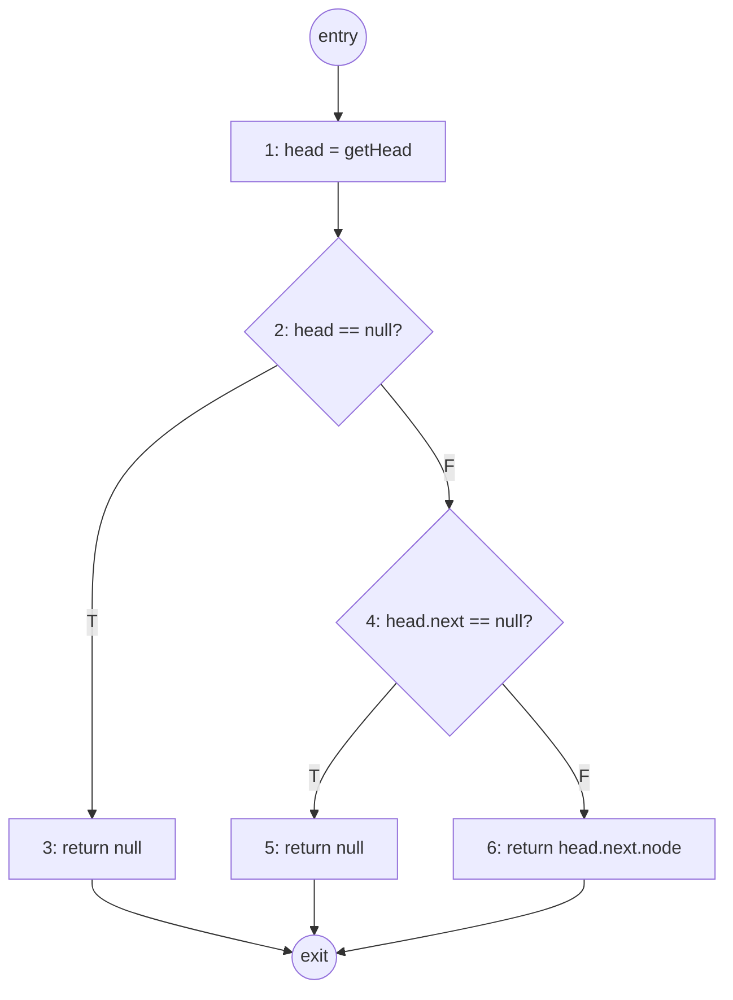
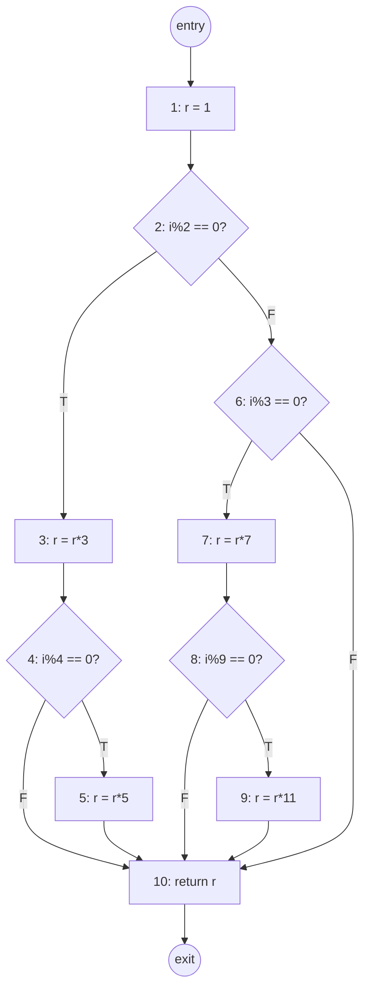

# Informatics 43 — 第八周课程笔记

> 涵盖 **Lecture 15 与 Lecture 16**：*"我们怎么挑选测试用例？（第 3、4 部分）"*

## 目录

1. [我们现在在哪 — 从"为什么测"到"测哪些"](#1-我们现在在哪--从为什么测到测哪些)
2. [两种总体测试思路](#2-两种总体测试思路)
3. [黑盒 / 基于规格的测试](#3-黑盒--基于规格的测试)
4. [等价类划分](#4-等价类划分)
5. [边界值分析](#5-边界值分析)
6. [系统化的 5 步流程](#6-系统化的-5-步流程)
7. [实战例子 — 评分程序](#7-实战例子--评分程序)
8. [组合测试](#8-组合测试)
9. [白盒 / 结构化测试](#9-白盒--结构化测试)
10. [控制流图（CFG）](#10-控制流图cfg)
11. [实战例子 1 — `getSecondElement()`](#11-实战例子-1--getsecondelement)
12. [语句（节点）覆盖](#12-语句节点覆盖)
13. [分支（边）覆盖](#13-分支边覆盖)
14. [实战例子 2 — CFG 与覆盖讲义](#14-实战例子-2--cfg-与覆盖讲义)
15. [其他覆盖准则](#15-其他覆盖准则)
16. [白盒测试的挑战](#16-白盒测试的挑战)
17. [检查与评审](#17-检查与评审)
18. [形式化方法](#18-形式化方法)
19. [静态分析](#19-静态分析)
20. [本次没讲的测试主题](#20-本次没讲的测试主题)
21. [Quiz 7 复习指南](#21-quiz-7-复习指南)
22. [总结与记忆框架](#22-总结与记忆框架)

---

## 1. 我们现在在哪 — 从"为什么测"到"测哪些"

第七周回答了我们*为什么*要测试。Lecture 13 把质量保证定义为 **verification + validation**，并点出四类 QA 方法（形式化方法、静态分析、评审、**测试**）；Lecture 14 引入了**基本测试流程**、三个**层次**（unit / integration / system）、**测试预言（test oracle）**，以及现实派的口号：*所有软件都有 bug。* 那节课收在三条断言上，而第八周正是把这三条作为起点：

- **测试永远做不到穷举。**
- **测试永远不能证明系统的正确性。**
- **所有软件都有 bug。**

既然三条都成立，工程问题就变成了一个操作性问题：

$$\boxed{\textbf{Of the (essentially infinite) possible test inputs, } \textit{which ones do we actually run?}}$$

第八周（Lecture 15 与 16）用三种具体策略回答这个问题 —— **黑盒（基于规格）**、**组合**、**白盒（基于结构）**测试 —— 然后再简短巡视另外三类 QA 方法（检查、形式化方法、静态分析），让整个测试单元在收尾时把完整的 QA 工具箱摆到台面上。Lecture 16 还顺便发布了 **Quiz 7 复习指南**。

第七周反复出现的那个模式 —— *混合使用多种技术* —— 在这一层同样适用：**没有任何单一的测试用例选取策略能抓到所有 fault**；黑盒和白盒各有各的盲区，最好搭配使用。

---

## 2. 两种总体测试思路

测试设计上第一个大区分是:*测试者依据什么来设计测试用例*。这一周后面的所有内容 —— 等价类划分、边界分析、语句覆盖、分支覆盖 —— 都归属在下面这两个标题之一之下。

| 思路 | 同义词 | 测试者看的是什么 | 心智图像 |
|------|------|------|------|
| **黑盒测试（Black-box）** | 功能测试（Functional）、**基于规格（Specification-based）**的测试 | 只看系统*应当*做什么的**规格**。实现是不透明的 | 一个封闭的盒子:输入喂进去，观察输出，与 **oracle** 比较 |
| **白盒测试（White-box）** | 结构化测试（Structural）、**基于代码（Code-based）**的测试 | **源代码本身**。测试者设计输入，让它走到指定的代码结构 | 一个玻璃盒子:测试者看得见代码，把测试瞄向选定的语句 / 分支 / 路径，以一个**覆盖准则**作为停止规则 |

幻灯片用的那两张示意图让对比一目了然:

```text
Black-box:
    Input → [ System ] → Output → Oracle → Pass / Fail

White-box:
    Input → [ System ] → Output → Oracle       → Pass / Fail
                       ↘ Coverage Criterion? → Stop (when met)
```


黑盒管线以 **oracle** 收尾:输出和规格说的对得上吗？白盒管线多了一个出口 —— **覆盖准则** —— 这条出口告诉白盒测试者:什么时候算把*代码结构*测得足够了。

> 两种思路是互补的，不是对立的。黑盒测试能抓到 **遗漏的功能** 和 **被误读的规格**，这些是白盒看不到的（代码可能完全在做开发者*以为*它该做的事，但规格说的是另一回事）。白盒测试能抓到 **死分支**、**不可达代码** 和 **实现层面的边界情况**，这些是黑盒可能漏掉的（规格里没提 `null` 头指针的情况，但代码里有）。一个真正的测试计划两种都用。

---

## 3. 黑盒 / 基于规格的测试

黑盒测试的定义性承诺:

- **用规格来推导测试用例。** 不是代码 —— 而是规格。
- **挑选测试用例以保证*对输入域*的广泛覆盖**，而不是对代码的覆盖。

幻灯片列出黑盒测试套件应当覆盖的五种输入:

| 输入种类 | 为什么要包括它 |
|------|------|
| **典型值（Typical values）** | 确认系统处理它被设计去应付的常见情形 |
| **边界值（Boundary values）** | bug 喜欢聚在边缘 —— off-by-one、`<` 与 `<=` 之争、整数回绕 |
| **特殊情况（Special cases）** | 空字符串、零、`null`、单元素集合、闰日、时区跨越 |
| **非法输入（Invalid input values）** | 负年龄、错乱的 JSON、未来生日 —— 系统能否安全拒绝？ |
| **值的组合（Combinations of values）** | 多个参数互动时，bug 可能藏在组合里，而不在任何单一参数中（见 §8） |

两个系统化的技术把这件事变成可重复的流程:**等价类划分**（§4） 和 **边界值分析**（§5）。它们配合工作 —— 划分给你类，边界分析告诉你在每一类内部挑哪些点。

---

## 4. 等价类划分

直觉:虽然输入空间巨大，但从程序的角度看，**大多数输入的行为是一样的**。我们不需要测 70 到 79 之间的每一个整数 —— 只需要测*其中一个*就够了，因为它们都映射到字母分 `C`。

$$\boxed{\textbf{An equivalence class is a set of inputs the program is expected to treat the same way for the purpose of finding bugs.}}$$

所以如果程序对其中一个成员通过了，它*大概率*会对所有成员都通过；如果对其中一个失败了，它*大概率*会对所有成员都失败。**每类挑一个代表**，你就覆盖了这一类。

### 类是怎么确定的

| 来源 | 例子 |
|------|------|
| **需求规格** | "分数 ≥ 90 映射到 A" —— 规格直接命名了一个类 |
| **测试者的直觉** | 规格没提 `null`，但测试者知道 null 输入是一个值得怀疑的麻烦类 |

### 类必须满足的两条性质

| 性质 | 为什么 |
|------|------|
| **覆盖整个输入域** | 否则，会有些输入彻底没被测到 |
| **不互相重叠** | 否则，你会在同一个行为上反复浪费测试 |

合起来:等价类**划分（partition）**了输入域 —— 每个输入恰好属于一个类。

> 等价划分把一个无穷（或巨大的）输入空间压缩成一个小的有限*代表性*输入集合。压缩比就是关键:一个 100 值的整数域（下面评分例子里的 0..100）塌缩到 5 个类，测试预算压缩了 20 倍。

---

## 5. 边界值分析

一个基于同样划分的互补技术。它背后的观察是经验性的，也是众所周知的:

> *许多错误发生在"边界"上，而不是在正常情况下* —— 比如 `<` 与 `<=` 之间的混淆、循环边界上的 off-by-one、`INT_MAX` 处的整数溢出。

边界值分析使用**和划分相同的等价类**，但不是从类的内部随便挑代表，而是挑类的**边界值** —— 最小值、最大值，以及（如适用）边界两侧*刚好越界*的值。

| 等价划分 | 边界值分析 |
|------|------|
| 在一个类内部挑*任意*代表 | 挑每个类*边缘上*的值 |
| 抓"整个类都坏了"的 bug | 抓 off-by-one 与边界情况的 bug |
| 每类用很少几个测试 | 每类用两到四个测试（就是这些边界本身） |

> 实践中两者总是**配合**使用:把输入域划分成类，然后对每一类挑*一个典型的内部值*（划分）**加上边界值**（边界分析）。§7 的评分例子展示了实际操作长什么样。

---

## 6. 系统化的 5 步流程

Lecture 15 把这两种技术整合成一个统一的菜谱:

1. **识别所有可能输入的集合（"域"）** —— 这个程序到底应当接受什么？
2. **找一个划分输入集合的依据。** 可能的依据包括:
   - **大小 / 量级** —— 小、中、大
   - **结构** —— 空集合 vs 单元素 vs 多元素集合
   - **正确性** —— 合法 vs 非法输入
   - **测试者的创造性思考 / 直觉**
3. **用这个依据把所有可能输入的集合分成若干类 / 子域。**
4. **从每个子域中选出一个（或多个）代表作为测试用例输入。** 一类通常一个测试用例就够。
5. **对每个子域分别测试:**
   - "正常"或"代表性"的值（子域内部的任意值）
   - **边界或边缘输入值**（边界值分析）

> 第 2 步里的依据并不互斥。一个真正的测试设计经常**同时使用多个依据** —— 比如同时按*正确性*（合法 vs 非法）和*量级*（小、中、大）划分。所得到的划分是各个单依据划分的*交集*:"小-合法"、"小-非法"、"中-合法"，依此类推。

---

## 7. 实战例子 — 评分程序

幻灯片的例子:

> 一个程序接收一个 **0 到 100** 的整数格式作业分数，返回标准评分下的字母分（90 多是 A，80 多是 B，70 多是 C，60 多是 D，50 及以下是 F —— 没有加减号）。

### 7.1 第 1 步 — 域

原则上:所有整数。规格上:**[0, 100]** 的整数。规格还隐含定义了*第二个*类:**[0, 100]** 之外的整数是 **非法** 输入。

### 7.2 第 2–3 步 — 依据与划分

这里自然的依据就是*规格里说输出应该是什么*。这给出六个类:

| 类 | 分数范围 | 期望输出 |
|------|------|------|
| F  | 0–59   | `F` |
| D  | 60–69  | `D` |
| C  | 70–79  | `C` |
| B  | 80–89  | `B` |
| A  | 90–100 | `A` |
| Invalid | < 0 或 > 100 | error / 拒绝 |

### 7.3 第 4–5 步 — 每类的代表 + 边界值

对每一类，列出**边界**（类内部最小的、最大的合法值）。边界值分析说这些值是最可能暴露出 bug 的。

| 类 | 下边界 | 上边界 |
|------|------|------|
| F  | 0   | 59  |
| D  | 60  | 69  |
| C  | 70  | 79  |
| B  | 80  | 89  |
| A  | 90  | 100 |
| Invalid（过低） | （任意 < 0 的值） | -1 |
| Invalid（过高） | 101 | （任意 > 100 的值） |

### 7.4 最终的测试套件（输入，期望输出）

幻灯片要求的格式是 `"输入, 期望输出"`:

| 输入 | 期望输出 | 这个测试的存在意义 |
|------|------|------|
| `0`   | `F` | 边界 —— F 的下沿（也是合法域的下沿） |
| `59`  | `F` | 边界 —— F 的上沿 |
| `60`  | `D` | 边界 —— D 的下沿（对 59 的 off-by-one 候选） |
| `69`  | `D` | 边界 —— D 的上沿 |
| `70`  | `C` | 边界 —— C 的下沿 |
| `79`  | `C` | 边界 —— C 的上沿 |
| `80`  | `B` | 边界 —— B 的下沿 |
| `89`  | `B` | 边界 —— B 的上沿 |
| `90`  | `A` | 边界 —— A 的下沿 |
| `100` | `A` | 边界 —— A 的上沿（也是合法域的上沿） |
| `-1`  | error | 非法 —— 刚好低于下沿 |
| `101` | error | 非法 —— 刚好高于上沿 |

对一个输入域只有 101 个合法整数的函数来说，这就是 12 个测试用例 —— 约 8 倍压缩，同时打中了所有可能藏着 off-by-one 的边界。

> 注意这套测试套件*擅长*什么、*不擅长*什么。**擅长**:抓 `< 90` vs `<= 90` 的混淆（F-vs-A bug）、抓漏掉的非法输入处理、抓每个切分点上的 off-by-one 错误。**不擅长**:抓不到像"当输入恰好是 85 时函数返回 `B`"这种细微 bug —— 因为我们根本没测 85。这就是为什么它要配 §16:黑盒测试留下的盲点正是白盒测试要填补的。

---

## 8. 组合测试

到目前为止，每个例子都只有*一个*输入参数。真实函数会有很多。**当有多个参数时，等价类划分会怎样？**

幻灯片给的答案是机械但有纪律的:

1. **对每个参数独立地**确定它的等价划分和代表（可以是边界）值 —— 完全按 §4–§7 的做法。
2. **然后设计这些每参数值的组合**，形成测试输入。

"设计组合"这一步是工程判断真正登场的地方，因为完整的笛卡尔积爆炸得很快。如果三个参数各有 5 个代表值，完整组合就是 $5 \times 5 \times 5 = 125$ 个测试 —— 而现实函数（比如十个参数，每个五个值）的完整乘积是 $5^{10} \approx 977$ 万。

| 组合策略 | 它覆盖什么 | 代价 |
|------|------|------|
| **完整笛卡尔积（Full Cartesian product）** | 每个参数每个值的每一种组合 | 在参数数上是指数级 —— 过了几个参数就不可行 |
| **All-pairs（pairwise，两两组合）** | 每一对 （参数 i 的值， 参数 j 的值） 至少出现一次 | 小得多；经验上能抓到大多数多参数 bug |
| **手挑组合（Hand-picked）** | 测试者觉得有意思的情形 | 便宜但不系统 |

> **all-pairs** 的经验依据相当醒目:对真实 bug 数据库的研究表明，大多数多参数 bug 是由**仅仅两个**参数的交互触发的。所以测试每一对（而不是每一个完整元组）能以一小部分代价捕获大多数组合价值。INF 43 不深入，但 "pairwise testing" / "all-pairs testing" 这个术语值得知道。

---

## 9. 白盒 / 结构化测试

从黑盒到白盒的转折。它的定义性承诺:

- **用源代码来推导测试用例**（不是规格）。
- **建一个系统的图模型**（**控制流图**，§10）。
- **以图覆盖的形式陈述测试用例** —— 挑选输入，让其执行访问到选定的图元素。

黑盒不需要而这里需要的新成分是 **覆盖准则（coverage criterion）** —— 一条精确规则，说*哪些*图元素必须被访问，测试才算"完成"。幻灯片列出六类，大致按严格度递增:

| 覆盖准则 | 必须访问什么 | 章节 |
|------|------|------|
| **语句（节点）覆盖** | 每个节点 | §12 |
| **分支（边）覆盖** | 每条边 | §13 |
| **条件覆盖** | 每个布尔表达式里的每个子条件，都要取到 `T` 和 `F` | §15 |
| **方法覆盖** | 每个方法至少被调用一次 | §15 |
| **方法调用覆盖** | 每个调用点都能到达每个可能的方法（包括所有多态目标） | §15 |
| **路径覆盖** | 从入口到出口的每条不同路径 | §15 |

更强的准则*蕴含*更弱的:完全分支覆盖蕴含完全语句覆盖（访问每条边强制访问每个节点），完全路径覆盖蕴含完全分支覆盖。**路径覆盖最强** —— 但正如 §15 所讲，**经常不可行**。

---

## 10. 控制流图（CFG）

白盒测试所操作的图模型。幻灯片上的规则:

| 元素 | 规则 |
|------|------|
| **入口节点（Entry node）** | 每个 CFG 都有一个 —— 代表所有进入函数的控制流 |
| **出口节点（Exit node）**  | 每个 CFG 都有一个 —— 代表所有离开函数的控制流 |
| **节点（Nodes）** | 每个节点对应一条**原子指令**，一般是一行代码 |
| **边（Edges）** | 每条边都是**有向的**（从源到目标的箭头），代表可能的控制流 |
| **分支（Branches）** | 任何有**两条或更多出边**的节点。这些边必须**带标签**，标注选中它的条件（谓词用 `T`/`F`，`switch` 用 case 值） |

> 关于 CFG 有两个事实值得现在就记住，后面会反复用到:**（1） 循环在 CFG 里是环** —— 一个 `while` 或 `for` 语句是一个节点，有一条出边最终循环回到循环头。**（2） 每个 CFG 按构造都只有单一入口和单一出口** —— 即使函数有多条 `return` 语句，也会有一个单一的虚拟出口节点，所有 return 都流向它。

---

## 11. 实战例子 1 — `getSecondElement()`

幻灯片的运行例子是这个 Python 函数:

```python
def getSecondElement():
1   head = getHead()
2   if head == null:
3       return null
4   if head.next == null:
5       return null
6   return head.next.node
```

### 控制流图




这张图通过函数体共有三条端到端路径:

| 路径 | 条件 | 返回值 |
|------|------|------|
| 1 → 2 → 3 → exit | `head == null` (2T) | `null` |
| 1 → 2 → 4 → 5 → exit | `head != null` (2F), `head.next == null` (4T) | `null` |
| 1 → 2 → 4 → 6 → exit | `head != null` (2F), `head.next != null` (4F) | `head.next.node` |

这三条路径就是经典的三种场景 —— 各自对应一*种*输入链表（空 / 单元素 / 多元素）。§12 和 §13 会在不同的覆盖规则下设计测试输入去命中它们。

---

## 12. 语句（节点）覆盖

第一个、也是最弱的覆盖准则。

$$\boxed{\textbf{Statement coverage: every node in the CFG must be visited by at least one test case.}}$$

也叫**节点覆盖（node coverage）**。对 `getSecondElement` 的 CFG 来说，必须被访问的节点是 `{1, 2, 3, 4, 5, 6}`。

### 为完全语句覆盖设计测试用例

我们需要若干链表输入，合在一起能把节点 1–6 都走到。幻灯片给的示例测试输入（记法:列表字面量，用 `null` 表示空）:

| 测试输入 | 走的路径 | 命中的节点 | 新增覆盖 |
|------|------|------|------|
| `{null, 2, 4}`（head 指针 = `null`） | 1 → 2 → 3 | `1, 2, 3` | 首次命中 1、2、3 |
| `{5, null, 8, 7}`（单元素列表 —— `head.next == null`） | 1 → 2 → 4 → 5 | `1, 2, 4, 5` | 加上 4、5 |
| `{9, 2}`（两元素列表） | 1 → 2 → 4 → 6 | `1, 2, 4, 6` | 加上 6 |

三个测试跑完后:命中的节点 = `{1, 2, 3, 4, 5, 6}` → **完全语句覆盖**。

> 幻灯片里的 {null, 2, 4} 记法是"一个第一个元素是 `null` 的列表"的简写 —— 也就是一个空列表，`getHead()` 返回 `null`。其它元素函数根本不用。同理，第二个测试传入一个 head 的 `.next` 是 `null` 的列表。这个记法看着别扭，是因为被测函数只看 `head` 和 `head.next`。

---

## 13. 分支（边）覆盖

一个更严格的准则。

$$\boxed{\textbf{Branch coverage: every } \textit{edge} \textbf{ in the CFG must be visited by at least one test case.}}$$

也叫**边覆盖（edge coverage）**。对 `getSecondElement`，边是:

`entry→1`、`1→2`、`2→3 (T)`、`2→4 (F)`、`4→5 (T)`、`4→6 (F)`、`3→exit`、`5→exit`、`6→exit`。

分支点是节点 2 和 4。要完全分支覆盖，我们要在*每个*分支点上同时走 `T` 和 `F` 出边 —— 所以我们需要一个走 `2T` 的测试、一个走 `2F+4T` 的测试、一个走 `2F+4F` 的测试。

| 测试输入 | `2T/F` | `4T/F` | 新增边 |
|------|------|------|------|
| `{null, 2, 4}` | 2T | （未到达） | `2→3` |
| `{5, null, 8, 7}` | 2F | 4T | `2→4`、`4→5` |
| `{9, 2}` | 2F | 4F | `4→6` |

三个测试跑完后:每条边都命中了 → **完全分支覆盖**。

> 这个例子里，同样这三个测试用例同时满足语句覆盖和分支覆盖 —— 它们恰好就是函数的**三条端到端路径**。这是小例子的巧合；一般来说，分支覆盖需要*比*语句覆盖更多的测试。**分支覆盖更彻底**，因为它能抓到语句覆盖会漏掉的逻辑错误 —— 比如一个 `else` 从未走过的分支，从 `if` 那一侧也可以把全部语句覆盖到，但分支覆盖强制两个方向都走。

---

## 14. 实战例子 2 — CFG 与覆盖讲义

那份讲义（`int m(int i)`）是一个更大的 CFG，顶层 `if/else` 两边都有嵌套的 `if`。把它完整做一遍，正是这块材料的经典练习。

### 14.1 代码

```c
int m(int i) {
 1    r = 1;
 2    if ( (i%2) == 0 ) {
 3        r = r * 3;
 4        if ( (i%4) == 0 ) {
 5            r = r * 5;
          }
      } else {
 6        if ( (i%3) == 0 ) {
 7            r = r * 7;
 8            if ( (i%9) == 0 ) {
 9                r = r * 11;
              }
          }
      }
10    return r;
}
```


### 14.2 控制流图

分支点在节点 2、4、6、8。图:



### 14.3 追踪几个输入

设计测试用例之前，手工追踪每个输入会做什么。函数的逻辑用人话:*从 `r=1` 开始；如果 `i` 是偶数，乘 3，若同时被 4 整除再乘 5；否则若 `i` 被 3 整除，乘 7，若同时被 9 整除再乘 11；返回 `r`。*

| `i` | 经过 CFG 的路径 | 访问的语句 | 走的分支 | 返回的 `r` |
|------|------|------|------|------|
| `1`  | 1→2→6→10 | 1, 2, 6, 10 | 2F, 6F | `1` |
| `2`  | 1→2→3→4→10 | 1, 2, 3, 4, 10 | 2T, 4F | `3` |
| `3`  | 1→2→6→7→8→10 | 1, 2, 6, 7, 8, 10 | 2F, 6T, 8F | `7` |
| `4`  | 1→2→3→4→5→10 | 1, 2, 3, 4, 5, 10 | 2T, 4T | `15` |
| `9`  | 1→2→6→7→8→9→10 | 1, 2, 6, 7, 8, 9, 10 | 2F, 6T, 8T | `77` |

### 14.4 **语句覆盖**的最小测试集（S1–S10）

我们要让 `S1, S2, ..., S10` 都至少被访问一次。从上表看:

| 测试输入 | 新覆盖的语句 |
|------|------|
| `i = 4` | `S1, S2, S3, S4, S5, S10` |
| `i = 9` | 加上 `S6, S7, S8, S9` |

两个测试用例 —— `i = 4` 和 `i = 9` —— 覆盖了全部 10 条语句。

| 测试输入 → | `i=4` | `i=9` |
|------|------|------|
| 期望输出 | `15` | `77` |
| S1 | ✓ | ✓ |
| S2 | ✓ | ✓ |
| S3 | ✓ |   |
| S4 | ✓ |   |
| S5 | ✓ |   |
| S6 |   | ✓ |
| S7 |   | ✓ |
| S8 |   | ✓ |
| S9 |   | ✓ |
| S10 | ✓ | ✓ |

### 14.5 **分支覆盖**的最小测试集（8 个分支）

要覆盖的八个分支是 `2T, 2F, 4T, 4F, 6T, 6F, 8T, 8F`。两个测试用例不够了 —— 每个输入在它到达的每个分支点上只能走一个方向，而我们需要在所有四个分支点上同时走两个方向。

| 测试输入 | 覆盖的分支 |
|------|------|
| `i = 4` | `2T, 4T` |
| `i = 2` | `2T, 4F` |
| `i = 9` | `2F, 6T, 8T` |
| `i = 3` | `2F, 6T, 8F` |
| `i = 1` | `2F, 6F` |

| 测试输入 → | `i=4` | `i=2` | `i=9` | `i=3` | `i=1` |
|------|------|------|------|------|------|
| 期望输出 | `15` | `3` | `77` | `7` | `1` |
| 2T | ✓ | ✓ |   |   |   |
| 2F |   |   | ✓ | ✓ | ✓ |
| 4T | ✓ |   |   |   |   |
| 4F |   | ✓ |   |   |   |
| 6T |   |   | ✓ | ✓ |   |
| 6F |   |   |   |   | ✓ |
| 8T |   |   | ✓ |   |   |
| 8F |   |   |   | ✓ |   |

五个测试用例给出了**完全分支覆盖**。注意它们顺带也给出了完全语句覆盖（每条分支上的每条语句都被路过） —— 这就印证了 **分支覆盖蕴含语句覆盖**。

> 上表里有个小细节:这套测试里没有任何一个测试同时覆盖了 `8T` 和 `4T`，因为它们在顶层 `if/else` 的对立两边。这不是缺陷 —— 它们在这个程序里本来就是互斥的，没有任何输入能同时命中两个。**某些覆盖目标在组合上是不可达的；完全分支覆盖要求的是每个分支至少被命中一次，而不是和其它每个分支的每种组合都被命中一次。** §16 在 **infeasibility（不可达）** 标题下还会回到这个想法。

---

## 15. 其他覆盖准则

除了语句覆盖和分支覆盖，幻灯片还提到四个 —— 列出来是为了让词汇完整，但并没有反复钻研。

| 准则 | 它要求什么 | 它在分支覆盖之上加了什么 |
|------|------|------|
| **条件覆盖** | 在像 `if (a > b \|\| c > d)` 这样的复合布尔表达式里，*每个子条件*（`a > b`、`c > d`）都必须被求值到 `T` 和 `F` | 抓"复合条件错了但顶层分支方向相同"这种 bug |
| **方法覆盖** | 系统中每个方法都被某个测试调用过 | 便宜的清醒检查 —— 找出根本没人在测的方法 |
| **方法调用覆盖** | 每个方法调用点都对每个可能的目标方法都执行过（考虑多态 —— 虚函数 / 被覆盖的方法） | 对 OO 代码很关键:一个调用 `shape.draw()` 可能分派到 `Circle.draw`、`Square.draw`、`Triangle.draw`；方法调用覆盖要求从那个调用点到达所有这些目标 |
| **数据流覆盖** | 每个变量赋值都到达它所有可到达的使用（def-use 对） | 抓"值被设定了但从未使用"或"在被设定前就使用"的 bug |
| **路径覆盖** | **每一条从入口到出口的不同路径**都被执行 | 最严格 —— 但一般不可行（见下） |

### 为什么路径覆盖几乎不可达成

路径数随分支数**乘性增长**，随循环**指数级增长**。

| 结构 | 加上的路径数 |
|------|------|
| 一个 `if/else` | × 2 |
| 两个嵌套 `if/else` | × 4 |
| 一个迭代 0..N 次的循环 | × (N+1) |
| 一个迭代 0..∞ 次的循环 | 无限条路径 |

对循环，幻灯片的实用妥协是:测试**0 次迭代**、**1 次迭代**、**某个平均次数的迭代**，以及**最大次数的迭代**。这能抓到最常见的循环 bug（入口的 off-by-one、出口的 off-by-one、累加器溢出），但并不号称穷举每条路径。

> 这个权衡是普适的:更强的准则发现更多 bug，但代价是更多测试，而到某个点代价就变无穷。实际推荐是:把 **分支覆盖** 作为大多数代码的工作标准，在安全攸关的复合表达式上加 **条件覆盖**，把 **路径覆盖** 留给路径数可控的小型、关键片段。

---

## 16. 白盒测试的挑战

白盒测试很强，但有三个被命名的局限，都值得记住:

| 挑战 | 它的意思 | 为什么重要 |
|------|------|------|
| **能用来识别程序中未被测到的部分** | 覆盖工具告诉你*什么从来没被跑到过* | 一个清晰、可行动的信号 —— 去给未覆盖的代码行写测试 |
| **覆盖所有节点或边并不意味着发现明显的 fault** | 100% 分支覆盖**不**等于无 bug | 覆盖是必要的，但不是充分的 —— 你可以跑过每一行而没有触发到那个 buggy 的输入*组合* |
| **某些节点、边或循环组合可能不可达** | 逻辑上不可达的代码（防御性的 `else` 分支、"这种情况永远不会发生"的断言）无论你输入什么都覆盖不到 | 不要不惜代价追求 100% 覆盖率 —— 有时 <100% 才是正确的停止点 |

> 三条里最深刻的是第二条。覆盖率是*测试执行*的属性，不是*发现的 bug* 的属性。一个跑过每一行却从不*检查*输出的测试套件，是一个 100% 覆盖率的废套件。正确的口号:**覆盖率是必要的，但不是充分的 —— 要把它和强的 oracle 搭配使用**。

### 延伸阅读（幻灯片上的）

讲师推荐的两篇教程式文章:

- *Path Testing: The Theory* — <http://testerstories.com/2014/06/path-testing-the-theory/>
- *Path Testing: The Coverage* — <http://testerstories.com/2014/06/path-testing-the-coverage/>

---

## 17. 检查与评审

两节课讲了可执行的测试之后，Lecture 16 回到 Lecture 13 提到的**另外三类 QA 方法** —— 从评审讲起。这一节的口号简短而出人意料:

> **Humans read documents and look for defects. Surprisingly effective.**
> *（人读文档，找缺陷。出乎意料地有效。）*


为什么出人意料？因为直觉上，让一位昂贵的专家*坐下来读代码*听起来比跑成千上万个自动测试要慢、要弱。经验性的发现是，评审能抓到*另一类* bug —— 测试根本想不到要为它写用例的那一类。

### 好处（出自 Bacchelli & Bird, *"Code Reviewing in the Trenches,"* IEEE Software 2018）

| 好处 | 一句话描述 |
|------|------|
| **改善代码质量** | 评审者会反对偷懒的写法和丑陋的模式 |
| **改善代码可理解性** | 强迫自己把代码讲给评审者听，会暴露不清晰的地方 |
| **发现缺陷** | 最初的目的；现在仍然有效 |
| **传递知识** | 评审者会熟悉他们评审过的那部分代码库 |
| **探索替代方案** | "你有没有考虑过用 X 来做这件事？" |
| **改进开发流程** | 评审意见的模式会暴露流程的漏洞 |
| **避免打坏构建** | 在错误进 CI 之前抓到明显的疏忽 |
| **提升团队认知** | 每个人都看得到别人在做什么 |
| **共享代码所有权** | 多人都了解代码的每一部分 |
| **团队评估** | 管理者能看到谁在评审，谁被评审 |

> 现代开源工作流让这件事变得具体:GitHub 上的一个 **Pull Request** *就是*一次代码评审。评审者在行内留评论，作者修改回复，PR 在评审者批准前不会合并。PR-评审这种模式就是工业界版本的 inspections，如今已经几乎在所有软件开发里普及。

---

## 18. 形式化方法

第三类 QA —— 保证级别最高、代价也最高的那一类。

幻灯片的三行总结:

| 属性 | 含义 |
|------|------|
| **正确性证明（Proofs of correctness）** | 一个数学证明，证明程序符合它的形式规格 |
| **只做 verification** | 形式化方法回答"系统是否匹配规格？"它无法回答"规格是否对？" —— 那仍然是 validation |
| **通常与形式化规格一起做** | 规格本身必须用一种形式化语言（比如 **Z**、**TLA+**、**Coq**、**Alloy**）写出，才能拿去做证明 |

幻灯片展示了一段 **Z 规格** 的片段（例子用了集合构造记法、全称量词、对 `OZSpec → UMLDiagram` 映射上的谓词逻辑） —— 暗示了形式化规格能稠密到什么地步。大多数学生这辈子都不会写 Z，但应该认得出它的样子。


> 这个权衡很残酷:形式化方法给出可能最强的正确性保证，但代价只在极小、极关键的组件上才值得 —— 飞控律背后的数学、TLS 库里的加密代码、实时操作系统内核。它们不用于日常应用代码。

---

## 19. 静态分析

第四类 QA，也是大多数学生真的会用上的那一类。

> **A computer program analyzes source code and finds possible defects (without running the code).**
> **Results are reviewed by a person because many warnings are not actually problems.**
> *（一个计算机程序分析源代码、找出可能的缺陷（不运行代码）。结果由人来审阅，因为很多警告其实不是问题。）*

这两行里塞了两个想法:

- **不运行代码。** 静态分析器解析源代码，在其上做符号化推理 —— 类型、数据流、控制流、可能的别名。它们从不执行程序。这就是为什么它们便宜、快，能在每次提交时跑。
- **很多警告其实不是问题。** 静态分析器必然是近似的。它会标出任何*可能*的缺陷 —— 包括运行时不可达的那些。输出是一份**候选缺陷清单**，不是一份 bug 清单。由人来分类处理这份清单。

### 示例工具:FindBugs

幻灯片截屏了 **FindBugs**，一个 Java 静态分析器，标记 bug *模式* —— "Suspicious calls to generic container methods"、"Call to equals() with null argument"、"Call to equals() comparing unrelated class and interface"。截图显示它标出了一行具体的 `if (!enum_.equals(""))` 并解释:*"We don't call nextElement() on `enum_`, so this will be an infinite loop if it is ever called. Should be `if (!enum_.nextElement().equals(""))`."* —— 一个不运行代码就抓到的真实 bug 模式。


其他值得知道名字的常用静态分析器:

| 语言 | 工具 |
|------|------|
| Java | FindBugs / SpotBugs、Checkstyle、PMD |
| Python | mypy（类型）、pylint、flake8、ruff |
| JavaScript / TypeScript | ESLint、TypeScript 编译器 |
| C / C++ | Clang Static Analyzer、Coverity、PVS-Studio |
| 多语言 | SonarQube |

> 静态分析是日常使用中**性价比最高**的 QA 技术。它几乎免费（在 CI 里跑），能抓到整类没有测试能可靠找到的 bug（空指针解引用、资源泄漏、死代码、简单的竞争条件），而且配置好之后基本不打扰你。每个严肃项目都该把它打开。第七周的 Power-of-Ten 第 10 条 —— *打开所有编译警告，并配合一个或多个源码分析器* —— 就是这同一推荐在安全攸关版本下的形态。

---

## 20. 本次没讲的测试主题

这一讲在收尾时点了一遍它*没讲*的主题 —— 让学生知道自己漏了什么，可以自己去补。

| 主题 | 一句话总结 |
|------|------|
| **回归测试（Regression testing）** | 每个新版本上重跑既有测试套件，确保老功能仍然能工作（第七周点过名；这一周没深入） |
| **集成测试（Integration testing）** | 测试金字塔的"中间层" —— 测试模块之间的接口 |
| **交互测试（Mocking）** | 用 **mock 对象** 替换真实协作者，mock 记录调用并返回固定值 —— 让一个单元能在脱离依赖的情况下被测试 |
| **调试（Debugging）** | 一旦测试失败，找出并修复底层 fault 的过程 |
| **变异测试（Mutation testing）** | fault seeding（第七周 §19.3）的自动化形式 —— 像 **PIT**、**Stryker**、**mutmut** 这类工具系统地注入变异，度量测试套件抓到了多少 |
| **模糊测试（Fuzz testing）** | 给程序喂*随机或畸形*输入，看它崩溃或卡死 —— 在找安全漏洞上极其有效 |
| **探索式测试（Exploratory testing）** | 熟练的人类测试者不带预定脚本地与系统交互，由假设和好奇心引导 |

> 这些都是**研究生测试课或工业界的标准主题**。INF 43 只是入门；你现在掌握了词汇和核心实践，但现实测试在这个基础上还涉及好几种技术。

---

## 21. Quiz 7 复习指南

Lecture 16 显式发布了复习指南。Quiz 7 覆盖从 Lecture 13（第七周）到 Lecture 16（第八周）的全部内容 —— 第七周和第八周加起来。

### 21.1 测试基础（Lecture 13–14）

| 主题 | 你需要会做什么 |
|------|------|
| **Validation vs. verification** | 给出两者定义；解释区别（"做对的系统" vs "把系统做对"） |
| **Mistake / fault / error / failure（IEEE）** | 四个都要会定义；给出因果链（Mistake → Fault → Error → Failure） |
| **测试目标** | 找 fault；提升信心（V+V）；准确 / 彻底 / 可重复 / 系统化 |
| **Dijkstra 名言** | 背原文:*"Program testing can be used to show the presence of bugs, but never to show their absence."* 解释*为什么* |
| **测试的层次** | 单元 / 集成（功能） / 系统（验收） —— 每一个的定义 + 例子 |
| **Test oracle** | 什么是 oracle？为什么自动化它很难？（cosine 例子） |
| **怎么算做完了的几种方式** | 时间/预算；find-rate 趋平；fault seeding；"每条需求至少被测过一次"（工业界最常见） |

### 21.2 黑盒测试（Lecture 15）

| 主题 | 你需要会做什么 |
|------|------|
| **等价类划分** | 给出定义；能从规格里识别类；挑代表 |
| **边界值分析** | 给出定义；在每个类内挑边界值；解释*为什么*挑边界（off-by-one、`<` vs `<=`） |
| **组合测试** | 解释如何跨多个参数合并划分；了解笛卡尔积的爆炸性 |

### 21.3 白盒测试（Lecture 15–16）

| 主题 | 你需要会做什么 |
|------|------|
| **语句 / 节点覆盖** | 给出定义；给一个 CFG，设计达到它的最小测试集 |
| **分支 / 边覆盖** | 给出定义；给一个 CFG，设计达到它的最小测试集；解释为什么它比语句覆盖更强 |
| **控制流图** | 从源代码画一个；正确标注分支（T/F 或 case 值）；识别入口和出口 |

### 21.4 其它 QA 主题（Lecture 16）

| 主题 | 你需要会做什么 |
|------|------|
| **代码检查（Code inspections）** | 是什么；*为什么*"出乎意料地有效"；说出 2–3 条好处 |
| **静态分析器（Static analyzers）** | 是什么；它们*不*执行代码就能跑；警告需要人工分类 |

### 21.5 实战例子熟练度

§14 的 CFG-与-覆盖讲义正是 quiz 可能重复的那种机械练习:*这里有一个小函数，画 CFG，给一个语句覆盖的最小测试集，给一个分支覆盖的最小测试集。* 要能流利地把这三件事都做完，不用把图画两遍。

---

## 22. 总结与记忆框架

```text
Week 8 knowledge structure
|
+-- The question this week
|   +-- Given that we can't test exhaustively / prove correctness,
|       which test cases do we actually run?
|
+-- Two overall testing approaches (Lecture 15)
|   +-- Black-box / specification-based / functional
|   |     +-- look only at the SPEC
|   |     +-- stops via the test oracle (pass/fail)
|   +-- White-box / structural / code-based
|         +-- look at the SOURCE CODE
|         +-- stops via a coverage criterion (statement, branch, ...)
|
+-- Black-box techniques (Lecture 15)
|   +-- Equivalence Class Partitioning:
|   |     +-- group inputs the program treats the same
|   |     +-- classes must COVER the domain and NOT OVERLAP
|   |     +-- one representative per class
|   +-- Boundary Value Analysis:
|   |     +-- bugs cluster at edges (< vs <=)
|   |     +-- pick values on the boundaries of each class
|   +-- Systematic 5-step procedure:
|   |     1. Identify the domain
|   |     2. Pick a basis for partitioning
|   |        (size, structure, correctness, intuition)
|   |     3. Divide into subdomains
|   |     4. Pick representative(s) per subdomain
|   |     5. Test reps + boundaries
|   +-- Grading example: 0..100 -> A/B/C/D/F + invalid
|   |     12 tests = boundaries of 5 classes + 2 invalid edges
|   +-- Combinatorial Testing:
|         +-- partition each parameter independently
|         +-- devise combinations (full Cartesian, all-pairs, ...)
|
+-- White-box techniques (Lectures 15-16)
|   +-- Control-Flow Graphs:
|   |     +-- entry + exit nodes
|   |     +-- node = atomic instruction
|   |     +-- edge = directed control flow
|   |     +-- branches = 2+ outgoing edges, labeled T/F
|   +-- Coverage criteria (increasing strictness):
|   |     +-- Statement / node:  every node visited
|   |     +-- Branch / edge:     every edge visited
|   |     +-- Condition:         every sub-condition T and F
|   |     +-- Method:            every method called
|   |     +-- Method-call:       every call site x every target
|   |     +-- Path:              every path (often infeasible)
|   +-- Branch SUBSUMES statement (every edge -> every node)
|   +-- Worked example: int m(int i) with i%2, i%4, i%3, i%9
|   |     +-- statement coverage minimal: { i=4, i=9 }     (2 tests)
|   |     +-- branch coverage minimal:    { 4, 2, 9, 3, 1} (5 tests)
|   +-- Challenges:
|         +-- great for finding under-tested parts
|         +-- 100% coverage != bug-free (need strong oracles)
|         +-- some elements are INFEASIBLE (unreachable code)
|
+-- The other 3 QA families (Lecture 16)
|   +-- Inspections & Reviews:
|   |     +-- humans read code/docs for defects
|   |     +-- "surprisingly effective"
|   |     +-- modern form: GitHub Pull Requests
|   +-- Formal Methods:
|   |     +-- mathematical proofs of correctness
|   |     +-- VERIFICATION ONLY (not validation)
|   |     +-- needs formal specifications (Z, TLA+, Coq, ...)
|   +-- Static Analysis:
|         +-- analyze source WITHOUT running it
|         +-- e.g. FindBugs / SpotBugs / mypy / ESLint / Coverity
|         +-- humans triage warnings (not all are real bugs)
|
+-- Topics named but not covered
|   +-- regression, integration, mocking, debugging,
|       mutation testing, fuzz testing, exploratory testing
|
+-- Quiz 7 = Weeks 7 + 8
    +-- V&V, M/F/E/F, Dijkstra, levels, oracles, when-done
    +-- Black-box: eq partitioning + boundary + combinatorial
    +-- White-box: statement + branch + CFG
    +-- Inspections + static analyzers
    +-- Be able to: draw a CFG, design min statement-coverage
        test set, design min branch-coverage test set
```

### 一句话总结

> 测试用例选取是把一个有效无穷的输入空间压缩成一个有限测试套件的工程艺术:**黑盒测试**用规格把输入划分成等价类，挑代表加边界值（并通过组合测试跨参数合并划分），**白盒测试**用从源代码导出的控制流图，要求测试输入达到某个覆盖准则 —— 最常见的是**语句覆盖**或严格更强的**分支覆盖** —— 而环绕在测试周围更大的 QA 工具箱还包括**检查与代码评审**（人读代码）、**形式化方法**（数学正确性证明，用于最关键的组件），以及**静态分析**（像 FindBugs 这样不执行代码就标记候选缺陷的工具），反复出现的教训是:没有任何单一技术能抓到每一个 bug，严肃项目都要用一套**混合**方法。
